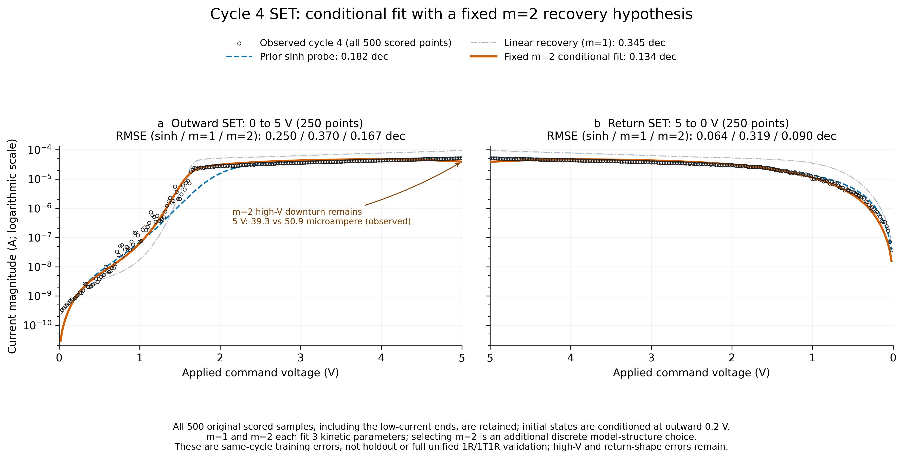

# 固定二次状态恢复：条件 SET 准确性改善，统一历史仍待验证

**本轮获得了经过数值复核的实际改善：同一周期、同一原始 500 点的 SET 条件拟合 RMSE 从 0.182231 降到 0.133895 decade，降低约 26.5%。** 改善集中在上升段；高电压回落、峰值不足和低电流端偏差仍存在。完整裸 1R / 1T1R、SET / RESET 统一解释尚未完成，不能用这个单圈成绩代替项目整体误差。

本阶段资料位于 `cooperative_relaxation_2026-11-04/`。旧阶段保留；本次没有访问原保留集、修改桌面默认模型或推送远端。

## 改动及其物理含义

保持已有谱读出、电路、晶体管映射和有效状态定义：

\[
q=e^{-u}=\frac{\Gamma}{\Gamma+\Gamma_c},\qquad
\Gamma=\frac{\Gamma_c}{\operatorname{expm1}(u)}.
\]

仅将线性状态损失改为固定二次项：

\[
\frac{dq}{ds}=\kappa v\left[\frac{I}{J}(1-q)-e^{\lambda v}q^2\right],
\qquad
\frac{du}{ds}=\kappa v\left[e^{\lambda v-u}-\frac{I}{J}\operatorname{expm1}(u)\right].
\]

这里 v、I 是电路求解得到的局部电压和电流幅值，s 是累计命令电压路径。当前公式只验证了正场 soft-only 组件；尚未实际运行负场扩展。

动机是改善状态反馈：弱状态下的损失与强状态下的自限不再按同一个线性比例变化。局部零率分析给出

\[
S_m=\chi-m-\frac{q}{1-q}+\lambda v_u.
\]

在已有两点重校准示例中，m=2 可使返扫 2 V、4 V 的零率点均局部吸引。这只是提出候选的数学依据；动态实验点不必处于平衡，局部稳定也不保证整个轨迹准确。

**q 是有效谱宽坐标，尚不是测得的陷阱占据率；q² 也不是已证实的双分子复合或特定离子反应。** 同系数下 q²≤q，不能说它在所有状态下都“加快恢复”。连续拟合参数仍为 λ、J、κ 三个，但 m=1→2 是一次新增离散结构选择，必须计入模型选择历史。未知扫描时间意味着这些系数尚不能解释为每秒速率。

## 实际运行和比较口径

初始化只使用已有 26 个条件反演点和 24 个分支内区间，没有新增反演。使用与上一 m=1 阶段相同的 41 点 λ 网格、两套求积和三分段起点规则。82 个非负回归只是起点生成，不是实际曲线成绩。

三个起点的真实 500 点误差分别为 0.343151、0.882594、1.310087 decade。仅从其中最优起点进行一次三参数局部优化，最多 80 次评估；随后同参数做两精度验证。共完成 **85 条实际轨迹、255 个积分段**，没有数值失败或域外参数请求，实际计算约 32.183 s。优化达到次数上限，**尚未收敛，也不代表全局最优**。

每条轨迹都使用同一外扫 0.2 V 条件态，向前积分到 5 V 并连续返扫到零；低压外扫由该方程反向补齐到零。没有顶点状态重置，没有裁去低电流点。全部 503 个原生记录中的原 500 个评分点均保留。

最终参数：λ=0.447039875 V⁻¹，J=4.108927208 mA，κ=77.700138249 V⁻²。三个参数均未贴搜索边界。

| 同圈条件候选 | 全部 500 点 RMSE / decade | 外扫 250 点 | 返扫 250 点 |
|---|---:|---:|---:|
| 旧 sinh 驱动 | 0.182231 | 0.249763 | **0.063518** |
| 上轮 m=1 有限拟合 | 0.345118 | 0.369697 | 0.318650 |
| 本轮固定 m=2 | **0.133895** | **0.166806** | 0.089618 |

0.133895 decade **不等于 13.4% 电流误差**。这里误差定义为 log10(预测电流/实验电流) 的均方根；单独统计得到的绝对倍数偏差中位数为 1.14921，即一半评分点的预测/实验比在约 1/1.149–1.149 内。这仍不能代表每一点都在此范围。

两个有限拟合采用相同流程和次数，但 κ、J 的边界按各自起点的 1/100–100 倍设置，所以其绝对搜索域不同。m=1 和 m=2 都未收敛，不能把全部成绩差唯一归因于二次项，也不能宣称 m=1 经过更充分校准必然达不到类似精度。

## 哪些改善可信，哪些问题还在

1 µA 启动跨越已与实验同处于 1.32–1.34 V；旧 sinh 候选为 1.46–1.48 V。外扫 0.5–1.5 V 的误差为 0.261569 decade，明显小于上轮 m=1 的 0.645062，但仍有局部曲线形状偏差。10 µA 跨越预测为 1.56–1.58 V，仍早于实验的 1.62–1.64 V。

高压端仍出现实验曲线未呈现的回落：5 V 预测 39.28695 µA，实验外扫 / 返扫分别约 50.94 / 50.97 µA，低约 23%。返扫 4 V 预测 46.91909 µA，高于实验 44.4 µA；返扫 2 V 预测 31.31559 µA，高于实验 29.778 µA。返扫整体误差比旧 sinh 候选更大，不能只展示改善的外扫。

低压两支共 20 点的 RMSE 为 0.405804 decade；其余 480 点为 0.108689。后者只是诊断，**主分数仍是包含全部 500 点的 0.133895**。

既有三个条件端点不等式中只有外扫 2 V 下界通过；返扫 5 V 下界和返扫 2 V 上界未通过。六项单圈返扫参考中只有 2–4 V 对数斜率落入参考带。这些参考带来自训练群体，单圈比较不等于原 32 圈中位数的 20 项主特征合同；本轮没有计算该聚合合同。

## 匹配线性恢复反事实：尝试已保存，但未形成完整成绩

为区分状态反馈与单纯速率尺度改变，使用预先固定的已有返扫 2 V 坐标 qref=0.05490380671259502，唯一映射为

\[
\kappa_1=\kappa_2q_{\rm ref},\qquad
J_1=J_2q_{\rm ref},\qquad \lambda_1=\lambda_2.
\]

捕获系数 κ/J 相同，q=qref 处的两个净率也相同。对同一命令、同一状态，二者向量场之差为

\[
F_2-F_1=\kappa_2 v e^{\lambda v}q(q_{\rm ref}-q).
\]

这是明确的状态反馈干预；不表示分离轨迹上的实际捕获通量仍相同。

实际运行了该唯一映射参数的两套精度，未重拟合。两次都在外扫约 4.707 V 时因 Γ 低于已有输运数值表下界而中止；失败发生于未完成的首积分段。计算约 0.432 s，两份失败摘要和 RHS 记录均已保存，20 项来源哈希一致。

**因此该控制没有完成 500 点轨迹，没有可报告的完整 RMSE，也没有完成两精度全轨迹或原生独立求根核验。** 这是本次计算的数值域未解决，不能当成模型物理不可能或 m=2 因果优势已证实。没有扩大数值表、换参数重试或给失败补造分数。原 m=1 有限拟合的 0.345118 是另一项已完成结果，不能与这里的失败混为一谈。

## 同一映射的必要误差下界：来自早期状态屏障

随后按单独记录的有限计划，只对旧初始状态屏障的保存电路角点做代数复算。参数直接读取上述真实控制的唯一 λ/J/κ；不重选参考态、拟合参数或补跑轨迹。原四种条件（两网格 × 两材料包络）、原生电流上界和 500 点分母保持不变，没有新求根、反演或 ODE，算术耗时约 0.000441 s。

在初始状态上界 qbar 处，线性模型的归一速率可被逐格上包为

\[
R(A,\bar q)\le
\frac{v_{\max}I_{\max}(1-\bar q)}{J_1}
-v_{\min}e^{\lambda_1v_{\min}}\bar q+\epsilon_{\rm num}.
\]

若从 0.2 V 开始该上界连续为负，连续且局部唯一的解不能向上跨越 qbar，因而电流也不能超过对应保存的电流上界。只取新负率前缀与旧认证范围的交集，范围外所有评分误差均乐观设为零。

| 材料包络 | 命令网格 | 使用的外扫前缀 / V | 原评分点数 | 原 500 点必要 RMSE 下界 / decade |
|---|---:|---|---:|---:|
| 名义 | 0.01 V | 0.2–1.40 | 61 | 0.313246 |
| 名义 | 0.005 V | 0.2–1.42 | 62 | 0.324510 |
| 0.3% 敏感性包络 | 0.01 V | 0.2–1.39 | 60 | 0.301399 |
| 0.3% 敏感性包络 | 0.005 V | 0.2–1.41 | 61 | **0.312600** |

这项界限在当前固定 λ/J、读出与条件初态下，对有限 κ≥0 成立。即使把其它 439 个原评分点误差都设为零，加密包络下也至少为 0.312600 decade，高于实际 m=2 的 0.133895；两种网格均给出相同方向结论。0.3% 是继承的材料数值敏感性假设，不是实验噪声、统计置信区间或新的全域数值认证。

因此有了明确的模型内证据：**在当前参考归一和条件初态下，仅保留线性损失及匹配尺度，会受到早期启动屏障；改变损失对状态的依赖可以避开这个障碍。** 它没有给失败的完整控制补造 RMSE，也没有证明所有重新校准的 m=1 都受此界限，更不证明 q² 就是真实器件的微观反应律。初始屏障证据和 4.707 V 的数值表域停止属于两个不同结论。

## 数值可信度及证据边界

本轮 m=2 最终两精度的最大原生电流差为 1.14655×10⁻⁶ decade，最大 u 差为 3.50531×10⁻⁶；原生 / RHS KCL 残差分别约 6.00×10⁻¹⁹ / 6.84×10⁻¹⁹ A。独立旧求根器检查全部 503 点，最大电流差约 1.97×10⁻¹³ decade；峰值和锚连接连续。当前模型误差显著大于这些数值差。

独立复核已完成全部 85 条保存轨迹的原生数据、评分掩码、分组误差、状态恒等式和 255 个积分段连接，15 项运行来源哈希全部一致；匹配控制的失败保存及新屏障计算分别通过独立审核。前一冻结阶段的 179 项研究文件也全部保持原哈希。首次审计器对后追加的 legacy 字段要求过严，其脚本和失败日志已保留；修正审计比较方式后复核通过，没有重跑模型或修改原始结果。

这些检查支持“这条改进的候选轨迹算得可靠”。它们不建立微观反应真实性、参数唯一性、物理时钟、保持时间或新协议预测。文献约束与已有捕获通量审计仍有效：净端口电流不能单独识别局部陷阱交换，Γ 也不是慢状态速率。

## 下一步转向跨极性连续检验

先固定本次正场参数，使用一个明确的有效极性参数 b，检验 **cycle 4 SET 末态 → cycle 4 RESET → cycle 5 SET**，后两段不重新定锚或拟合各自初态。signed 方程使用实际局部场符号，不能由文件名、扫描方向、圈号、栅压或拓扑选择材料公式。正场返扫仍为正场。

可保留已有正场方程的映射为 κq=κplus exp(b)、J0=Jplus exp(2b)。该映射只是下一实验设计，尚未实现或产生预测。先检查 soft 组件的跨极性记忆，再考虑裸器件所需的额外有效导电通道 a；开启 a 后总电流会反馈到 q，现有 SET 精度和条件锚不会自动保持。不能把旧标量积分器中的停止界或状态裁取直接用于可逆二状态模型。

最终两种接法必须调用同一个材料方程和状态定义，仅外电路不同。相同名义器件结构并不自动证明两个物理器件共用完全相同的数值参数；未知扫描速度也不能补成已知秒钟。

用户已确认裸 1R 是同一器件按编号顺序重复测试、同号先 SET 后 RESET，缺失 4 和 23 圈实际测过但未提供。因此保留已知连续段 1–3、5–22、24；训练仍为 1–3、5–15，缺圈后仅允许明确的段入口未知态。未来 16 必须继承 15，不能逐圈重置；24 若另设初态只能是条件评价。series 训练仍为 4–35，前三圈不计入正常工作主分数。

本轮按有限计划结束，不追加单圈搜索。完整统一目标保持 **active、未完成**。

## 主要产物

- [实际拟合及全部评估](cooperative_relaxation_2026-11-04/finite_family_fit.json)
- [最终加密轨迹指标](cooperative_relaxation_2026-11-04/final_refined.json)
- [理论及初始化审查](cooperative_relaxation_2026-11-04/COOPERATIVE_THEORY_REVIEW.md)
- [匹配控制完整记录](cooperative_relaxation_2026-11-04/matched_linear_control.json)
- [匹配控制的条件必要误差下界](cooperative_relaxation_2026-11-04/matched_linear_barrier.md)
- [必要界限独立复核](cooperative_relaxation_2026-11-04/MATCHED_BARRIER_RESULT_REVIEW.md)
- [实际轨迹独立复核](cooperative_relaxation_2026-11-04/COOPERATIVE_ACTUAL_RESULT_REVIEW.md)
- [比较图 PDF](cooperative_relaxation_2026-11-04/cooperative_set_comparison.pdf)
- [跨极性接入评估](cooperative_relaxation_2026-11-04/SIGNED_EXTENSION_READINESS.md)
