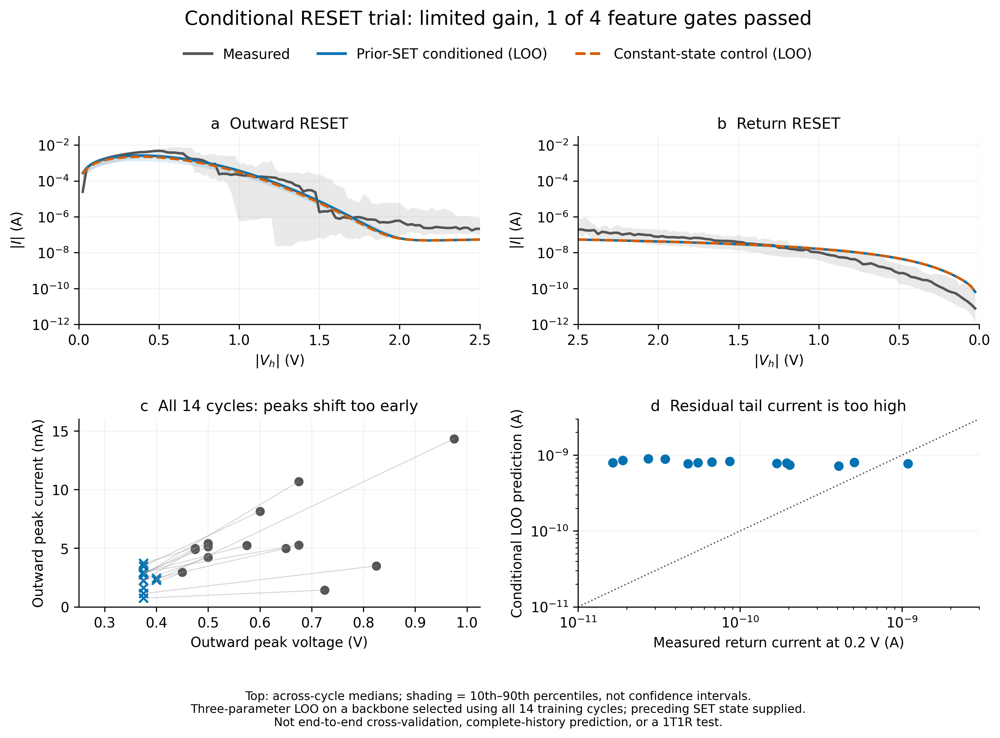

# 共式双通道筛选：已有证据、一次受限试验和下一道判别

**本阶段尚未得到更好的完整 1R/1T1R 统一模型。** 已完成文献约束核对、裸器件前态—RESET关联分析，以及一次三参数 RESET 条件试验。结果支持保留前一段的导电状态，但不支持把“固定软背景＋简单场驱动通道衰减”升级为新模型。没有改动桌面默认或推送。

## 1. 已落实的实验历史

用户确认裸 1R 的数字标签来自同一器件的多次循环，按实际顺序排列，同号先 SET 后 RESET；第 4、23 圈实际测过，但数据缺失。因此已知连续段为 1–3、5–22、24。当前训练仍只用裸 1–3、5–15，以及 1T1R 4–35。

完整历史模型必须在段内连续传递全部状态，不能重置每圈初态，也不能直接连接 3→5。将来 15→16 必须继承终态；第 24 圈若借助自己的数据标定缺失历史后的初态，只能作条件检验。扫描、驻留和等待时间仍未知，本阶段不换算出秒率。

本次 RESET 子试验显式借用了每圈前一段 SET 的实测读态，**并未完成上述跨圈状态传播**。它只检验一个局部必要环节，不能替代已建立的分段联合接口。

## 2. 原文把候选范围缩小了

重新核对 Zhu 的 Nature 正文及 SI、Ranjan 的 hBN 实验和 Ducry 的 hBN 计算全文后，保留三个可区分候选：

| 候选 | 要解释的物理差别 | 当前证据边界 |
|---|---|---|
| 非线性网络与可生成/消退的近欧姆通道 | 低应力下保留非线性，高应力后出现高导状态 | Nature 的两类 LRS 和局部退化提供动机；并未直接测出两个并联支路 |
| 限流响应与寄生瞬态 | 外部电路改变材料实际经历的应力 | Nature 提出过冲解释；本批曲线没有同步局部瞬态，不能补造波形 |
| 界面占据与局部结构耦合 | 匹配瞬时读态后，后续响应仍依赖历史 | 界面解释及其他 hBN 计算提供可能性；不能指定未鉴别物种或照搬保持时间 |

Nature 对稳定 VG=1.1 V 的 1T1M 作非丝状软退化解释；SI 对小器件明确保留“不能宣称开关为丝状”的限制，并报告未检测到金属迁移。故不能把两种接法都写成已证实的金属丝形成/断裂。

优先检验的材料结构是

\[
I_h=F_{\rm soft}(V_h,u)+aV_h,\qquad a\ge0.
\]

两接法应共用此式及同一状态演化规律，外部电路决定实际应力。这里的 a 是有效电导，不是已测丝径；它不能由接法标签或圈号开关。加法项可以改变冻结状态下的电流—电压形状，而单纯乘数主要改变幅度。这只说明候选的可检验差别，不是机制已成立。

## 3. 前一段 SET 确实保留了 RESET 的信息

原 14 条裸训练记录中，SET 返扫 +50 mV 电导与随后 RESET 50–200 mV 斜率的对数相关系数为 **0.99549**；与 RESET 峰电流的相关系数降至 **0.69806**。

只用其他 13 圈确定关系、再用留出圈的前 SET 电导预测峰值时，峰电流 RMSE 可由常数对照的 0.24843 降到 0.19482 或 0.18159 decade。然而中位倍数误差由 1.141 增到 1.262 或 1.405，不能声称所有循环都改善。使用同圈实测峰电压可得更小误差，但那是条件分解，不是预测。

这支持“前态应传递到 RESET”，没有证明最低状态维数或微观物种。所有 14 圈均保留；第 3、10 圈峰值超过 10 mA，未擅设 RESET 10 mA 限流或删除它们。

## 4. 实际完成的三参数 RESET 试验

试验锁定同一个软背景、共同 Ron=58.4630 Ω，使用

\[
I_h=F_{\rm soft}(V_h,\Gamma_{\rm leak})+aV_h,
\qquad \frac{da}{ds}=-\kappa(|V_h|-V_r)_+a.
\]

s 是命令电压路径，κ 的单位为 V⁻²；Γ_leak 在各条 RESET 内及该次拟合的各圈之间相同。初始 a 来自前 SET +50 mV 电导减共同软背景，或来自拟合折内 SET 电导几何均值的常数对照。它没有用该圈 RESET 去单独拟合 a。

仅拟合 V_r、κ、Γ_leak 三个共同参数。两模型各做全训练及 14 次内部留一，每次从预声明的三个初值重新开始；共 90 次，全部有限并正常停止，没有扩范围或追加起点。评分保留原 2,799 个 RESET 点及原四项特征门槛。

| 指标 | 使用前 SET 读态 | 常数初态对照 |
|---|---:|---:|
| 训练全 RESET RMSE / decade | 0.86952 | 0.88813 |
| 固定骨架内部留一 RMSE / decade | 0.89663 | 0.91856 |
| 留一外扫 RMSE / decade | 1.09433 | 1.12954 |
| 留一返扫 RMSE / decade | 0.64037 | 0.64134 |
| 留一中位倍数误差 | 2.6695 | 2.7216 |
| 原四项聚合特征通过数 | 1/4 | 1/4 |

留一 RMSE 降低约 2.39%，14 圈中 10 圈改善、4 圈变差。这是两种**同一受限 RESET 子模型**之间的比较，不是相对旧完整统一模型的准确率提升。

**留一范围更正：**本次只有三个新参数在折内重拟合；Ron 和谱形来自此前全训练数据选择，且内部折可能包含时间上较晚的循环。因此这些分数是固定已选骨架上的内部条件诊断，不是端到端交叉验证、原保留集误差或未来循环外推。运行时的原始产物保留不改，独立审核记录了这项限定。

## 5. 失败已定位到两处，不能靠继续加速率修复

使用前 SET 状态的全训练解得到：

| 原特征 | 预测中位数 | 原接受区间 | 结果 |
|---|---:|---:|---|
| RESET 外扫低压拟合电阻 | 99.86 Ω | 71.20–207.75 Ω | 通过 |
| RESET 峰电流 | 2.551 mA | 3.106–9.909 mA | 偏低 |
| RESET 峰值电压幅值 | 0.375 V | 0.475–0.795 V | 偏早 |
| RESET 返扫 0.2 V 电流 | 803.9 pA | 21.34–477.0 pA | 偏高 |

全部 90 次拟合的 V_r 都贴近零边界。全训练解各圈峰位均为 0.375 V，而实测峰位为 0.45–0.975 V：仅改变 a 的初始幅度、保留共同衰减形状，无法提供足够的峰位变化。

返扫 0.2 V 处，aV 已降到约 5.7×10⁻²² A，几乎全部预测尾流来自冻结软背景。继续提高 κ 会进一步关闭已经消失的通道，却不能降低这个背景。需要分别约束峰前通道演化与软背景演化。

图中上排为各圈中位数和 Q10–Q90 范围，不是参数置信区间；下排保留全部 14 圈。图中的内部留一遵循上一节的固定骨架限定。

## 6. 另一个低压冲突不能被夸大为全模型失败

1T1R 第 4 圈 SET 的 0.1、0.2 V 原始读数，在额外 ±5% 比较带及 ±0.3% 材料表包络下，反演的状态次序与单调 SET 不相容。需要约 35.76% 的对称电流半宽才使两带接触。

但 ±5% 并不是原主特征合同。允许共同状态作最有利折中时，两点 RMSE 约 0.16377 decade，对原 16,000 点 SET 组的 MSE 贡献仅 3.35×10⁻⁶、总目标贡献约 1.68×10⁻⁶。它不能用来禁止允许局部残差的完整前向候选。

同一扫描的零命令电流为 0.22379 nA，提示最低偏压读数未必全是静态导电分量；本阶段没有扣零、拟合偏置或将其认定为仪器误差。原计划 β=1、2、4、6 的速率预算在这个前置诊断处停止，**实际 β 预算数为零**，不能写成四个 β 已被否决。

## 7. 下一步先用必要条件选动力学

对于任何只依赖场幅值的一阶通道损失 `da/ds=-h(v)a`，若背景 B(v) 在整条 RESET 不变、扫描幅值对称且路径速率一致，则定义如下。这里 v=|V_h|，I 和 B 均为电流幅值：

\[
Q_{out}(v)=\frac{I_{out}(v)-B(v)}v,\quad
Q_{ret}(v)=\frac{I_{ret}(v)-B(v)}v
\]

应满足

\[
Q_{out}(v)Q_{ret}(v)=a_0^2\exp[-2H(V_{max})],
\quad H(v)=\int_0^v h(w)dw.
\]

同圈乘积应不随 v 改变；共用 h 的各圈归一化剩余通道还应具有共同形状。这条条件可以先检验“只换一个更陡的场函数是否有用”，无需立即添加指数和拟合参数。只在背景扣除后确实可分辨的区间使用它，不能给负剩余电流取对数；未知不对称驻留或状态相关背景会改变其前提。

下一阶段分别检验：共同损失形状是否可行；软背景是否必须随 RESET 演化；新通道能否由 SET 的实际前激活应力产生。同时保留 series 软支路的早期/返扫动力学要求。需要先通过这些局部约束，再接入全部已知连续历史和两接法联合评分，不能用每圈参数或拟合随机种子补缺口。

本阶段没有得到完整联合新解，也没有访问原保留集。原失败结果、旧完整模型及原验收门槛均保留，项目目标仍未完成。

## 复核入口

- [观测特征与关联](mechanism_selection_2026-11-03/BARE_STATE_PEAK_AUDIT.md)
- [三篇文献约束及精确定位](mechanism_selection_2026-11-03/LITERATURE_CONSTRAINTS.md)
- [双状态的可辨识性与必要条件](mechanism_selection_2026-11-03/MINIMAL_EXTENSION_REVIEW.md)
- [已执行的 RESET 试验](mechanism_selection_2026-11-03/field_rupture_trial.md)
- [失配定位与通用场驱动必要条件](mechanism_selection_2026-11-03/field_rupture_audit.md)
- [独立实现及科学范围审核](mechanism_selection_2026-11-03/FIELD_RUPTURE_INDEPENDENT_REVIEW.md)
- [低压冲突的实际目标函数代价](mechanism_selection_2026-11-03/SOFT_FEEDBACK_LOW_BIAS_BUDGET.md)
- [RESET 对照图 PDF](mechanism_selection_2026-11-03/figures/reset_trial_comparison.pdf)
- [候选结构示意图](mechanism_selection_2026-11-03/figures/hypothesis_framework.png)：只表示概念性连接，不能作为器件端子接线图；并非已验证统一模型。
