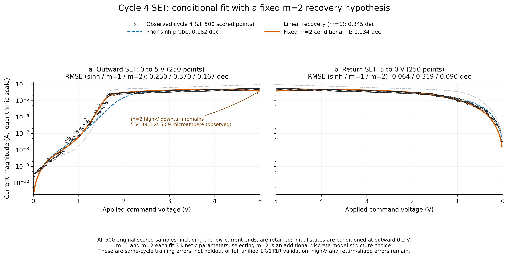
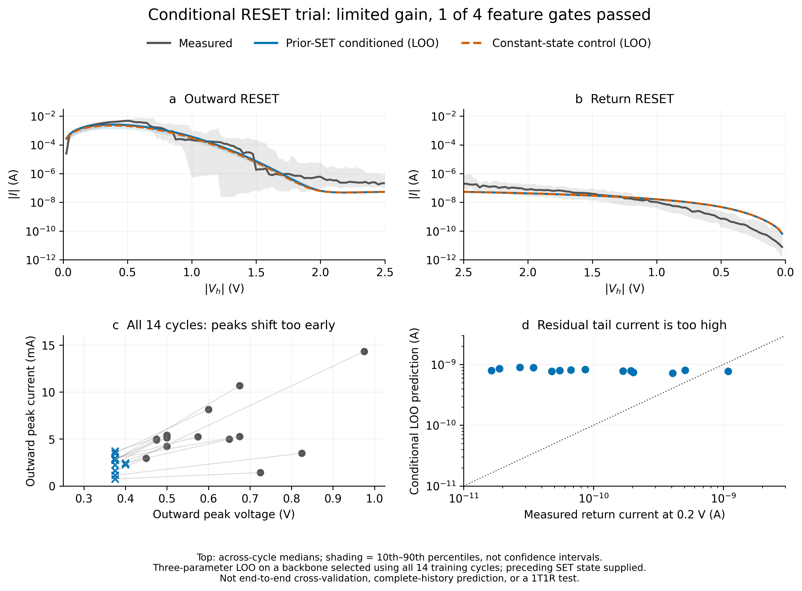
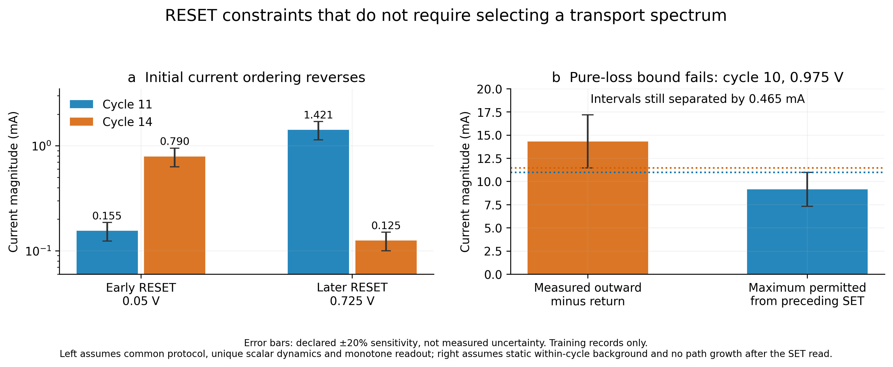
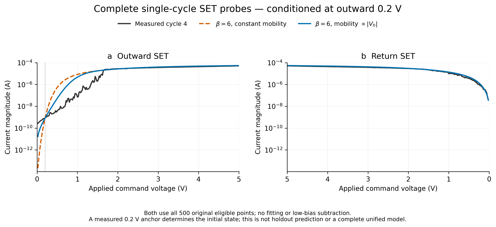
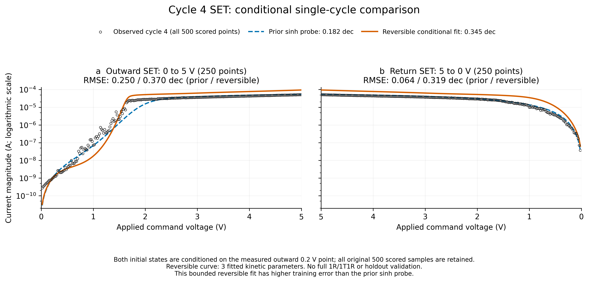
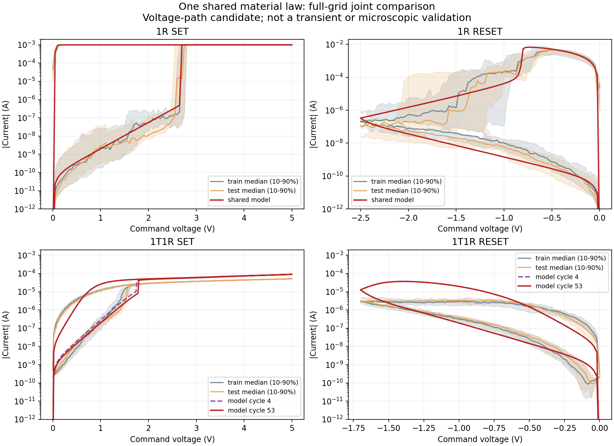
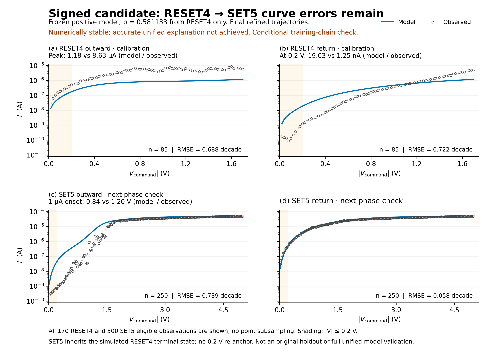
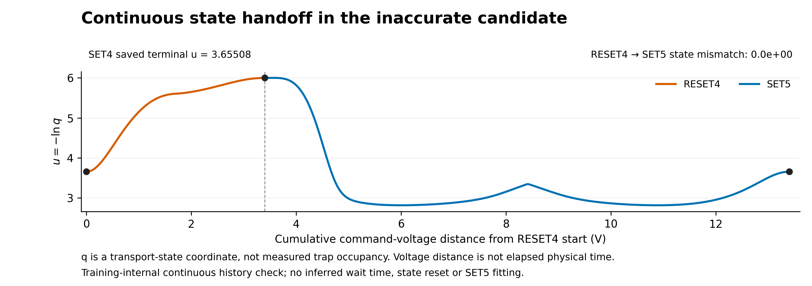
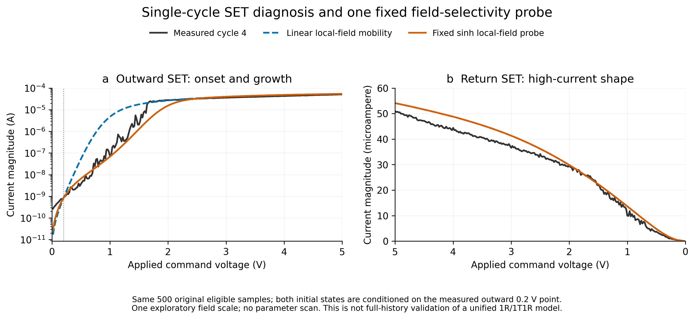
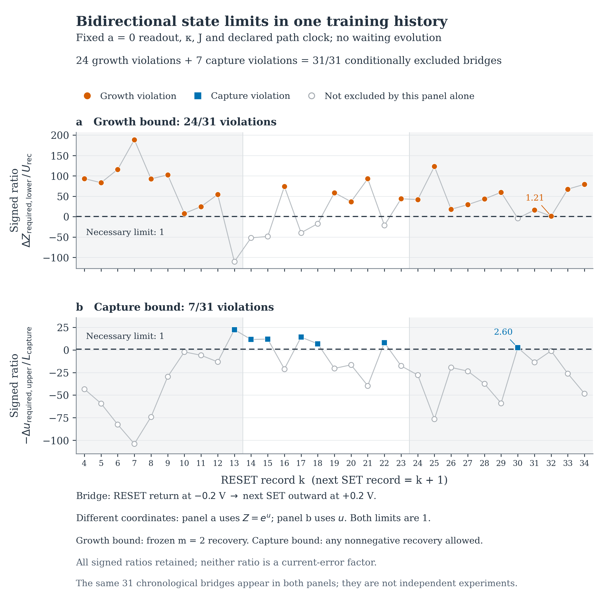

# 历史阶段报告汇编

整理日期2026-11-05。以下是历史原文，保留当时假设与后续可能已更正的说法。

**当前更正优先：串联前三圈是启动阶段；裸1R是连续循环且4、23为已测缺失圈；研究保持暂停。旧文中的待办、active、下一步不表示当前授权执行。不同评分口径不可合并排名。**

本汇编由已保存报告复制，未重新运行实验。


---

# 原报告：ACTIVATED_CONFIGURATION_RESULTS_2026-09-21.md

来源：/Users/sujiangyu/Desktop/SIM2RRAM/VULCAN-2D/analysis/ACTIVATED_CONFIGURATION_RESULTS_2026-09-21.md

# 激活保留构型：连续完整扫描的物理候选检验

## 结论

建立了能量一致的“快速电荷读取＋慢构型转换＋晶体管负载”模型，全部 53 对
SET→RESET→下一 SET 连续传播，RESET 不再逐圈指定初态。但该条件候选仍未
解释关键历史变化：全数据误差约 0.39016 decade，
前三圈约 1.08192；前 35 圈确定参数后，后 18 圈
约 0.31660，未显示相对平均曲线参照的预测优势。

更具体地，原生端口 0.10–0.30 V 内，S4/S3 回程几何平均电流比为
1.00955，R4/R3 去程比为 259.82；
当前选中模型两者均预测为约 1。这是明确的未解释残差，不能用“平均拟合不错”
代替。模型数学自洽不等于目标器件机制已确定。主研究目标仍 active、未完成。

## 1. 本轮真正改变的内容

每个独立谱通道包含导电电子 n、旁侧电荷 m 和两种慢构型 q。快电子保留四态
联合概率和相互对称的库仑反馈；构型改变导电能级及旁侧能级。构型的正反
微观速率由同一能量差及共同鞍点决定，零偏有效速率比严格等于完整构型配分
函数之比。推导见 `ACTIVATED_CONFIGURATION_PHYSICS_2026-09-21.md`。

比较共同鞍点的线性场倾斜形式（lambda=0）与额外二次场软化形式
（lambda>=0）。输运基线固定为前轮对应训练集合的宽能谱解；新增共享参数
分别为 7/8 个，没有逐圈自由参数。初始 q=0、旁侧/右库快尝试率=1 是明确
假设；独立初态和快尝试率敏感性另行保留。

使用原生外加电压和正/反实测晶体管查表前向求解，目标电流不参与内部电压
反解、初态选择或负载选根。总计 35,828 个原始点连续传播，34,662 个点评分，
其中 787 个标记为低信号，主分析没有删除。每圈 SET/RESET × 去程/回程 ×
0.08–0.30 V/高于 0.30 V 共八窗等权；零偏、低于 0.08 V 和顶点不评分，仍
参与历史。全部 53 圈有相同的原生电压序列。

## 2. 同一原生完整扫描任务的结果

| 候选 | 全53共同描述 | 前三圈 | 后50圈 | 前35训练 | 后18预测 |
| --- | ---: | ---: | ---: | ---: | ---: |
| 共同鞍点，lambda=0 | 0.39016 | 1.08192 | 0.30187 | 0.43081 | 0.31660 |
| 加二次场软化 | 0.39016 | 1.08195 | 0.30186 | 0.43081 | 0.31660 |
| 逐相位重复波形参照 | 0.32302 | — | — | 0.36221 | 0.24141 |

单位均为 decade。重复波形参照在每个相位点取训练圈的加权对数均值，参数比
物理候选更多，是灵活的经验基准，不是竞争微观机制。全53参照是“每圈恰好
重复同一波形”类别的精确最小二乘下限，不约束任意历史模型。顺序参照只用
前35圈；物理顺序拟合的输运和新增参数也只用前35圈。数据曾用于探索，因此
这些留出检验不冒充新采集的外部验证。

这些分数不能与前轮 5,072 个内部稳定支网格点的 0.13318 等结果直接比较；
本轮评价的是完整端口曲线、初态传递和连续循环，评分窗口也不同。

## 3. 优化陷阱及为何保留负结果

四组拟合各先采用四个固定起点，再从同一训练集合另一嵌套候选增加一个起点，
共20起点；1 个未选中起点未在上限内收敛，全部选中解收敛。原始结果
和交叉初始化结果分别保存，没有覆盖失败记录。不能以收敛声称全局最优。

这一复核实质重要：原始顺序 lambda=0 拟合的最好训练误差为
0.51248，同训练集交叉初始化后为
0.43081。如果不做这一步，会把局部优化差异误写成
二次鞍点项的物理优势。目前两类结果近乎相同，没有证据要求新增该项。

选中的全数据解从第二圈之后在数值精度内重复同一波形，循环间状态没有被
代码重置，但已被本身的扫描动力学擦除了大部分历史。因此仍预测不了 R3→R4
约260倍的变化，也未描述普通循环之间的漂移。初始 q=0.01/0.5/1 的未重新拟合
敏感性已保留；不能把未测初态或一次局部拟合的失败当作所有构型模型的否证。

另外将固定快旁侧/右库速率比从 exp(-12) 扫到 exp(12)，保持其他选中参数不变，
最大曲线变化约 0.239 decade。这说明该未测量速率对构型动力学不能一概
忽略；但这些固定参数敏感性仍预测 R4/R3≈1。它们未重新拟合，也不是完整
剖面似然或物理时标测量。下一轮应先检验这些固定动力学假设，再判断是否
必须引入更慢的景观演变。

## 4. 数值和热力学证据

- 27 项相关测试通过（3.703 s），包括随机条件联合概率对原四态生成树解、
  零偏配分函数比、完整八态逐边详细平衡、快电子极限、自适应 ODE＋直接电路
  对照、连续状态/重复零路径、非单调负载稳定根和无效输入。
- 主计算使用64个分段能量节点、电流/速率表步长0.005 V、路径步长0.01 V；
  所有选中解加密至128/192节点、最细0.00125 V表及0.0025 V路径。
  最大曲线差 0.000339 decade，加权差最多 9.4e-05，远小于实验残差。
- 加密计算串联电流相对残差至多 5.73e-14；独立枚举 720 个记录点的
  冻结构型负载交点，最大电压差 4.17e-14 V，选中点均为稳定交点。
  每条选中轨迹原生点及加密后的多根数量见审查文件。
- 保留所有模型来源哈希、原始/交叉起点、低信号标记、完整预测及构型概率。
  图为 `figures/39_activated_configuration_evidence.png/.pdf`。

实际电子/构型绝对时标未测。当前严格验证的是绝热数学极限和固定扫描协议的
路径动力学；速率单位为 V^-1，不能从 ell0 分离尝试频率与势垒，不能报告秒级
保持寿命。重复电压与扫描间未知等待未被人为补入；模型忽略构型转换后的
高阶电荷重分布瞬态，不是脉冲或位移电流模型。

## 5. 文献与下一步

本轮下载并核对 Ducry 等 npj 2D Materials and Applications 6, 58 (2022)，
DOI 10.1038/s41699-022-00340-6。其 DFT/NEGF 已研究电荷、原子构型和电导耦合，
该概念本身不是本项目新发现。原文还明确指出所算较小势垒不足以支持年级保持。
其石墨烯/本征多空位体系不能直接替代目标 Au–Ti/h-BN/W 器件的物种与参数证据。
详见 `ACTIVATED_CONFIGURATION_LITERATURE_NOTE_2026-09-21.md`。

下一轮以已量化的 S3/S4 近似相同、R3/R4 相差约260倍为硬约束，优先检查
“旁侧电荷始终条件平衡”的假设，显式保留电荷与构型的联合历史，执行前约定
见 `RETAINED_CHARGE_CONFIGURATION_DESIGN_2026-09-21.md`。该下一候选尚未实现。
同时保留未定快交换速率、过渡态对电荷占据的依赖和读取映射的限制。若这些
受能量一致性约束的改变仍无法保留必要历史，再检验更慢的结构景观/缺陷
积累坐标，区分可逆开关与早期条件化；不能由本轮失败直接推出某个微观物种
或必需状态数。相同协议的证据仍可推进，不把补做实验作为当前工作的前提。

本轮尚未扩展整对五折：两候选已在全数据历史转变和顺序预测上暴露实质缺口，
继续机械增加折数不会补齐物理解释。后续候选通过这些约束后再扩大检验。
生产 M13 未改变，未提交或推送；完整机制、独立参数证据和新颖性仍未完成。


---

# 原报告：BARE_HISTORY_RESULTS_2026-11-03.md

来源：/Users/sujiangyu/Desktop/SIM2RRAM/VULCAN-2D/analysis/BARE_HISTORY_RESULTS_2026-11-03.md

# 裸 1R 连续循环：来源更正、重复轨迹和模型上限检查

本轮落实了用户的两项确认：裸1R的22个标签来自同一器件多次循环；编号为实际
顺序、同号先SET后RESET，第4和23圈实际测过但数据未提供。由此更正裸组的
状态历史策略，并发现原单对扫描诊断漏掉的重复周期失配。**尚未得到更准确的
统一模型，本轮没有进行参数优化。**

## 已修正的建模与评分前提

已提供记录的连续段为1–3、5–22、24。保持原训练范围，当前只计算1–3和5–15；
16–22、24未被用于本轮候选选择或误差诊断。每段内SET终态传给RESET，RESET
终态传给下一圈SET，全部使用同一个材料对象和同一组材料参数。

第4圈的操作真实存在，不能以“跳号”为由直接连接3→5。新接口仅允许第一段
初态u1及缺失第4圈之后的未知状态u5；u5是缺失历史的边界条件，**不是声称
实验重新初始化，更不是逐圈自由参数**。真实缺失圈的驱动及等待仍未获得。
将来第16圈必须继承第15圈终态；第24圈前还缺第23圈，若自行标定u24，就不能
把第24圈误差报告成未经接触的完整历史预测。

`bare_history_2026-11-03/segmented_problem.py` 保留原5,583个裸训练残差、掩码和
权重，逐条预测14对扫描，不再将一次准备的预测复制给所有记录。它是训练用
分段历史接口，未替换旧联合模型或桌面默认。旧单对结果及冻结快照均保留为
历史条件诊断，不能当作已验证多圈历史的成绩。

## 旧四个候选在重复协议下不能维持所需曲线

各候选只设置一次初态，连续计算三对相同SET/RESET命令；不等待、不补缺失圈、
不把simulation_cycle标成实际实验编号。严格共12对，无新参数点或优化。

| 原候选gamma_c/eV | 首周期SET阈值/V | 第二、三周期SET阈值/V | 聚合特征通过数 |
|---:|---:|---:|---:|
| 0.125893 | 3.175 | 1.525 | 3/7 → 2/7 → 2/7 |
| 0.158489 | 3.125 | 1.625 | 3/7 → 2/7 → 2/7 |
| 0.177828 | 3.075 | 1.725 | 3/7 → 2/7 → 2/7 |
| 0.199526 | 3.025 | 1.925 | 3/7 → 2/7 → 2/7 |

原SET阈值目标为2.590–2.775 V。这些候选首周期偏晚，继承RESET状态后又偏早；
RESET峰值和尾流在三周期保持相同的失败结果。后两周期的完整轨迹逐位相同。
四个首周期均逐位复现上一轮的电流与状态，故差异来自实际状态传递，而不是
修改参数或评分门槛。

未回到最初准备状态本身不构成失败：器件可以存在跨圈瞬态。这里不合格的依据
是重复轨迹仍不满足原特征，且未改善RESET问题。结论只针对这四个固定候选及
声明的路径协议，不是所有共同材料模型的无解定理。

## 固定导电上限还存在独立校准问题

当前冻结谱对所有状态有 `|I| ≤ |V|/Ron`，Ron=93.4801Ω来自训练低阻读数的
中位数。中位数不能自动充当所有循环的最大电导的倒数。

- 裸SET返扫50mV，7/14条超过这个上界，最大超出51.9%。
- 裸RESET外扫50–200mV，49/98点超界；包络放宽10%仍有42点超界。
- SET限流平台另有136点仅超1mA约不超过0.0011%，与上述材料上限冲突分开。

这些点不能通过改变初态或状态速率来突破该固定电流上限。但仅此上限造成的
全RESET原始对数RMSE下界约0.022 decade，远小于上一轮候选2.30–3.18 decade
的RESET误差。因此它是需要澄清的额外问题，不能替代动力学失配的解释。
本轮没有自动降低Ron、把所有散布归因于物理变化，或把5%/10%敏感性当成仪器
不确定度。完整逐点证据在 `TRANSPORT_CEILING_AUDIT.md/.json`。

## 原始边界读数能支持什么

同号低阻交接在50mV的RESET/SET电流幅度比中位0.976，范围0.873–1.079。
该点未限流；更高电压的SET末端已有大量限流，不能直接与未限流RESET比较。
高阻端存在低于既有评分门槛的读数；评分门槛不是经标定的噪声底。

固定谱不是正负奇对称，必须分别反演正负偏压下的共同状态。读点到零点仍有
电压路径，不能仅凭两侧I/V不同断言状态不连续；零电压也不能辨识状态。
`BOUNDARY_SCOPE_REVIEW.md` 给出有限变化预算、冻结条件、未知驻留和缺失圈
各自的适用范围。尚未据这些端点识别任何唯一微观机制。

## 验证及下一步

分段接口的9项针对性检查通过：同一材料对象、段内连续、只在1和5设置边界、
原残差逐位一致、训练数据范围及自定义工厂元数据。独立审核已进行。
真实14对接口复算使用原首个候选，并显式设u5=u1作为实现检查情景，结果单列在
`segmented_smoke.json`；这个赋值不是实测或拟合得到的缺失圈终态。

后续任何新候选应先通过连续重复SET/RESET检查，再做两接法的联合训练。
还需要重新约束共同输运电导上限：区分可校准的幅度上限与状态演化参数；
重新确定上限后，之前依赖固定谱幅度的必要界只能作为原参数下的历史结论。
不再以复制一对扫描的误差降低作为完成统一解释的依据。

本轮未读留出数值、未改变原特征门槛、未修改桌面默认、未推送。


---

# 原报告：BARRIER_HEIGHT_AND_POLARITY_RESULTS_2026-09-21.md

来源：/Users/sujiangyu/Desktop/SIM2RRAM/VULCAN-2D/analysis/BARRIER_HEIGHT_AND_POLARITY_RESULTS_2026-09-21.md

# 势垒高度状态与跨扫描物理约束

## 本轮结论

**在既定先验与同一留出方案下，改变势垒高度的模型比改变势垒宽度的模型更有预测价值，并接近有效形状对照。** 这使有效能量状态值得继续发展；它仍不是接触电荷、离子或具体结构的唯一识别。

同时独立证明：同一冻结状态、被动电势分配和共同供给下，任意不对称WKB势垒及其正权并联都受到有限温度整流比界限约束。已确认配对的1.1 V数据最初三圈仍越界。因此，**改善负向局部拟合不足以完成全周期解释；跨扫描状态/读取关系必须明确，不能靠静态左右势垒差异蒙混过去。** 其他超出该势垒类的输运或未标定测量系统误差仍是竞争解释。

本轮未修改生产M13。图为`figures/35_barrier_height_polarity.png/.pdf`；完整结果见`barrier_height_comparison.json`、`barrier_height_validation.json`和`wkb_frozen_polarity_bound.json`。

## 1. 同一套条件比较宽度状态和高度状态

沿用300 K有限温度Landauer–WKB供给积分和实测反向晶体管正向求解。高度候选固定几何g，每支低偏压支路只识别一个Phi；共享供给系数G_pre。默认m*=0.5m_e，Phi=0.02–4 eV，G_pre=1e-7–0.1 S，g剖面为0.25/0.5/0.75/1/1.5/2/3/4/6 nm。

数据、评分与上一轮完全相同：1.3 V全部101条负向曲线，共202支路、4,646个0.08–0.30 V点。49个晶体管容量不相容点、857个不高于3倍零偏参考的点均在主评分中保留。工作表编号是否为同一器件连续循环仍未确认。

五折按整条曲线分组，共享参数与g只用训练支路选择。目标0.08–0.16 V识别一个Phi，再预测0.17–0.30 V；共2,828个留出电压点。回程的低电压点发生得更晚，所以本检验是本构电压外推，不是时间或自主SET→RESET预测。

| 候选 | 全数据描述RMSE | 五折留出电压RMSE | 高信号/容量相容子集RMSE | 留出去程 / 回程RMSE |
| --- | ---: | ---: | ---: | ---: |
| 幂律形状+幅值 | 0.1109 | 0.1697 | 0.1422 | 0.1507 / 0.1868 |
| PF-like形状+幅值 | 0.1075 | 0.1659 | 0.1379 | 0.1479 / 0.1821 |
| 势垒宽度状态 | 0.1206 | 0.2046 | 0.1720 | 0.1621 / 0.2397 |
| 势垒高度状态 | 0.1115 | 0.1667 | 0.1384 | 0.1499 / 0.1818 |

单位均为decade。高度状态与PF-like的差距很小，不能据此宣称谁是唯一机制；PF-like仍只是有效曲线形状。两种WKB候选的比较仅针对各自声明的参数剖面与供给先验，不排除其他宽度/供给范围或更复杂几何。

高度模型全数据和五个训练折均选g=4 nm，供给系数约1.21mS；但4 nm是条件剖面值，不是几何测量。全数据下有11个支路高度接近0.02 eV下界，所有边界均记录。默认条件下去程/回程Phi中位为0.1515/0.3261 eV，逐条差值中位0.1663 eV。这些分别拟合的状态不能充当独立势垒测量或演化预测。

事后敏感性保持g=4 nm：高度下界改为0.005/0.05 eV，描述误差为0.11036/0.11460；共享供给相对最优改变±1 decade后，重新识别高度的差值中位约0.166–0.171 eV。相对状态变化在这组条件检查中较稳定，但绝对Phi、供给和几何仍有补偿；没有用事后先验改写主五折数字。

## 2. 冻结被动WKB的独立整流界限

完整推导见`WKB_FROZEN_STATE_POLARITY_BOUND_2026-09-21.md`。这不是直接借用之前独立固定率能级的证明。

在共同平均化学势下，两电极为±v/2。对同一冻结结构，若被动分压使每点|U_+(x)−U_−(x)|≤v，WKB作用量的单调性给出T_+(E)≤T_−(E+v)。有限温度供给窗口w_v(E)=f(E−v/2)−f(E+v/2)满足|d ln w_v/dE|≤1/V_T。能量变量平移后得到

\[
\exp[-v/V_T]\le\frac{|I(-v)|}{I(+v)}\le\exp[v/V_T],\qquad V_T=k_BT/e.
\]

共同且与能量无关的非负供给权重允许逐路径相加，因此静态左右不对称、任意不同的冻结宽度/高度以及正权并联不会自动绕开它。

该界限不适用于任意相干谐振、任意能量依赖接触供给、不同温度、额外偏置、改变的电荷/结构状态或其他不满足电势序关系的机制。它更不等于所有隧穿机制的排除。

独立实现不对称梯形势垒的能量积分，并检验1,200个参数案例和200组正权并联。左右势垒0.005–4 eV、宽度0.05–6 nm、m*=0.1–1m_e、温度250–400 K、v=0.02–0.5 V范围内均满足界限。48→96阶能量积分的最大自然对数差1.17e-6；另有独立自适应积分、对称势垒与旧核的一致性、谱序关系及热窗口平移测试。随机案例用于查错，不代替解析证明，也不是新实验。

## 3. 对最初三圈的应用

复用且核验了原始数据/处理代码哈希一致的53对匹配内部电压比值。以下使用内部幅值0.1 V、300 K条件；被动冻结WKB下界为0.02090。

| 配对循环 | 原始估计的负/正电流比 | 有利零偏参考扰动后的比值上界 | 被动冻结模型允许的最小比 |
| --- | ---: | ---: | ---: |
| 1 | 0.002335 | 0.002757 | 0.02090 |
| 2 | 0.0000583 | 0.001250 | 0.02090 |
| 3 | 0.001780 | 0.002556 | 0.02090 |

两种晶体管分支处理×四种栅压插值共八种处理中，即使采用上述有利扰动，首三圈均仍越界。53对、0.1–0.3 V网格的原数据审查保留，原始主处理仅最初三圈有违反点；不能只摘取某个曲线制造普遍性结论。

测量上比较的是SET回程和随后RESET初始支；它们是否共享同一个冻结状态正是待检验假设。零偏参考不是完整噪声/量程模型，八种查表处理也不能消除所有1T/1T1M测量系统差异。温度为条件假设而非本项目测温结果。

若仅允许在原被动分压外增加一项有效势垒景观变化，并保持WKB序关系、同一供给等其余假设，则两极性间该额外景观差的最大幅值delta须满足

\[
\delta\ge\max[V_T|\ln r|-v,0].
\]

取每圈八种处理下最保守的有利比值上界，首三圈分别需要至少**52.36、72.80、54.32 meV**的这类额外景观差。它们是条件一致性下限，不是实测充电能、接触电势、离子迁移势垒或实际位置。改变供给权重、路径集合、几何、相干谱或跨扫描状态时，不能继续将此数值直接指定给某个微观参数。

## 4. 验证与未完成部分

高度候选完成54次共享拟合、108个起点及5次目标低压识别；108个起点均报告收敛。全部54个剖面检查能量积分加密及电压/高度网格减半，组合加密最大差4.81e-4 decade，目标预测最大差4.46e-4 decade；单独积分差≤6.50e-8 decade。这个数值误差不足以解释高度/宽度模型的主要差异，但更不能用高度与PF-like约0.0007的差距作机制胜负结论。

完整178项测试通过，45.629 s。`verify_barrier_height_polarity_artifacts.py`已执行通过：核验三个结果的全部输入哈希，从原始数据重建202支路，重算54组共享拟合评分、全部训练/目标加密与7组事后敏感性评分；每条曲线只作一次目标，共享几何与供给只在训练内确定。训练评分最大重算差2.22e-16 decade；从两端电流独立检查的最大KCL相对误差3.77e-9，低于1e-8容差。检查全部1,200个单路径与200个并联存档的极性界限，重新积分误差最大的20个单路径；重算首三圈全部24个处理案例的条件下限。三个旧版产物清单及其文件核验通过，未重写旧证据。审计与文件哈希清单为`barrier_height_polarity_validation_audit.json`和`barrier_height_polarity_artifact_manifest.json`。已有执行源码和旧结果不覆盖。

目前获得的是两类相互独立的约束：同一负向数据中高度状态的幅值—曲率预测有竞争力；在另一组已确认配对的数据中，所有满足明确假设的冻结被动WKB模型无法解释首三圈。两者并不共同证明电荷机制，也未给出完整SET→RESET→下一SET的状态传递。

下一步应建立并检验显式的状态桥接：例如局域电荷占据改变有效势垒/可读性，与结构记忆的竞争模型。对少数构型应平均各构型电流，而非把平均势垒代入指数。候选必须同时面对S3/S4正向低压电流只差约1%、随后R3/R4差约260倍，以及普通循环的保持、异常恢复和后期漂移；不能给每条目标RESET重新自由初始化来掩盖交接问题。

WKB、热供给及陷阱门控本身均不是本项目的新颖性证明；该条件界限的文献新颖性也尚未核实。主研究目标仍未完成。


---

# 原报告：BARRIER_STATE_RESULTS_2026-09-21.md

来源：/Users/sujiangyu/Desktop/SIM2RRAM/VULCAN-2D/analysis/BARRIER_STATE_RESULTS_2026-09-21.md

# 有限温度势垒输运：连续物理状态候选与可辨识性

## 当前结论

本轮新增了满足有限温度载流子供给、零偏和晶体管电流连续的梯形势垒候选，用有效势垒宽度g同时控制电流幅值和曲率。它可以描述1.3 V下202个低偏压支路的大幅电流变化，但**尚未在留出电压上优于简单的有效输运对照，也未识别唯一势垒高度或实际间隙**。

这比给每条曲线任意重设高/低包络增加了一项可检验约束：变化的宽度应当带来相应的曲率变化。当前结果支持继续将它作为竞争候选，不支持宣布残余纳米间隙变化已经解释了全部SET/RESET，或将其最优参数当作结构测量。M13及旧归档模型未修改。

完整结果为`barrier_state_comparison.json`、`barrier_state_sensitivity.json`，图为`figures/34_barrier_state_evidence.png/.pdf`。计算前约定保存在`BARRIER_STATE_DESIGN_2026-09-21.md`。

## 方程及物理边界

对于负向电压幅值v，注入端和接收端化学势分别为0和−v（能量使用eV），势垒沿有效宽度从Phi下降至Phi−v。透射为

\[
T(E,v,g)=\exp\left[-\frac{2\sqrt{2m^*e}}{\hbar}g
\int_0^1\sqrt{\max(\Phi-E-vx,0)}\,dx\right],
\]

其中g在代码中由nm转换为m。电流通过完整有限温度供给积分计算：

\[
I_h(v,g)=G_{\mathrm{pre}}\int_{-\infty}^{\infty}T(E,v,g)
[f(E)-f(E+v)]\,dE .
\]

能量积分以eV计，相应G_pre单位为S；零宽度给I=G_pre v，零偏给I=0。300 K下的热激发越垒部分保留，不能用单个费米能处的透射率乘电压代替。再正向求解`I_h(V_h)=I_T(V_app−V_h)`，预测不使用测试点电流反推内部电压。

在这个具体供给模型内，E≥Phi的载流子T=1，因此任意宽度均有条件电流下限

\[
I_h\ge G_{\mathrm{pre}}V_T\left[\ln(1+e^{-\Phi/V_T})-
\ln(1+e^{-(\Phi+v)/V_T})\right].
\]

这说明增大宽度不能任意压低热激发电流。本式不是所有h-BN器件的普适下限：它依赖本模型的供给、透射和单势垒假设。

主比较固定有效质量0.5m_e、宽度0–6 nm、G_pre范围1e-7–0.1 S，Phi作0.10/0.20/0.35/0.50/0.75/1.0/1.5/2.0/3.0/4.0 eV剖面。300 K是本轮条件假设，没有使用温度扫描识别势垒。宽度与质量通过g√m*简并；G_pre是供给系数，并非已测得的量子通道数。WKB也不包含真实界面电子结构、相互作用或散射的全部细节。

该实现只检验负向0.08–0.30 V的本构关系；它没有宽度动力学，不处理正负接触不对称，也没有新增SET→RESET交接律。

## 数据、划分和比较结果

保留全部101条1.3 V负向曲线，每条去程、回程各23个原生电压点，共202支路、4,646点。范围内49点超过被动晶体管查表容量，857点不高于该条零偏参考的3倍；均保留主评分。另报告同时满足信号和容量条件的敏感性统计，不能将它写成完整噪声模型。

对照为共享幂律形状+逐支幅值，以及共享PF-like形状+逐支幅值。PF-like在这里是有效曲线形状，不代表先前已受质疑的均匀场PF介电参数得到了验证。

五折按工作表编号（代码沿用cycle_id）1–21、22–41、42–61、62–81、82–101分组，同一条曲线的两支始终在同一折。该组是否为同一器件连续循环仍未确认，分组不证明真实老化顺序。共享参数及Phi的选择仅用训练支路；目标支路仅用0.08–0.16 V识别一个宽度或幅值，随后预测0.17–0.30 V。主评分共2,828点，敏感性统计2,355点。

**这是本构关系的留出电压外推。回程低电压在实际扫描中发生得更晚，因此它不是按时间预测回程，也不是自主预测下一循环。** 数据已经参与模型开发，不称为外部盲测。

| 候选 | 全202支联合描述RMSE | 五折留出电压RMSE | 信号/容量敏感性RMSE | 留出去程/回程RMSE |
| --- | ---: | ---: | ---: | ---: |
| 共享幂律+幅值 | 0.1109 | 0.1697 | 0.1422 | 0.1507 / 0.1868 |
| 共享PF-like+幅值 | 0.1075 | 0.1659 | 0.1379 | 0.1479 / 0.1821 |
| 共享梯形势垒+宽度状态 | 0.1206 | 0.2046 | 0.1720 | 0.1621 / 0.2397 |

误差单位均为decade，按点汇总。没有把拟合残差和留出误差混在一起。主上界和粗剖面内，全部六次训练选择均为Phi=0.5 eV，但这个重复选择不是参数唯一性的证据；以下边界检查直接显示其依赖性。小于1 V之外的高压、完整回线和跨栅压未在本轮检验。

## 供给系数、宽度和势垒高度互相补偿

在看过主比较后，新增事后描述性敏感性，不用它改写此前固定方案的五折数字：

| 条件 | Phi | 拟合G_pre | 联合描述RMSE |
| --- | ---: | ---: | ---: |
| 主范围 | 0.5 eV | 2.22e-3 S | 0.12065 |
| 主范围，G_pre达到0.1 S上界 | 1.0 eV | 0.1 S | 0.14932 |
| 放宽G_pre上界至100 S | 1.0 eV | 100 S（触顶） | 0.13097 |
| 放宽G_pre上界至1e6 S | 1.0 eV | 3.58e5 S | 0.11095 |

后一个数值组合尚未取得接触面积、实际模式供给等独立物理支持，不能因为残差较小就采用它。它揭示的是**势垒高度判断受到供给系数先验和宽度补偿的影响**，因而不能从当前曲线宣称测得了0.5 eV势垒，也不能据主范围结果排除所有更高势垒模型。这里没有验证新增供给范围下的五折预测优势。

同样在Phi=0.5 eV、原供给边界下，m*=0.2/0.5/1.0m_e的描述误差为0.12981/0.12065/0.12053。几何上限会打破纯g√m*的缩放简并，但不是质量被实验识别。

默认条件下拟合去程/回程宽度中位为1.225/2.561 nm，99/101条回程宽度更大。这些宽度是分别用两支实测电流反推的结果，**不构成额外的结构证据或宽度演化预测**。图c展示另一组参数能把同样支路映射到明显不同的条件宽度。

## 数值与复现

- 完成72次共享输运拟合、144个起点，全部起点报告收敛；另有15次被留出支路低电压状态识别，均收敛。收敛不证明全局最优。
- 10组供给边界/有效质量敏感性各保留两个起点。
- 60个势垒训练剖面均检查24→48阶能量积分、内部电压/宽度网格各减半。单独积分最大差6.49e-8 decade，组合加密最大差1.52e-4 decade；被留出目标预测最大差1.05e-4 decade。
- 电路KCL相对误差约2e-11量级；基础测试还包括空间WKB积分与独立求积、有限温度能量独立求积、无势垒极限、质量/宽度缩放、隐式导数有限差分及线性串联电阻极限。
- 全部171项测试通过，39.364 s。验证脚本`verify_barrier_state_artifacts.py`检查完整曲线覆盖、五折按整条曲线隔离、模型选择只来自训练误差、逐点重新评分、源文件哈希、数值加密及测试记录，全部通过；最大重新评分差2.23e-16 decade。
- 首次描述输出在JSON序列化原生索引时遇到NumPy整数类型错误，未生成有效结果文件。已修正为Python整数；失败日志与修正前脚本保存在父目录verification中，当前所有结果均由修正后的同一版本生成。

理论背景属于已有势垒隧穿理论。Simmons《Generalized Formula for the Electric Tunnel Effect between Similar Electrodes Separated by a Thin Insulating Film》，DOI [10.1063/1.1702682](https://doi.org/10.1063/1.1702682)的题名/作者/DOI已通过元数据核验，本轮未阅读全文。当前代码实现上述有限温度Landauer–WKB积分，不称为逐项复现该文的完整Simmons公式；势垒隧穿本身不作为项目创新。

## 下一步物理判别

最有价值的下一项竞争是：**几何宽度改变**、**固定几何下势垒高度/接触电势改变**、**可用导电贡献数量改变**，分别会怎样约束幅值与曲率。需要在相同数据、相同参数选择和留出条件下比较，而不是给不同机制不同的评分优势。

随后把有预测价值的输运状态接入完整历史：用普通循环中的非事件区间和回程保持约束状态演化，同时保留异常恢复。当前宽度候选尚未解释最初三圈跨极性差异、后期漂移或稀有跃迁频率，不能因低偏压拟合可用就跳过这些目标。


---

# 原报告：BIDIRECTIONAL_STATE_RESULTS_2026-09-21.md

来源：/Users/sujiangyu/Desktop/SIM2RRAM/VULCAN-2D/analysis/BIDIRECTIONAL_STATE_RESULTS_2026-09-21.md

# 双向状态动力学与随机导电瓶颈：结果和未解决问题

2026-09-21。上一轮的原始曲线与电路上界已经排除了若干单向/固定导电假设，本轮实际实现了受能量关系约束的双向速率，并进一步检验单次随机跃迁。**研究目标仍未完成；M13未替换。** 本报告不将一个特殊循环的描述性解释冒充统一器件模型或SCI论文创新性已成立。

## 1. 结论怎样改变下一步

双向转变确实提供了比单向擦除更合适的研究框架，但“允许正反两个速率”本身不够。两个最小确定性候选在普通1.1 V示例上描述误差较低，却不能重现1.3 V第23条的骤降—恢复及返回状态。

这还不是对微观跃迁机制的否证：**一个连续占比的平均轨迹，与少数导电瓶颈的单次随机轨迹，是不同的观测对象。** 后续离散随机对照只用第23条去程拟合，能够以非零且并不极端的小概率产生一次下降、一次恢复和随后保持高电流的模式；但它没有解决返回电流幅值、绝对保持、跨循环规律和初始正反向异常。

下一步应把正常渐进回线与异常跳变共同纳入随机状态/存活概率检验，检查有限数目的有效导电通道及接触/电荷读取状态。不能仅为了贴合单条跳变而增加确定性状态变量，也不能从两个跳变认定已找到离子通道。

## 2. 已实现的两个确定性候选

负向内部电压幅值记为v，s为可导电构型的占比：

`ds/dx = k_build(v)*(1-s) - k_remove(v)*s`，`x=integral |dV_app|`。

`I_h(v,s)=H(v)+s*C(v)`，H/C沿用相同有效输运包络；不把它们称为已确认的PF/跳跃微观输运。每条曲线起始s=1，参考幅值吸收初始可见导电贡献；这仍不是SET传来的统一结构状态。

`DeltaG(v)=delta0-q_eff*v`；以eV为能量单位，`V_T=kBT/e`：

`ln k_build = ell - delta0/(2V_T) + theta*q_eff*v/V_T + lambda*v^2/V_T`；

`ln k_remove = ell + delta0/(2V_T) - (1-theta)*q_eff*v/V_T + lambda*v^2/V_T`。

因此在相同内部电压处严格有`ln(k_build/k_remove)=-DeltaG/V_T`。单一倾斜势垒对照令lambda=0，0<=theta<=1，|q_eff|<=1；第二候选允许共同过渡态能量降低项lambda>=0。该项加速两个方向，但不改变两构型的能量差；不是已经测出的极化率，也不是焦耳热证据。

温度条件为300 K。速率单位1/V，只识别真实尝试频率与未知扫描速率的组合。参数采用0–1.7 V域内最大单向速率的对数参数化，范围−12至18；lambda范围0至0.5 eV/V²。边界命中被记录，不视作参数测量。示例势垒换算声明`nu/r=1e13 /V`，只作条件解释，不推断实验扫描时间或原子势垒。

每一步电流和内部电压均由外加电压及实测晶体管正向求解；没有以目标实测电流驱动状态。以log(s)积分，避免极小状态乘大输运包络时被绝对容差掩盖。重复电压点不凭空增加驻留时间。

## 3. 完整曲线比较：22次描述性拟合

预先列明11条探索性示例：全部具有本轮关注上升阶跃的6条曲线，以及1.1 V第1/3/4/27/53条正常或早期对照。不是254条曲线的代表性随机抽样。每曲线、每候选允许独立的全部参数；每次4个起点。全部去程和回程都参与以下确定性拟合。

评分：外加幅值>=0.08 V的正电流；去程<=0.3 V、去程其他、回程各占1/4、1/4、1/2。没有使用实测反演坐标筛分权重。因而不能与前一轮内部电压权重或M13分数直接比较。

| 栅压/编号 | 单一倾斜势垒RMSE | 加共同势垒降低RMSE |
| --- | ---: | ---: |
| 0.9 V / 6 | 0.4918 | 0.4541 |
| 0.9 V / 14 | 0.3077 | 0.2937 |
| 1.1 V / 1 | 0.0925 | 0.0935 |
| 1.1 V / 3 | 0.0506 | 0.0496 |
| 1.1 V / 4 | 0.0702 | 0.0724 |
| 1.1 V / 27 | 0.0903 | 0.0940 |
| 1.1 V / 53 | 0.1716 | 0.1723 |
| 1.3 V / 10 | 0.2348 | 0.2348 |
| 1.3 V / 22 | 0.3552 | 0.3716 |
| 1.3 V / 23 | 0.8791 | 0.8763 |
| 1.3 V / 52 | 0.2067 | 0.2068 |

单位decade。第二候选包含第一候选；部分行反而稍差，说明有限多起点优化尚不能声称达到全局最优，更不能把这点差异当作物理优劣。各起点、最优参数、边界及数值精度均保存。

第23条的模型只给出了平滑的弱下降及恢复，两个确定性模型的最大单点误差都约2.45 decade；没有解释原始大阶跃。这是本次候选及优化的失败记录，不是对一切双向速率机制的数学排除。

原始254条负向记录与当前晶体管查表还存在容量不相容点：0.9 V有84个、1.3 V有132个非零电压点超过查表容量，1.1 V没有。不能将这些点强行反演成正内部电压。它们在本轮端口比较中按原规则保留：选中曲线中1.3 V第22条有10个容量不相容点，其中3个进入评分。第23条没有此问题。数据匹配/背景/仪器等因素尚待核准。

## 4. 单条随机路径不能用平均轨迹误差直接否定

引入两种离散构型z=0/1，各自通过同一晶体管求解独立的固定状态电流I0/I1。形成速率取OFF构型的内部电压，消除速率取ON构型的内部电压。它继承共同内部电压下的能量关系；**不由此宣称整个有偏压耗散电路满足热平衡详细平衡**。

对第23条，去程的两个已检测跳变提供观察到的高/低构型标签：第39点下降、第109点恢复。标签参与条件化，不是模型预测出来的。输运包络、速率只读取去程；峰值处已观察到高构型之后，对整个回程作条件概率预测。回程电流没有进入初始化或拟合，已加入回程电流污染不改变标定结果的检查。

每小步使用精确两态转移矩阵，允许采样点之间的隐藏往返；每个原始步用8段积分，再以16段核对。比较恒定速率、对称单势垒场倾斜，以及加共同势垒降低三种候选。速率拟合仅有两个被观察到的跳变，不具备唯一微观识别能力。

| 候选 | 去程状态序列负对数似然 | 预测回程每个采样点都保持高构型的概率 | 模拟出现一次下降、一次恢复且回程采样全高的比例 |
| --- | ---: | ---: | ---: |
| 恒定速率 | 10.6171 | 0.1516 | 0.0413 |
| 场倾斜速率 | 8.6851 | 0.2972 | 0.2103 |
| 共同势垒降低 | 7.7104 | 0.1387 | 0.0976 |

最后一列来自固定种子的20,000条**模型样本**，不是新增实验或显著性证据；模式不要求跳变恰好落在观察的两个电压格点。第3列是在去程峰值高构型条件下的独立回程预测，不是拟合优度。

场倾斜候选的下降位置仍很宽：条件于去程恰有一次下降和恢复时，下降电压10/50/90%分位约0.02/0.11/0.40 V，恢复约0.91/1.06/1.16 V。实际下降0.39 V靠近模拟分布上侧。不能只展示一条恰好像实验的随机样本就宣布解释成功。

共同势垒降低模型还可能在采样间隔内快速往返，因此回程“采样点都高”的概率0.1387与“连续从未离开高构型”的概率0.0845不同。这提醒我们，现有低时间分辨率记录不能独立确认每个原子转变。

## 5. 随机解释仍有三项明显缺口

**输运幅值尚未预测好。** 用去程高/低标签标定两个输运支，描述性误差0.1533 decade，连接支sinh曲率达到0.05/V下界，近似欧姆。即使假定回程一直是高构型，未用于标定的回程电流误差仍为0.3276 decade，平均偏高0.2310 decade。两个固定构型的电流水平尚不能充分解释返回状态，更不能宣称状态参数已识别。

**速率自由度未识别。** 共同势垒模型触及峰值速率上界。固定log峰值为12/18/24/30并重新拟合其余参数，去程负对数似然为8.1806/7.7105/7.3760/7.1285，但回程全高概率反而为0.1741/0.1387/0.1089/0.0987。更好地解释两个已知事件，不等于更好地预测回程。最高速率剖面在示例`nu/r=1e13 /V`下还对应负的最小势垒，不能当作物理可接受的最优解。此处是描述性剖面，不是置信区间。

**非易失保持仍未闭合。** 若反事实地把同一个拟合构型、同一速率律延伸到零偏，并要求7 h后高构型概率>=95%，则三个候选要求3 V扫描路径至少耗时约21/86/50天。这不是实验时长的估计，也不直接否证Nature的+0.1 V读取保持：器件、编程状态、读偏压和时间信息未匹配。它说明这些速率不能直接作为同一个非易失结构状态的普适速率使用。若s是快速接触/电荷读取状态，而非真正存储结构，保持要求应由另一个明确的状态过程承担，不能混用。

## 6. 文献对当前物理图像的约束

本轮使用nature-academic-search流程，实际可用的发现工具是Sider Scholar/OpenAlex，再用Crossref核对DOI、摘要和出版信息；已获取并阅读Ranjan等2018年的公开正文。Wiley全文接口返回403，KAUST机构库只返回验证脚本页，**没有把这些页面当作已读全文**。

- Pan等，*Coexistence of Grain-Boundaries-Assisted Bipolar and Threshold Resistive Switching in Multilayer Hexagonal Boron Nitride*，AFM 27, 1604811（2017），[DOI](https://doi.org/10.1002/adfm.201604811)。本轮核对的是出版摘要：已有双极性与阈值切换共存、晶界/电极离子相关解释。不能将“存在两个方向的导电变化”直接作为本项目新颖性。
- Ranjan等，*Conductive Atomic Force Microscope Study of Bipolar and Threshold Resistive Switching in 2D Hexagonal Boron Nitride Films*，Scientific Reports 8, 2854（2018），[全文](https://www.nature.com/articles/s41598-018-21138-x)。正文Fig.3讨论0.35/0.40 V下多级RTN和毫秒至约100 ms的捕获/发射；Fig.5报告在100 mV–1 V读取下10–100 s的自恢复，并专门讨论AFM漂移的不确定性；Fig.6的B离子漂移/扩散属于该文提出的解释。其Pt针尖/h-BN/Cu、1–100 nA条件与目标1T1M不同，不能拿来指定我们器件的物种或保持寿命。
- Pazos等，*High-Temporal-Resolution Characterization Reveals Outstanding Random Telegraph Noise and the Origin of Dielectric Breakdown in h-BN Memristors*，[DOI](https://doi.org/10.1002/adfm.202213816)，2023年2月在线发表，文章号2213816。Crossref出版摘要报告多层h-BN的高时间分辨率噪声/ambipolar切换，以及低至50 Ω工作区与高低电流比>100的随机电报行为，并关联到热驱动金属纳米丝中断。本轮未取得全文；该低阻工作区不能直接套用于本项目的限流、部分退化状态。

文献支持把随机陷阱/接触过程与结构跃迁同时作为竞争解释，也说明“大幅随机跳变”不是本项目独有发现。当前创新性检索只是定向补充，尚未形成全面的新颖性证明。

## 7. 下一轮需要检验的内容

1. 用普通循环的未发生事件区间、异常循环的跳变位置和返回状态共同限制速率；不能只拟合两个特殊事件。先在已确认配对的1.1 V序列中连通SET→RESET→下一SET，再处理跨栅压条件差异。
2. 检验有限通道数/权重异质性是否能在同一框架内连接渐进变化和离散跳变；不从I–V直接宣称已测出通道数或必须存在金属丝。
3. 将非易失结构与可能快速变化的接触/电荷读取过程分开提出竞争模型，利用最初三圈跨极性异常、S3/S4状态信息及低偏读取约束；额外状态必须改善未参与初始化的数据预测。
4. 保留保持时间、真实扫描速度和驻留间隔的缺口。缺少元数据时先给可辨识组合及条件预测，不编造绝对能垒和寿命。

## 8. 复现与检查

确定性比较22个拟合、88个固定起点均收敛；两种独立积分器及容差加密均检查。最大容差加密电流差异`1.89e-5` decade、独立积分器差异`9.35e-7` decade、电流连续性相对误差`1.31e-7`。随机转移矩阵与独立矩阵指数一致；采样频率与解析占比一致；回程数据污染不改变去程输运标定。完整测试158项通过。数值精度不等于机制验证。

性能辅助仅用一个小型C++电路求解核，首次调用时编译至`.venv/.cache/bidirectional`；需要本机C++编译器。物理参数、速率和分析仍由Python模块定义。独立Python求根及两种ODE积分器检查覆盖该辅助核，运行环境版本已存入数值审计。

结果包括`bidirectional_<gate>_<cycle>_<candidate>.json`、`stochastic_reentry_probe.json`、`stochastic_retention_diagnostic.json`，数值与来源汇总见`bidirectional_validation_audit.json`，图见`figures/32_bidirectional_stochastic_evidence.png`。此前模型及结果均保留，本轮没有替换生产M13或提交推送。

```text
python analysis/compare_bidirectional_states.py
python analysis/check_stochastic_reentry.py
python analysis/check_stochastic_retention.py
python analysis/plot_bidirectional_evidence.py
python -m unittest discover -s tests -v
python analysis/verify_bidirectional_artifacts.py
```


---

# 原报告：CHARGE_SPECTRUM_RESULTS_2026-09-21.md

来源：/Users/sujiangyu/Desktop/SIM2RRAM/VULCAN-2D/analysis/CHARGE_SPECTRUM_RESULTS_2026-09-21.md

# 有限能谱、电荷状态传播与条件记忆上界

## 结论

有限导电能谱改善了四态电荷反馈的共同描述，但没有完成SET→RESET预测，尤其未解释前三圈。放宽能量范围后，高压斜率从约0.068改善到约0.712，实测中位0.594；这说明原先验参与了形状失配，不能把一次受界限约束的拟合当成整个机制的否证。放宽后完整分组敏感性也已完成，不能仅用全数据改善宣称预测成功。

更有物理意义的新增结果是一个条件动力学上界：在各位点总尝试率不随偏压和另一占据改变的模型中，已选参数不能靠电荷相互作用产生很强的“零偏慢、加偏快”的慢模态分离。全数据窄谱与宽谱解的上界均约1.23倍。这个结果限定到选中参数和明确速率假设，不是对目标器件保持时间的测量，也不排除带额外激活势垒、能量相关供给或结构演变的机制。

203项测试通过；全部原始共同数据、初始三圈和缺失点标记保留。主目标仍active且未达到，生产M13保持不变。

## 1. 模型与对照

导电能量在[E_d−w,E_d+w]均匀分布，各通道各有自己的旁侧电荷，位置、库仑作用和接触比共享。每圈仍只有一个共同正负电流尺度和保留结构能量E_t。平均的是各能量下的完整电流，不是平均势垒的电流。均匀谱不是测得的DOS；每通道独立侧电荷也不是多个导电位点共享一个陷阱。

共享参数E_d、x_d、x_t、u、ln(Gamma_L/Gamma_R)、w。E_t没有逐扫描演化律，因此当前候选仍是状态条件下的读取模型，不能冒充完整记忆器件。零谱宽严格回到前轮五参数核。旁侧交换速率不在稳态拟合内；其影响在新增动态传播器中明确保留。

原先验E_d∈[−0.5,0.5] eV、w∈[0,0.6] eV；其余参数沿用前轮。全数据与六个训练折的中心触及+0.5 eV上界（留出1–11的训练折除外），因此进行事后扩展至E_d∈[−1,1]、w∈[0,1] eV的检验。

原先验全数据解为`[0.49999999999999994, 0.4394753792931235, 0.5343773691824902, 0.3728267089063208, -5.391530515402342, 0.4136098140745007]`；宽先验解为`[0.6733823989748052, 0.4885545920629247, 0.5398934318925809, 0.16976833559122967, -5.246972830871303, 0.5870390271052944]`。谱最低能量分别为0.086390和0.086343 eV。宽先验最优解未触及共享参数边界，但不等于唯一识别。电流尺度仍不能分离通道数和绝对跃迁率，位置/相互作用仍受条件几何先验约束。

## 2. 相同全部53对的结果

仍用原5,072有效内部网格点、16个高压缺失位置、三个窗口权重0.25/0.25/0.5。全数据共同描述读取两种极性；主预测中共享参数仅由训练对确定，目标SET回程识别局部尺度/E_t，然后预测目标RESET。内部电压由测量去嵌入，这些分数不是自主外加端口完整周期预测。本阶段未新增原生端口电路验证。

| 模型 | 全数据共同描述 | 五折RESET全部 | 五折RESET首3圈 | 五折RESET后50圈 | 顺序后18圈RESET |
| --- | ---: | ---: | ---: | ---: | ---: |
| 单能级四态反馈 | 0.14982 | 1.18099 | 2.93613 | 0.98040 | 0.94266 |
| 有限谱：原先验 | 0.13509 | 1.02563 | 3.14754 | 0.72153 | 0.73368 |
| 有限谱：放宽先验 | 0.13318 | 1.02366 | 3.14755 | 0.71857 | 0.82577 |

单位均为decade，但共同描述与RESET预测是不同任务。前轮平衡WKB电荷候选的同一内部RESET五折误差为0.81066，当前两种能谱先验仍须按这个相同任务参照判断，而非只和单能级比较。

原先验7个共享拟合/35起点、12次目标识别均收敛。宽先验全数据4起点均收敛；另外6个共享训练折/30起点及12次目标识别完成，选中解与目标解均收敛，未选中起点有1次未收敛，保留全部记录。扩展折只使用该训练集合已有窄谱解、固定起点和同训练集合的无谱宽解初始化，不使用全数据共享参数。扩展属于开发后的敏感性，不是从未参与模型选择的外部验证。

宽先验的首三圈共同描述加权误差仍0.33713，其中正向低压0.50398 decade；它与主SET初始化后的巨大负向误差共同表明交接尚未解决。不能以高压斜率接近实测替代这个要求。

## 3. 精确状态传播与可检验的记忆约束

已实现`charge_moments.py`，沿分段恒定电压传播两个平均占据，跨正负电压不重置状态。与完整四态生成矩阵的独立指数传播比较：100个随机参数/初态的平均占据最大差8.54e-15，并通过包含SET样式正向→零→负向→零的多步单元检查。时间仍为Gamma_R*t，未标定为秒；此模块尚未接入晶体管和位移电流，是精确状态传播器，不是瞬态端口模型。

设a=Gamma_L+Gamma_R、b=Gamma_t、P=(F0−F1)(c0−c1)。两个平均占据的慢衰减率为

`lambda_slow = [a+b−sqrt((a−b)^2+4abP)]/2`。

利用`lambda_slow/min(a,b) >= 1−sqrt(P)`，以及零偏下`P<=f(E_min)`，得到

`lambda_slow(V)/lambda_slow(0) <= 1/[1−sqrt(f(E_min))]`。

完整证明在`CHARGE_RELAXATION_BOUND_2026-09-21.md`。原先验各训练解的上界约1.21–1.31，全数据为1.22676；宽先验全数据为1.22700。上界对这些参数下的任意局部E_t、任意正旁侧速率及谱内所有独立通道成立。因此仅把一个偏压无关旁侧速率调得很小，不会自动形成相互作用导致的强慢模态速度分离。

这不是任意初态的电流开关时间上界，也不包括慢结构能量演变、偏压相关隧穿矩阵元、额外迁移势垒或不同的多位点网络。不能据此宣称h-BN器件没有电荷记忆；准确结论是当前选中读取参数尚未提供所需保留机制。

## 4. 数值与文献核验

首次64点积分测试在极宽谱先验例子中有约9.62e-7 decade差异，未通过2e-7门槛；在任何数据拟合前改为96点分段积分并保留失败日志。主拟合全部19组训练/目标状态的96→192点最大差1.09e-13 decade，另加密至384点。42个正负/高低电压案例与独立自适应积分的最大差2.27e-15 decade。宽先验使用192点，并在综合审查中核对全部训练/目标状态的384点值。

完整203项测试通过（45.003 s），包括零谱宽、梯度、谱积分、正耗散、无相互作用极限、独立四态动态传播和慢模态性质。综合来源、整对分组、预测和误差重算见`charge_spectrum_validation_audit.json`；文件身份见`charge_spectrum_artifact_manifest.json`。图为`figures/38_charge_spectrum_evidence.png/.pdf`。此前六份阶段清单所列文件保持原身份。

原文核对见`CHARGE_DYNAMICS_LITERATURE_NOTE_2026-09-21.md`。Michalek与Bulka的arXiv:0907.2879已经讨论电容耦合、动态库仑阻塞、亚稳极化态及不同弛豫时间。但其连续DOS正统隧穿率不同于当前固定总尝试率的离散能级，不能把我们的精确闭合或上界直接推广过去。该文也不是目标h-BN的物种或保持证据。两个新推导的文献新颖性仍未确认。

## 5. 下一项：从读取模型进入保留状态演化

下一步不再仅扩展静态谱以压低平均误差。需要明确哪个保留坐标改变E_t/势垒，并由完整SET、零偏交接和RESET历史推进它；目标RESET不得每圈自由重新初始化。可检验候选是具有独立激活势垒的结构/陷阱构型，电荷读取保持快速守恒，构型转移受共同能量景观及正反速率关系约束。这只是下一候选，不是已经确定的离子物种。

必须共同面对初始三圈、普通循环、正负读取、负向恢复及后期漂移，并对随机构型切换给出适当的概率预测而非承诺每次跳变的确定时刻。无扫描时间元数据时只能识别速率与扫描时标的组合，不能伪造绝对保持时间。现有同协议数据仍可推进；新增实验和UI不是此阶段前提。整体物理解释、自主状态交接和新颖性尚未完成。


---

# 原报告：COMMON_LAMBDA_FEASIBILITY_RESULTS_2026-11-04.md

来源：/Users/sujiangyu/Desktop/SIM2RRAM/VULCAN-2D/analysis/COMMON_LAMBDA_FEASIBILITY_RESULTS_2026-11-04.md

# 共同场依赖的条件检验：找到唯一乘积根，但没有合格候选

本轮实际执行了共同 lambda 的有限节点诊断。**增强场依赖可使两个 RESET
外扫窗口各自对应正速率，但同时满足正负极性共同参数关系的根要求
b≈−0.175，超出现行 [0,ln10] 域；即将负 b 保留作诊断，RESET 返扫仍预测
错误的状态变化方向。** 因此没有进入连续前向验证的合格候选，也没有新的
I–V 拟合精度。完整 1R/1T1R 统一解释仍未完成。

唯一执行 session98817，exit 0；四配置全部完成，源哈希未变。数值时间
0.176829 s，加载、哈希与文件保存另计。执行前冻结5项源码/输入，作者停止
编辑；没有重启、额外起点、放宽b域或修改旧模型。

## 从必要外包到实际正系数区间

输入仅为上一阶段固定 a=0 读出、路径时钟及线性/PCHIP 插值下的保存节点。
在每个节点上重加权 A(lambda)=Σ w v exp(lambda v−u)，B和Δu保持不变。
没有重新反演状态、解材料/电路根、生成节点或运行ODE。

RESET两个外扫窗令 R=A高/A低、S=B高/B低、T=Δu高/Δu低。
在已核对的 Δu高>Δu低>0、T>S 条件下，α>0且β>0当且仅当 S<R<T。
R随lambda严格递增；本轮实际求出R=S与R=T的两个参数交点。

| 配置 | RESET正系数的开区间 / V⁻¹ | 共同乘积根lambda / V⁻¹ | 根对应b |
|---|---|---:|---:|
| linear / Gauss8 | (3.273462283, 3.376316429) | 3.284089282 | −0.175736705 |
| linear / Gauss16 | (3.273462176, 3.376316130) | 3.284089156 | −0.175736670 |
| PCHIP / Gauss8 | (3.274233068, 3.376925578) | 3.284878531 | −0.173926166 |
| PCHIP / Gauss16 | (3.274232225, 3.376925074) | 3.284877706 | −0.173927027 |

表中端点来自保存函数值的二分括区，四配置差异是插值/求积敏感性，
不是参数置信区间。上一阶段的 lambda>约2.374 只是必要外包下界，不能
把那个数直接作为满足正系数的候选；实际区间明显更窄。

## 共同乘积关系只有一个根，b范围并非唯一的问题

每个lambda用SET4两外扫窗识别κ/r，用RESET4两外扫窗识别α/β。
四系数正时计算

\[
H(\lambda)=\ln\frac{\alpha\beta}{\kappa r},\quad
b_F=\tfrac12\ln(\alpha/\kappa),\quad
b_G=\tfrac12\ln(r/\beta).
\]

共同动力学要求H=0以及同一个b。每配置31个预定内部点均保留，每配置
发现一个异号括区并实际二分，四个H根的|H|最大约1.27e−13。
使用 b=(b_F+b_G)/2 投影为实际共同系数
α*=κexp(2b)、β*=r exp(−2b)，最大相对投影差约6.47e−14。
没有用两个独立负支系数冒充一个共同b。

额外的保存节点推导检查了整个正系数区间的H导数，而非只依赖31点扫描：
四配置的导数上界分别为 −28.37179、−28.34375、−28.40586、−28.38281 V。
结合边界H→+∞/−∞，在这些有限正指数和条件下每配置恰有一个乘积关系根。
推导及180项独立算术检查见 H_MONOTONICITY_PLAN/CHECK/REVIEW。
这项证明的范围是当前有限节点重建，不是未知连续实验轨迹的全模型结论。

四个唯一根的b均为负，故没有满足原b域的候选。b域本身也是现行建模约束，
不是独立测量出的置信范围；所以还完整报告了负b根在其余窗口的表现。
结果显示，单纯取消b下界仍不足以解释返扫。

## 其余窗口的实际检验

以下用linear/Gauss16根及投影后的同一组参数。κ=7.028874309/V²、
r=23300.488001/(A·V²)、b=−0.175736670；这是被拒绝的诊断参数，
不是默认模型或新的物理标定。

| 预先保留的训练窗口 | 固定读出反演要求Δu | 共同系数积分预测Δu |
|---|---:|---:|
| RESET4返扫1.6→0.8 V | +2.087996 | **−4.233433** |
| RESET4返扫0.8→0.2 V | +2.228142 | **−0.569561** |
| SET4返扫1.6→0.8 V | +0.234628 | +7.417399 |
| SET4返扫0.8→0.2 V | −0.028548 | −0.185518 |
| SET5外扫0.2→0.8 V | −1.361825 | −0.816407 |
| SET5外扫0.8→1.6 V | −5.116799 | −3.177720 |
| SET5返扫1.6→0.8 V | +0.246996 | +6.622587 |
| SET5返扫0.8→0.2 V | +0.381373 | **−0.285321** |

四种配置均保留相同方向的主要问题。PCHIP/Gauss16的两个RESET返扫预测
分别为−4.217901与−0.567508，仍与重建要求相反。其余八窗最大绝对归一化
闭合差约0.993；这是积分残差，不是99.3%的电流误差或I–V RMSE。

这些结果说明，四个用于识别的外扫窗口能精确闭合，仍远不足以建立一条
完整的状态轨迹。这里没有使用实验端点重锚前向模型，表中预测也不称ODE仿真。
所有窗口仍属于同一训练数据，并且端点/反演误差相关，不是八次独立实验。

## 实际工作量与可复核性

- 8个R边界根、4个H根，12个参数标量求根均完成。
- R边界二分383步、H二分172步；允许精确浮点零或中点停滞按计划提前结束。
- R标量函数求值399次，H参数点296次（含124个预定网格点）。
- 两系数线性识别592次、2×2求解592次，全部返回。
- 新保存窗口指数和2014次，保存节点重加权846160点计次，缓存复用16次。
- 4个候选各完成12窗的独立极性/共同b两套闭合，共48对。
- 新材料/电路根、状态反演、ODE、非线性前向拟合均为零。

标量参数根并不是“零求根”。这些计算与上一阶段的21108次电路求解属于
不同工作量，不能混计。运行时保存完整的网格、括区、系数、候选与计数。

新lambda前向接口 `lambda_forward.py` 已准备，显式区分冻结读出与共同
λ/κ/J/b快照；旧 `joint_forward.py` 及其冻结λ保护未修改。准备检查包括
编译和积分正文对比，**没有导入或运行新接口，也没有前向数值验证**。
由于本次eligible候选为零，按计划没有启动该接口的模型计算。

## 判断边界与后续方向

本轮完成了一个有针对性的筛选：在当前固定读出、插值、路径时钟和所选
窗口条件下，仅放开共同lambda，不能得到满足现有约束且解释其余窗口的
正参数候选。不能据此排除全部共同材料模型，也不能宣称已识别微观物种。
特别是RESET小窗Δu=0.047941及T>S前提仍受未知测量/读出误差影响。

下一步不继续扩大同一常数族的搜索次数。已只读核对实际代码：当前没有
联立q/a、同一材料用于裸/串联、贯穿SET→RESET→下一圈的完整实现。
`soft_rate_compatibility_2026-11-03/SOFT_FEEDBACK_NEXT_DECISION.md` 已写出
可逆q/a正率耦合骨架，但尚未实现；下一步直接实现并检验这个既有候选，
不把它重新包装成新建议。保留q²须显式记为已有结构选择。

裸电压驱动下，该骨架仍是合作系统：若两圈入口q/a逐分量同序，读出排序
依然保持。要解释圈11/14反序，必须由真实连续历史产生不可逐分量比较的
状态。可逆q也只是允许打破旧单峰证明的u非减前提，轨迹必须实际产生
足够的q回升；两个变量本身不是通过证据。
增加a会改变电流分解、局部电压和反馈，必须重新检验读出与完整曲线，
不能沿用本次a=0反演、给每圈另配a或把新增状态当作机制已被证明。

完整46对/92相位/27023残差/20聚合特征仍未验收。裸器件4/23缺失且已测，
禁止跨缺口连接；扫描/等待时间仍未知。未访问原保留集、替换默认模型或推送。
目标保持active。本轮是新的实际数值与理论进展，不是已经改善准确率。

证据目录：`analysis/common_lambda_feasibility_2026-11-04/`。
核心结果为 `SAVED_LAMBDA_FEASIBILITY.json`；独立保存结果审查另列于
`SAVED_LAMBDA_REVIEW`：9320/9320项检查通过，实际读取9输入文件及144个
NPZ成员，核对全部保存根轨迹、592次识别和4候选闭合；没有新增lambda
试点、根搜索或模型运行。H单调性另有180/180项独立检查通过。


---

# 原报告：CONDITIONAL_PROTOCOL_RESULTS_2026-11-03.md

来源：/Users/sujiangyu/Desktop/SIM2RRAM/VULCAN-2D/analysis/CONDITIONAL_PROTOCOL_RESULTS_2026-11-03.md

# 未知扫描设置下的统一模型：必要条件与下一步

本阶段尚未得到优于既有 GapLaw 的完整统一模型。当前工作把部分拟合失败
定位到具体假设，并修正前一阶段结论的适用范围；这些是诊断进展，不是
电学曲线精度已经提高。原始数据、主评分、桌面默认模型和旧失败记录均保留。
本阶段未推送代码。

## 已确认的工作边界

用户说明扫描速度、逐点积分/停留时间暂时拿不到。不再追问，也不填写假秒数。
两组实验必须使用同一材料电流方程和状态方程；同一个数值参数、同一个
每伏扫描路径速率，则是额外检验假设。名义材料堆栈相同不等于缺陷完全相同。

1T1R 第 1–3 圈继续不进入主拟合；第 4 圈只设置一次初态，之后连续传递。
裸器件保留已有条件配对，不编造记录之间的采集顺序。此次未用 1.1 V 的
第 36–53 圈选择模型。其他栅压资料是已看过的补充约束，不叫盲测。

## 一项必须收窄的推论

前一阶段的有限温度输运界在某些 0.9 V 栅压记录中有强违例，但不能因此
断言主训练对象 1.1 V 必须增加松弛或非刚性输运。

`spectral_dynamic_2026-11-03/fermi_window_training_crossgate.*` 对 1.1 V
训练 32 条记录的 1,440 个保留原生点对，没有找到这条广义 Fermi 界的违例。
0.9 V 中，要求至少 0.05 V 电压跨度时有 15 条违例；要求至少 0.10 V 时
只剩 3 条。1.3 V 对应为 1 条和 0 条，前一项仅超界约 1.06 倍。
5% 电流区间是声明的敏感性，不是测出的噪声置信区间；未违例也不等于模型
成立。完整掩码、当前晶体管联合去嵌入和范围见该报告。

两项方程审核同时明确：

- 单纯增加零场松弛，不自动解除高压软态留带与裸态快速穿带的标量比较。
- 固定几何、固定权重和被动电势分配的普通 WKB 势垒变形仍满足相应宽松
  输运界。任意偏压耦合函数不能直接称为有证据的接触物理。

详见 `RELAXATION_CANDIDATE_GATE_REVIEW.md` 和
`BIAS_DEPENDENT_TRANSPORT_REVIEW.md`。二者都没有产生新的已验证机制。

## 未知相对扫速作为条件情景

`conditional_clock_2026-11-03/protocol_problem.py` 在积分边界加入
外部固定比例 alpha=r_series/r_bare。裸器件用原状态导数，串联器件的
SET/RESET 均除以 alpha；材料对象、输运、阈值、状态边界和初态规则不变。
alpha=1 直接走原接口。12 项验证通过，解析 ODE 最大误差 1.73e-12；
独立审核未发现方向或对象共享错误。这只验证了适配器，不验证真实扫速。

原预登记 alpha=20、50 和 gamma_c=0.2、0.4、1.0 eV 情景的有限必要
预算没有生成种子，未进入 ODE 或优化。较早仅使用 7.95 V 全返扫路径
的宽松预算会允许器件直到返扫才闭合，不能证明外扫约 2.8 V 已到达限流。
最终预算加入每条原生约 0.05 V 的切换括区；旧临时种子已撤销。

其中 JS 网格当时限制在 JS<Icc，必须明确这是有限筛选的范围，不能据此
宣布原方程所有阈值都失败。对于 JS>Icc，状态依赖阈值仍可能启动。后续
补充审核及 beta 筛选已允许到达既定低阻读态所容许的更高阈值，单独保存，
没有覆盖原预算。

## 同一裸记录的缓变与骤变

同一记录在 2 V 到最后一个限流前点之间允许的状态变化，给出 k_SET 上界；
从该点到下一个达到 0.995 mA 的点，给出 k_SET 下界。两段来自同一条曲线，
不涉及串联器件或跨接法 alpha。

对固定谱、原 beta=1 方程、gamma_c=0.2/0.4/1.0 eV、理想 1 mA 限流
和声明的端点区间，12 条方向可行记录的两个速率区间均无交集。其余 2 条
（6、15）在 5% 端点带内已不满足状态单调方向。这是带条件的逐记录诊断，
不把窄 5% 区间改成原全曲线拟合的新硬门槛，也不忽略循环散布。

已保存的解析式去掉了 JS 网格依赖，但最初仅覆盖 0<JS<Icc：

| gamma_c / eV | 12 条记录中最宽容的速率下/上界比的解析下界 |
|---:|---:|
| 0.2 | 3.9493 |
| 0.4 | 6.3368 |
| 1.0 | 9.0002 |

比值大于 1 表示两个区间不相交。证明、各记录与数值来源保存在
`conditional_clock_2026-11-03/same_record_budget_audit.*`、
`same_record_full_threshold_bound.*` 和 `SAME_RECORD_SCOPE_REVIEW.md`。

这个结果不需要知道整体扫速数值，但需要同一记录两段共用恒定路径速率。
若仪器在跃迁附近改变停留时间或扫描斜率，电压点距不能限制真实演化时间，
必须重新用真实时序检验。它也没有排除其他连续 gamma_c、输运形状、瞬态
电路或不同材料动力学。

独立审核进一步用原有低阻读出预算给出 JS≤Icc*exp(u_L)，因此可平移
上面的解析界覆盖仍可能到达该读态的全部阈值。三个 gamma_c 的 JS 上限
分别为 1.1122、1.2243、1.5609 mA，最宽容速率比下界仍为
3.5642、5.7014、7.8050，均大于 1。更高阈值受状态停止界限制。

这里的低阻要求 R≤187.68 Ω 是原训练 Q90 公共预算，不是每条记录的实测
上界。原生记录 1、11 的读出为约 206.8、315.6 Ω，超过该预算。因而
“12 条”指同时施加公共读出要求的条件结果；若要求与各条实测读态相容，
直接支持的是其余 10 条速率记录，6、15 仍另属端点方向问题。详见
`SAME_RECORD_BOUND_REVIEW.md` 与 `same_record_readout_shifted_bound_review.json`。
这项区别不能在组会或论文中省略。

## 已完成的最小反馈检查

小耦合区间内读出近似 I 正比于 exp(-u)，原驱动 ln(I/JS)+u 恰好抵消
这项状态依赖。优先检查把系数固定为 1 是否过强：以同一个 beta 进入
两接法、两极性的 ln(|I|/J)+beta*u，计算初态启动、慢段/跳变、低阻
读态以及 RESET 的共同必要预算。不因单个 SET 分支改善就跳过 RESET。

这是一项有效反馈敏感性，beta 不是已识别的微观活化常数。高压同态时间
比较与低压输运方向约束仍在，不会因多一个系数自动消失。

`beta_feedback_2026-11-03/SCREEN_PLAN.md` 预先声明了 24 个情景：
gamma_c 为 0.2/0.4/1.0 eV，beta 为 0.25/0.5/0.75/1，alpha 为 20/50。
初态启动与低阻读态共同限制 JS；没有继续人为截在 Icc。原始固定谱矩阵
一次计算、所有 beta 共用，57.713 秒完成；旧源产物哈希不变。

全部情景的 SET 必要预算都没有交集，最宽容的所需/允许速率比仍为
7.9491（gamma_c=0.2、beta=1、alpha=50）。降低 beta 可以减轻某些
同记录慢/快诊断，但没有得到同时满足主预算的候选。RESET 也单独记录；
某些 RESET 比值为 0 是该保守上界为无穷，不能读成无误差或已正确预测。
详见 `finite_beta_budget_screen.json/.md`。依计划停止，未运行 ODE、
拟合、扩大 alpha 或读取留出曲线。有限域失败不证明所有 beta 都失败。

## 不增加参数的载流子供给对照

在 beta 筛选之后，仅增加一项预登记的结构对照：SET/RESET 都乘实际
|I|/(1 mA)，beta 固定为 1、A_RESET=0。1 mA 只是速率归一化，裸
RESET 没有限流。这是载流子供给限制尝试频率的有效假设，不是机制认定。

`carrier_supply_2026-11-03/SCREEN_PLAN.md` 固定原来的三个 gamma_c
和 alpha=20/50，共 6 个情景，不增加拟合参数。跃迁预算沿必须经过的
128 个状态分片积分：每片用最终命令电压和最大谱宽给电流上界、用最小
谱宽给状态上界，再求该片允许最快变化的时间。这样保留了跃迁初期的
小电流，不能把整个 0.05 V 括区都当成已经达到 1 mA。

59.677 秒完成的筛选中，6 个情景的 SET 必要区间全部无交集；最宽容的
所需/允许速率比为 79.0723，仍在 gamma_c=0.2、alpha=50。RESET 有
部分必要相容区间，但不能弥补 SET。无穷上界被单列为“未约束”，没有
误计为无解，也没有计作已验证的速率。

这个因子虽使慢段更慢，却也抑制跃迁初段；只看限流后的高速变化会误判
其可行性。另一方面，在逐条裸记录诊断中，12 条方向可行记录有 5 条的
有限速率区间出现交集；不能把跨接法预算失败说成它对裸单组毫无帮助。
这些交集仍不是完整曲线解，也不证明同组能用一套参数拟合。
原源文件哈希不变，无 ODE、拟合、扩大参数域或生产模型修改。
见 `carrier_supply_budget_screen.json/.md`。这仍只是有限域的条件结果，
不能推广为所有载流子参与的微观过程都失败。

## 下一步的选择准则

同一数学模型不等于不同物理 cell 的全部数值参数必须相同，但放开跨组
参数相等也不能修复单组内部的矛盾。新增记忆态前，应先区分“同方程分别
能解释两组，只是参数域不相交”与“方程连裸器件单组也不能解释”。
`conditional_clock_2026-11-03/PARAMETER_TRANSFER_SCOPE_REVIEW.md` 给出
有边界的迁移检查方案；这仍是方案，尚无分组校准或迁移结果。

另在三分钟内重新核查公开 Zenodo 目录及本地两份裸工作簿的元数据。
公开目录仍只有主文 Figures 1–3 与 Source_code，未明确提供 SI Fig.6
硬态裸器件文件；2c form 对应串联 1T1M，不能映射为本地裸 1R。
本地两本工作簿都是 22 个纯数字标签，没有 cell、成形/循环阶段或采集
顺序对照。未读取留出数值、未下载整个压缩包。详见
`conditional_clock_2026-11-03/SOURCE_IDENTITY_NEXT_CHECK.md`。

因此，首次成形与后续循环是否被混合仍须有来源证据；不能根据阈值大小
自行决定其身份。这个缺口与未知扫描速度不同。当前所有条件配对和准备
初态的解释都要保留该限制，不能直接追加损伤状态并称为实验支持的事实。

完整轨迹、同掩码四分支误差和原 20 项特征同时改善，才算得到更好的模型。
目前主基线及其误差不变；本轮的成果是减少无效尝试和界定下一次试验。


---

# 原报告：CONSTRAINED_HISTORY_CONVERGENCE_RESULTS_2026-11-04.md

来源：/Users/sujiangyu/Desktop/SIM2RRAM/VULCAN-2D/analysis/CONSTRAINED_HISTORY_CONVERGENCE_RESULTS_2026-11-04.md

# 三相位不退化的连续校准：得到新的折中候选，机制缺口仍大

本轮实际执行了固定候选核验与有约束的局部搜索，使用同一组动力学参数和
唯一整段初态，连续计算 SET4 → RESET4 → SET5。**三个相位的 RMSE 均
低于旧控制，1170 点合计 RMSE 由 0.444364 降至 0.405892 decade，
下降 8.66%；但关键局部特征仍有数量级误差，完整 1R/1T1R 统一解释未完成。**

## 实际改善及其边界

比较下列结果使用相同的 refined 精度、原 500/170/500 点评分及全部低压点。
request57 是上一阶段只以搜索精度算过的候选，本次已通过两精度与独立电路核验。

| 三相位指标 / decade | 旧控制 | 已核验 request57 | 本轮选定候选 |
|---|---:|---:|---:|
| SET4 RMSE | 0.133894931 | 0.128685744 | 0.132576835 |
| RESET4 RMSE | 0.705457872 | 0.692714555 | 0.693868932 |
| SET5 RMSE | 0.524327189 | 0.490870182 | 0.451929383 |
| 合计 1170 点 RMSE | 0.444364008 | 0.423993898 | 0.405892062 |

选参目标为三个相位等权平均 MSE，由旧控制的 0.263505888 降至
0.234423626 decade²，下降 11.04%；相对 request57 下降 4.62%。它与
逐点合计 RMSE 的权重不同，不混用改善比例。三相位 RMSE 相对旧控制分别
下降约 0.98%、1.64%、13.81%，改善主要来自 SET5。

本轮候选的 SET4、RESET4 都略差于已核验 request57，SET5 则更好，因此
它也不是相对 request57 的逐相位全面改善。保留两组参数，不把单个汇总目标
的最低值当作唯一科学结论。

上一轮无不退化护栏的最低总误差候选为 0.391205 decade，但 SET4 误差达到
0.235947。本轮的 0.405892 并没有进一步降低那个总分，而是在三相位都不差于
旧控制的明确目标下保住 SET4 精度。该护栏是建模目标，不是测量噪声或统计置信区间。

## 尚未解释好的曲线特征

| 固定实验特征 | 实验 | 本轮候选 | 偏差 |
|---|---:|---:|---|
| RESET4 原生采样峰值 | 8.6317 μA | 0.788037 μA | 低约 10.95 倍 |
| RESET4 返扫 −0.2 V | 1.2504 nA | 12.0477 nA | 高约 9.64 倍 |
| SET5 外扫 +0.2 V | 0.7250 nA | 25.2583 nA | 高约 34.84 倍 |

RESET4 的外扫 RMSE 由旧控制 0.688383 增至 0.737100 decade，而返扫
由 0.722130 降至 0.647760；RESET 的整体 RMSE 小幅改善掩盖了分支间的
取舍。其峰值也比旧控制更低。**“三个相位 RMSE 都降低”不能替代峰值、
低压衔接和历史变化的物理解释。**

三相位低压 20 点 RMSE 为 0.311230291 / 0.888418233 / 0.870582637
decade；所有低电流评分点都保留。当前没有实验噪声模型，不能将这些数值
改善宣称为统计显著的机制证据。原 20 项聚合特征合同没有被这些逐点诊断取代。

## 同一参数、真实状态连接与有限搜索

冻结 λ=0.4470398752554136/V、Ron=58.463033350725695 Ω、
Γc=0.03127031375421752 eV、谱表与晶体管表、q² 动力学、a=0 及命令电压
累计路径时钟。校准参数为：

- κ=57.6779879361/V²，r=κ/J+=15378.3627073/(A V²)；
- J+=0.00375059354716 A，b=0.769297378470313；
- 整段唯一 u0=9.464551672652638，是拟合坐标，不是测量的陷阱占据。

refined 实际状态链：
9.464551673 → 3.497978435 → 6.451974470 → 3.497978406。
相位之间直接使用前一实际终态；没有分段反演初始化、重锚或状态剪裁。
未知真实扫描、停留与等待时间仍保留未知，不能把路径参数解释为秒率。

先固定核验 old 与 request57 各两精度，共 12 个相位；确认 request57 的
每个相位改善均超过两套计算所见精度差后才搜索。执行前把护栏由 SET 子集
收紧到全部三相位均不差于同精度 old，防止把 SET 的退化转移到 RESET。

搜索在归一化四参数域内用 .02、.01、.005 坐标步长。每轮固定中心完整评价
四轴正负方向，再接纳满足全部护栏且 mean MSE 降低至少 1e−4 decade² 的
最好点；参数越界、约束违约和数值未定分开记录。没有引入新的状态或速率项。

唯一运行 session47591，exit 0。共 102 条链请求：4 条预核验、96 条搜索、
2 条最终验证；86 条实际计算链，16 次精确缓存复用。12 轮完整邻域后，
选择 request93 / round12_axis0_minus。最后一轮的中心是 request91，
接受 request93 后剩余额度为 0，**没有检查 request93 自己的完整邻域**。

因此 search_outcome=request_budget_exhausted、grid_stopped=false。
不能称为坐标网格停止，更不是连续驻点、KKT 条件、全局最优或方程族被否定。
约束边界还可能存在可行对角方向。没有自动增加额度或重新启动。

## 数值核验与来源

最终两精度分别连续计算三相位，使用同一候选参数和整体初态。三相位护栏
在 nominal/refined 均通过，改进均大于实际观察到的数值精度变化。
最大评分电流精度差约 1.84e−6 decade；u 差约 6.00e−6，远小于当前
实验曲线偏差。预核验及最终链均保存 RHS 并做全部原生点独立 48 步根回代，
沿用 KCL/KVL、被动性、状态域、掩码、连续交接和近零微段检查。

数值时间：预核验 6.737229 s、搜索 84.574403 s、最终验证 3.647435 s，
合计 94.959067 s，符合预先规定预算。I/O 和哈希另计。
本轮在作者明确完成、主代理与接口审查通过之后写入 SOURCE_FREEZE，再唯一
执行；输入与结束源哈希一致。冻结前阶段源码没有修改，未发生前阶段的启动编辑竞态。

定向保存结果审查已完成，1786 项检查通过：全部 102 条请求、12 轮选择账本，
预核验与最终的 18 个相位，以及末轮中心/邻点引用的 27 个搜索相位。
实际重读并核验 98 个文件、45 份相位数组；没有声称逐个重读全部 626 项
运行产物。图形已由主代理视觉复核。数值通过仍不代表物理准确性达标。

只解码 SET4/RESET4/SET5 的 9 个观测数组，没有解码后两相位的模型或评分，
没有使用原保留集，没有改变默认模型或推送。本轮没有执行 RESET5/SET6
延续，不能把前阶段另一组参数的延续结果移植到本候选。

## 对后续机制筛选的意义

本轮确认了“同一方程、共同参数、连续状态”下存在三相位均优于旧控制的
候选，排除了“上一轮 SET4 退化必然不可避免”的说法。但 RESET 峰值与
下一圈低压启动仍严重偏离，继续只追求这三段的平均误差不足以推进完整目标。

新增的积分可辨识性推导给出固定 a=0 读出/λ/路径时钟下的必要结构：
正支 Δu=κA−rB，负支 Δu=αA−βB，且 α/κ=r/β=exp(2b)。这可用于
检查共同速率系数是否兼容。**离散 I–V 并不确定 A/B 的真实积分**，必须
先检查采样与插值是否会在已知满足方程的轨迹上制造不闭合；不能把插值不共线
直接当作机制否定。本阶段另有已保存模型数组上的自检，结果另列于
`constrained_history_convergence_2026-11-04/integral_selfcheck/`。

该自检已实际执行一次（session32356，exit 0），仅用保存模型数组作
0.009792 s 的积分和线性代数，没有实验反演、静态求根、ODE 或优化。
在已知满足共同动力学的轨迹上，原生采样梯形积分识别出的
αβ/(κr)=1.010755，κ 偏差约 −0.94%；隔点采样后分别为 1.044802 和
−3.82%。同采样两求解精度的最大闭合差异仅约 1.97e−6，原生积分自身
最大闭合差约 8.78e−4；正支识别矩阵的缩放条件数约 159.34。
这是一项实质的诊断方法校验：**即使模型确实共用系数，离散积分仍可能产生
约百分之一的伪不一致**。不能把实验里类似幅度的系数差直接宣称为新物理，
也不能把本模型轨迹上的偏差直接当成实验误差界。

裸 1R 的毫安级分支变化、同极性循环次序反转和真实历史仍必须同时处理。
当前软通道 a=0 的局部结果不能替代这些条件。若保留 (u,a) 两状态，材料
方程与驱动定义须对 1R/1T1R 相同，状态由历史产生；加入 a 后电流反馈和
读出都会改变，旧软通道反演与 SET 拟合不能自动沿用。

完整目标仍是原 46 对 / 92 相位 / 27023 残差 / 20 项聚合特征的统一解释。
裸器件缺失 4/23 确实测过，不能跨缺口直接连接。目标保持 active。

## 证据入口

- `constrained_history_convergence_2026-11-04/EXPERIMENT_PLAN.md`
- `constrained_history_convergence_2026-11-04/SOURCE_FREEZE.json`
- `constrained_history_convergence_2026-11-04/bounded_coordinate_check.json`
- `constrained_history_convergence_2026-11-04/SAVED_RESULT_DIAGNOSTICS.json`
- `constrained_history_convergence_2026-11-04/INTEGRAL_IDENTIFIABILITY_NOTE.md`
- `constrained_history_convergence_2026-11-04/figures/fig_calibration_iv_old_vs_final.png`


---

# 原报告：CONSTRAINED_SHARED_RESULTS_2026-11-03.md

来源：/Users/sujiangyu/Desktop/SIM2RRAM/VULCAN-2D/analysis/CONSTRAINED_SHARED_RESULTS_2026-11-03.md

# 共享材料模型：约束、读出与动力学的分阶段筛选

当前结论：**已有新的排除证据和局部输运形状改善，尚未得到更准确、经物理验证的
完整统一开关模型。** 既有连续 GapLaw 仍是全曲线比较基线；本阶段新候选不替换
桌面默认模型，不把冻结读出误差当作整圈预测误差。持续研究目标保持未完成。

详细文件位于 `constrained_shared_2026-11-03/`。裸 1R 与 1T1R 共用材料
本构和状态律；本阶段额外检验共同数值参数，不能将这一更强假设等同于
用户要求“同一个数学模型”。1T1R 第 4 圈唯一初态连续到 53 圈，第 1–3 圈保留但不参与
正常工作主评分。裸数据仅使用已声明的同编号条件配对，不假造跨表时序。
本阶段材料候选筛选只使用训练记录；已历史曝光的内部检验集不称盲测。

## 1. 电路前提进一步得到量化，但尚未变成无条件材料事实

- 固定晶体管映射下，32/32 个训练 SET 的去嵌入 Rh(4 V)/Rh(2 V)>1，
  中位 1.23971。24 种分支/插值组合仍全部上升。
- 统一电流尺度 0.78903 或有效栅压约 1.01772 V 可消除这一个两点矛盾。
  它们是敏感性条件，不是已测校准修正；单纯增加共同串联电阻不能改变两点差。
- 仅用独立 1T 数据交叉检验插值后，选中的幂次插值在 1.1 V 只改变约 1.4%–4.2%
  电流，不能据此宣称所需 21.1% 缩放已有支持。源正向表没有直接 1.1 V 测量；
  正反向资料与实际串联器件的对应关系仍需确认。

见 `circuit_constraint_audit.md`、`gate_interpolation_validation.md`。
默认映射未修改，不通过任意改变外电路救材料拟合。

## 2. 可达性筛选避免了一个昂贵而不自洽的拟合起点

实际电流 cubic 候选使用

    Vh = Ron I + u V0 asinh(I exp(u)/I0) + u B (I/1mA)^3

继承旧 G，不新增状态。B=0 精确退回旧核，6 项针对性检查通过。
对分别拟合的冻结裸 HRS / 冻结软 SET 包络，重建共同材料参数后得到
u_soft=50.5081、u_bare=59.5743。

有限 0.05 V 低阻读点给出 u_low≤0.002506，因此需要跨越至少 50.5056 的状态差。
但冻结软态最大电流 51.322 µA 与裸 1 mA 限流只允许

    u_soft − u_low ≤ ln(1mA / 51.322µA) = 2.96963。

这否决**当前静态最优包络、冻结、原 G 和名义映射的组合**。尚未 profile 所有
可接受静态误差参数，不能扩张为整个 cubic 族、所有有限速率轨迹或一切共同模型
都无解。单纯给旧参数加大 B 的起点也有很高闭合障碍，不能直接启动 ODE 扫参。
详见 `ACTUAL_ACCESS_REACHABILITY.md`；原静态拟合与失败证据均保留。

## 3. 同一个有限温度谱读出：局部改善与关键失败分开报告

候选采用 Lorentz 传输与正权能量分布，同一带符号读出覆盖两种极性。
状态可经 γ(u)=γc/(exp(u)−1) 改变输运，u→0 理论上恢复 I=V/Ron。
Ron=93.4801 Ω 沿用训练锚定；300 K 是条件假设。谱宽、γ、有效通道数不被解释
为已测能谱、原子距离或唯一物种。尚未实现其连续状态动力学。

下表**仅比较同一软 LRS 的条件静态窗口**：1T1R 训练 SET 返回 0.06–5 V，
以及 RESET 外扫 −0.06 至 −0.30 V。先以观测电流去嵌入作条件形状校准；
参数冻结后，下面的预测都只输入命令电压，自主解 hBN/晶体管电流相等，
观测电流不进入预测函数。不是完整 SET/RESET，更没有拟合裸 1R 或留出记录。

| 冻结谱形 | SET 均值 / 原记录 RMSE | 低偏 RESET 均值 / 原记录 RMSE | SET 2→4 V 指数 | 显示性特征通过 |
|---|---|---|---|---|
| Gaussian | 0.083301 / 0.093765 | 0.043549 / 0.194053 | 0.100453 | 10/16 |
| 正能量 lognormal，同为 4 个参数 | 0.027945 / 0.051320 | 0.015169 / 0.189711 | 0.744234 | 12/16 |

RMSE 单位 decade。“均值”是逐点几何平均曲线，原记录评分包含 32 条记录的散布。
原记录 MSE=几何平均偏差 MSE+散布 MSE；散布不等于不可约噪声。
16 项包括已有主门槛和透明显示的局部读点，不能把 12/16 称为完整模型验收率。

Gaussian 过早饱和：2/4/5 V 预测约 35.66/38.23/38.24 µA，实测均值约
29.52/44.07/51.32 µA。其反演状态在正返扫要求 γ 降低，与只允许 SET 闭合
的方向相反。32/32 条记录同一见证点对均有该要求；完整串联 KCL 的均值两点
minimax 误差下界约 0.10176 decade，独立受约束优化已复核。
这一结论针对冻结的谱形参数和映射，不是整个谱读出家族的无解定理。

Lognormal 是针对早饱和而检验的正偏斜能量分布替代，没有增加参数数目。
数值修复后，仍未通过全部静态形状门槛：2 V 电流 27.207 µA 偏低，4 V 电流
45.574 µA 偏高；2→4 V 指数 0.74423 高于训练范围 0.54239–0.61834；
0.1→0.2 V 指数 1.71875 略高于范围上界 1.68692。
其参数所对应能量尾部约 18.18%>5 eV、6.36%>10 eV，不能解释成已证实的缺陷 DOS。
是否能由同向连续 SET 演化修正这些静态偏差，必须先做状态方向审核；不能仅因
总误差更低就把新分布升级为完整机制。

后续固定 lognormal 参数的状态反演确实缓解了原先高压矛盾：4→2 V 的 32 条
训练记录均允许 γ 增大来修正静态偏差。但均值路径在 1.56→0.52 V 仍要求
γ 从约 0.003041 降至 0.002204 eV，31/32 条记录同号。完整电路两点 minimax
误差下界为 0.05975 decade，不能直接当作全曲线 RMSE，也不能仅因其非零就
拒绝有用模型。该点对的训练 Q10–Q90 允许 γ 区间仅相差约 0.55%，说明按
实际误差预算仍值得检验最简连续动力学。详见 `lognormal_state_identifiability.md`。
完整电路给该点对的最小对称电流区间扩张为 0.001008 decade（约 0.23%），
而原 Gaussian 见证点对需要约 18.8%；lognormal 的 5→4 V 点对另需约 0.73%。
这些仅是指定点对的容许区间诊断，既非全路径可行性证明，也不修改原主特征门槛。

相关报告：`spectral_readout_validation.md`、`SPECTRAL_STATE_IDENTIFIABILITY.md`、
`LOGNORMAL_SPECTRAL_SCREEN.md`、`lognormal_spectral_refinement.md`。

## 4. 数值错误与模型错误已分开

Gaussian 在选中参数处通过 512→1024 节点、独立 Voigt/Fermi 能量积分及独立
电路求根。初期宽分布起点的积分失败没有删除；4 项物理/独立积分检查通过。

Lognormal 的 128 节点初筛存在积分伪差，512→1024 仍变化约 0.00949 decade。
随后改用固定能量复合 Legendre 积分，只在原候选邻域作局部复拟合，没有新增参数。
32→64 每段节点变化不超过 4.04e−10 decade；对独立自适应 Z 积分不超过
2.36e−10 decade；尾电流上界和 KCL 均显式记录。原不合格结果未覆盖。

这种数值认证只覆盖已检窄 γ 的静态点和窗口。固定能量截断不能自动用于任意
宽 γ 或裸低阻态：γ→∞ 的尾部质量会影响 Ohmic 极限。建立动态模型前必须扩大
验证域并给出连续极限，不能用 u=0 的硬分支掩盖邻域数值间断。

## 5. 动力学约束和协议缺口

`SPECTRAL_DYNAMICS_DERIVATION.md` 推导了任意无源串联电路下的状态反馈条件。
对 Jβ=|I|exp(βu)，SET 自限与 RESET 恢复性反馈对 β 的要求可能相反，不能
原封不动搬用旧 G。一个共同微安级 RESET 硬停止电流也与裸 RESET 亚微安尾部不符。
Gaussian 选中谱形下，窄谱、大 u、共同 RESET 阈值锁定的子情景，匹配裸/软
电流比会预言过大的平台漂移；有限 u、有限速率和其他允许谱形尚未由此排除。

还直接核查四个工作簿的全部 150 张表结构和文件哈希：没有逐点时间列；
1T1R 写入的 C 列仅是两个 A/B 电阻公式。见 `protocol_column_audit.json`。
当前导出没有扫描速率/等待资料，不意味着原始仪器记录也不存在。

共享物理 dz/dt 不自动等于共享 dz/ds，其中 s=∫|dV_command|；后者隐含了
可共用路径率的协议假设。未知扫描速率不能伪称相等，也不能自由拟合两套速率
掩盖偏差。阈值可达性往往不依赖速率，但有限速率解释非常依赖真实协议。

已把“现有数据还能推导什么”和“真正需要补什么”写入 `DATA_OR_DERIVATION.md`。
优先核实协议/器件来源、实际 1.1 V 晶体管映射、低偏压读出；已有多栅压数据先核
来源，再考虑受控速率/等待实验。当前并不以缺少新实验为停止全部工作的理由。

## 6. 后续完整校准的实现准备

新增 `ordered_objective.py` 保留真实训练记录和四相分组，真实连续传播 32 个训练圈。
受检周期近似按首圈 1/32、后续 31/32 权重评分，第三圈检查失败会回退完整路径；
最终候选仍须与 full32 对照。基线原记录目标与独立审计一致，已检周期近似代价差
仅约 −3.92e−9。没有用这一工具偷偷重新拟合或重置循环状态。

下一步应先把共同谱形、正反状态方向、裸 HRS/低阻极限和阈值可达性联合起来。
通过必要条件后，再进行有计算上限的共享动力学校准和完整连续评价。当前本阶段
的主要进步是**更窄的可行方向、一个更好的局部读出、以及可复算的拒绝证据**；
完整准确统一解释仍未完成。

`SPECTRAL_DYNAMIC_TRIAL_PLAN.md` 已给出下一次最小动态试验的公式与前置条件：
先固定共同 β=1，使用同一单状态的正/负对数超驱动律，不默认增加第二状态或
极性独立谱形。它是可撤销的有效模型试验方案，不是已建立微观能垒机制。


---

# 原报告：CONTACT_MEMORY_RESULTS_2026-09-21.md

来源：/Users/sujiangyu/Desktop/SIM2RRAM/VULCAN-2D/analysis/CONTACT_MEMORY_RESULTS_2026-09-21.md

# 接触耦合记忆反事实：能产生跳变，但未解释极性选择性

日期：2026-09-21。状态：本轮无重拟合反事实及数值核验完成；完整物理模型、
随机路径及新颖性仍未解决。原研究目标继续进行，生产M13未改变。

## 结论与直接证据

已有两组保留电荷模型参数下，在第3对结束的零偏处交换有效接触耦合，确实
能产生跨圈电流跳变；但SET与RESET同时改变，未复现实验要求的选择性。
这项结果不排除重新估计参数后的接触机制，更不是全部物理模型族的否证。

在完全相同的0.10–0.30 V原生低压窗口，实测S4/S3=1.009546549，
R4/R3=259.820020470。比值均为对应支路电流的几何平均比。
定义便于判别的选择性对比 C=(R4/R3)/(S4/S3)，实验C=257.363091。
全53参数的−g→+g反事实为S约46.61倍、R约42.39倍，C约0.909；前35参数
为S约349.50倍、R约215.23倍，C约0.616。只看第二组R的跳变大小会掩盖SET失败。

前35参数的该反事实在第3圈预测SET回程几何平均1.259 nA，实测651.37 nA；
第4圈预测439.84 nA，实测657.59 nA。它用过低的第3圈SET换取了跳变，
不能作为两条支路的联合物理解释。C只是一项诊断，不替代全曲线和绝对电流。
同一循环两个端口电流若乘相同的纯比例因子，C不变；此代数性质不能推广成
调整内部B并重算非线性晶体管/状态反馈后仍不变的定理。

## 受控物理假设与实现

沿用 `CONTACT_ASYMMETRY_MEMORY_DESIGN_2026-09-21.md`，不重新拟合。
g=ln(ΓL/ΓR)，冻结条件电流只依赖B=A·expit(g)。交换g的符号时，以
log10A'=log10A+[log expit(g)−log expit(g')]/ln(10)补偿，保持B不变。
条件电子占据则为n=expit(g)fL+expit(−g)fR，能够改变后续q、m跃迁率。
零偏fL=fR，因此条件占据和慢率在切换点不变。

g的幅度沿用两个来源拟合的约12。补偿后的A可能超出旧拟合界限；完整值与
越界标记保存在JSON，没有裁剪。A是eNΓR的参数表示，不能直接解释为测得的
原子尝试率；物理时间仍是电压扫描路径单位，没有新增秒级保持寿命。

新增 `retained_contact_memory.py`，复用原来的原生正概率传播器和负载求解器，
不修改已归档的物理模块。切点为2028点之后；S4起点与R3终点两个原生零点
均保留，完整P(q,m;E)连续传递，无每圈或RESET重置、无实测电流驱动。
续传接口只接受零偏起点与同能量节点基底的合法全状态，未提供非零偏多根交接。

四种设置×两个来源参数，共八条完整53对/35,828点轨迹。34,662个计分点、
每对八个等质量窗口及787个低信号标记保留。两种方向与固定正负对照全部展示：

| 来源 / 接触设置 | 全53误差 | 首3误差 | 后50误差 | 后18误差 | S4/S3 | R4/R3 | C |
| --- | ---: | ---: | ---: | ---: | ---: | ---: | ---: |
| 全53参数 / 固定+g | 0.370029 | 1.061772 | 0.278380 | 0.268835 | 0.99208 | 0.992291 | 1.00021 |
| 全53参数 / 固定−g | 1.699481 | 1.677189 | 1.700809 | 1.627410 | 1.02328 | 1.02033 | 0.997115 |
| 全53参数 / −g→+g | 0.499547 | 1.677189 | 0.309422 | 0.268835 | 46.6112 | 42.389 | 0.909417 |
| 全53参数 / +g→−g | 1.668596 | 1.061772 | 1.698124 | 1.627410 | 0.0167218 | 0.0186948 | 1.11799 |
| 前35参数 / 固定+g | 0.354079 | 0.961328 | 0.278290 | 0.273370 | 1.05154 | 1.05141 | 0.99988 |
| 前35参数 / 固定−g | 1.975479 | 1.722674 | 1.989626 | 1.926304 | 1.05069 | 1.05176 | 1.00102 |
| 前35参数 / −g→+g | 0.505095 | 1.722674 | 0.303928 | 0.273389 | 349.495 | 215.23 | 0.615831 |
| 前35参数 / +g→−g | 1.942509 | 0.961328 | 1.986024 | 1.926298 | 0.00315756 | 0.00513383 | 1.62589 |

误差单位decade。全53参数是共同描述；前35参数来自原模型的顺序训练。
所有切换边界均人为指定，后18列只是在该假设下延续状态的条件误差，
不能称为随机接触模型预测了第4圈的事件，也不是新独立实验验证。
固定正接触逐点恢复此前归档结果；现有真实连续模型的后18基准仍为0.273370。

## 数值与来源核验

- 同参数分段和完整53对计算对电流、全状态、内部电压逐点完全相同。
- 随机相关初态、零时长重复点、非法输入、补偿恒等式及独立自适应ODE检查通过。
- 15项相关测试通过；均未放宽旧的物理加密门槛。
- 全部八个候选各两级加密：64→128→192能量节点，表格0.005→0.0025→0.00125 V，
  路径0.01→0.005→0.0025 V。最大计分电流差0.00035606223 decade，
  最大加权差8.0714445e-05 decade，均小于原先0.005/0.001门槛。
- 768个独立冻结负载根核对通过，最大内部电压差1.43e-13 V。
  电路KCL、状态概率非负/归一、完整重复零点与切换处状态连续性均核验。

## 对下一步物理研究的约束

我们获得了可被具体模型检验的联合目标：正向读取几乎不变、反向响应增加
两个多数量级。通道数量、共同导电幅度或这组参数下的接触控制变化，不能
仅凭“产生了大跳变”宣称解释成功。本次是后者的明确失败记录。

此前循环顺序检验p=1/11713继续说明可交换循环基线不足，但不排除相关随机
路径或采集条件改变；本次不增加其统计独立性，也没有确定离子物种。
四域支持误差0.17516仍是逐点利用实测电流选状态的乐观下限，不能拿来
替代轨迹验证。有限域共用慢状态的能谱反作用还需热力学推导，不能直接
把逐能级平均速率移植成全局随机构型率。

下一步优先审查仍继承自旧瞬时平衡模型的五个输运先验（能谱中心/宽度、
两位置、相互作用比例），评估它们是否限制了保留电荷模型的极性响应。
先在同一连续固定接触基准中做受物理边界约束的敏感性及可辨识性检查，
再决定是否需要新增接触状态。保持SET/RESET完整历史和相同训练划分，
同时检查选择性、首三圈绝对电流、普通回线、后期漂移及后18预测；
不得用只改善RESET的一条反事实升级为随机机制。尚不声称新颖性得到证实。

证据图：`figures/42_contact_memory_counterfactual.png`、同名PDF。
运行与完整输出：`check_contact_memory_counterfactual.py`、
`contact_memory_counterfactual.json/.npz`、八份完整状态文件；
数值核验：`contact_memory_refinement.json/.npz`。


---

# 原报告：CONTACT_NETWORK_RESULTS_2026-09-20.md

来源：/Users/sujiangyu/Desktop/SIM2RRAM/VULCAN-2D/analysis/CONTACT_NETWORK_RESULTS_2026-09-20.md

# 接触—局域态网络、有限充电能与状态信息：本轮结果

2026-09-20。上一轮单能级跨极性否证之后，本轮完成具有完整两端能差和电流连续性的联合输运候选、有限双占据检查、整对留出及状态信息审查。**目标仍未完成，生产 M13 未替换，未提交或推送。** 本轮不是宣布目标器件已被确定为库仑阻塞或某种离子机制。

## 1. 实质进展与结论

已有一个比固定单能级更合理的静态候选：两个局域态与两端接触共同限制电流，电子占据改变可用通道概率。在两端化学势差保持 qV、同一参数用于正负电流的前提下，它可以同时描述正向回程转折与负向较弱的平均关系。允许双占据并给充电能施加条件几何上界后，这个解释没有立即失效。

但固定共享形状、每圈只调整电流幅值，仍解释不了循环间的极性差异，特别是最初三圈。进一步数学分析给出了此类模型的误差下限。用目标 RESET 反向拟合能级可以降低该支残差，却会破坏被留出的正向低压预测；因此不能把这种修补说成异常已被解释。

这让下一阶段的任务更明确：**必须允许结构/占据状态改变输运形状或极性关系，且用完整低压约束与扫描历史检验其初始化和交接。** 本轮没有证明必须有某个确定数量的慢变量，也没有证明状态一定是在 SET→RESET 间随时间弛豫。

## 2. 物理方程与守恒

三态网络的状态为通道空态0、电子处于局域态1、电子处于局域态2。暂时最多容纳一个电子。设正向环0→1→2→0的速率为a、b、c，反向为d、e、f；电极交换使用Fermi进入/离开率，内部跳跃使用满足局部详细平衡的热激活率。给定线性外加电势：

`epsilon_j(v)=E_j+(1-x_j)*v`（eV），`mu_L=v`、`mu_R=0`。

有 `ln(abc/def)=v/VT`，`VT=kBT/q`。平稳主方程得到

`J=(abc-def)/(tau0+tau1+tau2)`，
`tau0=dc+bc+ed`，`tau1=ae+fe+ca`，`tau2=fb+ab+df`。

这使三条边的净电流相等，零偏置净流为零，电流方向与外加电压一致。线性电势仍是模型假设，**不是包含局域空间电荷反馈的 Poisson 自洽解**。单个通道电流乘 qN 后得到总电流，N与绝对速率不能仅由这些曲线分别识别。

完整两态链的六参数拟合进入一端接触远慢于其余过程的极限，两个相对速率非常不稳定；因此从主方程导出四参数的左慢/右慢极限，而不是保留两个没有证据约束的微观参数。

有限U版本进一步允许双占据态。以右慢接触为例，设 `f(z)=1/(1+exp(z))`：

```text
Z_L = 1 + exp[-(epsilon1-v)/VT] + exp[-(epsilon2-v)/VT]
        + exp[-(epsilon1+epsilon2+U-2v)/VT]

J/Gamma_R = { f(epsilon2/VT)
             + exp[-(epsilon1-v)/VT] * f[(epsilon2+U)/VT] }
            * [exp(v/VT)-1] / Z_L
```

U=0严格退化为一个非相互作用单能级的净Fermi输运；U较大时趋近互斥三态极限。实现与独立四态主方程数值解核对一致。有限占据/充电假设并不等于目标器件已观测到库仑阻塞。

## 3. 公平联合比较与留出结果

本轮先把固定单能级也重新做正负共同拟合，避免仅凭上轮“正向最优参数”的失败就不公平地否定其联合最优解。

主分析保留全部53对：SET回程内部0.15–3 V、RESET初始内部0.10–0.30 V（外加幅值<=0.45 V）。每对只有一个共享幅值；正负支各占一半权重，每对等权。五折按整对排除，划分为1–11、12–22、23–33、34–43、44–53。按顺序检验使用1–35训练、36–53评价。下表都是**内部电压下两条冻结支路的联合RMSE，单位decade**，不是完整周期或端口电流成绩。

| 候选 | 共享形状参数 | 全53对回顾性拟合 | 五折整对留出 | 顺序留出36–53 |
| --- | ---: | ---: | ---: | ---: |
| 固定率单能级 | 2 | 0.3973 | 0.5216 | 0.3123 |
| 单能级+一个偏压相关接触率 | 4 | 0.3032 | 0.4495 | 0.1808 |
| 单能级+两个偏压相关接触率 | 5 | 0.3032 | 0.4496 | 0.1812 |
| 完整两态串联链 | 6 | 0.3034 | 0.4509 | 0.1789 |
| 左/右慢接触互斥极限 | 4 | 0.3034 | 0.4509 | 0.1789 |
| 有限U、条件几何受限右慢接触 | 5 | 0.3034 | 0.4509 | 0.1789 |
| 经验双支基线 | 5 | 0.3016 | 0.4494 | 0.1767 |

有限U与其余候选均保存在完整结果中；未列出的自由U及左侧几何受限模型没有实质胜出。仅第4–53圈的敏感性拟合中，几何受限右慢接触模型残差为0.1214，而经验基线为0.1174。**这个0.1214不能代替全部53对的0.3034，更不是留出成绩。** 该敏感性条件下后18圈的顺序误差仍约0.1902。

读数门槛敏感性保留51对，主分析仍53对。不同筛选结果完整保存，没有根据拟合误差剔除异常。晶体管去嵌入与域选择仍使用实测电流；本轮尚未用新网络生成完整的自主SET/RESET历史。

指数调制接触率的模型在负向诊断域存在负微分电导；它们没有被直接送入要求单调性的电路求解器。这些区间主要超出当前负向拟合窗口，不能单凭外推的负斜率认定目标器件发生该过程。

## 4. 充电能、位置与速率：哪些仍不可辨识

不能因互斥模型拟合好就默认第二个电子永远进不来。例如左慢接触的一组条件位置对应约1.31 nm的垂直间距；6 nm、epsilon_r=3.1点电荷近似给U约0.354 eV，而3 V下严格阻止第二次注入所需的能量更高。为此本轮已经允许双占据，重新拟合。

几何受限模型取

`U = s * 1.439964 / [epsilon_r * max(d*(x2-x1),0.25 nm)]` eV，`0<=s<=1`。

主参照T=300 K、d=6 nm、epsilon_r=3.1；介电常数2与8单独作敏感性。这是均匀介质、点电荷及最小不同位点距离的条件上界，忽略电极像电荷进一步屏蔽；它不是目标器件的U测量。

- 全53对的右慢受限最优解给U约0.684 eV、条件垂直距离约0.604 nm。它们只是某组有效参数，**不能作为真实陷阱间距或充电能报告**。
- 固定U后重拟合其他参数，U约0.7–3 eV的残差几乎不变；多组参数能够解释同样曲线。U的优化器输出不是精确测量，也没有得到统计置信区间。
- 第4–53圈中，epsilon_r=8时右慢模型残差约0.1512，左慢约0.1275；epsilon_r=2或3.1时可接近0.1214。不能仅由这些条件拟合反推出目标介电常数。
- 互斥极限存在**精确的左右接触参数对偶**：左慢的(E1,E2,x1,x2)可映为右慢的(E2−E1,−E1,x2−x1,1−x1)，得到同样的归一化正负曲线。该等价关系已以数值测试核实。因此，单看拟合曲线不能确定哪一个真实电极是慢接触。


## 5. 一个不依赖具体输运公式的误差下限

若同一圈只有一个幅值状态，且所有循环共用正负两条形状，即

`y_i,+ = a_i + s_+(v)`，`y_i,- = a_i + s_-(v)`，`y=log10|I|`，

则差值 `d_i(v)=y_i,-−y_i,+` 中幅值a_i严格抵消。定义 `m_i=(y_i,+ + y_i,-)/2`，两支等权平方误差可拆成

`MSE = MSE_m + MSE_d/4`。

即使允许s_+、s_-在每一个电压点任意取值，跨圈d_i的离散度仍不能被a_i消去。对共同±0.10–0.30 V、各21个匹配网格点，解析最优结果为：

| 共同数据集 | 任意共享形状+每对一个幅值的精确最低RMSE | 当前有限U网络在同一网格上的描述性RMSE |
| --- | ---: | ---: |
| 全53对 | **0.31545** | 0.32768 |
| 第4–53对 | **0.12915** | 0.15944 |

经验双支基线在相同网格上分别为0.32054/0.14163；固定单能级为0.41503/0.29647。因此，继续给“幅值状态+共享形状”增加静态参数，不能把全部循环误差降到接近零。

这里只能与**同一网格、窗口和权重**的成绩比较，不能从第3节不同原生点窗口的误差中直接减去这个下限。解析解也与独立的任意共享形状线性最小二乘核对一致。

零偏参考敏感性中，52对具有完整四组合区间（R2不完整，明确保留为缺口）。在同一52对上，纯比值差贡献的下限为0.24786；即使放松为每点都可独立选取扰动区间中最有利的比值，下限仍为0.24370。这个放松检查不是噪声分布或置信区间，只表明该幅值模型的主要矛盾不会被这组零偏读数尺度的扰动消除。

这一结论排除的是**状态仅缩放幅值而不改变形状/极性**的模型类；它不证明任意单标量状态都不可能，更不能直接证明离子数、具体缺陷物种或弛豫。

## 6. 初始三圈：描述性拟合不能冒充解释

用整对留出得到的共享几何参数，在目标SET上识别一个能量E1及幅值，再预测目标RESET；目标RESET不进入该预测。还做了读取目标两支、共同调E1/E2的回顾性容量检查。

| 目标圈信息的使用方式 | 第4–53圈RESET误差 | 首3圈RESET误差 | 首3圈SET拟合区间误差 | 首3圈正向0.10–0.14 V留出误差 |
| --- | ---: | ---: | ---: | ---: |
| 只用SET给幅值 | 0.2814 | 2.4249 | 0.0944 | 0.2620 |
| 只用SET识别E1和幅值 | 0.2953 | 2.4405 | 0.0852 | 0.2211 |
| 读取目标两支共同调整E1/E2（描述性） | 0.0738 | 0.0993 | 0.2144 | **1.6581** |
| 两支各自独立设幅值（描述性基准） | 0.0742 | 0.1085 | 0.0944 | 0.2620 |

第三行看似解决了RESET，但这些参数把没有参与本次正向拟合的0.10–0.14 V电流严重低估；首三圈分别约1.44、1.99、1.49 decade。该区间的数据以前已用于项目其他检查，这里仅指没有参与当前参数拟合，**不是新增外部盲测**。

在当前模型类和固定几何下，SET对这类极性变化的信息不足，调一个能量没有带来预测改善；再调两个能量虽能拟合RESET，却破坏其他已观测约束。最初三圈仍未得到合格的统一解释。未证明所有静态多路径模型都失败，也不能凭此指定弛豫或某种离子迁移。


## 7. 对创新点及下一版模型的影响

局域态、热激活跳跃、有限占据本身均为已有物理概念；此前核对的Greenaway 2018是不同结构的局域态谱学证据，不直接证明目标CVD忆阻器的充电机制。本轮没有新增“目标器件已观测到双态库仑阻塞”的文献证据，也不把检索题名当成证据。

当前可发展的贡献是：以实测晶体管约束、同一正负电流方程、热力学一致性、数学误差下限和留出失败，建立一个能被否证的状态—输运解释。最终仍需正面说明状态如何由扫描与历史演化，不能只靠排除候选成文。

下一步：

1. 将正向0.10 V附近的曲率纳入共同标定/留出约束，避免仅靠0.15–3 V平均误差选模型；研究能级分布/多路径是否为必要扩展，而不是用有效高温补偿。
2. 比较允许形状随状态变化的单坐标与幅值/极性分别受控的双坐标模型；“至少两个状态”仍待检验，不能由本轮幅值下限直接推出。
3. 把输运与SET/RESET完整扫描的状态识别和历史交接相连，检验实测SET能提供哪些初态信息、哪些必须由先前状态或随机分布承担；独立RESET幅值只能作对照，不得藏在最终物理模型里。
4. 继续保留最初三圈、后期RESET阈值漂移和跨栅压验证。新核目前只是研究候选，旧M13继续作为可复现基线。

## 8. 复现与审计

主比较4,048条逐对记录包含候选、筛选、五折与顺序协议重复，不是独立实验数。完整测试 **121项通过**（44.987 s），包括主方程电流连续、详细平衡、完整电压差、有限U与独立四态数值解、左右对偶、目标RESET不泄漏及误差下限与独立线性求解核对。测试验证实现，不证明机制。

```text
python analysis/compare_contact_networks.py
python analysis/check_contact_charging_sensitivity.py
python analysis/check_contact_state_information.py
python analysis/check_shared_amplitude_bound.py
python analysis/plot_contact_network_evidence.py
python -m unittest discover -s tests -v
```

- [主比较](contact_network_comparison.json)、[充电能敏感性](contact_charging_sensitivity.json)、[状态信息](contact_state_information.json)、[幅值状态下限](shared_amplitude_bound.json)。
- [联合网络图PDF](figures/27_contact_network_evidence.pdf)、[状态信息图PDF](figures/28_contact_state_information.pdf)。
- [执行时方案快照](CONTACT_NETWORK_DESIGN_AT_FIT_2026-09-20.md)保留与运行记录完全相同的SHA256；[持续方案](CONTACT_NETWORK_DESIGN_2026-09-20.md)随后追加了状态信息审查说明。恢复原文快照只修正了来源指向，没有改变任何拟合结果。
- 日志在上级 `verification/2026-09-20/contact-*.log` 与 `shared-amplitude-bound.log`。图与CSV受仓库既有忽略规则影响，文件在本地保留，可由脚本复现。


---

# 原报告：COOPERATIVE_RELAXATION_RESULTS_2026-11-04.md

来源：/Users/sujiangyu/Desktop/SIM2RRAM/VULCAN-2D/analysis/COOPERATIVE_RELAXATION_RESULTS_2026-11-04.md

# 固定二次状态恢复：条件 SET 准确性改善，统一历史仍待验证

**本轮获得了经过数值复核的实际改善：同一周期、同一原始 500 点的 SET 条件拟合 RMSE 从 0.182231 降到 0.133895 decade，降低约 26.5%。** 改善集中在上升段；高电压回落、峰值不足和低电流端偏差仍存在。完整裸 1R / 1T1R、SET / RESET 统一解释尚未完成，不能用这个单圈成绩代替项目整体误差。

本阶段资料位于 `cooperative_relaxation_2026-11-04/`。旧阶段保留；本次没有访问原保留集、修改桌面默认模型或推送远端。

## 改动及其物理含义

保持已有谱读出、电路、晶体管映射和有效状态定义：

\[
q=e^{-u}=\frac{\Gamma}{\Gamma+\Gamma_c},\qquad
\Gamma=\frac{\Gamma_c}{\operatorname{expm1}(u)}.
\]

仅将线性状态损失改为固定二次项：

\[
\frac{dq}{ds}=\kappa v\left[\frac{I}{J}(1-q)-e^{\lambda v}q^2\right],
\qquad
\frac{du}{ds}=\kappa v\left[e^{\lambda v-u}-\frac{I}{J}\operatorname{expm1}(u)\right].
\]

这里 v、I 是电路求解得到的局部电压和电流幅值，s 是累计命令电压路径。当前公式只验证了正场 soft-only 组件；尚未实际运行负场扩展。

动机是改善状态反馈：弱状态下的损失与强状态下的自限不再按同一个线性比例变化。局部零率分析给出

\[
S_m=\chi-m-\frac{q}{1-q}+\lambda v_u.
\]

在已有两点重校准示例中，m=2 可使返扫 2 V、4 V 的零率点均局部吸引。这只是提出候选的数学依据；动态实验点不必处于平衡，局部稳定也不保证整个轨迹准确。

**q 是有效谱宽坐标，尚不是测得的陷阱占据率；q² 也不是已证实的双分子复合或特定离子反应。** 同系数下 q²≤q，不能说它在所有状态下都“加快恢复”。连续拟合参数仍为 λ、J、κ 三个，但 m=1→2 是一次新增离散结构选择，必须计入模型选择历史。未知扫描时间意味着这些系数尚不能解释为每秒速率。

## 实际运行和比较口径

初始化只使用已有 26 个条件反演点和 24 个分支内区间，没有新增反演。使用与上一 m=1 阶段相同的 41 点 λ 网格、两套求积和三分段起点规则。82 个非负回归只是起点生成，不是实际曲线成绩。

三个起点的真实 500 点误差分别为 0.343151、0.882594、1.310087 decade。仅从其中最优起点进行一次三参数局部优化，最多 80 次评估；随后同参数做两精度验证。共完成 **85 条实际轨迹、255 个积分段**，没有数值失败或域外参数请求，实际计算约 32.183 s。优化达到次数上限，**尚未收敛，也不代表全局最优**。

每条轨迹都使用同一外扫 0.2 V 条件态，向前积分到 5 V 并连续返扫到零；低压外扫由该方程反向补齐到零。没有顶点状态重置，没有裁去低电流点。全部 503 个原生记录中的原 500 个评分点均保留。

最终参数：λ=0.447039875 V⁻¹，J=4.108927208 mA，κ=77.700138249 V⁻²。三个参数均未贴搜索边界。

| 同圈条件候选 | 全部 500 点 RMSE / decade | 外扫 250 点 | 返扫 250 点 |
|---|---:|---:|---:|
| 旧 sinh 驱动 | 0.182231 | 0.249763 | **0.063518** |
| 上轮 m=1 有限拟合 | 0.345118 | 0.369697 | 0.318650 |
| 本轮固定 m=2 | **0.133895** | **0.166806** | 0.089618 |



0.133895 decade **不等于 13.4% 电流误差**。这里误差定义为 log10(预测电流/实验电流) 的均方根；单独统计得到的绝对倍数偏差中位数为 1.14921，即一半评分点的预测/实验比在约 1/1.149–1.149 内。这仍不能代表每一点都在此范围。

两个有限拟合采用相同流程和次数，但 κ、J 的边界按各自起点的 1/100–100 倍设置，所以其绝对搜索域不同。m=1 和 m=2 都未收敛，不能把全部成绩差唯一归因于二次项，也不能宣称 m=1 经过更充分校准必然达不到类似精度。

## 哪些改善可信，哪些问题还在

1 µA 启动跨越已与实验同处于 1.32–1.34 V；旧 sinh 候选为 1.46–1.48 V。外扫 0.5–1.5 V 的误差为 0.261569 decade，明显小于上轮 m=1 的 0.645062，但仍有局部曲线形状偏差。10 µA 跨越预测为 1.56–1.58 V，仍早于实验的 1.62–1.64 V。

高压端仍出现实验曲线未呈现的回落：5 V 预测 39.28695 µA，实验外扫 / 返扫分别约 50.94 / 50.97 µA，低约 23%。返扫 4 V 预测 46.91909 µA，高于实验 44.4 µA；返扫 2 V 预测 31.31559 µA，高于实验 29.778 µA。返扫整体误差比旧 sinh 候选更大，不能只展示改善的外扫。

低压两支共 20 点的 RMSE 为 0.405804 decade；其余 480 点为 0.108689。后者只是诊断，**主分数仍是包含全部 500 点的 0.133895**。

既有三个条件端点不等式中只有外扫 2 V 下界通过；返扫 5 V 下界和返扫 2 V 上界未通过。六项单圈返扫参考中只有 2–4 V 对数斜率落入参考带。这些参考带来自训练群体，单圈比较不等于原 32 圈中位数的 20 项主特征合同；本轮没有计算该聚合合同。

## 匹配线性恢复反事实：尝试已保存，但未形成完整成绩

为区分状态反馈与单纯速率尺度改变，使用预先固定的已有返扫 2 V 坐标 qref=0.05490380671259502，唯一映射为

\[
\kappa_1=\kappa_2q_{\rm ref},\qquad
J_1=J_2q_{\rm ref},\qquad \lambda_1=\lambda_2.
\]

捕获系数 κ/J 相同，q=qref 处的两个净率也相同。对同一命令、同一状态，二者向量场之差为

\[
F_2-F_1=\kappa_2 v e^{\lambda v}q(q_{\rm ref}-q).
\]

这是明确的状态反馈干预；不表示分离轨迹上的实际捕获通量仍相同。

实际运行了该唯一映射参数的两套精度，未重拟合。两次都在外扫约 4.707 V 时因 Γ 低于已有输运数值表下界而中止；失败发生于未完成的首积分段。计算约 0.432 s，两份失败摘要和 RHS 记录均已保存，20 项来源哈希一致。

**因此该控制没有完成 500 点轨迹，没有可报告的完整 RMSE，也没有完成两精度全轨迹或原生独立求根核验。** 这是本次计算的数值域未解决，不能当成模型物理不可能或 m=2 因果优势已证实。没有扩大数值表、换参数重试或给失败补造分数。原 m=1 有限拟合的 0.345118 是另一项已完成结果，不能与这里的失败混为一谈。

## 同一映射的必要误差下界：来自早期状态屏障

随后按单独记录的有限计划，只对旧初始状态屏障的保存电路角点做代数复算。参数直接读取上述真实控制的唯一 λ/J/κ；不重选参考态、拟合参数或补跑轨迹。原四种条件（两网格 × 两材料包络）、原生电流上界和 500 点分母保持不变，没有新求根、反演或 ODE，算术耗时约 0.000441 s。

在初始状态上界 qbar 处，线性模型的归一速率可被逐格上包为

\[
R(A,\bar q)\le
\frac{v_{\max}I_{\max}(1-\bar q)}{J_1}
-v_{\min}e^{\lambda_1v_{\min}}\bar q+\epsilon_{\rm num}.
\]

若从 0.2 V 开始该上界连续为负，连续且局部唯一的解不能向上跨越 qbar，因而电流也不能超过对应保存的电流上界。只取新负率前缀与旧认证范围的交集，范围外所有评分误差均乐观设为零。

| 材料包络 | 命令网格 | 使用的外扫前缀 / V | 原评分点数 | 原 500 点必要 RMSE 下界 / decade |
|---|---:|---|---:|---:|
| 名义 | 0.01 V | 0.2–1.40 | 61 | 0.313246 |
| 名义 | 0.005 V | 0.2–1.42 | 62 | 0.324510 |
| 0.3% 敏感性包络 | 0.01 V | 0.2–1.39 | 60 | 0.301399 |
| 0.3% 敏感性包络 | 0.005 V | 0.2–1.41 | 61 | **0.312600** |

这项界限在当前固定 λ/J、读出与条件初态下，对有限 κ≥0 成立。即使把其它 439 个原评分点误差都设为零，加密包络下也至少为 0.312600 decade，高于实际 m=2 的 0.133895；两种网格均给出相同方向结论。0.3% 是继承的材料数值敏感性假设，不是实验噪声、统计置信区间或新的全域数值认证。

因此有了明确的模型内证据：**在当前参考归一和条件初态下，仅保留线性损失及匹配尺度，会受到早期启动屏障；改变损失对状态的依赖可以避开这个障碍。** 它没有给失败的完整控制补造 RMSE，也没有证明所有重新校准的 m=1 都受此界限，更不证明 q² 就是真实器件的微观反应律。初始屏障证据和 4.707 V 的数值表域停止属于两个不同结论。

## 数值可信度及证据边界

本轮 m=2 最终两精度的最大原生电流差为 1.14655×10⁻⁶ decade，最大 u 差为 3.50531×10⁻⁶；原生 / RHS KCL 残差分别约 6.00×10⁻¹⁹ / 6.84×10⁻¹⁹ A。独立旧求根器检查全部 503 点，最大电流差约 1.97×10⁻¹³ decade；峰值和锚连接连续。当前模型误差显著大于这些数值差。

独立复核已完成全部 85 条保存轨迹的原生数据、评分掩码、分组误差、状态恒等式和 255 个积分段连接，15 项运行来源哈希全部一致；匹配控制的失败保存及新屏障计算分别通过独立审核。前一冻结阶段的 179 项研究文件也全部保持原哈希。首次审计器对后追加的 legacy 字段要求过严，其脚本和失败日志已保留；修正审计比较方式后复核通过，没有重跑模型或修改原始结果。

这些检查支持“这条改进的候选轨迹算得可靠”。它们不建立微观反应真实性、参数唯一性、物理时钟、保持时间或新协议预测。文献约束与已有捕获通量审计仍有效：净端口电流不能单独识别局部陷阱交换，Γ 也不是慢状态速率。

## 下一步转向跨极性连续检验

先固定本次正场参数，使用一个明确的有效极性参数 b，检验 **cycle 4 SET 末态 → cycle 4 RESET → cycle 5 SET**，后两段不重新定锚或拟合各自初态。signed 方程使用实际局部场符号，不能由文件名、扫描方向、圈号、栅压或拓扑选择材料公式。正场返扫仍为正场。

可保留已有正场方程的映射为 κq=κplus exp(b)、J0=Jplus exp(2b)。该映射只是下一实验设计，尚未实现或产生预测。先检查 soft 组件的跨极性记忆，再考虑裸器件所需的额外有效导电通道 a；开启 a 后总电流会反馈到 q，现有 SET 精度和条件锚不会自动保持。不能把旧标量积分器中的停止界或状态裁取直接用于可逆二状态模型。

最终两种接法必须调用同一个材料方程和状态定义，仅外电路不同。相同名义器件结构并不自动证明两个物理器件共用完全相同的数值参数；未知扫描速度也不能补成已知秒钟。

用户已确认裸 1R 是同一器件按编号顺序重复测试、同号先 SET 后 RESET，缺失 4 和 23 圈实际测过但未提供。因此保留已知连续段 1–3、5–22、24；训练仍为 1–3、5–15，缺圈后仅允许明确的段入口未知态。未来 16 必须继承 15，不能逐圈重置；24 若另设初态只能是条件评价。series 训练仍为 4–35，前三圈不计入正常工作主分数。

本轮按有限计划结束，不追加单圈搜索。完整统一目标保持 **active、未完成**。

## 主要产物

- [实际拟合及全部评估](cooperative_relaxation_2026-11-04/finite_family_fit.json)
- [最终加密轨迹指标](cooperative_relaxation_2026-11-04/final_refined.json)
- [理论及初始化审查](cooperative_relaxation_2026-11-04/COOPERATIVE_THEORY_REVIEW.md)
- [匹配控制完整记录](cooperative_relaxation_2026-11-04/matched_linear_control.json)
- [匹配控制的条件必要误差下界](cooperative_relaxation_2026-11-04/matched_linear_barrier.md)
- [必要界限独立复核](cooperative_relaxation_2026-11-04/MATCHED_BARRIER_RESULT_REVIEW.md)
- [实际轨迹独立复核](cooperative_relaxation_2026-11-04/COOPERATIVE_ACTUAL_RESULT_REVIEW.md)
- [比较图 PDF](cooperative_relaxation_2026-11-04/cooperative_set_comparison.pdf)
- [跨极性接入评估](cooperative_relaxation_2026-11-04/SIGNED_EXTENSION_READINESS.md)


---

# 原报告：COUPLED_CHARGE_NETWORK_RESULTS_2026-09-21.md

来源：/Users/sujiangyu/Desktop/SIM2RRAM/VULCAN-2D/analysis/COUPLED_CHARGE_NETWORK_RESULTS_2026-09-21.md

# 四态电荷反馈、精确降阶与完整SET信息检验

## 结论

本轮建立了输运能级与旁侧电荷相互反馈的四态主方程，完成全53对共同描述、整对留出和顺序检验。模型满足局部详细平衡、两端电流守恒和正耗散，但**共同拟合改善仍没有转化为RESET预测改善**。完整SET特征的嵌套统计映射也没有稳定优于简单参照，不能据此宣称结构交接已解决。

实质数学进展是发现并证明：在本模型的“占据不改变总尝试率”假设下，旁侧交换速率从稳态平均电流中精确消失。新增五参数形式与原四态电流严格等价，避免把不可识别的速率边界当作物理结果。相关性和时间响应仍可依赖该速率。该命题的文献新颖性尚未核实。

另一个关键检查避免过度否证：原最小电流误差解过早饱和，但施加高压斜率约束可以得到约0.594的斜率，代价是其他电压段误差增大。故本轮没有证明所有单能级反馈参数都不能产生次线性，只确认当前候选尚未同时满足所有曲线约束。

M13未改，完整目标仍active且未达到。图为`figures/37_coupled_charge_evidence.png/.pdf`。

## 1. 模型的物理定义

输运能级占据n=0/1，旁侧电荷m=0/1，四态00/10/01/11。顶部Au–Ti电极化学势V、底部W为0；位置x从顶部量起：

`H=n[E_d+(1−x_d)V]+m[E_t+(1−x_t)V]+U*n*m`。

输运能级与两电极交换，旁侧只与W交换。每条边的入/出率为Gamma*f和Gamma*(1−f)，使用另一占据下的相互作用加电子能量。完整非平衡占据由主方程求解，不先假定独立的旁侧平衡。

条件几何限制`U=u*1.439964/[3.1*max(6|x_d−x_t|,0.25)] eV`，u∈[0,1]。6 nm、介电常数3.1和0.25 nm最小分离是模型先验；不是目标器件的实测缺陷位置或充电能，也不是Poisson/电极屏蔽求解。每圈局部E_t代表尚无演化律的保留结构能量；一个电流尺度共同用于正负极性，无法分离路径数和绝对速率。

通过矩阵树定理求概率，将每个输运闭合循环的正反流量以完整亲和力V/V_T相联系，稳定计算小电流，避免两个大流量相减。无目标RESET电流进入预测初始化。

## 2. 相同共同数据与预测成绩

仍为全部53对、5,072有效共同网格点和16个高压缺失标记。正向0.10–0.30、0.35–3和负向0.10–0.30 V的权重0.25/0.25/0.5与前轮完全一致。共享物理参数只在训练对内确定；目标SET回程识别局部尺度/E_t后预测RESET。内部电压来自测量去嵌入，因此这些是内部本构预测分数，不冒充外加电压自主周期。

| 指标（decade） | 四态反馈 |
| --- | ---: |
| 全53对共同描述，三窗口加权RMSE | 0.14982 |
| 首三圈共同描述，三窗口加权RMSE | 0.45297 |
| 后50圈共同描述，三窗口加权RMSE | 0.10715 |
| 五折SET确定状态→RESET，全部 | 1.18099 |
| 同上，首三圈 | 2.93613 |
| 同上，后50圈 | 0.98040 |
| 五折联合读取目标两支的RESET描述误差，全部 | 0.19677 |
| 顺序前35→后18，SET确定状态→RESET | 0.94266 |

前轮平衡WKB电荷模型在同一内部RESET检验为0.81066，四态反馈没有改善。联合目标描述消耗RESET，不能作预测。7个共享拟合/28起点及12次目标局部识别均报告收敛。整对划分、目标共享参数不变、保存电流和所有汇总分数已重新计算核对。

全数据条件解E_d≈0.1278 eV、x_d≈0.1571、x_t≈0.3338、U≈0.4380 eV、Gamma_L/Gamma_R≈0.00356。u触及条件几何上界，不能将其当成已测得最大库仑作用。旁侧速率曾取拟合边界；下节证明该速率对稳态电流不可辨识，所以此边界没有快/慢时间尺度含义。

## 3. 精确降阶：删除一个稳态不可辨识参数

令F_j=(Gamma_L*f_L,j+Gamma_R*f_R,j)/(Gamma_L+Gamma_R)，c_j为旁侧能级在n=j时的W电极Fermi因子。二值变量上的函数精确为仿射形式，故一阶矩闭合：

`dnbar/dt=(Gamma_L+Gamma_R)[F_0+(F_1−F_0)mbar−nbar]`；
`dmbar/dt=gamma_t[c_0+(c_1−c_0)nbar−mbar]`。

稳态两个平均占据都与gamma_t无关，电流为

`I/(e*N)=Gamma_L*Gamma_R/(Gamma_L+Gamma_R)*[(1−mbar)(f_L,0−f_R,0)+mbar(f_L,1−f_R,1)]`。

这不是平均场近似；没有用平均能量替代构型能量。联合相关性<nm>仍可随gamma_t改变。若占据改变接触矩阵元/总跃迁率，此结论不直接适用。

完整推导见`COUPLED_CHARGE_EXACT_REDUCTION_2026-09-21.md`。新增`coupled_charge_reduced.py`只保留E_d、x_d、x_t、u和ln(Gamma_L/Gamma_R)五个共享参数。全部19组训练/目标状态上的电流与原四态解最大差3.56e-15 decade。不是通过改参数重新拟合才得到一致。

将Gamma_L/Gamma_R降至足够小，归一化形状回到此前的finite_left慢接触核，最大差4.87e-12 decade。原选中参数与该极限最大差0.1535 decade，不能简单当成已经完全处于该极限。这个核对连接已有模型，不是新独立机制证据。

## 4. 正向高压形状与电流误差的取舍

相同非缺失内部2–3 V点的实测斜率中位0.5940；四态最小电流误差解约0.00136，即过早饱和。不能仅以此宣布整个模型类失败，因此另做事后取舍检验：在原电流目标外，加入局部斜率误差乘log10(3/2)的残差，权重lambda=1/10/100。

| 斜率惩罚权重 | 原始电流加权RMSE | 预测斜率中位 |
| --- | ---: | ---: |
| 无惩罚 | 0.14982 | 0.00136 |
| 1 | 0.14983 | 0.00158 |
| 10 | 0.19067 | 0.57337 |
| 100 | 0.19145 | 0.59416 |

lambda=100时，首三圈正向低压误差仍0.8401 decade，首三圈三窗口加权误差0.5399。能匹配高压平均斜率，但没有同时解决低压和跨极性。三组取舍、六个起点均收敛。这些斜率来自相同数据，不是独立观测；权重不是标定噪声模型，不能用它改写主留出成绩。

## 5. 完整SET是否补上了遗漏的信息？

独立信息审查使用原生SET去/回程四个电压窗口、回滞差、首次达到最大电流10%/50%的外加电压、SET电流对电压积分；再比较加入累计SET积分、编号和上一条SET回程。全部输入在目标RESET之前可用。A V积分是电压域应力代理，缺少扫描时间时不是电荷或能量。

目标为原生RESET初始0.10–0.30 V的平均log10电流（每圈11点），不是整条曲线。使用岭回归作信息对照：标准化和惩罚选择均嵌套在训练对内。五折、逐对留一和前35→后18分别回答不同泛化问题。

| 输入 | 五折全部53对RMSE | 逐对留一RMSE | 顺序后18对RMSE |
| --- | ---: | ---: | ---: |
| 训练均值 | 0.6409 | 0.6101 | 0.2037 |
| SET回程低压幅值 | 0.6425 | 0.6185 | 0.2044 |
| 完整SET特征 | 0.6565 | 0.6105 | 0.2244 |
| 完整SET与历史代理 | 0.8253 | 0.5903 | 0.3923 |

更多SET特征没有在这些检验中稳定改善。这个结论只针对本次声明的特征和正则线性映射，不证明所有非线性结构模型都缺少信息。用未来其他初始圈参与训练的逐对留一，也不能替代完全留出初始区间的预测。

上一圈**实测**RESET作为持久性参考在第2–53圈误差0.4460，但第1圈没有预测；第4圈跨状态变化仍形成约2.415 decade最大误差。它是测量历史条件下的参照，不是自主模型，不能与包含第1圈的分数直接混比。

25个五折泄漏检查把目标RESET结果整体改变100 decade，训练模型、嵌套惩罚选择及预测均不变。低信号目标没有从主分析中丢弃。

## 6. 数值与证据边界

210个覆盖全部训练折、初始/中间/末尾状态及正负电压的案例，与独立160位十进制线性方程求解核对：概率最大差1.67e-15、log电流最大差2.67e-15 decade。主循环亲和力残差≤2.85e-14，概率归一化残差≤1.89e-15；双精度总左右流量的相对不平衡≤1.24e-12。旁侧大流量相减的残差相对净输运最大1.13e-7，但相对旁侧总进出流量仅≤7.16e-15（已检查全部19组训练/目标状态）；绝对残差≤1.48e-12，以Gamma_R为单位，并非安培。

进一步对上述210个独立线性解直接计算旁侧守恒：160位精度下相对总交换残差≤1.33e-124，240位精度下≤5.68e-204，符合舍入误差随精度下降。初版审查器对160位求解设置了1e-130相对阈值，在交换流量指数级小时未通过；保留失败日志与该版审查源码，加入精度加密后核验通过。此检查只验证同一组基本跃迁率下的数值守恒，不验证材料输入或微观机制。

完整194项测试通过（33.260 s），包括原始主方程、独立线性解、梯度、精确降阶、零偏、相同稳态电流但不同相关性的反事实。最初的相关性见证样例过于接近强阻塞极限，未达到测试预设差异阈值；改用具有明显双占据的反事实后通过，电流等价核本身没有修改，失败日志保留。

主要结果：`coupled_charge_comparison.json`、`coupled_charge_validation.json`、`coupled_charge_slope_tradeoff.json`、`coupled_charge_reduction_check.json`和`full_set_information_audit.json`。综合审查见`coupled_charge_validation_audit.json`，文件身份见`coupled_charge_artifact_manifest.json`。已重新从原始数据生成SET特征与RESET目标、复算全部295次外层嵌套统计记录，核对19组精确降阶与25项目标扰动记录，并确认前五份阶段清单中所有旧文件保持原身份。旧源码、旧结果和M13均保持。本阶段未新增原生端口电路预测，不能借用前轮端口核验冒充本轮结果。

下一步优先检验有限能量分布或受偏压影响的接触供给能否让饱和逐渐发生，同时保留精确守恒和整对预测。精确降阶允许删去无信息速率，再检验确有物理作用的谱宽。与此同时，结构记忆必须有从完整SET及可用先前状态到RESET的明确演化关系；当前局部E_t和统计映射尚未提供它。不能用更多状态名字、较小平均误差或数值测试替代这一步，也不能宣称已确定缺陷物种或论文新颖性。


---

# 原报告：COUPLED_ENTRY_PROFILE_RESULTS_2026-11-05.md

来源：/Users/sujiangyu/Desktop/SIM2RRAM/VULCAN-2D/analysis/COUPLED_ENTRY_PROFILE_RESULTS_2026-11-05.md

# 固定材料参数的入口状态对照：局部改善，统一准确性仍未通过

本轮唯一模型运行 session 8143 已退出 0；独立保存结果审阅 session 50520 已退出 0。按用户“这一轮结束就暂停下来”的要求，本轮收尾后停止，不启动下一轮模型。完整研究目标尚未达到。

## 本轮实际做了什么

保持上一轮 q¹+a 模型的全部七个材料参数、读出、电路、训练数据和评分规则固定，仅估计三个连续数据段的入口 (q0,a0)：裸 1R 的 1–3 圈、5–15 圈，以及 1T1R 的 4–35 圈。各段使用首个 SET 的原始 0–0.25 V 外扫训练点校准入口，再从原始零电压起完整计算该段；没有逐圈或逐相位重设状态。

实际完成 3 项原入口前缀回归、9 个起点、224 次前缀数值评价，以及两种精度的全历史验证，共 184 个完整相位。数值时间 97.4491 秒；额外等待主要发生在云文件读取。没有第二次模型启动，未使用准备中的 I/O 替换方案。

## 相同完整训练口径下的结果

全部比较使用原 46 对 SET/RESET、92 相位、27,023 个残差和 20 项特征指标。误差单位为 decade，越小越好；裸 SET 保留原子组权重。

| 指标 | 原入口控制 | 本轮入口修正 |
|---|---:|---:|
| 裸 1R SET RMSE | 1.710645 | 1.583437 |
| 裸 1R RESET RMSE | 1.269966 | 1.267606 |
| 1T1R SET RMSE | 0.916947 | 0.926106 |
| 1T1R RESET RMSE | 1.104109 | 1.103491 |
| 全部原评分点合并 RMSE | 1.070060 | 1.058664 |
| 四块均衡 RMSE | 1.284423 | 1.243931 |
| 原 cost | 3.299484 | 3.094731 |
| 关键特征通过数 | 3/20 | 3/20 |

合并点 RMSE 降低 1.0649%，均衡 RMSE 降低 3.1525%，cost 降低 6.2056%。1T1R SET 略有退步；不能宣称全面改善。1.058664 decade 对应约 11.45 倍的乘性误差尺度，并非百分比误差，也不是每点的误差上界。相较此前关闭 a 的对照（合并点 RMSE 1.013692），本轮该指标仍较高。

## 改善发生在哪里

| 段首低压校准区间 | 原入口 RMSE | 修正后 RMSE |
|---|---:|---:|
| 裸 1R，第 1 圈 | 1.650717 | 0.018149 |
| 裸 1R，第 5 圈 | 1.763961 | 0.070127 |
| 1T1R，第 4 圈 | 1.416865 | 0.140110 |

这些前缀是校准数据，不能称为独立预测。裸器件段首整条 SET 也明显改善：第 1 圈 RMSE 从 1.490958 降至 0.469840，第 5 圈从 1.628949 降至 0.463210；但 1T1R 第 4 圈整条 SET 从 0.808973 升至 1.102901，说明局部入口拟合并不保证整条曲线改善。

新旧入口造成的首圈 SET 最大电流差约为 2.36、2.68、3.34 decade；次圈仅约 0.020、0.025、0.039 decade。裸第 15 圈与串联第 35 圈的最大差异约为 2×10⁻⁹ decade，已低于本次数值精度差。因此，在本次固定参数对照中，入口修正的影响迅速衰减，后期共同曲线形状基本未改变。

## 可辨识性与科学结论

裸器件三个起点得到相近入口；这不证明全局唯一。串联入口存在几乎相同低压误差、不同 q0 的端点，例如约 3.21×10⁻²³ 与 1.16×10⁻¹⁶。两者均是很小的有效状态坐标，不能据此宣称识别出不同微观结构或测得真实陷阱占据。串联 Jacobian 奇异值比约 10⁻¹⁰，不能因数值秩为 2 就认为 q0 已被可靠识别。

本轮支持的结论是：**在当前共同材料参数、共同路径时钟及这三个段首低压校准方案下，修正初始化不足以消除主要曲线误差。** 不能推广为排除所有初态、所有 q¹+a 参数或所有统一物理模型；也不能直接对新非零 a0 沿用旧 a0=0 的条件界限。

共同路径速率仍附带相同有效扫描时钟假设；真实扫描时间未知。本轮没有调整协议时间比例，没有建立微观机制证据闭环，也未进行留出验证。

## 复核与留存

独立审阅通过：94 份来源、固定材料参数、前缀残差与选择规则、Jacobian 重建、完整历史原残差逐位重建、514 条逐记录特征、20 项指标及段内状态连续性。两精度最大差为 Δlog10|I|=1.80175×10⁻⁶ decade、Δu=3.52286×10⁻⁶、Δ(a/A)=3.16312×10⁻⁸。数值验证通过不等同于实验准确性通过。

- 来源冻结 SHA256：`e577ca2ab1294fee418cbb1eec496a363b65fa5d09017a44aa6c3bf677c70bce`
- 终态 RESULT SHA256：`992dd5e6f1ceec7deb96128099159a95d056b52423629ebb1bc65aa5918a60bd`
- [终态账本](coupled_entry_profile_2026-11-04/entry_profile_run/RESULT.json)
- [独立结果审阅报告](coupled_entry_profile_2026-11-04/SAVED_ENTRY_REVIEW.md)及[完整核对记录](coupled_entry_profile_2026-11-04/SAVED_ENTRY_REVIEW.json)
- [低压入口可辨识性推导](coupled_entry_profile_2026-11-04/ENTRY_LOW_BIAS_IDENTIFIABILITY.md)
- [时钟假设核查](coupled_entry_profile_2026-11-04/CLOCK_SCOPE_REVIEW.md)

原始数据、默认模型及 GitHub 未因本轮而改变。


---

# 原报告：COUPLED_LINEAR_RECOVERY_RESULTS_2026-11-04.md

来源：/Users/sujiangyu/Desktop/SIM2RRAM/VULCAN-2D/analysis/COUPLED_LINEAR_RECOVERY_RESULTS_2026-11-04.md

# 一阶恢复有限对照：裸SET转变进入实验区间，但统一准确性仍未通过

唯一前向 session 28266 已 exit 0。四个固定候选全部尝试，其中两个完整通过数值检查，另两个在首个裸 RESET 中超出既有 Gamma 表域；随后对原 cost 最小的有效候选分别完成 nominal/refined 全历史验证。合计6次评价、**370个完成相位**，数值时间97.481994s；不能把552相位上限写成实际完成量。

本阶段不增加状态，只将 q 恢复项从二阶改为一阶。首个控制保留全部原数值参数；三个候选还改变共同 A 和 kappa_positive。因此后者的误差变化不能全部归因于恢复阶数。没有使用留出集、替换默认模型或推送。

## 为什么先修正容量再计算

同一限流条件下，一阶 q 在正向满足 q<=qcap=0.2105000123。结合负向边界和 a 方程，已验证裸器件的联合不变矩形 a<=A*fcap，fcap=0.7222498212，适用原两个裸段的入口。

如果直接沿用上一轮 A=0.001320674738 S，不论正的 kappa 怎样选，裸 SET 返扫低阻均不能低于1034.93 ohm，超过原187.68 ohm上限。条件必要 A 下界为0.007360096436 S。此前三个仅改变速率的候选没有执行。

因此用原裸 SET 返扫阻值中位数91.08532747 ohm、一个已核验软读出和明确的“90%不变上界”种子假设，构造 A=0.016870627 S。该90%不是实测占据率或拟合状态。随后使用恢复参考速率0.05765319668 V^-2的1、3、10倍；原三个段入口仍固定，均没有逐圈重设。

## 全训练的同口径结果

以下为保存的 refined 全历史数据，全部使用原46对、92相位、27023残差和20项特征。

| 指标 / decade（cost与通过数除外） | 关闭a对照 | q²校准选中 | q¹有限对照选中 |
|---|---:|---:|---:|
| 裸 SET 原子组权重RMSE | 2.848131 | 2.531427 | 1.710645 |
| 裸 RESET RMSE | 2.077595 | 1.410279 | 1.269966 |
| 串联 SET RMSE | 0.401816 | 0.870414 | 0.916947 |
| 串联 RESET RMSE | 0.584096 | 1.065242 | 1.104109 |
| 原 cost=0.5Σ四块MSE | 6.465440 | 5.144687 | 3.299484 |
| 四块均衡RMSE | 1.797977 | 1.603853 | 1.284423 |
| 全部原评分点直接合并RMSE | 1.013692 | 1.176494 | 1.070060 |
| 原20项特征通过数 | 4/20 | 2/20 | 3/20 |

q¹相对q²选中候选，cost下降35.87%，合并点RMSE下降9.05%；但串联两块变差。相对关闭a的对照，合并点RMSE仍高5.56%。这是有限候选中的取舍，不能宣称全面改善或全参数优化收敛。

## 有效候选揭示的具体取舍

| 原特征中位数 | 速率参考×1（选中） | 速率参考×3 | 原接受区间 |
|---|---:|---:|---:|
| 裸 SET 转变电压 / V | 2.725 | 3.475 | 2.590–2.775 |
| 裸 SET 外扫2V电流 | 23.35 microampere | 0.03231 nA | 18.85–187.69 nA |
| 裸 SET 返扫低阻 / ohm | 219.47 | 157.68 | 69.16–187.68 |
| 裸 RESET 初段低阻 / ohm | 256.16 | 183.05 | 71.20–207.75 |
| 裸 RESET 峰值 / mA | 0.8114 | 1.1491 | 3.106–9.909 |
| 裸 RESET 返扫0.2V电流 | 4.588 nA | 8.834e-7 nA | 0.02134–0.47700 nA |
| 串联 RESET 峰值 / microampere | 45.80 | 65.58 | 2.653–5.986 |
| 串联 RESET 返扫0.2V电流 / nA | 98.84 | 2.787 | 0.3009–3.5152 |

本表两项有限候选特征取各自保存的coarse结果，精化选中候选的对应值在同一数值容差内；正式汇总分数使用上表refined。×1首次把裸 SET 转变中位数带入原实验区间，但开通前电流偏高、低阻略高，串联电流依旧过大。×3能够达到裸低阻和串联RESET尾电流区间，却把裸RESET压得过低，并使随后SET延迟。这反映了连续历史的耦合，不能只改善某个单独相位。

## 失败与数值可信度

同系数阶数控制及×10候选均在首个裸RESET进入有限谱表之外，各保留1个已完成相位和失败轨迹，没有残差罚值、重新锚定或自动重试。这是未解决的数值域问题，不能作为q¹物理家族不可行的证据。

选中候选两精度最大log10电流差1.732834e-6 decade、u差2.781775e-6、a/A差4.872299e-8。两次全历史检查各完成184次替代电路根验证。独立审阅核对77个冻结来源、选择规则、原27023残差逐位重建、514条逐记录特征及所有段内状态交接，均通过；物理准确性仍未通过。

运行初期延迟来自云盘dataless输入，并非数值计算耗尽。恢复同一输入后原进程继续，没有启动重复仿真。

## 下一项实际检查

原入口 q 来自假定 a=0 的软读出反演；开启并联状态后，这不是唯一入口解释。独立闭式检查表明：对原固定入口，首SET1和SET5若2V前未限流，即便三个候选中最大的速率，其2V电流下界仍为各自实测的约43倍；若提前限流，则转变提前。这只涉及两个段首记录，不能据此否决14圈中位门或整个家族。

下一项固定选中q¹的全部材料参数，仅使用三个连续段首SET的低压外扫训练点联合估计各段(q0,a0)，再从这些段入口完整复跑92相位。既不逐圈重设，也不把局部最优入口当成测得的微观状态。局部多解、拟合数据重叠和完整曲线变化均必须报告。

证据：

- [终态账本](coupled_linear_recovery_2026-11-04/rate_controls_run/RESULT.json)
- [独立保存结果审阅](coupled_linear_recovery_2026-11-04/SAVED_FORWARD_REVIEW.md)
- [容量约束](coupled_linear_recovery_2026-11-04/CAPACITY_CHECK.md)
- [段首SET条件下界](coupled_linear_recovery_2026-11-04/EARLY_SET_BOUND.md)
- [最终候选声明](coupled_linear_recovery_2026-11-04/FORWARD_DECLARATION.json)


---

# 原报告：COUPLED_NATIVE_TRAINING_RESULTS_2026-11-04.md

来源：/Users/sujiangyu/Desktop/SIM2RRAM/VULCAN-2D/analysis/COUPLED_NATIVE_TRAINING_RESULTS_2026-11-04.md

# 共同两状态模型首次完整原生评价：数值通过，当前种子准确性未通过

本轮已经把共同两状态内核用于完整原训练集：裸1–3、裸5–15、串联4–35，合计46对／92相位。每个接法共用同一材料对象与参数，仅外电路不同；只在三个明确段入口给初态，段内同时继承q/a，不跨缺失圈。原27023残差及20项聚合特征均实际计算。

当前新增参数是按裸低阻、限流及开关电压构造的唯一初始化种子，**尚未经过联合优化**。两状态模型的实现自洽不等于这组参数具有好的实验准确性。

## 实际完整对照

固定相同三个入口，关闭／开启a各算两精度，共368相位。下表为精细精度，单位均为decade。裸SET沿用原三个子组各1/3的权重；最后一行按四个接法／相位块等权，不能与全部点直接合并的RMSE混用。

| 原训练范围 | 关闭a | 开启a的当前种子 |
|---|---:|---:|
| 裸1R SET（原子组权重） | 2.848131 | 2.998398 |
| 裸1R RESET | 2.077595 | 3.982279 |
| 1T1R SET | 0.401816 | 1.276511 |
| 1T1R RESET | 0.584096 | 2.474957 |
| 四块均衡RMSE | 1.797977 | 2.854988 |
| 原27023点直接合并RMSE | 1.013692 | 2.137292 |
| 原目标cost=0.5Σ四块MSE | 6.465440 | 16.301914 |
| 原20特征通过数 | 4/20 | 5/20 |

两候选的四块得分均未达到完整准确解释要求。开启a的种子所有四块误差都更高，不是一个精度改进版本；通过数从4变5也不能作为整体改善证据，因为通过项目发生替换。

此前0.405892是SET4→RESET4→SET5的1170点成绩。本表覆盖完整训练范围，不能把两种统计范围的数字直接比较成版本退化幅度。

## 新通道补上了什么，又错在哪里

关闭a时，裸RESET峰值仅约1.043µA，裸低阻约0.89–1.02MΩ，14个裸SET都未达到0.995mA。开启a后：

- 裸RESET峰电流中位5.03054mA、峰压0.75V，进入原经验验收带；裸SET返扫与RESET初段的低阻约86.0／88.5Ω，也进入原验收带。
- 裸SET转变中位却提前至0.475V，实验中位2.675V；2V外扫预测1mA，而实验中位54.5nA。首段首圈已偏早，随后连续历史并未修复。
- 裸RESET返扫0.2V预测109.849µA，实验中位76.7pA；串联RESET返扫0.2V预测13.4513µA，实验中位0.790nA。关断后的剩余电导严重过大。
- 串联RESET峰预测529.83µA，实验中位3.713µA；原单状态对照通过的三个串联形状指标被破坏。

保存的支路分解表明：该种子裸RESET峰与低压尾的电流约99.55%／99.68%来自aVh；串联低压返扫同样由该支路主导。串联RESET末a约.00327S，局部器件压降已降至毫伏量级，仍输出微安级电流。新增通道形成太早、消退不足，是实际轨迹显示的问题。

不过，裸RESET尾部的软支路本身仍约0.3525µA，亦高于观测。不能把结论简化为“关掉a就全部解决”，也不能根据一个未优化种子否决整个两状态方程族。

## 数值与来源

V1唯一执行session41883，exit2：开启a两案例完成；关闭a在首裸SET的5V处遇到浮点端点错误。原表的log上限恰为log(5)，但exp(log(5))舍入为4.999999999999999，导致原guard误拒合法闭端点。V1产物全部保存。

V2复制内核仅使用原metadata中的端点值，并严格验证log(endpoint)==原lv[-1]；不改变方程、物理域、参数或裁剪状态。V2唯一执行session7191，exit0，四案例／368相位全部完成，数值190.483670s，预算900s。原评分器27023项算术对照和原20特征的514项逐记录重构均通过。

关闭a的两精度最大电流差1.99027e-6 decade，开启a为1.94154e-7 decade，均远小于实验偏差。全部原生点守恒／状态检查及每相位两个替代根算法检查通过。所有预声明38项源文件／输入哈希不变。当前误差不能由本轮已检验的积分精度解释；该结论不是整个连续物理模型的无条件误差上界。

## 下一步的约束

先在完整原目标上进行有限的共同参数校准，不能继续仅优化三个串联相位，也不能给每圈独立状态。新增A、kappa_a、rho与共同极性参数b的取舍应显式检查；尤其不能把b固定后的关断不足误当作整个族无解。保留四块误差和逐项20门，不能只报一个最低总分。

另已推导q²+a在理想(q,a)=(0,0)极限的线性矩阵det<0，以及固定负向恢复项下q的有限路径下界。这提示HRS稳定性和关断结构值得检验，但原点不在有限谱表域，原点不稳也不排除有限HRS／有限扫时轨迹；不据此跳过参数校准或宣布模型已被全面否定。

无原保留集访问、默认模型替换或推送；未知扫描时间仍未知。准确统一解释与微观机制证据仍未完成，目标保持active。

证据：`coupled_native_training_2026-11-04/baseline_run_v2/RESULT.json`、各案例JSON/NPZ、`SOURCE_FREEZE_V2.json`、`V1_ENABLED_DIAGNOSTICS.md`、`LOW_STATE_STABILITY.md`。


---

# 原报告：COUPLED_STATE_KERNEL_RESULTS_2026-11-04.md

来源：/Users/sujiangyu/Desktop/SIM2RRAM/VULCAN-2D/analysis/COUPLED_STATE_KERNEL_RESULTS_2026-11-04.md

# 共同两状态内核：已实现，首次有限数值验证通过

可逆 q²/a 候选已从方程骨架落实为可执行的共同材料内核。裸 1R 与 1T1R 使用同一个材料对象、读出和两条状态方程，仅外部电路不同。总电流同时进入负载线与状态反馈；理想限流反求实际器件电压。开启 a 后同时积分 u=-ln(q)、x=a/A 并连续传递两个状态，零场附近完整积分，不沿用旧的软通道省略界。

本阶段是实现与数值检验，不是实验参数标定。新增参数固定 A=.001 S、kappa_a=.1/V²、rho=1，未拟合。沿用 q² 是明确的结构选择；两个转变共用 b 是待检假设。q/a 的微观身份仍未知，路径时钟不能解释成真实秒数。

## 实际运行

唯一数值执行 session87468，exit 0。执行前冻结 18 个源码／输入文件，作者停止编辑并完成根代理及独立静态审查。静态审查发现禁用 a 时 Radau 会扰动固定的第二坐标，已在首次运行前修正为真正的标量 u 控制分支；保存输出仍严格含 a=0，没有裁剪状态。

固定范围全部完成：

- 关闭 a：SET4→RESET4→SET5 原生训练链，两精度，共 6 相位。
- 开启 a：同一材料与固定参数，裸／串联各执行合成正负三角波连续历史，两精度，共 8 相位。a 从零实际生成，两状态跨相位继承，裸正扫实际触发限流。
- 54 个静态电路点及 54 个独立电路核对；48 次低场读出，包括两种表内锚点和直接谱两种求积精度。

共 6 条历史／14 个相位，数值时间 6.895617 s，预算 180 s；全部预声明检查通过，无重试、无扫参、无新状态反演。独立电路检查使用另写的四角谱插值及局部电压二分，不调用被检内核的 reference 方法。

## 数值结果及适用范围

| 指标 | 实际结果 |
|---|---:|
| 禁用 a、精细精度的原 1170 点 RMSE | 0.4058920643 decade |
| 旧冻结控制 RMSE | 0.4058920620 decade |
| 两精度及旧控制比较的最大评分电流差 | 1.72842e-6 decade |
| 上述比较的最大 u 差 | 5.45807e-6 |
| 最大 x=a/A 差 | 1.82163e-9 |
| 静态独立根的最大电流差 | 1.08421e-19 A |
| 静态独立根的最大电压差 | 1.11023e-16 V |
| 低场延拓对直接谱的最大相对差 | 0.090262% |
| 直接谱 order32/64 最大相对差 | 1.19020e-9 |

两状态启用的精细合成试验最终状态分别为：串联 q=.00688117545、a=8.59984629e-6 S；裸 q=.00675933601、a=7.81972643e-6 S。这些是固定合成输入下的预测状态，不是实验测量或拟合参数。

**本阶段没有新的实验准确率改善。** 禁用 a 的回归成绩与旧模型一致，开启 a 的波形是合成输入，没有实验评分。测试通过支持该有限范围内的数值实现自洽，不能证明原生 RESET 的低尾、峰值或裸器件跨圈反序已经得到解释。低场检查只覆盖预声明的两个状态，不能说成整个状态表域的误差上界。

原 46 对／92 相位／27023 残差／20 项聚合特征尚未用新内核验收。裸器件缺失 4、23 圈不能跨过；真实时间协议仍未知。没有访问原保留集、替换默认模型或推送。下一步应检验真实连续历史，保留旧基线、全部评分点和失败记录；加入 a 后不再将旧 a=0 单值反演当作新模型的状态观测。

依据：`coupled_state_kernel_2026-11-04/VALIDATION_PLAN.md`、`SOURCE_FREEZE.json`、`validation_run_v1/RESULT.json` 及保存的六条历史数组。


---

# 原报告：COUPLED_TRAINING_CALIBRATION_RESULTS_2026-11-04.md

来源：/Users/sujiangyu/Desktop/SIM2RRAM/VULCAN-2D/analysis/COUPLED_TRAINING_CALIBRATION_RESULTS_2026-11-04.md

# 共同两状态模型：四参数校准降低目标，但尚未通过统一解释

固定 q² 恢复和 q/a 两状态方程后，已完成四轮有界共同参数校准。唯一执行 session 52747，exit 0；35 次实际完整评价、3220 个相位，数值耗时 530.955498 s。每次都使用裸 1–3、5–15 圈和串联 4–35 圈的全部 46 对／92 相位／27023 原残差与原 20 特征。未使用留出集，也未增加每圈初态。

这是固定正向 q 参数和三个段入口的四参数有限搜索，**不是全参数优化或收敛证明**。最终模型不能作为准确统一解释版本。

## 同范围的精化精度比较

| 指标 | 关闭新增通道 | 两状态初始种子 | 本轮选中参数 |
|---|---:|---:|---:|
| 裸 SET 原权重 RMSE / decade | 2.848131 | 2.998398 | 2.531427 |
| 裸 RESET RMSE / decade | 2.077595 | 3.982279 | 1.410279 |
| 串联 SET RMSE / decade | 0.401816 | 1.276511 | 0.870414 |
| 串联 RESET RMSE / decade | 0.584096 | 2.474957 | 1.065242 |
| 原目标 cost = 0.5 × 四块 MSE 之和 | 6.465440 | 16.301914 | 5.144687 |
| 全部原评分点直接合并 RMSE / decade | 1.013692 | 2.137292 | 1.176494 |
| 原特征通过数 | 4/20 | 5/20 | 2/20 |

裸 SET 的三个子组仍各占 1/3；四块在 cost 中等权。合并点 RMSE 的权重不同，不能与该目标混用。相对初始两状态种子，四块误差均降低；相对关闭通道的对照，裸器件两块改善，但串联两块变差，合并点 RMSE 也变差。不能只报 cost 降低而声称模型全面改善。

## 参数和选择过程

正式接受中心为请求 1 → 9 → 15 → 18 → 26，分别改变共同 b、rho、A、A；每轮固定中心并完成全部 8 邻点后才接受。最终 nominal/refined 均独立重算请求 26 参数，没有使用粗精度缓存。

| 参数 | 初始种子 | 选中参数 |
|---|---:|---:|
| A / S | 0.0132067473786 | 0.00132067473786 |
| kappa_a / V⁻² | 3.60746202417 | 3.60746202417 |
| rho | 0.336128780949 | 1.06293253493 |
| b | 0.769297378470 | 1.16929737847 |

lambda=0.447039875255 /V、kappa_positive=57.6779879361 /V²、J_positive=0.00375059354716 A 及三个段入口保持原值。探索边界是预声明假设，不是实验材料界限。

## 哪些物理行为仍然失败

下面均为逐记录特征再取普通中位数，不是平均曲线的特征。

| 现象 | 选中参数 | 原实验接受区间 |
|---|---:|---:|
| 裸 SET 转变电压 / V | 1.225 | 2.590–2.775 |
| 裸 SET 外扫 2 V 电流 | 1 mA | 18.9–187.7 nA |
| 裸 RESET 峰值 | 0.19265 mA | 3.106–9.909 mA |
| 裸 SET 返扫低阻 | 922.14 ohm | 69.16–187.68 ohm |
| 裸 RESET 初段低阻 | 1074.77 ohm | 71.20–207.75 ohm |
| 裸 RESET 返扫 0.2 V 电流 | 17.35 nA | 0.02134–0.47700 nA |
| 串联 RESET 峰值 | 74.96 microampere | 2.653–5.986 microampere |
| 串联 RESET 返扫 0.2 V 电流 | 25.00 nA | 0.3009–3.5152 nA |

减小 A 和增强消退显著减少了原种子的尾电流，却同时丢失了裸器件毫安峰和约百欧低阻。SET 仍提前，串联 RESET 仍过强。仅通过串联 SET 返扫 2–4 V 指数和串联 RESET 峰压两项。全部 20 项及其失败均保留在结果中。

## 数值证据与科学边界

最终两精度最大评分 log10 电流差为 2.955285e-6 decade，最大 u 差 2.632042e-6，最大 a/A 差 4.515124e-7；逐点状态域、守恒、限流、连续交接和最终替代电路根核验通过，47 个冻结输入／文件哈希保持不变。这支持把本轮大幅实验偏差定位于模型／参数，而不是本次积分精度。

本次有限结果不能排除 q² 两状态模型的所有参数，也不证明真实微观机制。当前主要科学问题是：相同动力学能否在保持低阻和开通电压的同时充分关断。不得重置每圈状态或扩充材料参数来隐藏冲突。

## 已完成的关断条件界诊断

另对14个裸RESET的真实入口计算闭式下界，并只做14次冻结软读出：没有新增ODE、拟合、求根或逆解。负电压表的相关单调性和域已核验。

从本候选的实际入口出发，即使删除所有非负q捕获，q²最大恢复给出的返扫0.2V软电流下界中位数仍为 **0.93054 nA**，高于原门限上界 **0.47700 nA**，约1.95倍。这是当前参数／入口条件下的恢复预算不足，不是整个参数族排除。

实际尾电流17.349 nA中，软支路为4.092 nA，并联支路为13.257 nA（约76.4%）。a的纯最大损失下界仅约8.45e-38 A，不能据此说a损失速率本身不够；保存返扫点形成／损失比约0.978，提示该点持续形成与损失近抵消，但不代表整个相位的积分贡献。

因此下一结构对照保留相同q/a状态、读出和外电路，明确检验q¹恢复。原q²的速率常数不能被视为q¹等价参数；需分别保留同系数阶数扰动，以及明确重标定速率的有限前向候选。当前尚无q¹前向准确性结果。

## 可复核产物

- [唯一校准账本和最终结果](coupled_training_calibration_2026-11-04/calibration_run/RESULT.json)
- [全部训练曲线对照 PDF](coupled_training_calibration_2026-11-04/figures/fig_calibration_all_training.pdf)
- [四块误差对照 PDF](coupled_training_calibration_2026-11-04/figures/fig_calibration_weighted_rmse.pdf)
- [有限诊断判据](coupled_training_calibration_2026-11-04/CALIBRATION_DIAGNOSTIC_CRITERIA.md)
- [实际关断诊断](coupled_training_calibration_2026-11-04/SHUTDOWN_DIAGNOSTIC.md)
- [冻结实验计划](coupled_training_calibration_2026-11-04/EXPERIMENT_PLAN.md)

本阶段未替换默认模型、未推送 GitHub。准确统一解释及独立验证仍未完成。


---

# 原报告：EMPIRICAL_INTEGRAL_RESULTS_2026-11-04.md

来源：/Users/sujiangyu/Desktop/SIM2RRAM/VULCAN-2D/analysis/EMPIRICAL_INTEGRAL_RESULTS_2026-11-04.md

# 训练曲线的积分诊断：固定场依赖下，正速率系数出现结构冲突

本轮实际完成全部预定计算：426 个训练观测条件反演、48 个固定窗口积分
变体、8 次两系数线性识别。**在固定 a=0 读出、λ=0.447039875/V、共同
电压路径时钟及两种指定插值下，RESET 外扫要求负的动力学系数；SET 返扫
也对同一个 J 提出相互冲突的要求。** 这是新得到的条件性结构证据，
没有获得新的前向拟合精度，也没有完成裸 1R/1T1R 的统一解释。

唯一执行 session26234，exit 0，终态
`completed_conditional_interpolation_diagnostic`。16 项源码/输入在运行前
冻结，作者停止写入，运行后哈希一致。完整结果位于
`empirical_integral_2026-11-04/empirical_integral_diagnostic.json`。

## 这次检验了什么

固定共同材料谱、正负晶体管表、Ron=58.463033350725695 Ω、
Γc=0.03127031375421752 eV 与上述 λ。仅使用 SET4、RESET4、SET5，
每相位预定四窗：外扫 |Vcommand| 0.2→0.8→1.6 V，返扫 1.6→0.8→0.2 V。
总计 12 窗、432 点计次、426 个唯一相位/原生索引。

u=ln(1+Γc/Γ) 是固定读出下反演的有效坐标，不是测得的陷阱数或几何间隙。
同电压的外扫与返扫分别保留。s=累计命令电压路径，单位 V；不虚构秒数。
每个连续分支的 71 点分别作线性或 PCHIP 状态插值，积分节点重新求解
冻结电路取得一致的局部电压 v=|VhBN| 和电流 i=|I|。

定义

\[
A=\int v e^{\lambda v-u}\,ds,\qquad
B=\int v i\operatorname{expm1}(u)\,ds,\qquad y=\Delta u.
\]

当前方程要求正支 y=κA−rB，负支 y=αA−βB，其中
r=κ/J、α=κexp(2b)、β=r exp(−2b)，四系数必须为正。
每种插值均比较每个原生区间的 Gauss8/Gauss16，四种变体全部保留。
正系数用 SET4 两个外扫窗识别，负系数用 RESET4 两个外扫窗识别；
其余八窗只作训练内一致性检查，不是独立实验留出。

## RESET：在比较两极性共同参数之前，正系数条件已发生冲突

令 ρ=B/A、η=y/A，则负支必须满足 η=α−βρ。
β>0 要求 η 随 ρ 递减。实际两个 RESET 外扫窗口却同向增大：

| linear/Gauss16 的固定窗口 | ρ / mA | η / V⁻² |
|---|---:|---:|
| 外扫 0.2→0.8 V | 0.6245623 | 2.2943769 |
| 外扫 0.8→1.6 V | 3.8750723 | 15.2879732 |

所以在这些 A/B/y 下，精确满足两个窗口必需 β<0。四个变体识别结果为：

| 插值 / 积分阶数 | κ / V⁻² | r / (A·V²)⁻¹ | α / V⁻² | β / (A·V²)⁻¹ |
|---|---:|---:|---:|---:|
| linear / 8 | 448.068369 | 23686.181248 | −0.202250 | −3997.403609 |
| linear / 16 | 448.068091 | 23686.175629 | −0.202250 | −3997.402348 |
| PCHIP / 8 | 444.234594 | 23685.154382 | −0.201822 | −3997.372639 |
| PCHIP / 16 | 444.234366 | 23685.148863 | −0.201823 | −3997.372049 |

这些是条件线性识别值，**不是可接受的新物理参数**。未用非负回归覆盖负值，
也未计算没有物理定义的共同 b 或乘积一致性。列归一识别矩阵的条件数约
20.35（正支）、5.39（负支），均数值满秩；这不能替代测量和反演不确定度。

该冲突比“某组 κ/J/b 拟合得不好”更具体：在固定 λ/读出/插值下，即使先
放开正负系数之间的共享关系，仅要求负支自身两个常数为正，也不能精确
满足这两个窗口。但改变 λ、读出、实际时钟或状态结构会改变检验前提。

## SET：外扫参数不能解释返扫，返扫自身也有条件性符号矛盾

linear/Gauss16 的正支外扫参数用于 SET4 高场返扫时，预测
Δu=25.219924，而条件反演端点仅要求 0.234628；闭合差为 −24.985295。
SET5 同窗口预测 21.758908，端点要求 0.246996。PCHIP 分别预测
24.951600 和 21.523921，同样显示外扫识别出的恢复作用在返扫中过强。
这些是积分闭合诊断，不是从这些反演点重新起步得到的 ODE 预测。

独立于外扫识别值，正支符号要求
y=κA(1−ρ/J)。SET4 两个返扫窗口给出：

- 1.6→0.8 V：Δu=+0.234628，要求 J>3.772619 mA；
- 0.8→0.2 V：Δu=−0.028548，要求 J<2.042536 mA。

同一个 J 无法同时满足。PCHIP/Gauss16 对应界为 3.772508/2.042516 mA。
**第二个窗口的 Δu 较小，当前没有测量噪声界，不能把它升级为实验无条件
排除证据。** 两窗识别两系数的精确闭合本身也不是机制成立证据。

## 数值结果与未被控制的不确定性

所有计划点和积分变体均完成，无失败、无超时、无删除或补洞：

- 条件反演 426/426；材料二分迭代 20448 次，含端点等共 22152 次材料调用。
- 静态电路求解 21108 次：反演回代 852、积分节点 20160、积分严格复核 96。
- 两种插值 × 两档积分 × 十二窗 = 48 个完整变体；8 次线性识别完成。
- 每节点通过域、被动性、KCL/KVL 检查；每个 Gauss16 窗口的四个预选节点
  由 strict42 独立求解复核，不因结果调整检查点。
- 数值时间：反演 0.247427 s、积分 1.148370 s、代数 0.006022 s，
  合计约 1.401818 s；文件读取、哈希和保存另计。

Gauss8/16 的 A/B 最大相对变化分别约 8.87e−7 / 4.75e−7；
linear/PCHIP 的 A/B 最大相对变化约 0.7953% / 0.02284%。四变体的
RESET 系数符号一致。这支持当前结论对这两种插值及两档求积稳定，
**不证明真实点间轨迹被包络，也不提供实验误差或统计显著性证书**。

反演局部放大率 |du/dlog10(I)| 为约 2.1723–2.7536，所有已遇到的
相邻格斜率均有定义。该值没有被用于筛点，亦不等于测量不确定度。
状态端点与 A/B 来自同一批电流，存在相关的自变量误差；不能把条件数
或两点回归残差当成完整物理置信区间。

若真实时钟与路径时钟只差一个正的常数倍率，它会同比缩放速率系数，
不能单独把这次负系数变为正值。未知、随扫描变化的停留/等待则可能
改变积分关系，现有数据没有识别这些时间设置。

本诊断没有覆盖 0<|V|<0.2 V；只包含原 60 个低压点中的 6 个边界点。
完整三段 1170 点评分仍按原口径保留，原 46 对 / 92 相位 / 27023 残差 /
20 项聚合特征合同未被本诊断取代。没有访问原保留集或 RESET5/SET6 扩展。

## 对下一步共同模型的实际影响

停止无依据地追加固定 λ 下 κ/r/b/u0 的局部搜索。新的结构或场依赖必须
同时满足 RESET 的正系数排序、SET 返扫的弱状态变化和跨周期低压连接。
不能把负系数直接装入模型，也不能给每个分支或每圈另配参数。

λ 本身仍是校准量，现有连续联合阶段将它冻结。随后实际完成了保存节点
上的必要条件推导与算术，不增加 λ 点求值、反演或 ODE。令 RESET 高/低
场窗口 A 的比为 R(λ)，B 比为 S，Δu 比为 T；当前 S≈13.084、T≈14.051，
且 T>S。在这些前提下，两个速率为正当且仅当 S<R(λ)<T。
两窗口的已保存局部电压支持严格分离，因此有限正和的 R 随 λ 严格递增。

利用保存节点的加权均值和 Jensen 不等式，四配置分别得到必要下界
**λ>2.37360–2.37410 V⁻¹**，必要上界约 5.12 V⁻¹。
这仅给出实际可行区间的保守外包，尚未找到交点或可行参数。
早先单圈拟合的 λ∈[0,2] 搜索范围不足以消除该固定重建下的 RESET
精确两窗冲突；那个范围并非独立测得的物理边界。

同一推导还表明：λ 大于约 2.0176 时，SET4 两返扫窗的符号条件已经
相容，低于 RESET 所需的必要下界。因此任何可能满足本 RESET 条件的
λ，都已消除那个 SET 返扫的符号矛盾；这不等于幅值或共同系数也相容。
下一步应先定位更强共同场依赖的可行区间，检查共同 b 和所有剩余窗口，
再以整段唯一初态进行前向验证。不能据固定 λ 的冲突直接认定必须加状态。

这组 λ 界依赖有限保存节点的正权求积重建；不是未知连续实验轨迹的
误差界。T>S 前提对小窗 Δu=0.047941 的未知测量/读出误差敏感，
必须保留这一限制。必要下界不是建议直接采用的参数值。作者保存了
`LAMBDA_NECESSARY_BOUND.md/.json` 及简短复算脚本；根代理另从原保存
节点独立复算，结果在 `ROOT_LAMBDA_ARITHMETIC.json` 中一致。

同时沿用裸 1R 已有证据：圈 11/14 的同极性排序反转、纯损失上界反例，
以及圈 10 在纯损失假设下的软电流/有序状态预算。圈10预算已经执行，
20% 敏感性情景要求外扫软电流至少 0.465058 mA，到返扫 0.2 V 的
Δu 至少 12.5628；不把这项旧结果重新算作本轮成果。若引入额外 a，
必须共同更新电路、读出与反馈；本次 a=0 反演和条件精度不能自动继承。

当前没有更新前向曲线 RMSE，没有替换默认模型或推送。完整统一解释目标
保持 active。上一目标回合主要为状态答复和计划，本回合已产生新数值证据。

## 复现与审查入口

- 执行前计划：`empirical_integral_2026-11-04/EXPERIMENT_PLAN.md`
- 执行前冻结：`empirical_integral_2026-11-04/SOURCE_FREEZE.json`
- 原始结果：`empirical_integral_2026-11-04/empirical_integral_diagnostic.json`
- 节点及调用账本：`empirical_integral_2026-11-04/empirical_integral_arrays.npz`
- 训练窗口来源：`empirical_integral_2026-11-04/WINDOW_DATA_AUDIT.json`

执行前两项失败保存问题已由作者修复，最终源码 SHA256 为
`6ca987d6db74fc8af96ace80288a69a0db910dbfcbf79ecd200fdc95017e7a16`。
独立保存结果复核 12156/12156 项通过，实际读取 19 个文件；覆盖保存节点、
账本、A/B、8 个线性系统和全部窗口闭合。没有新增模型调用。独立按晶体管
表回算的最大 KCL 残差约 2.30e−17 A，KVL 约 1.11e−16 V。
PCHIP 复核限于依赖节点与值域，没有重构多项式；χ 复核用保存斜率，
未重新求材料导数。详见 SAVED_RESULT_REVIEW 文件，不夸大其覆盖范围。


---

# 原报告：FINITE_PATH_TRANSFER_RESULTS_2026-09-21.md

来源：/Users/sujiangyu/Desktop/SIM2RRAM/VULCAN-2D/analysis/FINITE_PATH_TRANSFER_RESULTS_2026-09-21.md

# 有限有效通道：异常曲线向普通循环的迁移检验

## 结论和适用边界

**将第23条异常RESET的去程参数固定，仅把有效通道数从1增加到32，不能同时解释其余100条曲线的罕见大跳变与普通回程阻态。** 多通道可以压低大阶跃发生频率，但相同速率和总输运包络并未随之获得正确的状态记忆。三个速率候选、六种通道数均保留，没有按误差删除普通曲线或异常曲线。

这个结果限制的是一个明确的同质扩展：源曲线输运与速率不变、初态全部连通、通道等权且只有电路耦合。它不排除存在历史/器件异质性的随机多通道模型，也不能单独识别离子、金属桥、接触电荷或仪器响应。源曲线是看过整个数据集后挑出的特殊例子，其两次跃迁所标定的速率不能自动被视为总体速率。

结果图：`figures/33_finite_path_transfer.png`和`.pdf`。完整数字：`finite_path_transfer.json`；18组摘要：`finite_path_transfer_summary.csv`；起始电流敏感性：`finite_path_initial_match.json`。M13未替换；整个研究目标仍未完成。

## 1. 计算方案与可比较性

主方案在计算前保存在`FINITE_PATH_TRANSFER_DESIGN_2026-09-21.md`。固定`stochastic_reentry_probe.json`中仅用1.3 V第23条去程得到的四个输运参数和三组速率参数，不使用目标曲线电流重新拟合、初始化或驱动电路。

有效通道数为N=1/2/4/8/16/32；连通数为n=0…N：

\[
I_h(V_h,n)=H(V_h)+\frac{n}{N}C(V_h),\quad
b_n=(N-n)k_b(V_h(n)),\quad d_n=n k_r(V_h(n)).
\]

每个n的内部电压由同一个实测晶体管负载线正向求解。总包络C固定，所以N只改变颗粒度，不能称为识别了真实原子或通道数量。初态n=N；时钟为外加电压路径长度，不增加不存在的驻留时间，也不由此推断绝对寿命。同内部电压的能量—速率关系并不等于整个受偏置电路满足平衡详细平衡。

101条1.3 V负向记录均有302个采样点、峰值幅值1.5 V、首个峰值索引150，原生电压序列完全一致。排除标定源第23条后，目标为完整100条。各条记录的器件身份、真实时间与前序历史仍未确认，因此频率比较只作描述，不给无条件二项拒绝p值。

模型样本与数据使用同一个持续阶跃规则：去程前一点幅值≥0.2 V、原生步长≤0.05 V、前三点和后三点中位数支持、向有利方向加入零偏参考后仍>10倍。向量化实现与此前归档的全部101条逐事件索引完全一致。去掉源曲线后，上升事件出现在10/22/52，下降后恢复出现在10/22，分别为3/100与2/100。

每组产生20,000条模型路径，另用独立种子再产生20,000条作抽样复核；这些不是新增实验。事件检测分别采用0、源零偏幅值1.846e-9 A和目标最大零偏幅值1.9969e-9 A。所有18组的两类事件频率在这三种检测参考下相同。这里没有完整仪器噪声模型。

除事件外同时比较：

- 在匹配的外加幅值0.5–0.8 V处，对回程/去程电流比取几何平均。
- 在外加幅值0.1–0.3 V回程，对电流取几何平均。
- 逐电压电流分布及其与所有目标点的偏差。

读数使用全部0.01 V原生网格。此前排序审查的窗口相同，但采用0.02 V网格；不要把两者写成完全相同的估计量。

## 2. 同时约束跳变和回程

下表摘取三组可以展示“大跳变变少”现象的设置，不把它们称为通过检验或最优模型；完整18组均在结果文件和图中。

| 数据/设置 | 持续下降后恢复 | 回/去电流比中位数，0.5–0.8 V | 回程几何平均电流的中位数，0.1–0.3 V |
| --- | ---: | ---: | ---: |
| 100条目标实测 | 2/100 | 0.0240 | 1.60 nA |
| 恒定速率，N=8 | 0.985% | 0.928 | 8.62 µA |
| 场倾斜速率，N=8 | 0.205% | 1.150 | 7.52 µA |
| 共同势垒降低，N=32 | 1.450% | 0.166 | 50.0 nA |

恒定/场倾斜N=8虽然减少了大跳变，却把普通回程电流水平预测高数千倍；100条目标的低压回程读数均低于这两组各自的模型5%分位。

共同势垒N=32的事件频率接近实测描述频率，但回/去比的模型中位仍高约6.92倍、低压回程电流中位高约31.2倍。其回/去比和低压回程读数的模型—实测经验分布最大差距分别为0.5862和0.4749；只报告分布差距，不附带独立同分布假设下的显著性结论。该模型分布很宽，不能仅据部分目标落在宽区间内宣称预测正确。

共同势垒N≤16有不同的权衡：低压回程中位停在约0.245 nA的冻结低包络，但大阶跃仍偏多，回/去比也未获得正确典型值。因此不能把全部候选概括为“低压电流都过高”。增大N并未同时解决这些量。

## 3. 两项更直接的限制

### 固定包络的状态支持范围

无论采用何种随机速率和N，只要输运仍是H+(n/N)C、被动负载相同，则端口电流不能低于n=0包络，也不能高于n=N包络。

在全部目标的外加幅值≥0.08 V点中，5,981点低于冻结低包络，1,037点高于冻结高包络。即使逐条按零偏参考作有利扰动，仍有40条曲线存在低于低包络的点、23条存在高于高包络的点。这是固定源包络的支持范围失败，与选择N=32还是更大无关；需要允许输运包络/可读性改变，或解释测量模型的差异，不能仅修改通道跃迁次数。

同时保留晶体管容量不相容的132个非零电压点，其中104个在≥0.08 V评分域。它们不能用改变被动h-BN输运来修复，也不能据此直接认定所有超界都是器件物理。来源查表与实际测量一致性仍须审查。

### 起始电流相近时仍不一致

看到全组迁移失败后，新增事后敏感性检查：仅用0.1–0.3 V去程初始电流筛选与源曲线相近的目标，模型参数和预测不变。源几何平均初始电流为13.083 µA。

| 与源初始电流相差范围 | 目标条数 | 回/去比的log10中位 | 有利零偏扰动后的上界中位 |
| --- | ---: | ---: | ---: |
| 全部 | 100 | −1.6193 | −1.5772 |
| 2倍内 | 31 | −2.6149 | −2.5338 |
| 3倍内 | 34 | −2.5534 | −2.5194 |
| 10倍内 | 40 | −2.4209 | −2.2964 |

例如3倍内的34条，实测回/去比中位约0.00280，而共同势垒N=32仍给0.166；即使采用有利零偏扰动上界0.00302，两者仍相差约55倍。筛选起始电流没有消除回程状态差异。不过相近初始电流不证明内部状态或器件相同，这也不是新的独立验证。

所有上界所需的扰动后去程分母均为正。下界所需的扰动后回程分子有13条在全组中变为非正；这些记录明确保留为无法给出有限对数下界，没有截断或悄悄删除。文件内“仅有效记录的下界中位”不能与全组原始中位直接作同组区间比较。

## 4. 数值和数据审查

- N=1与上一轮两构型转移概率最大差3.67e-15；没有重定义旧模型。
- 8→16中点子步加密后，转移概率最大绝对差4.84e-5，状态分布最大差3.37e-5，平均电流最大差9.70e-6 decade。
- 概率行和误差≤2.05e-13，转移概率非负；最大KCL相对误差7.61e-10。
- 20,000条路径的经验状态分布与精确边缘分布最大差0.01052。两个独立种子的事件概率最大差0.0054（各项合并标准误下最大1.264倍），读数经验分布最大差0.01255；离散混合分布的读数中位最多差0.1001 decade，故不把中位数的小数位数当成精度。这些差异远小于主要模型—数据差异。
- 测试涵盖独立通道二项极限、状态相关速率的独立矩阵指数、出生—死亡相邻稳态通量关系、N=1回归、采样、旧检测器一致性及匹配电压读数。完整166项测试通过，33.383 s。
- `verify_finite_path_artifacts.py`核查数据/代码哈希、100目标完整覆盖、18设置完整覆盖、冻结参数身份、实际参数下的独立SciPy矩阵指数、数值阈值和测试日志；全部通过。18组各检查6个实际扫描子区间，独立矩阵指数最大差9.26e-14。输出见`finite_path_validation_audit.json`及`finite_path_artifact_manifest.json`。

数值检查证明当前比较可复现，不证明候选的物理解释正确。源模型、旧归档结果和生产M13均未修改。

## 5. 对物理机制研究的意义

结合上一阶段固定被动负载的电流增量上界，已有两端约束：某些同一扫描内的强恢复要求有效导电能力增强；多数普通曲线又在回程保持明显削弱。单向削弱不能统一解释，而将异常的可逆速率均匀套给所有曲线也不成立。

接下来必须让**普通循环的未发生事件区间和回程保持，与异常跃迁一起约束模型**。待比较的解释包括：不同初始结构/历史造成速率异质性；可保留的结构变化改变导电包络；快速接触或电荷状态改变读取能力。当前结果未证明其中某一项，也未证明必须存在两个慢变量。还需要解释SET→RESET→下一SET的状态交接、最初三圈及后期漂移。

物理证据的新增价值是：给出模型无法回避的联合约束和可失败的跨曲线预测，而不是把已有文献中的随机跳变、多级通道或势垒降低重新命名为创新。最终创新性仍取决于能通过这些约束的机制、独立预测及文献对照。


---

# 原报告：JOINT_HISTORY_CALIBRATION_RESULTS_2026-11-04.md

来源：/Users/sujiangyu/Desktop/SIM2RRAM/VULCAN-2D/analysis/JOINT_HISTORY_CALIBRATION_RESULTS_2026-11-04.md

# 连续历史共同参数校准：误差有下降，但统一解释仍未完成

本轮实际完成了一次预先限定的联合校准。保持同一套有符号 q² 动力学、
谱输运、电路与状态含义，整段只设一个初态，连续计算
SET4 → RESET4 → SET5 → RESET5 → SET6。前三相位参与校准，后两相位
只作固定参数的训练内延续检查。没有使用原保留集，没有修改默认模型或推送。

**结论：三段合计电流对数 RMSE 下降约 12%，但不是各相位同时改善；
RESET 误差仍大，尚不足以支持准确统一的 1R/1T1R 物理解释。**
这是一组受限候选的实际比较，不能称为已找到最优参数或排除了整类方程。

## 1. 校准结果和代价

比较使用本轮重新执行的实际连续 Radau 旧参数控制与最终加密计算，
两者均为 rtol=1e−8、atol=1e−9、max_step=.01 V。每次相位交接使用
上一实际终态，没有把旧文件中的入口状态强行拼接进去。

| 原评分范围 | 旧参数 RMSE / decade | 联合校准 RMSE / decade | 判断 |
|---|---:|---:|---|
| SET4，500 点 | 0.133894931 | 0.235946536 | 变差 |
| RESET4，170 点 | 0.705457872 | 0.647167951 | 小幅改善 |
| SET5，500 点 | 0.524327189 | 0.400056442 | 改善 |
| 前三相位合计，1170 点 | 0.444364008 | 0.391205067 | 下降约 11.96% |

预先规定的选参目标是三个相位的 **平均 MSE**，由
0.263505888 降到 0.211514094 decade²，下降约 19.73%；其开方由
0.513328246 降到 0.459906614 decade。它与按 1170 点直接平均的 RMSE
权重不同：RESET 每点约为 SET 每点的 500/170 倍。不能混用这两个改善比例。

RMSE 按 log10(|I预测|/|I实验|) 计算，不是百分比误差。
0.391 decade 对应的倍数尺度约为 2.46；RESET4 的 0.647 decade 对应约
4.44。这里的 10^RMSE 不是逐点误差上界、算术平均倍数或置信区间。

低电流点没有删掉。三相位低压 20 点 RMSE 分别为
0.277882748、0.809666102、0.815945677 decade。RESET4 和下一圈 SET5
的低压状态衔接仍然是突出问题，不能靠全局平均值掩盖。

保存数组还揭示了汇总分数没有消除的具体错误：

| 固定读出特征 | 实验 | 选定模型 | 偏差 |
|---|---:|---:|---|
| RESET4 原生采样峰值 | 8.6317 μA | 0.98313 μA | 约低 8.78 倍 |
| RESET4 返扫 −0.2 V | 1.2504 nA | 9.8936 nA | 约高 7.91 倍 |
| SET5 外扫 +0.2 V | 0.7250 nA | 20.8098 nA | 约高 28.70 倍 |

RESET 峰值仍差近一个数量级，下一圈起始低压电流差异更大。
因此本轮得到的是误差分配更好的候选，不能据此宣称关键机制已经解释成功。

## 2. 同一组参数与实际连续状态

冻结 λ=0.4470398752554136/V、Ron=58.463033350725695 Ω、
Γc=0.03127031375421752 eV、谱表与晶体管表、并联通道 a=0。
共同校准的是 κ、r=κ/J+、b，以及整段唯一的 u0：

| 量 | 旧控制 | 本轮有限候选中选定值 |
|---|---:|---:|
| κ / V⁻² | 77.700138249 | 27.445542999 |
| κ/J+ / (A⁻¹ V⁻²) | 18910.079035 | 8147.683280 |
| J+ / A | 0.004108927208 | 0.003368508821 |
| b | 0.581133003 | 1.009451607 |
| 整段 u0 | 9.860489173 | 8.526949020 |

u0 是校准量，不是实验测量的陷阱占据。q、u、Γ仍是有效谱状态坐标。
时间仍采用命令电压累计路径；扫描速度、停留及等待时长未知，不能赋予
这些参数未经测量支持的秒单位速率或微观跃迁率解释。

最终加密计算的状态链为：

8.526949020 → 3.199565952 → 6.645603209 →
3.199566106 → 6.645603212 → 3.199565957。

每个连接的状态与命令电压误差均为 0。SET4/SET5 末态、RESET4/RESET5
末态已经十分接近，说明这个选定候选很快走向近似重复的循环。
这只是该候选的数值现象，不能据此证明全部共同参数模型都只能给出重复循环。
在完全相同的命令波形上，模型 RESET4/RESET5 最大对数电流差为
7.44e−8 decade，SET5/SET6 为 7.23e−8 decade；实际两组曲线差异的
对数 RMS 则分别为 0.22552 与 0.15692 decade。这些观察尚无噪声置信区间，
但明确表明当前候选没有重现实验中的循环间变化。

## 3. 固定参数的后续检查

| 训练内延续相位 | 原评分点 | RMSE / decade | 低压 20 点 RMSE / decade |
|---|---:|---:|---:|
| RESET5 | 170 | 0.504698758 | 0.604568193 |
| SET6 | 500 | 0.363253187 | 0.789163441 |

这两段接收前相位真实终态，没有重新设初态或调参。其误差未参与候选排名。
两段原本就在训练范围，也在早先的约束分析中出现过，不能称为独立保留集
或从未见过的预测。没有执行旧参数的 RESET5/SET6 基线，不能声称这两段
相对旧参数改善。也没有把五相位的 1840 点合并成新的选参目标。

## 4. 实际搜索范围、数值验证与局限

唯一执行为 session10395，exit 0。两方法控制复现旧结果；按预定计划，
共 85 次目标请求，另有一次 DOP853 控制和两次最终连续链，共 88 条请求。
四个必要参数区域起点均成功完成数值计算，但其三相位误差很大。
从最好新起点与旧控制各作最多 40 次目标请求的有限搜索；两者均到达
评估次数上限，**都没有满足优化收敛条件**。不是穷尽参数空间的实验。

最佳已评估候选来自旧起点搜索的最后一次请求（request 86，
old_optimizer_40），按所有已完成有限评分中的最小值选出；无需等同于
优化器返回的当前 simplex 最佳点。新起点搜索本次最小平均 MSE 为
0.469049352，仍高于旧控制。高速度起点表现差，不能证明高速度区域没有
更好的参数组合，更不能将局部有限搜索当作方程家族的否定证明。

也不能把选定候选的 SET4 退化说成不可避免的物理权衡：保存搜索中有一组
三个相位都略有改善的粗精度候选（request 57，old_optimizer_11），
RMSE 为 0.128686 / 0.692714 / 0.490870 decade。它的平均 MSE 较高，
所以未按本轮既定目标选中，也没有做最终两精度独立验证；此处仅记录其存在，
不另行改选或冒充已验收模型。这支持下一轮在预先明确 SET 退化限制后检查收敛。

拟合数值计算共 73.490746635 s；最终验证 5.823247042 s；没有超时或失败。
文件读取、写入及哈希时间单列。计时和请求的详细记录保存在结果 JSON 中。

最终两精度各自连续运行五相位，并保存所有 RHS 试算点。10 个相位均通过
原掩码、域、被动性、KCL/KVL、RHS 代数、实际状态连接及近零微段检查。
全部 3710 个原生读出点（包含零点）完成独立回代；非零点以局部 hBN 电压
为未知量作 48 次二分。两精度最大评分电流差约 9.30e−7 decade，远小于
当前实验拟合误差。因此本轮的大误差不能归因于这个精度设置下的求解误差。

保存结果的独立审查已完成：15054 项检查通过，16 项实际来源、622 项
生成产物的哈希相符；审查覆盖 265 个实际计算相位、530 个积分段和最终
48903 行 RHS 记录。另有 136 项保存特征检查通过。审查没有重新运行模型。
严格谱表 Γ 边界由原执行的 `phase_integrity` 检查支持；独立保存算术仅另行
检查了宽 Γ 有限域，没有重新解码旧谱表来独立重建精确表边界。
曲线对比图已由主代理视觉检查，低电流尾部和 SET4 退化均清晰展示。

近零 vmin=1e−9 V 和冻结规则没变。执行前已公开把新阶段每物理微段
局部遗漏预算定为 1e−10，以覆盖预定参数域；这不是全轨迹误差证书。
此前冻结阶段的源码未修改。

**源码时序记录：** 运行启动后、执行通知送达协作者之前，runner 有一次
仅涉及 main 异常出口的标志补强。启动版精确恢复在
`joint_history_calibration_2026-11-04/EXECUTED_RUNNER_SNAPSHOT.py`（4ffd87…），
输入哈希记录的是随后磁盘版（5b99ed…）。二者只有异常时显式清除
`numerical_validation_passed` 标志这一处差异，方程、搜索、预算及正常结果
路径相同。本次正常完成，没有进入该异常出口。结果中的
`source_files_unchanged=true` 仅说明加载哈希到结束检查期间未变，不能解释为
从进程启动起完全没有改动。保留时序说明与两份源文件，不自动重跑覆盖历史。

## 5. 对统一模型的实际意义和下一步

本轮验证了可以用同一套方程与共同参数，真实连续地校准写入、擦除和下一圈
启动；同时也显示，降低一个汇总目标仍可能牺牲原来拟合好的 SET。
当前结果没有充分消除 RESET 与低压衔接误差，尚未提供微观机制的独有证据。

下一步应先完成**可判断收敛的共同参数核查，并明确约束 SET 的退化**，
区分这次 40 次评估停止带来的搜索不足和方程结构造成的矛盾；沿用同一
全历史初态和逐相位误差检查，不能通过分段初态或不同方程来修好曲线。
本轮有限比较不足以支持立即宣布该模型家族失败或无边界增加隐藏状态。

与此同时，裸 1R 的毫安级分支变化与跨循环次序反转约束仍未解决。
用户已确认：裸 1R 为同一器件依序循环，同号先 SET 后 RESET，缺失的
4 和 23 实际测过；已知段 1–3、5–22、24 不允许跨缺失圈直接衔接。
共享方程不等于已经证明不同实体器件必须共用全部数值参数。

最终仍须面对原 **46 对 / 92 相位 / 27023 残差 / 20 项聚合特征** 合同。
当前三段校准与两段延续不是完整统一模型验收。目标保持 active，未标完成。

## 证据文件

- 执行前约定：`joint_history_calibration_2026-11-04/EXPERIMENT_PLAN.md`
- 数据角色与波形：`joint_history_calibration_2026-11-04/DATA_PROTOCOL_AUDIT.md`
- 逐请求、参数、评分与计时：`joint_history_calibration_2026-11-04/bounded_joint_calibration.json`
- 启动源码时序：`joint_history_calibration_2026-11-04/RUNNER_SOURCE_TIMING_NOTE.md`
- 保存结果算术诊断：`joint_history_calibration_2026-11-04/SAVED_RESULT_DIAGNOSTICS.json`
- 独立结果审查与图形：本阶段目录下审查文件及 `figures/`。


---

# 原报告：MECHANISM_SELECTION_RESULTS_2026-11-03.md

来源：/Users/sujiangyu/Desktop/SIM2RRAM/VULCAN-2D/analysis/MECHANISM_SELECTION_RESULTS_2026-11-03.md

# 共式双通道筛选：已有证据、一次受限试验和下一道判别

**本阶段尚未得到更好的完整 1R/1T1R 统一模型。** 已完成文献约束核对、裸器件前态—RESET关联分析，以及一次三参数 RESET 条件试验。结果支持保留前一段的导电状态，但不支持把“固定软背景＋简单场驱动通道衰减”升级为新模型。没有改动桌面默认或推送。

## 1. 已落实的实验历史

用户确认裸 1R 的数字标签来自同一器件的多次循环，按实际顺序排列，同号先 SET 后 RESET；第 4、23 圈实际测过，但数据缺失。因此已知连续段为 1–3、5–22、24。当前训练仍只用裸 1–3、5–15，以及 1T1R 4–35。

完整历史模型必须在段内连续传递全部状态，不能重置每圈初态，也不能直接连接 3→5。将来 15→16 必须继承终态；第 24 圈若借助自己的数据标定缺失历史后的初态，只能作条件检验。扫描、驻留和等待时间仍未知，本阶段不换算出秒率。

本次 RESET 子试验显式借用了每圈前一段 SET 的实测读态，**并未完成上述跨圈状态传播**。它只检验一个局部必要环节，不能替代已建立的分段联合接口。

## 2. 原文把候选范围缩小了

重新核对 Zhu 的 Nature 正文及 SI、Ranjan 的 hBN 实验和 Ducry 的 hBN 计算全文后，保留三个可区分候选：

| 候选 | 要解释的物理差别 | 当前证据边界 |
|---|---|---|
| 非线性网络与可生成/消退的近欧姆通道 | 低应力下保留非线性，高应力后出现高导状态 | Nature 的两类 LRS 和局部退化提供动机；并未直接测出两个并联支路 |
| 限流响应与寄生瞬态 | 外部电路改变材料实际经历的应力 | Nature 提出过冲解释；本批曲线没有同步局部瞬态，不能补造波形 |
| 界面占据与局部结构耦合 | 匹配瞬时读态后，后续响应仍依赖历史 | 界面解释及其他 hBN 计算提供可能性；不能指定未鉴别物种或照搬保持时间 |

Nature 对稳定 VG=1.1 V 的 1T1M 作非丝状软退化解释；SI 对小器件明确保留“不能宣称开关为丝状”的限制，并报告未检测到金属迁移。故不能把两种接法都写成已证实的金属丝形成/断裂。

优先检验的材料结构是

\[
I_h=F_{\rm soft}(V_h,u)+aV_h,\qquad a\ge0.
\]

两接法应共用此式及同一状态演化规律，外部电路决定实际应力。这里的 a 是有效电导，不是已测丝径；它不能由接法标签或圈号开关。加法项可以改变冻结状态下的电流—电压形状，而单纯乘数主要改变幅度。这只说明候选的可检验差别，不是机制已成立。

## 3. 前一段 SET 确实保留了 RESET 的信息

原 14 条裸训练记录中，SET 返扫 +50 mV 电导与随后 RESET 50–200 mV 斜率的对数相关系数为 **0.99549**；与 RESET 峰电流的相关系数降至 **0.69806**。

只用其他 13 圈确定关系、再用留出圈的前 SET 电导预测峰值时，峰电流 RMSE 可由常数对照的 0.24843 降到 0.19482 或 0.18159 decade。然而中位倍数误差由 1.141 增到 1.262 或 1.405，不能声称所有循环都改善。使用同圈实测峰电压可得更小误差，但那是条件分解，不是预测。

这支持“前态应传递到 RESET”，没有证明最低状态维数或微观物种。所有 14 圈均保留；第 3、10 圈峰值超过 10 mA，未擅设 RESET 10 mA 限流或删除它们。

## 4. 实际完成的三参数 RESET 试验

试验锁定同一个软背景、共同 Ron=58.4630 Ω，使用

\[
I_h=F_{\rm soft}(V_h,\Gamma_{\rm leak})+aV_h,
\qquad \frac{da}{ds}=-\kappa(|V_h|-V_r)_+a.
\]

s 是命令电压路径，κ 的单位为 V⁻²；Γ_leak 在各条 RESET 内及该次拟合的各圈之间相同。初始 a 来自前 SET +50 mV 电导减共同软背景，或来自拟合折内 SET 电导几何均值的常数对照。它没有用该圈 RESET 去单独拟合 a。

仅拟合 V_r、κ、Γ_leak 三个共同参数。两模型各做全训练及 14 次内部留一，每次从预声明的三个初值重新开始；共 90 次，全部有限并正常停止，没有扩范围或追加起点。评分保留原 2,799 个 RESET 点及原四项特征门槛。

| 指标 | 使用前 SET 读态 | 常数初态对照 |
|---|---:|---:|
| 训练全 RESET RMSE / decade | 0.86952 | 0.88813 |
| 固定骨架内部留一 RMSE / decade | 0.89663 | 0.91856 |
| 留一外扫 RMSE / decade | 1.09433 | 1.12954 |
| 留一返扫 RMSE / decade | 0.64037 | 0.64134 |
| 留一中位倍数误差 | 2.6695 | 2.7216 |
| 原四项聚合特征通过数 | 1/4 | 1/4 |

留一 RMSE 降低约 2.39%，14 圈中 10 圈改善、4 圈变差。这是两种**同一受限 RESET 子模型**之间的比较，不是相对旧完整统一模型的准确率提升。

**留一范围更正：**本次只有三个新参数在折内重拟合；Ron 和谱形来自此前全训练数据选择，且内部折可能包含时间上较晚的循环。因此这些分数是固定已选骨架上的内部条件诊断，不是端到端交叉验证、原保留集误差或未来循环外推。运行时的原始产物保留不改，独立审核记录了这项限定。

## 5. 失败已定位到两处，不能靠继续加速率修复

使用前 SET 状态的全训练解得到：

| 原特征 | 预测中位数 | 原接受区间 | 结果 |
|---|---:|---:|---|
| RESET 外扫低压拟合电阻 | 99.86 Ω | 71.20–207.75 Ω | 通过 |
| RESET 峰电流 | 2.551 mA | 3.106–9.909 mA | 偏低 |
| RESET 峰值电压幅值 | 0.375 V | 0.475–0.795 V | 偏早 |
| RESET 返扫 0.2 V 电流 | 803.9 pA | 21.34–477.0 pA | 偏高 |

全部 90 次拟合的 V_r 都贴近零边界。全训练解各圈峰位均为 0.375 V，而实测峰位为 0.45–0.975 V：仅改变 a 的初始幅度、保留共同衰减形状，无法提供足够的峰位变化。

返扫 0.2 V 处，aV 已降到约 5.7×10⁻²² A，几乎全部预测尾流来自冻结软背景。继续提高 κ 会进一步关闭已经消失的通道，却不能降低这个背景。需要分别约束峰前通道演化与软背景演化。



图中上排为各圈中位数和 Q10–Q90 范围，不是参数置信区间；下排保留全部 14 圈。图中的内部留一遵循上一节的固定骨架限定。

## 6. 另一个低压冲突不能被夸大为全模型失败

1T1R 第 4 圈 SET 的 0.1、0.2 V 原始读数，在额外 ±5% 比较带及 ±0.3% 材料表包络下，反演的状态次序与单调 SET 不相容。需要约 35.76% 的对称电流半宽才使两带接触。

但 ±5% 并不是原主特征合同。允许共同状态作最有利折中时，两点 RMSE 约 0.16377 decade，对原 16,000 点 SET 组的 MSE 贡献仅 3.35×10⁻⁶、总目标贡献约 1.68×10⁻⁶。它不能用来禁止允许局部残差的完整前向候选。

同一扫描的零命令电流为 0.22379 nA，提示最低偏压读数未必全是静态导电分量；本阶段没有扣零、拟合偏置或将其认定为仪器误差。原计划 β=1、2、4、6 的速率预算在这个前置诊断处停止，**实际 β 预算数为零**，不能写成四个 β 已被否决。

## 7. 下一步先用必要条件选动力学

对于任何只依赖场幅值的一阶通道损失 `da/ds=-h(v)a`，若背景 B(v) 在整条 RESET 不变、扫描幅值对称且路径速率一致，则定义如下。这里 v=|V_h|，I 和 B 均为电流幅值：

\[
Q_{out}(v)=\frac{I_{out}(v)-B(v)}v,\quad
Q_{ret}(v)=\frac{I_{ret}(v)-B(v)}v
\]

应满足

\[
Q_{out}(v)Q_{ret}(v)=a_0^2\exp[-2H(V_{max})],
\quad H(v)=\int_0^v h(w)dw.
\]

同圈乘积应不随 v 改变；共用 h 的各圈归一化剩余通道还应具有共同形状。这条条件可以先检验“只换一个更陡的场函数是否有用”，无需立即添加指数和拟合参数。只在背景扣除后确实可分辨的区间使用它，不能给负剩余电流取对数；未知不对称驻留或状态相关背景会改变其前提。

下一阶段分别检验：共同损失形状是否可行；软背景是否必须随 RESET 演化；新通道能否由 SET 的实际前激活应力产生。同时保留 series 软支路的早期/返扫动力学要求。需要先通过这些局部约束，再接入全部已知连续历史和两接法联合评分，不能用每圈参数或拟合随机种子补缺口。

本阶段没有得到完整联合新解，也没有访问原保留集。原失败结果、旧完整模型及原验收门槛均保留，项目目标仍未完成。

## 复核入口

- [观测特征与关联](mechanism_selection_2026-11-03/BARE_STATE_PEAK_AUDIT.md)
- [三篇文献约束及精确定位](mechanism_selection_2026-11-03/LITERATURE_CONSTRAINTS.md)
- [双状态的可辨识性与必要条件](mechanism_selection_2026-11-03/MINIMAL_EXTENSION_REVIEW.md)
- [已执行的 RESET 试验](mechanism_selection_2026-11-03/field_rupture_trial.md)
- [失配定位与通用场驱动必要条件](mechanism_selection_2026-11-03/field_rupture_audit.md)
- [独立实现及科学范围审核](mechanism_selection_2026-11-03/FIELD_RUPTURE_INDEPENDENT_REVIEW.md)
- [低压冲突的实际目标函数代价](mechanism_selection_2026-11-03/SOFT_FEEDBACK_LOW_BIAS_BUDGET.md)
- [RESET 对照图 PDF](mechanism_selection_2026-11-03/figures/reset_trial_comparison.pdf)
- [候选结构示意图](mechanism_selection_2026-11-03/figures/hypothesis_framework.png)：只表示概念性连接，不能作为器件端子接线图；并非已验证统一模型。


---

# 原报告：MODEL_PROGRESS_SUMMARY_2026-09-20_TO_21.md

来源：/Users/sujiangyu/Desktop/SIM2RRAM/VULCAN-2D/analysis/MODEL_PROGRESS_SUMMARY_2026-09-20_TO_21.md

# VULCAN-2D：2026-09-20 晚至 2026-09-21 模型改进、新发现与当前判断

本文汇总昨晚至今天围绕 Zhu 等 *Nature* 2023 h-BN 1T1M 器件所完成的模型、代码、数值验证和物理判别工作。重点不是罗列所有运行记录，而是回答四个问题：模型具体改进了什么，结果改善到什么程度，获得了哪些新的物理认识，接下来最值得做什么。

## 一、结论摘要

这一轮的主要成果不是“已经找到最终机制”，而是把项目从普通曲线拟合推进到了可证伪的机制判别阶段。

1. 建立并审查了 v0.13 研究接口，纳入全部 53 对顺序 SET→RESET 数据，明确了跨阶段状态交接、零偏评分、失败记录和训练/留出边界。
2. 将模型从逐支路、逐循环拟合推进到 53 对完整扫描连续状态传播。模型不再为每条 RESET 任意指定初态，也不读取目标电流驱动隐藏状态。
3. 从原始数据中提取出目前最强的机制约束：在外加电压幅值 0.10–0.30 V 内，第 3→4 圈 SET 回程几乎不变，而 RESET 去程电流增大约 260 倍。
4. 系统检验了输运、局域占据、接触网络、随机通道、保留电荷和构型记忆等候选。多种模型能改善普通循环或产生“大跳变”，但都没有同时满足“SET 约 1 倍、RESET 约 260 倍”的联合约束。
5. 当前连续模型对后期普通循环已有约 0.27 decade 的预测误差，但首三圈仍接近 1 decade，关键启动历史仍未解释。
6. 项目下一步已从继续增加自由参数，转为先核实原始测量背景与独立可重复性，再选择最小判别实验或最小候选模型。

因此，目前最准确的定位是：**数值模型和证伪工具已较成熟，关键异常已被清晰量化，物理机制尚未闭环。**

## 二、模型与代码层面的主要改进

### 1. v0.13：补齐完整样本验证和状态交接边界

v0.13 保留 v0.12 的主要准静态方程和标定结果，新增了严格的研究接口与验证口径。

- 新增 `model_v13.py`，明确 SET 与 RESET 使用不同的局部状态坐标，不能因为两个变量都位于 [0,1] 就直接令它们相等。
- 对“充分 SET 后再进入 RESET”的包络近似增加可执行检查；域外输入抛出 `HandoffDomainError`，不再静默外推。
- 将原来未完整评分的 S2/R2、S3/R3 纳入全部 53 对样本评价，训练目标和留出目标均明确记录。
- 零偏点从对数误差中单独分离并保存，不再因预测电流为零而被隐式跳过。
- 所有失败、训练编号、参数来源和输入哈希均进入审查结果，避免只汇报成功子集。

v0.13 没有通过改公式降低旧误差。它的价值是让模型适用域、失败样本和数据泄漏边界变得明确，为后续物理比较提供可信基线。

### 2. 评价任务从“中位回线”升级为“连续完整历史”

后续连续模型统一采用 1.1 V 栅压下已经确认顺序的 53 对 SET→RESET：

- 35,828 个原生采样点；
- 34,662 个评分点；
- 每对按 SET/RESET、去程/回程、低压/高压分为八个等质量窗口；
- 787 个低信号点保留并标记，不通过删除低信号来改善分数；
- 峰值、零偏和 |V|<0.08 V 的点虽然不评分，仍参与状态传播；
- 前 35 圈训练后直接从训练末态连续预测后 18 圈，不重新初始化状态。

这一变化很关键：模型现在必须同时解释普通循环、首三圈、跨圈历史、正负极性和晶体管负载，而不能只对单条支路做条件拟合。

### 3. 连续电荷—构型模型

建立了“快速导电电子 n＋旁侧电荷 m＋慢构型 q”的联合模型：

- 导电电子条件快速平衡；
- 保留旁侧电荷与二值构型的联合概率 P(q,m)，而不是只传播两个独立平均值；
- 微观捕获/释放率满足 Fermi 关系；
- 构型正反转换由同一能量差约束；
- 通过正概率矩阵指数沿完整扫描传播状态；
- 每个外加电压点前向求解 h-BN 与实测晶体管负载线的电流连续条件。

这使模型能够表示跨 SET、RESET 和下一圈保留的电荷/构型记忆，同时维持能量与概率的一致性。生产 M13 没有被这些实验候选替换，所有候选保持为独立研究模块。

### 4. 参数化与优化流程改进

- 将冻结电流幅值改写为 `B=A·expit(g)`，减少接触不对称参数 g 与幅值 A 之间的人为边界耦合。
- 在最新输运审查中联合估计 14 个参数，包括有效幅值、能谱中心/半宽、有效位置、库仑作用比例、接触比、构型能级偏移、旁侧陷阱能量和交换尺度。
- 对全 53 圈描述和前 35→后 18 圈顺序预测分别进行多起点优化。
- 候选只按训练误差选择；即使某个补充起点在后 18 圈得到更低误差，也不因看到了留出结果而重新选为最佳模型。
- 保存未收敛起点、边界参数、局部 Jacobian、奇异谱和失败日志，不用“优化器成功”代替全局最优或参数可辨识性证明。

### 5. 数值验证和可复现性加强

本轮为不同候选增加了独立线性求解、负载根、概率守恒、详细平衡、步长/能量节点加密、随机种子复核和产物哈希审查。最终代码同步时：

- 本地工作区 239 项测试通过；
- 仅由准备上传文件导出的干净副本同样通过 239 项测试；
- 最新代码、测试和研究说明已同步到 GitHub `main` 分支，提交为 `87b6a15`；
- 原始测量数据和约 1.7 GB 的本地轨迹/图件没有上传。

数值检验说明当前报告的模型行为不是明显的步长、负载求根或概率归一伪影，但不能据此证明模型对应真实微观机制。

## 三、最重要的新实验事实

### 1. 首三圈是当前模型的主要失配来源

v0.13 将全部 53 对纳入评价后，同协议 RESET 的留一验证结果为：

| 评分集合 | SET 汇总 RMSE | RESET 汇总 RMSE |
| --- | ---: | ---: |
| 原先保留的 51 对 | 0.166 decade | 0.293 decade |
| 全部 53 对 | 0.167 decade | 0.370 decade |
| 原先排除的 S2/R2、S3/R3 | 0.180 decade | 1.200 decade |

RESET 误差最大的三个样本正是 R1、R2、R3。旧筛选没有识别出所有预测困难的循环，因此以后不能再把“包络可分”当成可靠性的充分条件，也不应为了整体分数好看而删除早期循环。

### 2. 第 3→4 圈给出了极强的极性选择性约束

在相同外加电压幅值 0.10–0.30 V 的原生点上：

| 支路 | 第 3 圈几何平均 | 第 4 圈几何平均 | 第 4/第 3 圈 |
| --- | ---: | ---: | ---: |
| SET 回程 | 651.37 nA | 657.59 nA | 1.00955 |
| RESET 去程电流幅值 | 1.7404 nA | 452.20 nA | 259.82 |

两条支路的变化倍率相差约 257 倍。这个现象说明第 3→4 圈的变化不是简单的整体导电幅值上升。任何候选模型都必须同时做到：

1. 保持 SET 回程近似不变；
2. 使随后的 RESET 初始电流提高两个多数量级；
3. 解释首三圈的绝对电流水平；
4. 不破坏普通循环和后期预测。

SET 回程与 RESET 去程既跨极性，也跨时间/扫描阶段，因此该对比本身不能证明内部状态相同，更不能直接归因于某种离子或陷阱。

### 3. 循环顺序不是简单的独立同分布波动

使用每圈 SET 回程、RESET 去程及其对数比值三个特征，对全部 52 个可能切点联合搜索，并对整圈向量进行置换。精确组合证书得到：

`p = 2 / C(53,3) = 8.5375×10⁻⁵`。

这说明在“循环响应可交换”的零假设下，最低三圈恰好位于序列开头很难由独立同分布波动产生。但该结果仍可能来自：

- 器件真实的启动或 conditioning 状态；
- 连续老化或缓慢漂移；
- 未记录的仪器量程、等待、积分时间或连接条件变化。

它排除了过于简单的可交换噪声基线，没有确定具体物理载体。

## 四、候选机制比较带来的新认识

### 1. 简单均匀场 Poole–Frenkel 解释缺乏支持

在统一窗口和留出协议下，自由 PF、接触发射、幂律和 hopping 可得到相近误差，但把 PF 势垒降低系数限制到 300 K、6 nm 和合理介电常数范围后，参数落在边界，预测明显变差。由此能得出的结论是：

- 当前“均匀场＋简单 PF”的解释不够；
- 不能因此排除所有陷阱辅助输运；
- 接触发射在条件参数上更相容，但并未被唯一识别。

### 2. SET 回程存在稳健的亚线性区间

在内部电压 2–3 V 范围，四种晶体管栅压插值方法都得到小于 1 的局部有效指数。对于冻结状态、每个串联元件局部幂斜率均不小于 1 的被动串联系统，总斜率也必须不小于 1。因此，仅把普通超线性势垒输运与固定正电阻串联，不能产生该亚线性区间。

这迫使候选模型考虑：载流子供给饱和、局域占据饱和、状态在回程中继续演化，或更复杂的电压分配。

### 3. 最小单能级占据模型能产生亚线性，但跨极性失败

基于电子进出率的有限供给单能级模型，可以在慢结构不变时生成 SET 回程由超线性转为亚线性的曲线。这说明仅凭曲线转折不能断言导电通道在回程中断裂。

但是，用正向 SET 回程拟合的同一冻结能级预测负向 RESET 初始电流时：

- 模型预测负/正电流比约 8–31；
- 实测网格点中位数约 0.532；
- 跨极性对数误差约 1.79–1.93 decade。

因此，固定进出率、单一冻结能级和同一状态的最小模型不能统一解释正负两支。这个失败保留了多能级、接触率随电压变化和跨扫描慢状态等更广机制。

### 4. 增加通道数量不能自动获得正确历史

随机有限通道模型表明，增加有效通道数可以降低“大阶跃”事件的出现频率，但无法同时复现实测普通回程的低电流水平和回程/去程比值。某些设置的跃迁频率接近实测，回程电流仍高 30 倍以上；另一些设置能保持低电流，却产生过多跃迁。

这说明真实机制需要的不只是“更多随机通道”，还需要历史依赖的输运包络、速率异质性、接触/读取能力变化，或不同初始状态。

### 5. 读出状态空间有容量，但还没有路径预测

允许每个测量点事后选择最有利离散状态时，四个有效域的乐观支持误差可以达到：

- 全 53 圈约 0.175 decade；
- 前 35 圈训练参数下，后 18 圈约 0.181 decade。

这只是逐点使用实测电流选状态得到的支持下限，不是仿真预测精度。它说明有限状态读出具有表达这些电流水平的能力，但尚未证明这些状态能以合理、守恒的速率连成连续路径。

### 6. 保留电荷改善普通循环，但仍没有关键历史

将旁侧电荷 m 与构型 q 的联合概率连续保留后，模型相对早期快速旁侧候选有所改善：

| 模型 | 全 53 圈描述误差 | 首三圈误差 | 后 18 圈预测误差 |
| --- | ---: | ---: | ---: |
| 激活构型、快速旁侧电荷 | 0.390 | 1.082 | 0.317 |
| 保留电荷＋接触联合版本 | 0.370 | 1.062 | 0.273 |
| 放开五个输运先验后的选中模型 | 0.365 | 1.051 | 0.279 |
| 重复波形经验参照 | 0.323 | — | 0.241 |

结论是：

- 保留电荷确实提供了有限的预测改善；
- 放开输运先验只小幅降低训练误差，没有提高按规则选出的后 18 圈预测；
- 物理模型仍未超过灵活的重复波形经验参照；
- 所有选中连续模型预测的 S4/S3 和 R4/R3 都约为 1，关键事件仍完全漏掉。

### 7. 接触切换可以制造大跳变，但不能满足选择性

在第 3 对结束的零偏处人为交换接触主导性，同时补偿冻结态电流幅值，得到：

| 参数来源 | 预测 SET 第4/第3 | 预测 RESET 第4/第3 |
| --- | ---: | ---: |
| 全 53 圈参数 | 46.61 | 42.39 |
| 前 35 圈参数 | 349.50 | 215.23 |
| 实验 | 1.01 | 259.82 |

第二组如果只观察 RESET，会显得接近实验；但 SET 同时变化 349 倍，物理解释失败。这项反事实的重要性在于证明：**“能产生大跳变”不是充分条件，必须同时保住 SET。**

该结果只否定这两组参数和人为切换方案，不排除所有接触或界面机制；切换时刻也是人为指定的，并非模型自主预测。

### 8. 快速陷阱交换给出极性线索，但不能解释恢复

在前 35 圈参数固定时，只提高旁侧电荷交换速度，模型第 3 圈可以得到：

- SET 低压几何平均 1.032 μA，实验为 0.651 μA；
- RESET 低压几何平均 1.664 nA，实验为 1.740 nA。

这说明在一组条件下，快速电荷交换确实能够保留较高正向电流并压低反向电流，是一个有价值的极性线索。但模型第 4 圈仍保持低 RESET，未恢复到实验的 452.20 nA，所以它没有解释跨圈历史，也不能据此认定具体陷阱物种。

## 五、当前最佳模型效果应怎样理解

当前保留的连续基准是前 35 圈训练、从训练末态连续预测后 18 圈的保留电荷/接触模型：

- 前 35 圈训练误差：0.389 decade；
- 后 18 圈预测误差：0.273 decade；
- 首三圈误差：0.961 decade；
- 预测 RESET 第4/第3：约 1.05，而实验约 259.82。

放开五个输运先验后：

- 训练误差从 0.389 降至 0.382；
- 后 18 圈按训练规则选择的预测从 0.273 变为 0.279，没有改善；
- 首三圈仍约 0.958 decade；
- 预测 RESET 第4/第3 仍约 1.06。

因此，模型现在对后期普通循环有一定描述和预测能力，但对论文最有信息量的启动异常仍无解释。继续把整体 RMSE 从 0.27 压到 0.24，不会自动形成物理创新点。

## 六、已经排除或受到限制的解释

以下结论都带有明确适用条件，不能扩大成对整个物理家族的否定：

1. 简单均匀场 PF 参数化不能同时给出合理参数和良好预测。
2. 固定状态、固定进出率的最小单能级模型不能统一解释正负极性。
3. 仅增加相同随机通道数量不能同时匹配跃迁频率和普通回程电流。
4. 重复协议下的独立二态平均轨迹不能产生实测第 3→4 圈的 260 倍平均跃升；单条随机路径仍可能跳变。
5. 受检验的接触耦合互换会同时改变 SET 和 RESET，不能解释实验选择性。
6. 单纯释放继承的输运参数不能解决关键历史，旧先验不是当前失败的唯一原因。
7. 快速陷阱交换可产生正高/反低，却不能自主产生下一圈恢复。

## 七、仍未解决的问题

1. 第 1–3 圈是否对应 forming 后启动、首次探针接触、预处理或某种 conditioning 阶段？
2. 第 3→4 圈之间是否存在未记录的量程、积分时间、限流、扫速、等待、栅压或接线变化？
3. 该现象是否在其他器件或独立初始化序列中重复？不要求固定发生在第 4 圈。
4. 什么隐藏状态能在正向读取近似不变时显著改变反向动力学或读取能力？
5. 后期阈值漂移与早期抑制/恢复是否属于同一物理过程？
6. 当前有效参数如何与目标 Au–Ti/h-BN/W 器件中的具体界面、缺陷或原子构型建立独立证据联系？

## 八、当前研究方向调整

当前已停止没有新增物理约束的自动加状态、加参数和大范围扫参。下一步优先顺序为：

1. 与原始实验团队核对前三圈的实验含义和第 3→4 圈之间的仪器设置。
2. 获取原始带符号 I/V、逐点时间戳、量程/限流标记、扫描脚本、器件 ID 和预处理日志。
3. 查找已有的独立启动序列，确认“反向先抑制、随后恢复”是否可重复。
4. 若现象可重复，再讨论固定幅度、扫速、栅压、限流和积分设置下的零偏等待对照；初步可比较 0、T、10T，具体秒数由真实扫描周期确定。
5. 有了新增约束后，再选择最小候选做前向验证。模型选择不再只依据整体 RMSE。

若短期内无法补实验，仍可继续整理已有原始记录和文献，建立机制证据表，明确现有 DC 数据能确定什么、不能区分什么。不能通过再拟合一次来补出缺失的实验事实。

## 九、对论文工作的意义

昨晚到今天的工作已经形成三类可用于论文的基础材料：

- **可靠的计算框架**：完整电路、自洽负载、连续状态、训练/留出规则和数值审查。
- **器件特定的关键事实**：SET 近似不变而 RESET 跨两个多数量级恢复，以及首三圈的显著顺序结构。
- **可追溯的否证链**：多种候选在跨电压、跨极性、跨循环或绝对电流水平上失败。

真正可能构成创新点的不是某个已经存在于文献中的“陷阱”“离子”“接触”名称，而是：提出一个能够同时解释上述联合约束的最小机制，并用独立记录或判别实验提供证据。目前这一闭环尚未完成。

## 十、关键结果索引

- v0.13 完整样本审查：`analysis/V13_PROGRESS_2026-09-20.md`
- 原始数据和物理证据边界：`analysis/PHYSICS_DISCRIMINATION_2026-09-20.md`
- 输运候选比较：`analysis/TRANSPORT_DISCRIMINATION_RESULTS_2026-09-20.md`
- 局域占据和跨极性检验：`analysis/OCCUPATION_DISCRIMINATION_RESULTS_2026-09-20.md`
- 激活构型连续模型：`analysis/ACTIVATED_CONFIGURATION_RESULTS_2026-09-21.md`
- 保留电荷连续模型：`analysis/RETAINED_CHARGE_RESULTS_2026-09-21.md`
- 随机读出和循环顺序：`analysis/STOCHASTIC_READOUT_RESULTS_2026-09-21.md`
- 接触记忆反事实：`analysis/CONTACT_MEMORY_RESULTS_2026-09-21.md`
- 最新输运参数与快交换审查：`analysis/RETAINED_TRANSPORT_RESULTS_2026-09-21.md`
- 当前研究方向：`analysis/RESEARCH_DIRECTION_RESET_2026-09-21.md`
- 供组会讨论的实验核实提纲：`analysis/MECHANISM_DISCUSSION_BRIEF_2026-09-21.md`


---

# 原报告：OCCUPATION_DISCRIMINATION_RESULTS_2026-09-20.md

来源：/Users/sujiangyu/Desktop/SIM2RRAM/VULCAN-2D/analysis/OCCUPATION_DISCRIMINATION_RESULTS_2026-09-20.md

# 从 SET 回程转折到跨极性否证：平稳占据候选结果

2026-09-20。研究目标仍在进行。本轮建立了可由电子进出率推导的候选核，并得到新的排除证据；尚未得到目标器件的统一物理机制，也没有将候选替换进生产 M13。

## 1. 本轮最有价值的物理结论

SET 回程的超线性到次线性转折，**可以在慢结构不变时由有限供给的电子通道产生**，因此仅凭转折不能推断导电丝在回程继续断裂。可是，拟合这段曲线得到的最小单能级模型，不能同时通过电压外推、跨极性和跨栅压检查。尤其跨极性预测与实测相差很大，说明不能把“正向拟合得更好”当作机制成立。

这约束了下一版模型：它需要解释正向回程、负向初始支和两者的关系，且必须保留晶体管电路约束。候选仍包括较复杂的静态局域通道/接触网络与跨扫描结构变化；本轮没有区分出哪一个是真因。

## 2. 方程与一次必要的物理修正

电子占据满足 `dp/dt=Gamma_L(f_L-p)+Gamma_R(f_R-p)`；平稳净电流为

`I=q*N*Gamma_L*Gamma_R/(Gamma_L+Gamma_R)*(f_L-f_R)`。

这里 p 是快电子占据，不是旧 M12 的结构包络坐标 x 或 p。假定能级之间无相互作用、单一有效能级、率系数与电压无关、T=300 K。

首个局部结核写为 `F=sinh(v/w)/(cosh(v/w)+cosh(v0/w))`，以 w 映射局部电压比例 lambda。审查发现：lambda<1 实际将储库能差设为 q*lambda*v，它只能表示部分电压落在某个局部结，**尚未自洽求解余下的分压，不能直接代表整个两端 h-BN 器件**。主窗拟合 w=0.27665 V；若坚持全偏压对称单能级，等效温度将约 1605 K，不能当成目标器件温度证据。这一候选仍保留以公开记录其局限。

随后追加严格保持完整储库电压差的非对称核：

`F(v)=f((Et-eta*q*v)/kBT)-f((Et+(1-eta)*q*v)/kBT)`。

两个 Fermi 自变量之差严格为 q*v/kBT。eta 只控制能级相对两端的偏移；负偏压必须用同一个 Et、eta、N 和率系数，不能人为做奇对称延拓，也不能另拟合负向幅值。另比较加独立欧姆背景 `gamma*v/vref` 的版本。有效 Et、eta 不等于缺陷种类、空间位置或材料常数已被测出。

执行前范围和追加顺序记录于 [比较方案](OCCUPATION_COMPARISON_DESIGN_2026-09-20.md)。原局部结核、追加全偏压核及经验基线均公开保留。

## 3. 逐循环留出结果：改善描述，不等于预测机制

主范围为 1.1 V 栅压 SET 回程内部 0.15–3 V，全部 53 圈。每训练圈一个解析消去的幅值、共享形状、循环等权；目标圈从训练中排除。下表单位均为 decade。

| 候选 | 形状参数数目 | 留一圈内部支路 RMSE | 留一圈端口支路 RMSE | 只训练<=1.2 V，预测高压：内部 / 端口 |
| --- | ---: | ---: | ---: | ---: |
| 单幂律 | 1 | 0.10370 | 0.08344 | 0.26933 / 0.10250 |
| 自由接触发射 | 1 | 0.17377 | 0.14445 | 0.72044 / 0.14618 |
| 局部部分分压单能级 | 2 | 0.06746 | 0.06099 | 0.23029 / 0.22940 |
| 上项+欧姆背景 | 3 | 0.06746 | 0.06099 | 0.23029 / 0.22939 |
| 全偏压非对称单能级 | 2 | 0.07530 | 0.06847 | 0.25748 / 0.25684 |
| 上项+欧姆背景 | 3 | 0.07218 | 0.06516 | 0.25094 / 0.24849 |
| 经验转折核 | 3 | 0.05735 | 0.05090 | 0.23453 / 0.09733 |

前两类留一圈评分用其他圈完整窗口训练形状和幅值中心，**仅为冻结 SET 回程支路**。内部横坐标来自实测去嵌入；端口评分则真正求解 `I_hBN(v)=I_T(Vapp-v)`，求解器不输入目标电流。两者均在相同的观测有效域评分，筛选仍使用实测电流，不能称为整个 SET/RESET 自主周期已经通过。

最后一列只用其他圈低压训练形状，并用目标低压读数确定幅值，高压仅评分；它不是无读数自主预测。完整高压规律已由其他圈提供、只迁移到目标圈的另一条件化协议也已记录，不能与真正电压外推混称。

上述对照揭示：错误本征输运若高估电流，晶体管限流可显著压低端口残差。例如接触核内部外推误差 0.720 降为端口 0.146；因此仅看总 I–V 的误差可能掩盖错误物理。相反，单能级低估高压电流时并未获得同等补偿。这个结论来自固定拟合参数的电路计算，没有重新按端口残差调参。

## 4. 跨极性形成更强的排除证据

仅用目标以外的正向 SET 回程标定，再预测同一个冻结能级在 ±0.10–0.30 V 的电流比；没有使用任何 RESET 数据拟合，没有新极性比例因子。与前一轮保存的直接去嵌入 `I_RESET_initial/I_SET_return` 比较：

- 全偏压单能级预测负/正比约 **14.8–30.7**；加背景仍约 **8.2–22.5**。
- 全部 53 对实测比值的网格点中位数约 **0.532**，约 88.9% 小于 1。网格点相关，不能当作独立样本来做显著性检验。
- 比值对数误差按循环等权 RMSE 分别为 **1.934 / 1.787 decade**。
- 即使只观察第 4–53 圈，仍为 **1.708 / 1.554 decade**；信号高于 10 倍零偏读数的敏感性检查也保留大幅矛盾。最初三圈没有从主结果剔除。
- 只使用与正向拟合范围重叠的 0.15–0.30 V 也已单独记录，避免把少量低压外推当作失败的唯一原因。

因此，**在既定温度、固定率系数和同一冻结状态假设下，这两种最小全偏压单能级核不能统一解释正负两支**。这不是对所有局域态输运的否定：电压相关的接触率、多能级/多路径网络或跨扫描状态变化仍可改变预测。实测比值来自先后两次扫描，不是同一瞬间翻转极性的实验，不能据此直接证明弛豫。


## 5. 参数、窗口与栅压边界

主窗全偏压单能级 Et=0.10944 eV、eta=0.10323；加背景后 Et=0.12727 eV、eta=0.12214、gamma≈0.0109。它们是给定方程的条件有效参数，不能因数值落在常见能量范围就称物理已获证实。

局部结+背景核在主插值主窗的 gamma 被压到下界 1e-6，增加一个参数没有改善；背景参数剖面在很小 gamma 区域近乎平坦，局部归一化 Jacobian 条件数约 2.2e5。无背景的两个参数局部条件数约 3.6，说明这一病态主要来自不被需要的背景项。扩到 4.2 V 时背景才有小幅改善，但该高端本就对晶体管插值敏感，不能据此宣布发现第二导电通道。经验转折核也在若干形状边界上取最优；其更小残差同样不等于机制识别。参数剖面和条件数不是统计置信区间。

跨栅压采用 1.1 V 主窗形状固定迁移、目标低压只给幅值，评分目标高压。主线线性插值下：

| 目标栅压 | 全部 / 可评价圈数 | 全偏压单能级内部 / 端口误差 | 同栅压重新拟合的形状残差（回顾性） |
| --- | --- | --- | --- |
| 0.9 V | 100 / 100 | 约 0.574 / 0.552 | 见完整结果，不作为预测 |
| 1.3 V | 101 / 67 | 约 0.415 / 0.374 | 见完整结果，不作为预测 |

所有候选都未显示可直接迁移的低误差。四种晶体管插值下可评价圈数分别是 0.9 V：100/98/84/100；1.3 V：67/57/55/60。某些方法下 2–3 V 的覆盖大幅减少，不能拿不同子集的斜率直接推断门电压因果关系。没有放宽保护门槛以强行保留高电流圈；这些受限区域仍是模型缺口。不同栅压可能形成不同结构，失败否定的是当前固定参数的迁移，并不排除状态相关输运。

## 6. 文献能支持什么，以及创新点应落在哪里

核对了 Greenaway et al., *Tunnel spectroscopy of localised electronic states in hexagonal boron nitride*, Communications Physics **1**, 94 (2018), [DOI](https://doi.org/10.1038/s42005-018-0097-1)。该研究在石墨烯/h-BN/石墨烯结构通过栅压、温度与电导谱识别局域能级，报道单能级和双能级串联过程。正文 Results 的两节与 Discussion 已阅读，补充材料未阅读。

它说明 h-BN 中局域态可以参与输运，**也说明“局域态导电”本身不是新发现**。其石墨烯电极、约 1–1.5 nm 势垒和低温谱学条件不同于本课题 6 nm CVD h-BN 金属电极忆阻器，不能移植它的能级、寿命或机制结论。本轮约 0.1 eV 与文献某个能级数值相近也不是物种证据。

可继续发展的贡献是：由实测电路约束和成对曲线建立可否证的物理模型，揭示哪些看似成立的输运解释会在内部电压、跨极性和跨条件检验中失败，再提出同时解释这些约束的最小模型。仅排除候选还不够成为完整论文主张；仍需一个有预测力的正面解释。

## 7. 下一步与未解决项

1. 保留单幂律/经验转折为性能基线；不把当前占据核直接塞入 M13，也不沿用旧 x/p 当作同一结构变量。
2. 优先构造具有完整电压分配和电流连续性的非对称接触—局域通道网络；检查电压相关进出率能否同时给出转折和正确极性。新增参数须由正负支共同约束。
3. 同时检查配对低压的形状/幅值能否用冻结网络解释；只有必要时才引入跨扫描慢状态变化，不凭一次失败断言离子运动。
4. 重新识别完整周期状态演化，再处理最初三圈、RESET 阈值漂移与跨栅压有效域。当前都尚未完成。

## 8. 可复现性

共 8,218 条主比较逐循环评分，包含不同窗口、插值与协议的重复分析，不是独立实验数。各协议保留逐圈参数、排除原因、输入与源码哈希。全套 **105 项测试通过**（19.516 s），涵盖速率平衡、两端电压差、非对称负偏压、极限、合成参数恢复、目标高压不泄漏和电路电流连续性；测试不充当物理证据。

依次运行研究环境中的：

```text
python analysis/compare_occupation_transport.py
python analysis/check_occupation_circuit_and_profiles.py
python analysis/check_occupation_cross_gate.py
python analysis/check_occupation_polarity.py
python analysis/plot_occupation_discrimination.py
python analysis/plot_occupation_polarity.py
python -m unittest discover -s tests -v
```

绘图库缓存仍用 `MPLCONFIGDIR=/tmp/vulcan-mpl-cache` 和 `XDG_CACHE_HOME=/tmp/vulcan-xdg-cache`。

- [主比较](occupation_comparison.json)、[电路与参数剖面](occupation_circuit_profiles.json)、[跨栅压](occupation_cross_gate.json)、[跨极性](occupation_polarity_check.json)。
- [转折与外推图](figures/25_occupation_discrimination.pdf)、[跨极性图](figures/26_occupation_polarity.pdf)。
- 日志位于上级 `verification/2026-09-20/occupation-*.log`；新增文献 HTML/文本与哈希在 `physics-sources/`。
- `*_quick` 为首次无留一圈的探索性快照，最终结果使用无后缀 JSON/CSV。CSV 与图目前受既有忽略规则影响，尚未提交；复现脚本均在本地保留。


---

# 原报告：PARALLEL_PATH_RESULTS_2026-09-21.md

来源：/Users/sujiangyu/Desktop/SIM2RRAM/VULCAN-2D/analysis/PARALLEL_PATH_RESULTS_2026-09-21.md

# 并行谱、整流界限与扫描记忆：物理证据进展

研究于2026-09-20启动，跨日至09-21整理。本轮继续用户“给目标h-BN 1T1M电学曲线提供物理解释及证据”的目标。**目标仍未完成；M13保持不变，未提交或推送。** 没有宣布器件已被识别为某种离子、库仑阻塞或弛豫机制。

## 1. 核心结果

本轮实现了能级分布和并行通道候选，并把正向0.10 V起的低压数据纳入主标定。允许通道比例随循环变化，能使本轮相同数据/权重下的联合描述误差从固定比例的0.3121降低到0.1564 decade；但整对留出后，**只用目标SET识别状态并预测RESET，反向误差反而从0.6567变为0.6982 decade**。增加状态自由度没有解决预测。

比参数拟合更强的结果是一个条件模型类界限：同一冻结状态、固定接触率、完整两端电势差、被动线性分压的独立局域能级，即使具有任意非负能级分布和任意数量并行路径，也满足

`exp(-|V|/VT) <= |I(-V)| / I(+V) <= exp(|V|/VT)`，`VT=kBT/q`。

300 K、内部|V|=0.10 V时，电流比下限为0.020897。最初三圈的实测配对比值及有利零偏参考扰动为：

| 循环 | 实测反向/正向比 | 使比值增大的零偏参考扰动 | 模型类下限 |
| --- | ---: | ---: | ---: |
| 1 | 0.002335 | 0.002757 | 0.020897 |
| 2 | 0.0000583 | 0.001250 | 0.020897 |
| 3 | 0.001780 | 0.002556 | 0.020897 |

因此，**单靠增加独立能级数量、谱宽或并行混合比例，不能完全解释这些配对数据**。该结论的条件和测量局限见下文；它不排除所有局域态模型。

同时完成直接扫描记忆核查：在相同外加|V|=0.50–0.80 V处，最初三圈SET回程/去程的几何平均比为约104–319，而RESET去程/回程只有0.943–1.348。后续50圈RESET该比值为9.42–81.71，中位31.75。**正向SET已有明显回线，并不保证随后负向扫描有同样显著的记忆差异。**

更直接地，在0.10–0.30 V外加电压下，S3与S4回程的几何平均电流比为1.00955，曲线间对数RMSE为0.03487 decade；R4与R3起始支的几何平均比却为259.82，对数RMSE为2.4164 decade。约1%的平均差异并不表示逐点完全相同；所有52组相邻循环对照均已保存，没有只保存这一例。


## 2. 整流界限的推导及适用条件

令一个能级的电势响应为 `epsilon(V)=E+(1-eta)V`，两端化学势为V和0（能量以eV计）。固定两端接触率给净电子流

`j(V)=C*[f((E-eta*V)/VT)-f((E+(1-eta)*V)/VT)]`，`C>0`。

代数上等价于

`|j(V)| = C*sinh(|V|/(2VT)) / {cosh([E+(1/2-eta)V]/VT)+cosh(V/(2VT))}`。

正负偏压下分母中第一个cosh的自变量相差 `(1-2eta)V/VT`。对`c>=1`，函数`log(cosh(x)+c)`的导数绝对值不超过1，因此

`|ln(|j(-V)|/j(V))| <= |1-2eta|*|V|/VT <= |V|/VT`，其中`0<=eta<=1`。

任意多条通道的比值是各通道比值的正权平均：权重为该通道的正向电流占总正向电流的比例。因此同一界限在求和、连续能级积分、每圈任意非负混合后仍成立。结论不依赖本次数值搜索中的能量/谱宽上界。

该类满足零偏置零净流、两侧相同线性电导极限及固定状态下单调被动电流。本轮并未求解空间电荷Poisson问题。

**界限的条件**：同一结构/状态用于两个方向；接触率和通道权重不随偏压变化；独立非相互作用能级；线性被动分压；给定温度。偏压相关接触势垒、相互作用串联网络或扫描间状态变化均在该类之外。超界不等于已经选中了其中一种解释，也不意味着所有单标量状态都不可能。

250、300、350 K条件检查均保留首三圈的超界，第4–53圈在所检窗口没有违反此界限。升高有效温度会收紧该界限，不能靠任意“有效高温”修补。输出中的反事实温度只是条件相容性上限，不是器件测温。

这是本轮独立推导并验证的约束；**尚未完成该一般界限的文献新颖性核查，不把它直接宣称为首次发现的新定理**。可能形成的研究贡献在于把约束、目标数据和可预测的历史状态模型连接起来。

## 3. 数据与零偏读数敏感性

主分析保留全部53对。正向低压0.10–0.30 V、较高压0.35–3 V、反向初始−0.10至−0.30 V分别占每圈误差的1/4、1/4、1/2；每圈等权。正向保留此前信号与晶体管保护条件，负向主分析保留所有正幅值以不隐去初始异常。

固定网格只能在相邻、单值、有效原始点之间插值。较高正向电压共有16个格点遇到内部电压折返，予以零权重并在各圈对应窗口内重新归一；没有删除整圈，全部正负低压格点仍保留。插值点不是独立实验样本。

最初三圈部分反向读数接近零偏参考，因此没有把其最小名义电流当成高精度测量。新检查直接计算使比值增大的扰动：正向电流减去该扫描的最大零偏参考，反向电流加上零偏参考，重新去嵌入并插值。R2减去零偏参考会出现不可用的下侧曲线，但**本次检验需要的上侧比值仍可计算**，因此没有重复使用先前“必须四组合完整”的限制。

四种正向栅压插值（线性电流、平方根电流、对数电流、PCHIP）乘两种查表支路（mean/up），共八种处理下，最初三圈都仍有上侧扰动后超界。0.1 V结果几乎不变。该敏感性不是仪器噪声模型或置信区间，也不涵盖所有测量系统误差、实际晶体管差异或未知等待条件。

把每个格点的拟合正负比允许在整个界限内独立任取，得到一个非常宽松的误差下限。对本轮1/4、1/4、1/2指标，首三圈的下限已为0.22782 decade；两分布两状态的实际联合残差为0.38527。这个下限只用于本轮相同网格与权重，不与上一轮原生点成绩直接相减。

## 4. 候选、状态及公平比较

一类通道取均匀能级分布 `[E0-W/2,E0+W/2]`，在300 K下对上面的净Fermi流积分；W=0退化为单能级。谱形是有效假设，不是缺陷谱实测量。用每类通道在正向0.1 V处归一化的F1/F2构造：

- 幅值状态：`I=A_i*F`。
- 共享比例双谱：`I=A_i*[(1-z)F1+zF2]`，z在各圈共享。
- 单状态通道转换：`I=(1-z_i)A1F1+z_iA2F2`，A1/A2共享。可对应固定通道总量下两类通道转换的有效候选，但不是所有一标量状态模型的代表。
- 双状态：`I=A_i*[(1-z_i)F1+z_iF2]`，每圈幅值和比例分别变化。A不是未经假设便能测得的通道数，z也不是直接测得的缺陷浓度。

两个离散能级采用相同双状态方式作对照。正反向始终共用参数和状态，没有独立RESET幅值。

全部候选用相同四个预设起点。共35个共享参数拟合、140次起点运行；五折按整对排除，另有前35→后18的顺序检验。目标预测只读取目标SET回程识别状态；读取目标两支的成绩明确为描述性。共975条逐对记录包含重复候选和协议，不是975次独立实验。

| 候选 | 全53对联合描述RMSE | 五折SET识别状态后：RESET RMSE | 首3圈RESET预测RMSE | 顺序后18圈RESET预测RMSE |
| --- | ---: | ---: | ---: | ---: |
| 一个能级分布+幅值 | 0.3301 | 0.6638 | 2.5039 | 0.2648 |
| 两个分布、比例共享+幅值 | 0.3121 | 0.6567 | 2.4899 | 0.2676 |
| 两个分布、单状态转换 | 0.1630 | 0.6906 | 2.6529 | 0.3076 |
| 两个分布、双状态 | 0.1564 | 0.6982 | 2.6777 | 0.3108 |
| 两个离散能级、双状态 | 0.2259 | 0.6559 | 2.5380 | 0.2806 |

单位均为decade。第一列是三窗口联合指标，其他列仅RESET；不能把不同列直接当同一评价任务比较。第4–53圈两分布双状态的描述性联合误差为0.1305，五折RESET预测为0.2943；仍不能用前者代替全部53圈或预测成绩。

单状态和双状态候选的共同谱宽多次触及本次1 eV搜索上界，不能将这个优化结果当测得的缺陷带宽。参数还存在路径交换等简并。即使放宽能量搜索范围，上述整流界限仍适用。**没有证据表明再加一个自由状态就已经完成物理解释。**

初筛和完整五折均实际运行完成；方案补充中曾允许在解析排除后省略完整五折，本次计算代价较低，最终仍全部运行并保留失败。

## 5. 对完整周期模型的直接要求

本轮同时考察了完整原始扫描的去程/回程，而没有把全周期研究继续缩成稳定支路拟合：

1. SET回程可以显著高于SET去程，但初始三圈负向扫描几乎没有额外去程/回程差异。
2. 后续50圈在同一负向电压窗口均有显著差异；零偏参考扰动后，最小比仍约9.39。
3. 第3→4圈正向返回电流变化很小，负向读数却发生两个数量级以上的变化。

这些是**扫描历史与极性可读性的约束**。它们尚不证明同一个结构状态在等待过程中衰减：强烈的极性选择性、偏压相关接触过程或隐藏结构差异仍可能使正向状态难以被负向读出。也没有时间戳或等待时间依赖支持提取弛豫常数。单次序列中“前三圈→以后”的转变，不能直接拟合成普适的第4圈阈值。

下一阶段应针对两类可判别解释建立最小完整周期候选：

- 同一保留结构下，反向接触/相互作用瓶颈改变可读电流；必须同时服从完整低压曲线和反向去回程约束。
- SET产生的可导电状态与后续负向可保留/可读状态之间存在历史依赖；用此前扫描驱动状态交接，不能把每个目标RESET初始电流偷偷读入状态。

继续利用所有53圈和后期RESET阈值漂移约束这两类候选。跨栅压迁移、状态演化的可辨识性、文献新颖性仍未完成。M13仍是可复现参考，不以尚未通过预测的并行核替换。

## 6. 复现与审计

- 133项测试通过：`../verification/2026-09-20/parallel-path-tests-final.log`，19.674 s。
- 新增测试包括独立数值能级积分、零谱宽极限、平衡/被动性、状态导数、候选嵌套、目标排除、缺失高压点不影响拟合、解析整流界限及原始扫描顺序。测试核对实现，不证明微观机制。
- 64/128节点比较：全部主拟合和留出共享参数拟合的最大电流对数差约`2.51e-10` decade。所有共享拟合至少有收敛结果，目标状态识别均收敛；触界和多起点结果保留。
- [主结果JSON](parallel_path_comparison.json)、[整流界限JSON](parallel_rectification_bound.json)、[直接扫描对照JSON](scan_memory_contrast.json)、[图PDF](figures/29_parallel_path_state_evidence.pdf)。
- 原始数据、查表和代码SHA256写入结果；所有主结果来源指针可核对。图与CSV受既有忽略规则影响，保留在本地并可重建。

```text
python analysis/compare_parallel_paths.py
python analysis/check_parallel_rectification_bound.py
python analysis/check_scan_memory_contrast.py
python analysis/plot_parallel_path_evidence.py
python -m unittest discover -s tests -v
```


---

# 原报告：PARAMETER_TRANSFER_RESULTS_2026-11-03.md

来源：/Users/sujiangyu/Desktop/SIM2RRAM/VULCAN-2D/analysis/PARAMETER_TRANSFER_RESULTS_2026-11-03.md

# 同方程分组诊断：参数相等约束不能单独解释当前失败

> 后续来源更正（2026-11-03）：用户已确认，裸 1R 的22个标签是同一器件的多次循环。
> 下文四条前向结果采用的“一次准备的一对扫描”只保留为历史条件诊断，不能代表
> 已验证多圈连续状态。用户随后确认编号顺序及同号先SET后RESET，4/23确实测过但数据缺失；后续分析见
> `bare_history_2026-11-03/`。此更正不改写旧数值、评分门槛或冻结快照。

本阶段没有得到更好的统一模型，也没有把两组分别拟合当作最终交付。
先解除跨组参数相等的要求，检查冻结谱、beta=1、A_RESET=0 的同一方程
对各组是否已有可用入口。结论是：裸组的必要预算可以相容，但四个真实
前向诊断都未达标；series单组在所查范围内仍有早期闭合与后期慢变冲突。
这使下一步重点从“给两组换参数”转到状态动力学的具体结构。

这些是有范围的证据，不是原方程整个连续参数域的无解证明。没有进行
本轮参数优化，不能把下列诊断误差当成该模型族的最优误差。

## 1. 分组评分已经与原目标对齐

`parameter_transfer_2026-11-03/group_problem.py` 保留原联合目标的掩码、
记录和权重：裸1R取5,583维残差，1T1R取21,440维，合计27,023维。
未选组不调用积分器，也不输出误差或特征。评分接口内部的未选槽位仅作
兼容占位，其零残差立即丢弃；不把它们算作完美预测。

10项合成验证通过，分组残差与原联合向量的对应片段逐字节相同，两个
分组成本相加等于原联合成本，未重新归一化。series仍在第4圈只初始化
一次，连续到35；周期近似未通过时传播全部32圈，最终候选仍须full32核验。
这10项验证没有运行真实ODE，也不验证材料物理。真实裸轨迹结果见第3节。

## 2. 裸组预算相容不等于可用曲线

`BARE_ENTRY_REVIEW.md` 在原算法域中使用裸训练聚合区间检查SET到达、
低阻读态、RESET尾态及峰值/峰位，没有把每条记录5%条件改成原主门槛。
五个既有候选具有有限必要速率区间，首个为gamma_c=0.12589254 eV。
本轮没有据此立即开始拟合，而是先算真实完整SET/RESET。

首个候选的尾流失败又定位出一个更强的RESET屏障：若某必经状态处

    JR >= |F(-Vmax,u)| exp(u),

则该状态在所有实际幅值不超过Vmax的RESET中都不能向上穿越。增大kR
或延长同电压路径不能越过零驱动屏障。缓存检查否决前两个候选，余下三个
只是未被此界否决，随后逐一前向检查。屏障脚本、Γ位置及尾电流下界在
`BARE_RESET_BARRIER_SUPPLEMENT.md` 和 `bare_reset_barrier_audit.json`。
使用缓存上邻电压2.50612 V作宽松上界；实际裸RESET最大幅值为2.5 V。
这项检查不等于重新认证谱积分，也不排除已有A_RESET非零模型。

## 3. 四个完整裸SET/RESET结果

每个候选只设置一个准备初态，SET终态连续交给RESET，再用同一个预测
对照原14条训练记录。不编造裸记录之间的连续时序。沿用原Radau精度、
电流/状态加密设置和同一固定谱表，无数值失败；本轮没有参数优化。

| gamma_c/eV | SET全点RMSE/dec | SET非限流RMSE/dec | RESET全点RMSE/dec | 裸主特征 |
|---:|---:|---:|---:|---:|
| 0.125893 | 0.5553 | 0.8276 | 3.1796 | 3/7 |
| 0.158489 | 约0.523 | 约0.875 | 约2.961 | 3/7 |
| 0.177828 | 约0.531 | 约0.940 | 约2.741 | 3/7 |
| 0.199526 | 约0.557 | 约1.025 | 约2.295 | 3/7 |

既有block GapLaw的同掩码裸SET全点/非限流/RESET分别为
0.473565/0.677121/0.838569 decade。上述点没有改善这些分支。
不同组的成本不能直接替代旧四分支联合成本；这里只比较相同分支误差。

四点都通过SET外扫2 V电流、SET低阻读电阻、RESET初段电阻；都未通过
SET切换位置、RESET峰值、峰位和RESET返扫低电流。具体而言，SET转折
为3.025–3.175 V，目标2.590–2.775 V；RESET峰约1.404–1.559 mA，
目标3.106–9.909 mA；RESET返扫0.2 V电流为1.407e-7–5.552e-6 A，
目标上界4.770e-10 A。没有用限流平台的好看误差掩盖这些失配。

首个轨迹为 `bare_entry_forward.json/.npz`；其余三条为
`bare_three_candidates_forward.json/.npz`，保留原参数、波形、状态和全部
特征结果。积分本身每对约0.7秒，三点批处理含记录输出约24.26秒，严格
只有三次评估。初始点与其余点没有互相覆盖。

## 4. series单组仍有SET时间尺度冲突

原第4圈0.2 V状态锚到外扫2 V目标要求足够快的闭合；随后5→2 V返扫的
状态区间要求足够慢。两段属于同一接法，因此跨接法扫速比例不能修复
它们之间的冲突。这里仍假设同一条记录共用恒定命令电压路径速率。

0.2 V锚本身不是0 V初态的实测值。主要必要界可从该读态理解，给早段
整整2 V而不是实际1.8 V路径，是有利于可行性的放宽；若要把它作为真正
0 V初态，则需另证0→0.2 V不演化。SET/RESET尾段读态也不能未经检查
直接作为相位初态，更不能据此重置。独立审查已核对这些区别。

原19个gamma_c点的181阈值格中，最小所需/允许速率比为2.5972。
连续JS复核枚举正部折点及各光滑段驻点，原格范围内结果不变；加入
既定必要上界前剩余2%边缘后，最低为2.3850，仍无相容区间。
这一步消除了固定19点上阈值窄谷的遗漏疑虑，未证明连续gamma_c全域。

随后纠正另一个范围问题：独立series没有裸1mA限流，因此不能将联合
拟合的JS<1mA算法盒当成series物理上界。移除该截断，保留初锚启动与
2 V到达的必要界后，19个点仍不相容。最宽容为gamma_c=1 eV、JS趋近
12.02735 mA的有利上界极限：kS至少1.19794/V，同时至多0.66263/V，
比值1.80787。这个冲突在不限制kS算法范围时也存在。

这不是合格seed：上界等号只作有利极限。检查仍保留JS原下界1e-7 A、
固定谱、当前T映射及声明端点预算，没有外推为所有物理模型无解。
见 `SERIES_ENTRY_REVIEW`、`SERIES_THRESHOLD_RECHECK` 和
`SERIES_UNCAPPED_THRESHOLD_SCOPE` 的JSON/MD及复算脚本。

独立审查发现并修正两处非主SET问题：重启驱动下界改成相邻Γ区间的
交叉端点乘积；RESET物理上界无限但算法盒相容的情况单列。原JSON/MD
保存在pre_review快照，SET字段逐项未变；未把勘误隐去。

## 5. 本轮支持的下一步，而非成功声明

当前证据不足以把误差主要归因于跨器件参数不应相等。series自身已经
有同一速率公式的早快/后慢问题，裸组真实轨迹还有RESET自我停止与峰值
问题。取消共享参数要求不是这两个问题的完整修复。

`FEEDBACK_SIGN_REVIEW.md` 检查了共同beta>1的方向：SET在beta>χ时
具有负反馈，可能先快后慢；RESET的反馈符号相反。两极性仍必须共用
同一个beta和连续状态。早期启动、实际目标态可达、裸低阻读态及尾段
条件必须同时检查，不能把仅由部分条件产生的粗beta窗口当成可行种子。
该文件目前只是推导，尚无新beta动力学实现、联合拟合或优于基线的曲线。

同一数学方程是用户要求；同数值材料参数、固定谱形和相同路径钟是额外
假设。真实扫速、局部微观参数、裸数据forming/cycling身份仍未确认。
本轮未读取留出数据、未改变桌面默认、未推送；目标仍未完成。


---

# 原报告：PROJECT_STATUS_2026-11-04.md

来源：/Users/sujiangyu/Desktop/SIM2RRAM/VULCAN-2D/analysis/PROJECT_STATUS_2026-11-04.md

# 统一物理模型当前进展（2026-11-04）

> 更新：入口状态对照已于 2026-11-05 完成，最新合并点 RMSE 为 1.058664 decade，关键指标仍为 3/20；用户要求本轮收尾后暂停。请以[最新状态](PROJECT_STATUS_2026-11-05.md)为准。下文保留为上一阶段记录。

当前结论：已建立可复核的连续历史基线，并取得局部精度改善；尚未完成裸 1R 与 1T1R 的准确统一解释，也尚未证明微观机制。

最新追加：q¹恢复的四候选有限对照及最终两精度已完成（6次实际评价、370完成相位）。选中候选cost=3.299484，全部点RMSE=1.070060decade，20门通过3项；裸SET转变电压进入原区间，但开通前电流、裸低阻／峰值和串联曲线尚未同时正确。相对q²选中候选裸两块改善、串联两块退步；相对关闭a对照合并点误差仍较高。详见[一阶恢复结果](COUPLED_LINEAR_RECOVERY_RESULTS_2026-11-04.md)、[q²共同参数校准](COUPLED_TRAINING_CALIBRATION_RESULTS_2026-11-04.md)及[校准前对照](COUPLED_NATIVE_TRAINING_RESULTS_2026-11-04.md)。

新增推导证据：选中q²参数从真实RESET入口出发，即便删除capture，其软尾电流条件下界仍是原门上限的1.95倍。q¹先验容量检查证明沿用旧A时任意正kappa都只能给出裸SET低阻>=1034.93ohm，不能通过原门；故采用共同A=0.016870627S再做有限前向。当前固定入口还使首SET1/5在未提前限流条件下的2V电流下界过高；正在准备仅对三个段入口(q0,a0)联合估计、再复跑完整历史的初始化对照，材料参数和方程保持固定。参见[关断诊断](coupled_training_calibration_2026-11-04/SHUTDOWN_DIAGNOSTIC.md)、[q¹容量证明](coupled_linear_recovery_2026-11-04/CAPACITY_CHECK.md)和[段首SET界](coupled_linear_recovery_2026-11-04/EARLY_SET_BOUND.md)。

## 已经获得的实质进展

1. **厘清实验历史和评价边界。** 裸器件是同一器件按编号的多次循环，同号先 SET 后 RESET；4、23 圈测过但缺失，不能假造波形或跨缺口直接继承状态。串联器件前三圈是启动记录，不再将原先的 3→4 跳变当作核心机制靶点。真实扫描/等待时间未知，现用命令电压路径时钟，不赋予秒级含义。
2. **获得真实连续的局部精度改善。** 同一组参数、一个整段入口状态，计算 SET4→RESET4→SET5，没有在相位之间用观测值重设状态。原 1170 个评分点的 RMSE 从 0.444364 降至 0.405892 decade（下降 8.65775%）。三个相位均优于旧控制，但不是相对所有既有候选均优，也未证明搜索收敛。
3. **区分数值误差与模型误差。** 上述结果通过两精度计算及独立电路根核验；最大评分电流精度差约 1.84e-6 decade，远小于实验偏差。这支持当前关键偏差不能简单归因于该次计算的步长或电路根精度。
4. **找到可定位的模型不相容。** 固定现有软读出、单状态和路径时钟，经验积分及共同场依赖检验都显示共同参数存在矛盾。四种有限节点重建配置的共同关系根均要求超出现行约束的负 b；即使放宽该约束，RESET 两个返扫窗口的状态变化仍预测成相反方向。这是对现行模型族的条件性筛选证据，不能推广为排除所有单状态理论或识别真实微观物种。
5. **共同两状态内核已经实际实现，并完成全训练对照与有限校准。** 同一个材料对象与参数用于裸／串联，外电路重新对总电流闭合，理想限流降低实际器件电压，两个状态联立演化并连续继承。首次14相位内核检查、368相位完整基线及3220相位校准均已执行。数值验证通过；实验准确性仍未通过，不能把完整实现等同于模型成功。

## 早期三相位的局部精度（非最新全训练结果）

| 范围 | 旧控制 / decade | 当前候选 / decade | 当前判断 |
|---|---:|---:|---|
| SET4，500 点 | 0.133895 | 0.132577 | 较好，改善很小 |
| RESET4，170 点 | 0.705458 | 0.693869 | 明显不足 |
| SET5，500 点 | 0.524327 | 0.451929 | 有改善，低压启动仍差 |
| 上述三段合计，1170 点 | 0.444364 | 0.405892 | 局部训练结果，不是全数据成绩 |

decade 是十进制对数电流误差的单位，0.405892 对应 10^RMSE≈2.55 的乘性误差尺度；不能说成 40.6% 电流误差，也不是每点均在 2.55 倍以内。

关键不足：RESET4 峰值低约 10.95 倍，返扫 −0.2 V 电流高约 9.64 倍；SET5 外扫 +0.2 V 电流高约 34.84 倍。汇总误差下降尚不能支持开关机制已解释准确。

## 尚未完成与当前执行方向

- 完整目标仍为原 46 对／92 相位／27023 残差及 20 项聚合特征；现已完成两状态全体训练评价及有限共同参数校准，但准确性未通过，也尚未执行其独立留出验证。
- 最近的共同 lambda 检验没有合格前向候选，没有新 I–V 精度提升。
- q²有界校准和q¹有限速率／容量对照均已完成。当前尚不能同时保持裸器件低阻／峰值、正确开通前电流和串联曲线。下一项检查固定q¹材料参数，用各段首低压训练曲线联合估计两个入口状态，量化旧a0=0约定造成的偏差；不增加每圈初态，不宣称局部入口拟合等同于全局材料识别。
- q、a 均为有效状态坐标，其微观身份尚未确定。下一项科学验收要求：由连续历史形成实际曲线和跨圈变化，而不是为每圈另配状态。

来源：

- [连续校准结果](CONSTRAINED_HISTORY_CONVERGENCE_RESULTS_2026-11-04.md)
- [共同场依赖检验](COMMON_LAMBDA_FEASIBILITY_RESULTS_2026-11-04.md)
- [下一实现的明确要求](common_lambda_feasibility_2026-11-04/COUPLED_IMPLEMENTATION_REQUIREMENTS.md)
- [共同两状态内核首次实际验证](COUPLED_STATE_KERNEL_RESULTS_2026-11-04.md)

本状态记录不改变默认模型、原始数据、评分合同或 GitHub；持续研究目标仍未完成。


---

# 原报告：PROJECT_STATUS_2026-11-05.md

来源：/Users/sujiangyu/Desktop/SIM2RRAM/VULCAN-2D/analysis/PROJECT_STATUS_2026-11-05.md

# 当前项目状态（2026-11-05）

本轮入口状态对照及必要独立审阅已完成。按用户要求，本轮收尾后暂停；完整目标“进一步进行有约束的推导与模型筛选，直至达成较好的模型”尚未达成。

裸 1R 与 1T1R 已共用材料方程、参数和连续状态传播框架，但当前候选仍未准确解释两组曲线。本轮固定全部材料参数，仅校准三个合法连续段的入口：合并点 RMSE 从 1.070060 降至 1.058664 decade，四块均衡 RMSE 从 1.284423 降至 1.243931；20 项关键指标仍仅通过 3 项。1T1R SET 略有退步。

主要改善集中在裸器件段首，初态影响在后续循环中迅速衰减。因此本次初始化修正不足以解决主要曲线偏差。串联入口 q0 仍缺乏可靠辨识，不能当作测得的微观状态。共同路径速率附带的扫描时钟假设也尚无真实测试设置支持。

数值与保存结果复核通过：94 份来源、224 次前缀评价、9 个起点、两精度完整历史、原 27,023 个残差、514 条特征及状态交接均已核对。没有使用留出集、替换默认模型、推送 GitHub 或启动下一轮实验。

详见[本轮完整结果](COUPLED_ENTRY_PROFILE_RESULTS_2026-11-05.md)。


---

# 原报告：RATE_STRUCTURE_RESULTS_2026-11-03.md

来源：/Users/sujiangyu/Desktop/SIM2RRAM/VULCAN-2D/analysis/RATE_STRUCTURE_RESULTS_2026-11-03.md

# 速率结构筛选：停止继续更换单调场因子

**本轮获得的是决定下一步模型结构的证据，没有新的更低全曲线误差成绩。**
上一阶段 1T1R 第 4 圈条件 SET 的 0.182231 decade 结果保留。
现在已查明：继续给同一单向反馈律换更陡的单调场因子，不能同时满足
目前采用的早期到达和返扫条件；裸器件中一个最简竞争生成/移除组件也
被高信号的多次恢复现象排除。完整准确统一 1R/1T1R 的目标仍未完成。

本轮只有有界反演、必要界与原训练数据的区间检验，没有新增 ODE、参数
优化或保留集访问。旧候选及失败档案保留，未将本轮排除证据当作精度改善。

## 1. “早期要快、后期要慢”确实存在速率冲突

冻结 β=6、JS、谱形、Ron 和晶体管映射，要求既有 0.2 V 条件初态在
2 V 外扫前到达 26.105524 µA，同时返扫 4 V 不超过 44.4812 µA。
这使 out2→5→ret4 全段的 u 只能位于很窄的区间，名义可用损失为
0.013205291。早期到达给速率下界，后期保持给上界。

下表采用最宽松的 ±0.3% 材料数值包络及加密网格；包络通过重新闭合
晶体管 KCL 处理，并同时放宽初态和终态，未直接缩放终端电流：

| 已试迁移率 | 必要速率下界 / 允许上界 |
|---|---:|
| 常数 | 58.03 |
| 与局部材料电压成正比 | 99.62 |
| 固定 0.5 V 尺度的 sinh 场因子 | 1301.30 |

三者均不相交。进一步令 K=κM(2 V)：早期 Vh≤2 V，而后期存在一段
保证 Vh≥2 V 的路径。因此对**任意有限、非负、只依赖电压且非递减的
迁移率 M**，都有 K≥0.482295 V⁻¹、K≤0.00854037 V⁻¹，相差
**56.47 倍**。M(2 V)=0 时则早期不能发生所需转变。

这是固定反馈及这些单圈条件下的函数类别约束，足以停止继续更换单调
场因子；它不覆盖状态/历史依赖或非单调迁移率、修改停止面、不同电路
或输运参数。±0.3% 是数值敏感性假设，并非实测噪声或全域精度证明。

[完整速率预算](soft_rate_compatibility_2026-11-03/rate_compatibility.md)
使用 6 次锚反演、两种网格，计算约 0.051 s。网格加密收紧必要界，
不能称为新动力学轨迹已经收敛。

## 2. 改 JS 和 κ 也不一定能绕过：三点比较定理

更一般地，若同一 SET 速度 r(A,u)=−u′≥0 对命令幅值 A 和状态 u
都非递减，out4→5→ret4 的 2 V 路径总损失必不小于 ret4→2 的
2 V 路径损失。因此必须

\[
2u_{ret4}\le u_{out4}+u_{ret2}\le H+U_2.
\]

结合返扫 4 V 的 u≥L，就有必要条件 2L≤H+U2。采用同一宽松包络，
数据条件给出的 2L−H−U2=0.0659032>0，仍不相容。

这不是只在几个点检查导数。正 Lorentz 谱的解析弹性界给出
χ≤2/(1−exp(−u))，而返扫 2 V 的电流上界给出全相关路径 u≥2.880240。
所以 β≥**2.118916** 足以保证这段路径上所需的速率单调性；它覆盖
β=4、6 的任意 JS 和 κ，以及非负非递减的电压迁移率。较小 β、额外
状态、双向演化、非单调场响应或不同路径时钟不在这个结论内。

将状态差换回可观察电流，得到的最低代价并非无限大：

- 若满足所用 out2 和 ret4 条件，ret2 电流至多约 **26.970 µA**，
  低于原参考下界 28.515 µA，差约 **5.42%**。
- 若满足所用 out2 和 ret2 条件，ret4 电流至少约 **45.510 µA**，
  超过参考上界 44.481 µA，差约 **2.31%**。

这些是条件终端偏差，不是全 500 点 RMSE 下界，不能据此宣布近似模型
无用。尤其 out2 下界是之前的条件到达锚，**不是原 20 项主特征之一**；
ret2/ret4 区间原用于 32 圈预测中位数，不能未经证明改成每一圈都必须
满足的门槛。因此本轮没有证明原聚合合同或整个材料理论无解。

相等的命令电压路径也不是已知相等物理时间；未知扫速、停留继续保留为
未知。此处适用于声明的共同路径率模型。

[三点约束与终端代价](soft_rate_compatibility_2026-11-03/branch_order_bound.md)
只新增 4 次反演和 4 次终端求根，约 0.006 s。
[独立审核](soft_rate_compatibility_2026-11-03/RATE_COMPATIBILITY_REVIEW.md)
已复核解析前提、保存算术和来源文件。

## 3. 裸 1R 的最简竞争通道也不能直接接上去

本轮明确检验了一个可自行成核的近欧姆通道组件：

\[
I=F_{soft}(V_h,u)+aV_h,\quad q=e^{-u},\quad
a'=|V_h|[k_n e^{\sigma b}q(A_{cap}-a)-k_d e^{-\sigma b}(1-q)a].
\]

这里 Acap 为电导容量，不是命令电压；σ 为真实材料电场方向。所有
系数须跨圈、跨接法共用。该式在 a=0 可生成通道，避免逐圈自由种子。
但若 RESET 的 u 始终非减，其瞬时平衡电导也非增，a 至多先增后减
一次，不能下降后再次增长。

为了检验“不需要大幅软通道变化”的场景，预声明 Γ≤0.00182137 eV，
这个值来自已有 series 候选，**不是裸器件实测上界**。允许每一个原生
点自由选择 0≤B≤Bcap，并把原电流转换成可能的 a 区间，再检验是否
存在任意峰位、任意区间内单峰序列。这样已经比实际动力学宽松。

原 14 圈训练 RESET 的 **2799 点全部保留**：名义数据下 14/14 圈失败；
采用 ±20% 电流敏感性带后仍有 **7/14 圈失败**，每圈都有三个电流
均高于 10 µA 的证书。

最强第 15 圈见证：

| 顺序 | 材料电压幅值 | 原始电流 | 宽松带下的硬电导约束 |
|---|---:|---:|---:|
| 前 | 0.075 V | 0.924172 mA | a≥9.85621 mS |
| 中 | 0.725 V | 0.092377 mA | a≤0.152900 mS |
| 后 | 0.950 V | 0.368757 mA | a≥0.301852 mS |

任意允许背景都仍要求先降后升；较弱的后侧下界是谷内上界的 **1.974 倍**。
因此停止这项“特定生成/移除结构＋RESET u 单向＋小 soft 上限”组合的
速率搜索。不能把结论扩大为所有双向通道或所有两状态模型失败。

[单峰筛查报告](soft_rate_compatibility_2026-11-03/hard_path_single_peak.md)
保存全部区间和证书。216 组三节点整数区间穷举及 6 项控制验证算法；
独立审核又以另一种逐峰递推核对全部 28 组区间。计算约 4.713 s，
无 ODE、反演或拟合。

## 4. 下一步的模型方向

下一步优先检验**可逆的有效占据变化与保留的导电结构相耦合**：同一电场
下允许生成与消退竞争，状态能够随当前电流、局部场及历史改变演化方向。
这比继续规定 SET 只闭合、RESET 只打开，更直接回应这两组新约束。

一个值得先做条件组件检验的形式是 q=e^(−u)、Γ=Γc q/(1−q)，以
捕获/发射两项取代单向正部律：

\[
q'=\kappa_q |V_h|[C(V_h,I)(1-q)-E(V_h,I)q].
\]

C、E 必须为非负、由同一材料规律定义的有效速率；不能由 1R/1T1R、
圈号或数据文件切换。它具有 q∈[0,1] 的边界约束，但还没有证明能拟合
两接法，也没有确认 q 是某个真实缺陷的占据率。

接下来只选择一个明确的速率形式和有限候选，先查零偏保持假设、有限
状态域、早期到达与返扫变化是否兼容，再做实际条件正向计算。旧单向
状态预算不能不加修改地套给可逆律。完整模型最终仍须通过原连续历史、
原误差和原聚合特征检验；一个组件的成功不能替代这项要求。

[共享状态决策](soft_rate_compatibility_2026-11-03/NEXT_SHARED_STATE_DECISION.md)
说明已拒绝的硬通道组件及其边界。当前阶段未得到新的完整统一模型，
但下一轮已不再重复扫描本轮明确受限的两条路线。

[下一软组件的明确方程与有限检查计划](soft_rate_compatibility_2026-11-03/SOFT_FEEDBACK_NEXT_DECISION.md)
采用 C=i/J+、E=exp(λv) 的正向组件，并给出共同场极性的两状态骨架。
从已保存的两个返扫点对齐零亲和势，只得到条件示例
λ≈0.349728 V⁻¹、J+≈0.282915 mA。该示例在 4 V 局部排斥、2 V 局部
吸引，不能称为两个稳定停止态。下一步先计算可逆首达及有限状态域的
稳定性预算，再决定是否积分；本轮没有执行这个新组件。


---

# 原报告：RESET_HISTORY_RESULTS_2026-09-21.md

来源：/Users/sujiangyu/Desktop/SIM2RRAM/VULCAN-2D/analysis/RESET_HISTORY_RESULTS_2026-09-21.md

# 完整RESET历史、状态可辨识性与负向导电恢复

2026-09-21。继续用户“为目标h-BN 1T1M电学曲线给出自洽物理解释和证据”的目标。本轮完成三类完整RESET状态模型、端口电路预测、参数剖面和254条跨栅压负向曲线核查。**目标仍未完成；M13未替换、未提交推送。** 本轮模型不是已经闭合的SET→RESET→下一SET微观模型。

## 1. 最重要的新证据：负向扫描并不总是单向擦除

检查0.9、1.1、1.3 V栅压下100、53、101条负向扫描，在同一条曲线、相同外加电压幅值0.50–0.80 V处比较去程/回程。这个比较不需要晶体管反演，也不依赖不同栅压组是否来自同一个器件。

采用保守的零偏参考扰动：回程电流减去该扫描最大零偏电流，去程电流加上该参考。以下五条曲线的回程/去程几何平均比仍超过3，且所有匹配格点的名义回程电流都较高：

| 栅压 | 文件内编号 | 名义回程/去程比 | 零偏参考扰动后的下侧比 |
| --- | ---: | ---: | ---: |
| 0.9 V | 1 | 87.24 | 81.68 |
| 0.9 V | 3 | 3.309 | 3.306 |
| 0.9 V | 27 | 3.621 | 3.386 |
| 1.3 V | 12 | 4.033 | 4.032 |
| 1.3 V | 23 | 1397.28 | 1237.98 |

3倍门槛是描述性稳健筛选，不是统计显著性水平。零偏参考扰动不是完整仪器误差模型。1.1 V下首三圈的反向回线弱，但没有通过这个“强反向顺序”门槛；不能把约6%的差异与上表的大幅变化混称。

进一步查看完整原始曲线，**1.3 V栅压第23条并非从头到尾低电流**。它先呈较高导电，随后下降，再在同一负向去程中恢复：

| 事件 | 外加电压幅值变化 | 电流幅值变化 | 保守持续阶跃倍数 |
| --- | --- | --- | ---: |
| 下降 | 0.38→0.39 V | 19.588 µA→16.038 nA | 约1095 |
| 恢复 | 1.08→1.09 V | 0.58628 µA→61.158 µA | 约104 |

电压在原始文件中始终为负。所有负向工作簿在比较窗口都保存正电流列，因此按幅值/端子约定处理；不能把原始两列直接相乘就宣称器件有负耗散。

在254条曲线上，按同一探索性规则扫描：幅值>=0.2 V、相邻步长<=0.05 V、零偏参考扰动后阶跃>10倍，且与前后三个点的中位数一致以排除孤立尖峰。发现先下降后上升的编号为：

- 0.9 V：6、14。
- 1.1 V：无。
- 1.3 V：10、22、23。

共5条。该规则是在查看第23条后形成的探索性描述，不能冒充预注册分类器或已确认的五次原子结构事件。完整数据和所有事件已保存。

## 2. 为什么这直接约束模型结构

考虑一个普遍的单向擦除模型：导电状态s只减不增；在固定内部电压下，h-BN电流随s单调增加；串联晶体管是固定栅压下的单调被动负载。则在相同外加电压处必有

`I_return(Vapp) <= I_outward(Vapp)`。

证明不依赖PF、隧穿、跳跃或具体状态衰减公式。在去程内部电压解处降低s，会使`I_hBN-I_T`不大于零；这个残差随内部电压增加而增加，所以新的交点移向更大的h-BN压降、更小的晶体管电流。因此，换一种单向存活函数也无法产生上表的强反向顺序。

这是**有条件的模型类排除**：假设记录代表准静态导电电流、栅压/负载在一条扫描内固定，且s单调对应导电能力。未独立量化的位移电流、量程/控制历史或其他测量因素仍须核准。这个不等式及其应用没有完成一般文献新颖性核查，不能称为新发现的物理定理。

它要求下一版至少允许**导电削弱和导电增强的竞争，或等价的非单调状态演化/状态可读性变化**；不证明必须两个标量状态，也不唯一确定离子、空位、局域电荷或热过程。只把“RESET单向衰减”从场函数换成时间或功率函数是不够的。

第23条在恢复前的查表内部电压约1.073 V，恢复后约0.520 V；突变同时改变了电压分配。下降前和恢复后的晶体管压降比例都超过本次0.5保护阈值，故不能把这几个数字作为精确本征转变阈值报告。可靠事实是原始端口电压和电流的下降—恢复，以及随后回程的较高电流。

### 2.1 新增有限电压步进上界：回升是否只是普通非线性

“电压增大时电流增大”本身不能证明导电状态恢复；固定状态的非线性也会使电流增大。因此进一步用独立晶体管给出一个不选择h-BN输运公式的必要条件。

如果h-BN在固定状态下具有非负微分电导，且导电能力没有增强，那么当电流上升时，其内部电压不能降低。于是晶体管压降最多增加外加电压步长，必有

`I_after <= I_T(I_T^(-1)(I_before) + Delta V_app)`。

这个上界只反演恢复前的低电流，避免把恢复后的强分压点当作精确内部阈值。对1.3 V第23条，恢复前0.58628 µA对应晶体管压降0.007277 V；外加电压只增加0.01 V，因此导电能力不增强时，下一点电流最多约**1.392 µA**。实际为**61.158 µA，超过上界43.94倍**。

将晶体管电流整体缩放为0.5/1/2倍，分别使用平均支/升支，并对前后电流施加有利于原假设的零偏参考扰动，共12种敏感性处理，最小超界倍数仍为**27.61**。这些缩放不是经过校准的晶体管误差区间，不能称为统计置信界限。

对已保存检测器中的全部7个持续上升阶跃（6条曲线）均检查，没有按结果排除：0.9 V第14条、1.3 V第10/22/23/52条在上述全部处理中仍超界，最小倍数分别约17.56、3.28、4.82、27.61、16.62。**0.9 V第6条的两个上升阶跃未通过这一稳健判据**，不能仅凭电流阶跃大就认定它们是导电状态重建。第52条没有被同一检测器判为先降后升，两个筛选集合不能混用。

这项结果支持“固定非线性+固定晶体管限流不足以解释这些回升”；仍允许接触/电荷状态变化、非单调输运、未建模的晶体管变化或仪器控制历史。**它不直接证明原子通道重建、离子物种或焦耳热。** 晶体管查表来自独立测量，套用于该单元仍是条件假设。

可复现结果：[有限步进上界](negative_reentry_load_bound.json)、[证据图](figures/31_recovery_load_bound.png)、[本项数值与来源审计](negative_reentry_load_bound_numerical_audit.json)；脚本`check_negative_reentry_load_bound.py`。这是数据观察后的探索性判别，尚未核查该不等式应用的文献新颖性。


## 3. 本轮实际实现了哪些数学模型

共同电流形式为 `I(v)=H(v)+p*C(v)`，其中`v=|V_hBN|`、`0<=p<=1`。p是该次RESET中剩余可擦除导电贡献的归一化比例，初值定义为1；其初始可见幅值由AC承担。**这个p尚未等同于SET中的统一结构状态。**

共同干扰项沿用有效形式：

`H(v)=AH*(v/0.2)*exp[b*(sqrt(v)-sqrt(0.2))]`；

`C(v)=AC*sinh(alpha*v)/sinh(alpha*0.2)`。

H的曲率不是已识别的PF介电机制，C也不是测得的跳跃距离。保留这些相同干扰项，是为了先检验历史规律，不把输运和状态的所有假设同时更换。

三种状态模型为：

1. **最大场阈值分布**：`p=exp[-ln2*(max_history(v)/v50)^m]`。不可逆异质阈值假设，回程达到相同最大内部电压后冻结。
2. **热激活累积**：`D=integral exp[gamma*(v-0.5)] d|Vapp|`，`p=exp[-ln2*D/D50]`。恒定扫描速率下的一阶单向损失近似；对称势垒降低、300 K、6 nm以及单电荷移动距离不大于厚度时，gamma<=19.34/V。该上界是条件假设，拟合不能独立识别绝对迁移势垒/速率前因子，也没有建立正反结构跃迁的完整详细平衡模型。
3. **功率累积损失**：`dp/ds=-(ln2/D50)*[v*(H+p*C)/(1 µW)]*p`，`s`为外加电压路径长度。功率由模型自身电流计算，包含擦除造成的功率变化；固定电压小步使用解析正值更新。没有温度方程，所以该候选不等于焦耳热机制已得到证实。

后两者在回程仍更新状态。重复电压点不自动等于已知等待时间；没有时间标签时电压域时钟不累计。所有候选单位一致、零偏置电流为零、固定状态下电流单调，已经与实测反向晶体管自洽求解；仍只是完整RESET研究候选。

## 4. 完整负向曲线和端口预测结果

在1.1 V全部53条、每条173点的记录上拟合。零偏置与保护条件明确分离，去程低内部电压、去程其他区间、回程分别占1/4、1/4、1/2，每圈等权。共享输运/存活形状，局部AH、AC和时钟尺度。四个固定起点，21个共享参数拟合及84次起点运行；五折整圈排除及前35→后18顺序检验均完成。

以下回程预测**只用目标RESET去程识别局部参数，目标回程不用于识别**。预测通过外加电压和晶体管负载正向求解，不读取目标电流作电路驱动；因此比仅在实测反演坐标上评分更完整，但仍不是SET→RESET初始化成功。

| 候选 | 全53圈描述性内部坐标RMSE | 五折留出：端口回程RMSE | 顺序后18圈：端口回程RMSE |
| --- | ---: | ---: | ---: |
| 最大场阈值分布 | 0.15768 | 0.3393 | 0.5829 |
| 热激活累积 | 0.16807 | 0.2795 | 0.3050 |
| 功率累积损失 | 0.15680 | 0.2748 | 0.3583 |

单位decade。第一列与后两列任务不同，不直接相减。两种累积模型的优劣随划分改变，不能以0.0047 decade的五折差异宣称功率机制被选中。

另做完全不读取目标RESET的初始化信息检查：从训练循环得到局部参数，再使用常数、目标SET低压回程、SET+循环序号、SET+累计`integral I dV`建立固定正则化映射。时钟映射只使用训练集中同极性回线对比>5倍的循环；全部目标仍评分。首三圈没有因为难以识别时钟而被删除。

| 候选 | 后18圈端口整段RMSE：常数初始化 | 后18圈：SET+累计代理 |
| --- | ---: | ---: |
| 最大场阈值分布 | 0.2612 | 0.4255 |
| 热激活累积 | 0.2825 | 0.4764 |
| 功率累积损失 | 0.2506 | 0.4401 |

简单历史映射没有改善预测；这不排除所有历史规律，只否定本次映射已足够的说法。循环序号与累计SET代理的对数相关系数为0.9999918，所以即使拟合好，也几乎无法在本协议中区分“循环次数效应”和该累计量效应。`integral I dV`的单位A·V，不是实测电荷或能量。

以上不能直接与M13原有汇总RMSE比较：评分权重、初态可用信息、输运形式及训练资格均不相同。

## 5. 输运与状态互相补偿：阈值还不能当作微观量

自由拟合的最大场模型把C的sinh曲率推至20/V搜索上界，代之以很早的状态衰减；训练中给出的约0.098 V半存活点并不是直接观测到的RESET阈值。

固定C曲率、重新优化其余参数，热激活模型得到：

| 固定C曲率（1/V） | 联合RMSE（decade） | 可识别回线组的半存活内部电压中位数 |
| ---: | ---: | ---: |
| 2 | 0.17684 | 1.174 V |
| 4 | 0.17215 | 0.770 V |
| 8.044 | 0.16823 | 0.276 V |
| 12 | 0.16812 | 0.139 V |
| 20 | 0.16970 | 0.0617 V |

拟合质量相近，推断状态却明显不同。在C接近指数的电压区间，增大C的上升斜率可以由更快的p衰减抵消；回程若已经主要由H贡献，无法充分识别两者。15组参数剖面和所有起点保留，**不是统计置信区间**。

原文Extended Data Fig. 5报告了在+0.1 V读取的稳定状态，部分保持至7 h；该材料的稳定状态不能被本项目笼统描述成快速弛豫。本轮也做了一个明确反事实的检查：如果将所拟合单向热损失率直接延伸到零偏置，并要求7 h后p仍保留95%，将对未知DC扫描时长提出很强、且随输运参数变化的要求。它不是对原文+0.1 V保持实验的直接否证，因为状态、读偏置、器件和扫描时长尚未匹配。此结果用于阻止把电压域拟合系数直接当作实测速率/寿命。

## 6. 对下一版物理模型的具体影响

本轮不应以“选一个RMSE最小的衰减公式”结束。已有的约束同时要求：

1. 正向导电幅值不能唯一决定随后负向可读状态，特别是最初三圈。
2. 在完整负向扫描中，导电贡献有时下降后恢复；统一状态律必须允许两个方向的变化，或允许改变导电稳定性/可读性的另一个结构过程。
3. 输运曲率和状态衰减必须联合受独立支路、低压数据及回程约束，不能把包络—状态分解的任意性当作机制证据。
4. 端口负载反馈、真实时间/电压域坐标和高场后的状态交接必须明确，不根据“SET/RESET文件名”预先强制状态变化方向。

下一步建立最小的双向结构转变候选，例如

`ds/dt = k_build(V, state)*(1-s) - k_remove(V, state)*s`，

或其有明确定义扫描速度的电压域形式，并与纯接触读取变化竞争。先要求它能够表示同一负向去程的下降—恢复和返回后的状态，再检验是否需要额外的缓慢激活/稳定性坐标。必须约束正反转变的能量关系和零偏置保持，不能用自由的每圈RESET初值替代跨扫描演化。这个方程目前是下一轮候选方向，不是已经验证的目标器件机制。

“界面离子交换”“软退化”“纳米间隙”等概念在原Nature论文中已存在，不能仅更换名称作为新颖性。潜在新贡献在于可否用同一物理状态演化解释正常回线、初始异常、同极性导电恢复及栅压/终止电压的条件依赖，并给出目标排除预测。

0.9/1.3 V数据的RESET端点均为1.5 V，1.1 V为1.7 V，跨组器件身份/采集顺序未确认，不能隔离出纯栅压因果效应。已向用户询问器件/顺序及每点停留/扫描速度、SET—RESET间隔，尚未得到回复；这些缺口不妨碍上述同一条扫描内的比较。

## 7. 数值和来源审计

- 主比较1224条内部坐标记录，另有1065条端口预测记录；重复候选和验证协议，不是独立实验数。
- 18组电路检查均通过步长加密：最大变化`9.35e-5` decade，最大相对电流连续性误差`8.61e-8`。原80次迭代上限下，最大场模型的顺序检验仍有69个子步触及上限；早期文字误写为没有未收敛项，本次按原始诊断纠正，原结果保留这些标记。
- 对上述唯一有标记的组，保留全部参数和方程、仅将迭代上限提高至240作独立复核：最多109次即收敛、无未收敛项；与原结果的最大电流变化仅`3.93e-8` decade，原评分逐项完全复现。这个数值差异不影响报告中的模型比较。复核变体源码已单独存档，未改动拟合时的原始源码或冒写其哈希。
- 数值检查曾发现一个实际问题：当C非常大、p非常小时，仅以p的绝对变化判断迭代收敛会过早停止。本轮改用log(p)变化检验，并加入回归测试；全部端口结果已重新计算，未用失败的旧数值结果作结论。
- 完整历史阶段143项测试通过；数值审计见`reset_history_numerical_audit.json`及上级`verification/2026-09-20/reset-history-tests-final.log`。新增有限步进判据的3项实现检查后，全套146项通过；记录另存于`verification/2026-09-20/reentry-load-bound-tests-final.log`，不覆盖此前测试证据。
- [主比较](reset_history_comparison.json)、[端口检查](reset_history_terminal.json)、[参数剖面](reset_history_transport_profiles.json)、[顺序不等式审查](reset_order_constraint.json)、[下降—恢复原始事件](negative_reentry_audit.json)、[图PDF](figures/30_reset_history_and_order.pdf)。
- 原始工作簿、查表、执行源码和结果均记录SHA256；此前阶段结果保留。带`_quick`的文件是初步探索快照，不作为最终来源。

```text
python analysis/compare_reset_histories.py
python analysis/profile_reset_history_transport.py
python analysis/check_reset_history_terminal.py
python analysis/check_reset_order_constraint.py
python analysis/check_negative_reentry.py
python analysis/plot_reset_history_evidence.py
python analysis/verify_reset_history_artifacts.py
python analysis/check_negative_reentry_load_bound.py
python analysis/plot_reentry_load_bound.py
python -m unittest discover -s tests -v
python analysis/verify_reentry_load_bound_artifacts.py
```


---

# 原报告：RESET_STRUCTURE_RESULTS_2026-11-03.md

来源：/Users/sujiangyu/Desktop/SIM2RRAM/VULCAN-2D/analysis/RESET_STRUCTURE_RESULTS_2026-11-03.md

# RESET 结构约束与软通道反馈筛选

本阶段从上一轮的三参数失败继续推进。核心新证据是：**仅把各圈初始电导乘以共同衰减形状不够；在明确条件下，即使把损失率改成依赖电导本身，也无法产生实验中的电流排序反转。** 这不是某个优化器未找到好参数，而是对一组模型假设的可检验约束。准确统一 1R/1T1R 的目标仍未完成。

范围保持裸 1R 原训练圈 1–3、5–15；软通道检验只用既有训练锚及 1T1R 第 4 圈 SET。未读原保留集，未补造第 4、23 个裸器件循环，未改变评分门槛、桌面默认或推送。上一目标轮完成实际试验与独立审核，属于实质进展。

## 1. 同圈背景相消后，纯损失上界仍被超过

若 SET 返扫低压读到的电导 G_SET 至少包含一个被动近欧姆通道，其后该通道只能减弱，则 a_RESET≤a_read≤G_SET。若同一圈 RESET 的背景 B(v) 在外扫与返扫间不变，令 v=|V_h|、I 为电流幅值，有

\[
0\le I_{out}(v)-I_{ret}(v)
=v[a_{out}(v)-a_{ret}(v)]\le vG_{SET}.
\]

这里**不需要选择背景的能谱形状，也允许不同圈有不同背景**。它仍要求读态到 RESET 没有通道增长、通道读出为欧姆形式，以及比较的是相同实际材料电压。

最强训练见证来自第 10 圈、v≈0.975 V：

| 量 | 数值 |
|---|---:|
| RESET 外扫电流 | 14.312920 mA |
| 同电压返扫电流 | 3.025 nA |
| 前 SET 电导给出的 vG_SET | 9.154399 mA |
| 分支差与上界之比 | 1.563502 |
| 各相关读数采用 ±20% 比较带后，分支差的最小值 | 11.450333 mA |
| 同一比较带下，vG_SET 的最大值 | 10.985278 mA |

即使采用上述宽容带，仍超出约 **0.465054 mA**。这是预声明敏感性比较，不是已测仪器误差；nA 级返扫小量不会解释这个 mA 级差距。

原 1,399 个评分有效分支配对中，0%、5%、10%、20% 比较带下分别有 64、24、22、6 对违反上界；20% 下剩下第 10 圈的 6 对。这些点相互依赖，不能当成独立实验重复。分支差小于零的另一类违反全部在低信号区，未作为主要机制证据。

若坚持近欧姆通道只损失，就至少需要背景在两分支间改变，或重新检验 SET 读态到 RESET 的衔接/观测模型；也可能是通道读出不再欧姆。**本检验不能单独判定 RESET 一定发生了通道生长。**

## 2. 更一般的单状态反馈还遇到排序反转

为避免正负读态以及 SET 末端到 RESET 的间隔假设，另直接用同极性 RESET 外扫的 50 mV 读数排序，再看同一扫描后续电压：

| RESET 电压幅值 | 第 11 圈电流 | 第 14 圈电流 | 排序 |
|---|---:|---:|---|
| 0.050 V | 0.155152 mA | 0.790152 mA | 第 11 圈较小 |
| 0.725 V | 1.421159 mA | 0.125306 mA | 第 11 圈较大 |

四个读数均远离 pA/nA 低电流区。±20% 比较带下仍严格反序；至少约 ±67.17% 才能使其中一个端点的两圈区间接触。这个百分数不是测得的噪声水平。

若后续驱动协议相同，确定性标量连续状态方程具有唯一解，且不同电压的电流读出对状态保持同一个单调方向，初态排序就必须保留。因而只把 `a'=-λ(v)a` 换成 `a'=-λ(v,a)a`，甚至换成一般光滑的一维增减律，都不能产生这项排序反转。

这项结论不依赖固定能谱或跨极性读数；但协议差异、随机演化、额外状态、非单调读出或不保序的跳变都可能改变前提。现有数据还不能在它们之间作唯一判断，不能直接写成“已证明必须两个连续状态”。



图中的误差棒表示声明的 ±20% 敏感性窗，并非实验不确定度。展示的是在预定规则下选出的最强见证，全部训练点结果仍保留在机器可读文件中。

## 3. 共用衰减形状不成立，但分支乘积检验尚不可判

另分别采用零背景及上一轮冻结背景，检查归一化剩余通道 `(I−B)/(v a0)`。在全部 14 圈都达到 10 µA、背景比例不超过 1% 的 37 个外扫节点中，0.925 V 的跨圈跨度约 **215.5 倍**；即使 SET 与 RESET 读数各自采用同一相对比较带，逐节点区间接触也需要约 ±87.25%。这不是对整条轨迹的拟合，也没有把此窗口替换为原评分掩码。

对任意跨圈共同非负背景，还可以放宽得到必要界

\[
\max(0,\max_j[I_j(v)-vG_j])\le\min_jI_j(v).
\]

在 ±20% 比较带下，0.875、0.900、0.925 V 三个全部 14 圈均为高信号的节点仍违反该界。主结论不采用含 nA 小分母的夸大比值。

上一轮推导的 `Q_out(v)Q_ret(v)=常数` 则需要两支扣背景后都可分辨。本轮没有一对同时满足预声明的双支高信号窗口，故**没有可靠检验这个乘积恒等式**，不能将缺少可用点写成实验否定它。

## 4. 软背景应如何解释，还不能由逐点反演决定

固定谱下，从返扫电流反演 Γ_eff，只在全部电流由软支路承担时才是状态等式；如果并联通道非负，它只是 Γ 的上界。原训练 14 圈六个返扫节点的 Γ_eff 在高压到低压总体下降 4–331 倍，7 圈仍有局部增加。

旧背景过高本身不要求新增自由度：将旧 Γ 降低约 1.685 倍，就能先满足原 0.2 V 尾流上限。若不知道软背景至少占多少，足够小的静态 Γ 仍可满足这些点的非负路径约束；代价是其他通道必须承担更多电流。

若额外假设每个返扫点至少 50% 电流由软谱承担，则某条非增 Γ 轨迹在 13/14 圈可行，但最简共同场律 `d lnΓ/ds=−kΓ|V_h|` 的必要区间要求同时 kΓ≥15.4545 和 kΓ≤−1.76435 V⁻²，因而为空。这个结果约束“固定谱＋背景份额＋此场律”的组合，不能据此确定哪一项失效，也不能把逐圈反演 Γ 直接当作预测模型。

此处 kΓ 为 V⁻² 的候选衰减系数，与下一节无量纲 soft 反馈 β 不是同一个参数。

## 5. 软通道 SET 的有限必要筛查

保留共用谱与 Ron=58.4630 Ω，固定 gc=0.031270314 eV，检查

\[
\frac{du}{ds}=-k_S[\ln(I_T/J_S)+\beta u]_+.
\]

原额外 0.1/0.2 V 的 ±5% 局部带不再充当新的硬门槛，但其残差仍必须进入完整前向评分。用原 0.2→2 V 到达和 5→2 V 返扫锚，对 β=1、2、4、6 各取五个预声明 JS，共 20 项，不作自适应扩域。

| β | 条件速率区间未排除 / 5 |
|---:|---:|
| 1 | 0/5 |
| 2 | 0/5 |
| 4 | 3/5 |
| 6 | 4/5 |

分片上、下界的方向及同一个 JS 同时用于两段的实现已独立审核。未排除只表示取得前向检查资格，不是完整曲线通过；某些返扫界无穷仅表示这个必要下界没有约束力。

两个前向探针预先锁定为 β=4、JS 上界比例 0.95，以及 β=6、比例 0.8。前者取有限 k 区间的几何中点，后者取 k 下界的两倍，不拟合或继续调参。第 4 圈实测 0.2 V 只用于条件初态反推；随后从 0 V 完整正向传播并保留全部低压残差。

两点实际完整单圈检查已经完成：

| 候选 | 全 500 点 RMSE / decade | 外扫 250 点 | 返扫 250 点 | 外扫低压 10 点 | 其余 480 点 | 三个预算端点同时成立 |
|---|---:|---:|---:|---:|---:|---|
| β=4 | 0.774736 | 1.093162 | 0.073680 | 2.975207 | 0.663827 | 否 |
| β=6 | 0.698574 | 0.985926 | 0.062939 | 2.189857 | 0.638986 | 是 |

β=6 的外扫 2 V、返扫 5 V、返扫 2 V 电流分别为 26.477、54.013、29.796 µA，满足生成此候选所用的三个条件。**这比只有必要区间未排除更进一步，但完整外扫依然不准确。** 去掉单列的低压窗口后误差仍约 0.639 decade，因此不能将全部偏差归咎于最初两个低压点。

六项 SET 返扫参考特征中，β=6 的单圈预测只有三项落入原聚合参考带：4 V 电流及两个斜率仍偏离。此处没有计算原 32 圈连续历史的聚合特征，不能称原主合同通过了三项。

两精度的原生电流最大改变分别为 5.45×10⁻⁶、1.95×10⁻⁶ decade，状态轨迹也已对照，故上述曲线失配不是积分步长造成的。初次 0 个 ODE 的电路边界舍入误判、以及两次近零电压表域停止均保留。后者只在证明正部驱动为零后恢复同一精度，不外推域外电流、不夹状态；合计六次求解尝试仍只有两个物理参数点，累计计算 3.505 s。

## 6. 只增加一个局部场因子的候选

外扫偏差为下一项有限检查提供了依据：保留 β=6 的反馈与有效阈值，只将速率乘以实际材料电压幅值：

\[
\frac{du}{ds}=-\kappa |V_h|[\ln(I_T/J_S)+\beta u]_+.
\]

这可在低场降低演化速率，正场下不改变原停止面。它是受场驱动迁移启发的**有效动力学候选**，并非已经推导或测定的微观迁移率；u 不是已测纳米间隙，κ 仍是协议条件下的路径系数。这里不用外加总电压代替 V_h，也不额外拟合场指数。

只允许 β=6 原 JS、gc、Ron 及 κ 数值 0.8900744371 的一个点；新 κ 单位为 V⁻²，不能与旧 V⁻¹ 参数当成同一个已标定物理量。先重算带 V_h 的早期/返扫必要预算，未排除才做同一单圈的两精度前向。结果另列，不以机制动机代替准确性检验。

带局部场的必要下界为 κ≥0.234575881 V⁻²，返扫没有得到有限必要上界；指定点未被排除。已完成的加密轨迹给出以下同数据、同评分点的比较：

| 原第 4 圈 SET 指标 | β=6，常迁移率 | β=6，线性局部场因子 |
|---|---:|---:|
| 全 500 点 RMSE / decade | 0.698574 | 0.470735 |
| 外扫 250 点 | 0.985926 | 0.662697 |
| 返扫 250 点 | 0.062939 | 0.063375 |
| 外扫低压 10 点 | 2.189857 | 0.621857 |
| 其余 480 点 | 0.638986 | 0.471845 |

整圈 RMSE 降低约 32.6%，改善并不限于最低压十点；返扫误差略增。三个实际预算端点仍同时满足，但单圈 4 V 返扫电流及两项斜率仍在原参考带外。**这是一个有效动力学修改在条件单圈上的实际改进，尚不是完整统一模型的性能提升或机制证实。** 原始全曲线偏差仍明显，不能把接近的返扫单独作为模型成绩。

名义精度在反向初始化接近零电压时触及数值表的低压边界；该处原正部驱动上界仍为正，故不能声称导数精确为零。针对这一数值问题保留原失败后，只恢复相同参数点的名义精度：在 A<v_min=10⁻⁹ V、u≤80 时，用被动电流界 I≤A/Ron 得到整个微段遗漏状态积分不超过约 2×10⁻¹⁶。这个证书仅界定局部遗漏量，不直接声称全轨迹误差上界；不会给域外电流赋值，也不改变原生非零点评分。

恢复完成后，名义/加密两轨迹的原生电流最大对数差为 **2.96×10⁻⁷ decade**，全状态差为 **6.93×10⁻⁷**；已完成的加密轨迹逐位保持不变。三个求解尝试仍仅一个物理参数点，累计计算 1.242 s。数值证书触发 15 次是求解器内部评估次数，对应反向初始化的一个物理微段，不能把它们计成 15 次实验等待或扫描。



图中线性场因子改善了起始段，但约 0.2–1.7 V 的外扫电流仍升得过早。返扫较接近不能抵消这个失配；下一步应约束启动与加速的电压依赖，而不是只继续提高全局速率。

## 7. 当前决策与仍须完成的工作

保留线性局部场因子作为下一轮可继续检验的候选，但不替换完整模型。它修正了一部分 soft SET 动力学，不会自动解决裸 RESET 的排序反例、通道形成和已知段的连续历史。

下一项模型必须明确满足两个结构要求：一是各圈未来响应不能只由一个保序标量初态和共同驱动决定；二是近欧姆通道纯损失与静态背景的组合不能照搬。可比较额外保留状态、共同随机演化或有依据的读出/协议修正，但不能为每圈单独拟合阈值、速率或随机种子，也不能把不可辨识背景当作已测状态。

完整评估仍要求同一材料数学方程用于 1R/1T1R，外电路只改变实际边界和应力；裸 1–3、5–15 与 series 4–35 连续传播全部状态，保持原 27,023 项联合评分和 20 项主特征，之后才进入真正的留出预测。相同材料方程与相同数值参数是不同假设，不能因两个名义同结构器件的联合拟合困难就混淆两者。

本阶段推进了模型选择和一个 SET 条件轨迹的准确度；尚未达成较好的完整统一模型，目标继续保留。

## 复核入口

- [纯损失形状、背景消去与完整点位结果](reset_shape_2026-11-03/RESET_SHAPE_DIAGNOSTIC.md)
- [同极性标量排序检查](reset_shape_2026-11-03/RESET_SCALAR_ORDER_CHECK.md)
- [理论及独立复核](reset_shape_2026-11-03/SHAPE_THEORY_REVIEW.md)
- [软背景反演与区间预算](reset_shape_2026-11-03/soft_return_diagnostic.md)
- [20 项 soft 反馈预算](reset_shape_2026-11-03/soft_beta_relaxed_budget.md)
- [两个实际单圈前向及数值记录](reset_shape_2026-11-03/soft_beta_conditional_forward.md)
- [实际到达端点与误差审计](reset_shape_2026-11-03/soft_beta_conditional_forward_audit.md)
- [局部场候选的理论审核](reset_shape_2026-11-03/LOCAL_FIELD_MOBILITY_REVIEW.md)
- [局部场候选实际前向记录](reset_shape_2026-11-03/soft_field_mobility_probe.md)
- [局部场候选独立数值复核](reset_shape_2026-11-03/SOFT_FIELD_MOBILITY_REVIEW.md)
- [完整 SET 对照图 PDF](reset_shape_2026-11-03/soft_field_probe_comparison.pdf)
- [证据图 PDF](reset_shape_2026-11-03/reset_constraint_witnesses.pdf)


---

# 原报告：RETAINED_CHARGE_RESULTS_2026-09-21.md

来源：/Users/sujiangyu/Desktop/SIM2RRAM/VULCAN-2D/analysis/RETAINED_CHARGE_RESULTS_2026-09-21.md

# 保留旁侧电荷与构型：连续扫描证据（2026-09-21）

本阶段完成的是一个条件物理候选的实现、拟合与检验。整体研究目标仍未达到。
正向曲线近似不变而反向初始支大幅改变，仍是模型必须面对的关键约束。
不能把拟合改善、主方程一致性或数值检验通过称为已证明目标器件机制。

## 物理模型与评价任务

导电电子 n 条件快速平衡；旁侧电荷 m 与二值构型 q 的联合概率 P(q,m) 保留。
能量为 q(G01−dipole V)+n[Ed+(1−q)DeltaEd+(1−xd)V]+m[Et_q+(1−xt)V]+Unm。
微观捕获/释放遵守Fermi关系，构型正反速率由同一能差约束；先对离开态的条件
n 分布求平均，再传播四态联合概率，不能把两个边缘均值相乘。相应完整八态
快电子极限、零偏分配函数与正概率矩阵指数已独立检验。

1.1 V 栅压下53对已确认顺序的 SET→RESET 全部连续传播，共35,828个原生电压
点；没有逐条RESET自由初态，也不读取实测电流驱动状态。34,662点评分，每对
SET/RESET×去/回×低/高压共八窗等权；787个低信号标记保留，峰值和|V|<0.08 V
不评分但仍传播。前35→后18是已看过数据内的参数留出检验，不是新采集外部验证。
全部速率以电压路径为参照；没有推断秒级寿命、真实尝试频率或绝对迁移势垒。

## 完整结果

| 拟合及敏感性 | 训练误差 / decade | 训练中首3圈 | 后18圈预测 |
| --- | ---: | ---: | ---: |
| all_descriptive / single_reconciled | 0.379892 | 1.089069 | — |
| all_descriptive / polarizable_reconciled | 0.379892 | 1.089062 | — |
| all_descriptive / single_wide | 0.376893 | 1.081801 | — |
| all_descriptive / single_contact | 0.370029 | 1.061772 | — |
| chronological / single_reconciled | 0.413191 | 1.035640 | 0.299548 |
| chronological / polarizable_reconciled | 0.413191 | 1.035487 | 0.299598 |
| chronological / single_wide | 0.413191 | 1.035571 | 0.299575 |
| chronological / single_contact | 0.389122 | 0.961328 | 0.273370 |

主比较有20个原始起点，加4个同训练划分的嵌套交叉起点。单鞍点再作2个宽能量
范围延续，以及2个划分各3个接触联合起点，总计32次优化起点。所有原始结果
与追加结果分开保存；选中解是否收敛和边界状态须结合JSON审查。
未收敛原始/敏感性起点：all_descriptive/polarizable/start3 (0.459449)。

全数据主单鞍点的DeltaEd与Et0抵达0.6 eV上界，因此将DeltaEd上限及Et0/Et1
绝对范围拓宽至1.2 eV，未悄悄改写主结果。释放接触比后，其余五个电子输运
参数仍来自匹配训练集的旧模型；这是有限先验敏感性，不是整个模型族的全局
排除，也不是全部输运参数联合估计。增加二次场鞍点项没有建立独立预测优势。
两组接触联合最优解都达到gl=+12上界；固定条件读取幅值后延伸至+18/+24，
曲线最多改变0.00718388 decade。此追加计算没有重新拟合，不能据此
声称接触比已被定量识别，也不抹去原始边界。

相同任务的旧快速旁侧候选约为0.39016（全部53共同描述）和0.31660（后18预测）。
训练得到的重复波形参照在后18圈约0.24141；它是灵活的统计参照，不是竞争
微观机制。较小误差只说明有限改善，不能代替关键物理现象的再现。

## 关键反例没有被平均误差掩盖

在原生0.10–0.30 V点，实测S4/S3回程为1.00955，实测R4/R3去程为259.82002。
下表是模型各自的完整历史预测，未针对这个比值重新初始化。

| 候选 | 预测S4/S3 | 预测R4/R3 |
| --- | ---: | ---: |
| all_descriptive_single_reconciled | 0.992269 | 0.992536 |
| all_descriptive_polarizable_reconciled | 0.992269 | 0.992537 |
| all_descriptive_single_wide | 0.989894 | 0.990157 |
| all_descriptive_single_contact | 0.99208 | 0.992291 |
| chronological_single_reconciled | 1 | 1 |
| chronological_polarizable_reconciled | 1 | 1 |
| chronological_single_wide | 1 | 1 |
| chronological_single_contact | 1.05154 | 1.05141 |

某些选中解确实产生跨圈累积电荷，说明程序没有抹除这一自由度；另一些很快
进入重复回线。两者都必须同时面对初三圈和普通循环，不能仅凭非零保留电荷
宣布机理成立。完整状态历史、初始m=0/0.5/1的未重拟合敏感性见数值审查JSON。
固定初态敏感性不是初态全局剖面，也不以其结果指定真实初态。

## 一个明确的参数解释限制

令gl=ln(Gamma_L/Gamma_R)。固定q,m的电流只通过A*expit(gl)依赖接触比。
将gl改为gl'同时令A'=A*expit(gl)/expit(gl')，冻结电流曲面严格不变，但条件
电子占据和慢转移速率可以改变。7个指定接触比加原值、两个训练划分的数值
验证最大冻结曲面变化为6.22e-15 decade。完整历史随之改变，却未由
该固定参数扫描解释R3→R4。此扫描未重拟合，个别补偿幅值超出主拟合先验已
标记。不能将它说成旧完整瞬时平衡模型中gl必然不可识别，因为旧旁侧反馈
也依赖gl；它说明旧模型推断的接触比不能当作新模型的独立实验测量。

## 数值可信度与适用限制

八个选中结果的连续加密全部通过声明门槛：是。最大预测变化0.000355324
decade，加权变化8.41963e-05 decade；门槛分别0.005/0.001。每组独立核查
120个冻结负载根，共960个；原生记录与全部加密的电流连续残差一并保存。
最终相关测试39项通过。初次接触测试误将每个接触扰动都要求产生>0.1的对数
速率变化，实际某个扰动仅0.0319；改为检验解析占据变化恒等式和非零速率
变化，保留失败日志，没有放松电流恒等式或数值收敛门槛。首次验证进程的空
日志没有成功证据，后续带阶段记录的完整验证才用于本报告。

端口读出仍采用条件稳态传输和电流连续，尚未计入慢电荷积累对应的有限速率
端口项及几何位移电流。快导电电子本身不保证极小电流处的相对瞬态误差可忽略。
该限制的精确电流恒等式见`RETAINED_CHARGE_PHYSICS_2026-09-21.md`；不能用
很小的负载求解残差冒充绝对时标分离的实验验证。

## 新增二态平均轨迹条件界限

对重复同一协议的独立二态连续时间Markov通道，在固定相位的概率平均电流
必满足I_(k+1)<=k/(k-1)*I_k（k>=2）；允许周期内任意变化的率、不同通道参数
和非负混合，因此I4<=1.5 I3。解析推导和120组随机多通道/分段周期矩阵指数
核对见`REPEATED_TWO_STATE_MEAN_BOUND_2026-09-21.md`及相应测试。实测11个
匹配低压点全部违反这一平均轨迹界限；有利零偏参考扰动后全部仍违反，
几何平均比为223.63222。

该结论约束平稳二态平均弛豫，不能用于排除单条随机样本路径。实验循环序列
并不等同于同初态器件集合平均，一个随机通道在第4圈发生跃迁是允许的。
集体电路反馈、四个联合慢态或逐圈变化的隐变量也不在此界限适用范围内。
所以它支持下一步检验随机路径概率，而不是要求概率平均在指定圈突然跃迁；
它不证明必须新增状态，更未证明某个随机机制已解释全部现象。新颖性未核实。

## 当前能支撑的论文主张

已有实测证据支持“单一固定读出幅值不足以连接正向末态与反向初态”，并对
冻结被动输运和单向导电削弱给出带假设的定量限制。这些是需要解释的事实与
候选排除证据。新增联合电荷—构型模型展示了可计算、守恒且连续的候选机制，
但关键循环突变仍未解决，不能称为已确认目标器件的微观物种或完整机制。
电荷/构型耦合与动态库仑阻塞已有文献；该名称与平均拟合变好不是创新性证明。

下一步应根据局域占据、状态寿命及读取关系检验物理假设，而非仅继续增加
曲线拟合自由度。尤其需要重新约束继承的能谱/几何先验，区分确定性平均状态
失配与少数随机通道的路径概率；不能把平均轨迹失败直接当作随机机制失败。
所有工作继续用现有DC数据推进，保持初三圈、后期漂移及跨栅压适用域的缺口。
生产M13未替换，原有八份阶段清单经核查未变；整体目标active。

图：`figures/40_retained_charge_evidence.png`及PDF。来源、起点、边界、评分及
数值参数以本阶段JSON、NPZ与清单为准。


---

# 原报告：RETAINED_TRANSPORT_RESULTS_2026-09-21.md

来源：/Users/sujiangyu/Desktop/SIM2RRAM/VULCAN-2D/analysis/RETAINED_TRANSPORT_RESULTS_2026-09-21.md

# 继承输运先验审查与陷阱交换速度：形状略改善，关键历史仍未解释

日期：2026-09-21。完整研究目标进行中，未达到统一物理解释或SCI一区论文
成熟度。当前研究成熟度的主观评价仍约5–6/10；不是录用概率。

## 本轮判断

放开之前来自瞬时平衡模型的五个输运参数，原连续模型的训练误差只小幅下降，
关键R4/R3仍接近1，首三圈仍有约1 decade误差。不能把旧先验固定作为这个
局部失败的唯一原因，也不能据此全局排除整个物理族。

更具体的机制线索来自旁侧电荷交换速度：原前35参数固定，只令ell_m=6，
加密后第3圈SET低压几何平均为1.032260 μA，RESET为
1.663574 nA；实测分别0.651372 μA、1.740432 nA。
模型在这组参数下确实能保留较高正向电流并抑制反向电流，但第4圈预测仍是
相同的低RESET，而实测升至452.20 nA。因此这只是极性机制的可行性线索，
不是跨圈历史的成功解释。另一组全53参数快m同时压低了SET，两组都保留。

## 参数化、训练与数值

改用B=A·expit(g)作为冻结电流幅度，避免改变接触比时旧A边界的人为约束。
同时重估十四参数：B、能谱中心/半宽、两个有效位置、U比例、接触比、
构型能级偏移、两个侧陷阱能量、q转换尺度/能量差/偶极与m交换尺度。
鞍点极化项仍为0。参数范围与条件几何U上界见执行前设计；它们不是测得的
原子位置、能量或尝试频率。原归档方程/求解器与生产M13没有修改。

两个训练划分各有三个主起点，另追加同训练原参数、ell_m=6的起点，共八次。
八次均由优化器报告收敛；其中较差全53负g起点以xtol终止、optimality约0.052，
不能视作严格驻点或全局最优。所有起点和较差结果保留。只以训练误差择优，
顺序组的初始化与选择均不使用后18圈电流；从前35末状态直接延续到后18。

| 参数来源/起点 | 训练误差 | 后18预测误差 | 首3圈误差 | S4/S3 | R4/R3 |
| --- | ---: | ---: | ---: | ---: | ---: |
| 全53 / 三主起点择优 | 0.364969 | — | 1.051246 | 0.992923 | 0.993001 |
| 前35 / 三主起点择优 | 0.382259 | 0.279460 | 0.957540 | 1.056499 | 1.055923 |
| 全53 / 快m补充起点 | 0.364971 | — | 1.051160 | 0.992881 | 0.992960 |
| 前35 / 快m补充起点 | 0.390919 | 0.263371 | 1.020104 | 1.000000 | 1.000000 |

误差单位decade。原全53描述误差为0.370029，本轮0.364969；原顺序训练
0.389122，本轮0.382259。但按训练选出的后18预测从原0.273370变为0.279460，
没有提升。快m补充起点得到另一盆地，后18为0.263371，但训练较差；不能因
看到了留出结果而把它重新选成最佳预测器。它的R4/R3仍为1，没有解决事件。
两个全53候选的m又回到慢区间，前35快起点则保持较快交换但同样漏掉历史。

所有53对/35,828原生点、34,662计分点、八窗等权与787低信号标记保留。
无每圈初态或实测电流驱动，无指定第4圈切换。四组选中/补充结果各两级
加密到128/192节点及0.0025/0.00125V电压表、0.005/0.0025V路径步，全部
通过原0.005/0.001 decade门槛；最大电流变化0.00086149522 decade。
480个独立冻结负载根、状态守恒、重复零点、独立评分和13项相关测试通过。

## 局部敏感性与可辨识性

两组原解十四参数的尺度化Jacobian用两种步长复核。最差相对列范数变化
约0.000741。五个新增方向中确有不被旧九参数张成的响应，因此不是完全
冗余；但当前解附近对log[(R4/R3)/(S4/S3)]的导数很小。

使用相对奇异值阈值1e−7，全53局部数值秩13/14，前35为14/14，但最小
奇异值很小且依赖参数尺度和阈值。满秩不等于参数有可用精度，局部不满秩
也不是全局不可辨识性的定理。完整奇异谱和方向保存，不给无误差模型支撑
的置信区间或原子身份。未加约束的切空间残差仅为局部诊断，不是可实现拟合。

## 快交换扫描的作用与失败记录

两个原始参数各扫描ell_m原值及−12、−6、−3、0、3、6、9、12，共18条
无重拟合完整轨迹。ell_m≤3及原值在原数值设置下通过加密；六条ell_m=6/9/12
没有通过，最大粗步长电流偏差约0.052 decade。没有把这些粗输出当精确证据。

事先约定的ell_m=6比较在两组参数下独立继续缩小路径步，两次连续核对均
通过原0.005/0.001标准，最终步长0.000625V、192能量节点、0.00125V表。
上文和图中极性线索采用这一结果。它仍是固定参数敏感性，不是拟合速率。

更极端的ell_m=9/12补充加密尚未全部完成。原追加程序在全53参数ell_m=12、
路径步0.0003125V时未通过原概率归一门槛。单独复算确认：经过
2,272,640个子步，最大概率和偏差
2.1331159e-11，略大于原2e−11；KCL仍为
2.197905e-14，概率非负。没有放宽阈值或重写
失败日志。高于本轮预定ell_m=6的极端区间仍需保守归一传播/更细步长的数值
处理，不能说18条轨迹全已认证。此失败不涉及四组独立加密通过的拟合结果。

## 下一项有物理约束的修改

先测试已有结构状态q是否改变陷阱m的交换势垒：令q=0和q=1各有一个
交换prefactor，同一个q内部正反两个m跃迁同时缩放。这样只增加一个参数，
不改变该边的局部详细平衡比，能在保留原能量函数的同时产生不同捕获速度。
两prefactor相等时必须恢复本轮模型。不能增加随循环编号改变的参数。

具体设计见`CONFIGURATION_DEPENDENT_CAPTURE_DESIGN_2026-09-21.md`，尚未实现。
先核验独立八态微观生成元的零偏平衡与快n极限，再作同训练划分的嵌套
比较。仍需同时解释前三圈、R4跃升、SET稳定、普通循环及后期漂移。
构型影响交换矩阵元、库仑阻塞等概念本身不作为新颖性；文献和目标器件
特异性的证据仍待闭合。当前不能称作已识别的微观结构或已完成论文创新点。

图：`figures/43_retained_transport_and_capture.png`与PDF。
原设计、追加设计、全部优化起点、局部Jacobian、扫描与失败日志均保留。


---

# 原报告：REVERSIBLE_CAPTURE_RESULTS_2026-11-03.md

来源：/Users/sujiangyu/Desktop/SIM2RRAM/VULCAN-2D/analysis/REVERSIBLE_CAPTURE_RESULTS_2026-11-03.md

# 可逆捕获候选：启动屏障与误差下界

本轮完成了一项有结果的模型筛选：**用两个返扫读点校准的可逆捕获候选，在当前初态与输运参数下，无论如何调整非负速率，都无法改善已有的同圈条件拟合。** 依据是连续状态方程的初态屏障和原 500 点误差下界，未依赖优化器是否找到好参数。完整 1R/1T1R 统一解释仍未完成；本轮没有产生更低的全模型误差。

## 检验对象

同一软支路谱读出与晶体管负载保持固定，令

\[
q=e^{-u}=\frac{\Gamma}{\Gamma+\Gamma_c},\qquad
q'=\kappa v\left[\frac{I}{J_+}(1-q)-e^{\lambda v}q\right].
\]

这里 q 是有效导电状态坐标，尚非已测陷阱占据率。导数相对于命令电压路径；由于扫描时间未知，不能解释成每秒速率。两种接法的最终目标仍是共享材料方程，外电路决定实际局部电压、电流。

当前只检查 series cycle 4 的正向软支路，平行近欧姆通路设为零。固定参数来自同一圈已存返扫 2/4 V 两点的零亲和势代数校准：λ=0.349727857336 V⁻¹，J₊=0.282914769138 mA。这是条件校准，不能称独立预测。初态也条件于同圈外扫 0.2 V 读点。

## 实际完成的检查

可逆首达预算在两个网格及名义/0.3% 材料表包络下执行。加密后的必要速率下界分别为 7.632512 和 7.429379 V⁻²；它们只说明到达目标至少要多快，不说明目标真的可达。网格加密显著收紧下界，尚不能称其收敛。

保存的两个零亲和势点中，返扫 2 V 点局部吸引，4 V 点局部排斥。因此不能把两点对齐解释成两个稳定工作点。单点排斥本身也不足以否定一条有限速率轨迹。

随后直接检查初态上界 q̄。在从 0.2 V 起的连续区间内，边界净率始终非正，故任何有限 κ≥0 都不能使连续解从 q≤q̄ 穿到 q>q̄。允许状态在边界以下下降或回升；证明不要求 q 单调。

| 材料表包络 | 加密网格认证区间 | 受约束的原生点 | 原 500 点 RMSE 必要下界 |
|---|---|---:|---:|
| 名义 | 0.2–1.675 V | 74 | 0.491628 decade |
| ±0.3% | 0.2–1.665 V | 74 | 0.490896 decade |

在每个受约束点，用最有利的材料读出求模型电流上限。仅把观察值超过上限的部分计入对数残差，**其余全部点的误差都乐观设为零，分母仍是原 500**。没有删点，也没有把这个电流上限当作实际预测轨迹。

例如在 1.4 V，实验为 1.5682 µA，而包含 0.3% 包络后，模型最高仍只有 0.0219273 µA，至少低估 71.52 倍。即使其余位置完美匹配，也不能消除这段启动误差。

旧 sinh 驱动候选在相同圈、相同条件起点和原 500 点口径下已有实际 RMSE=0.182231 decade。新候选的乐观下界仍高约 2.69 倍，所以本轮停止该固定种子的速率调整，未选择 κ，也未执行准备好的正向积分器。这是对已有成绩的比较，没有临时增加验收门槛。

## 结论的范围

被筛掉的是**固定 λ/J₊、固定谱和当前条件初态的这一种子**。这不否定全部可逆捕获模型，也不证明原 32 圈聚合特征合同无解。0.3% 是继承的材料表数值敏感性假设，不是仪器噪声；区间界结合根括区和舍入缓冲，也不冒充形式化机器区间证明。

此前 0.182231 的单圈条件拟合仍保留，但它也没有通过所有局部约束，更不是完整统一模型成绩。本轮未检查裸 1R、RESET、已知跨圈连续历史或未来保留集。裸器件仍按同一器件、同号先 SET 后 RESET、1–3/5–22/24 三段处理；缺失 4 和 23 确实测过，不能把段间直接衔接成已知历史。

## 净流与正向传输的区别是否能修复启动

现有两端同温、弹性谱输运可以分解成正反端到端事件流：

\[
I=I_+-I_-,\qquad I_+=\frac{I}{1-e^{-v/V_T}},\qquad
V_T=k_BT/e.
\]

沿用谱表的 300 K，不新增温度参数。这个正向传输流仍不是局部陷阱捕获率。为检查一个具体补救，保持 λ/J₊ 和初态不变，仅用上述正向流替换捕获项中的净流。直接对保存的区间上界乘最有利修正因子，四个原网格/包络各复算一次，无新求根、谱积分或拟合。

最大修正只有 **×1.000436962（约增加 0.0437%）**。四个口径的认证前缀与原 500 点误差下界均不变，精细 0.3% 结果仍为 0.490895645 decade。因此这项替换也不能修复当前种子的启动问题。

## 下一步的物理问题

需要核查当前捕获项与输运读出的联系：端口净电流是否足以决定缺陷捕获，正反载流子交换是否已在模型中定义，以及 q 与真实占据的对应能否推出。此轮反证只提供检查这个假设的动机，尚未证明它是失败的唯一原因。不能据此直接加入任意注入函数或第三个状态。

具体审计见[捕获通量与模型含义](reversible_capture_2026-11-03/CAPTURE_FLUX_MODEL_AUDIT.md)。同一个净输运核并不唯一给出局部占据，谱宽也不能直接当成慢态捕获速率。下一候选应先有明确的输运—状态联系及可辨识范围，再进行固定预算的曲线计算。

## 复核与产物

首达预算和初态屏障共 178,434 个 KCL 节点问题，算术耗时约 0.497 s；端到端通量补救只用了约 0.000742 s 保存数组代数。新观测反演、ODE、参数优化均为零。独立复核已检查保存角点、连续前缀、原始观测/掩码及 500 点误差下界。正向脚本只完成语法和只读代码审查，运行能力未经数值试跑。

- [可逆速率预算](reversible_capture_2026-11-03/reversible_budget.md)
- [启动屏障与误差下界](reversible_capture_2026-11-03/initial_barrier.md)
- [正向端到端传输流的无参数补救检查](reversible_capture_2026-11-03/forward_transfer_barrier.md)
- [独立数学和保存数组复核](reversible_capture_2026-11-03/REVERSIBLE_BUDGET_REVIEW.md)
- [正向脚本的准备状态](reversible_capture_2026-11-03/FORWARD_PREPARATION.md)
- [根任务来源与范围核查](reversible_capture_2026-11-03/ROOT_VALIDATION.json)

项目目标保持进行中。本轮没有修改桌面默认模型或推送远端。


---

# 原报告：REVERSIBLE_FAMILY_RESULTS_2026-11-04.md

来源：/Users/sujiangyu/Desktop/SIM2RRAM/VULCAN-2D/analysis/REVERSIBLE_FAMILY_RESULTS_2026-11-04.md

# 可逆三参数族的实际条件曲线校准

**本轮完成了真正的连续曲线拟合与数值复核，得到 0.345118 decade 的原 500 点误差；尚未优于已有的 0.182231，完整统一模型目标仍未完成。** 这次放开了“两个返扫动态读点都处于平衡”的校准假设，没有添加状态、材料读出、温度或每圈参数。优化达到预定 80 次目标函数评估上限，未收敛，结果不能称为全局最优或整个模型族的反证。

## 为什么继续检查同一方程

上一阶段已证明固定 λ/J 和初态下，无论 κ 如何选择，原 500 点 RMSE 都至少为 0.490896 decade。那个 λ/J 来自返扫 2/4 V 两点零净率校准；动态测量并不必然满足零净率。因此有必要做一次独立于该假设的有限参数校准，避免把一个种子的失败扩大为整个方程失败。

同一方程保持为

\[
q=e^{-u},\quad \Gamma=\Gamma_c/\operatorname{expm1}(u),\quad
u'=\kappa v\left[e^{\lambda v}-I\operatorname{expm1}(u)/J\right].
\]

λ≥0、κ>0、J>0；固定谱、Γc、Ron 和晶体管映射。v、I 是闭合电路给出的局部电压与净电流。q 仍是有效谱宽坐标，不能改称实测陷阱占据；动力学使用命令电压路径，不能识别每秒速率或小时级保持。

## 实际做了什么

首先只用已有的 26 个条件反演点，在两个分支各 12 个非零路径区间内构造插值积分。固定 λ∈[0,2] V⁻¹ 的 41 个点，对 κ 和 κ/J 做非负两系数回归，Gauss 8/16 求积共 82 个回归。该有限域只控制显式场倍率与计算范围，不是实验测得的参数置信界。

这一步仅提供初始化，不是 ODE 轨迹，也不是电流 RMSE。三个预先划分的 λ 区间分别得到一个正参数起点。随后三个起点均实际完成原生曲线积分，但误差分别为 3.88027、4.72819 和 5.58258 decade，不能直接使用。

取其中误差最低的一个进行唯一一次三参数 Nelder–Mead 校准。λ 保持 [0,2]，κ、J 各自在初始值的 1/100–100 倍范围内搜索，不裁参数、不新增起点。所有 80 次优化请求完整保留，其中 8 次超出已声明参数域而记为无限目标值，没有伪造成有限残差。

实际共完成 **77 次 kernel/ODE 轨迹**：3 个初始候选、72 个域内优化评估、2 个最终精度复核。没有数值失败；总计算约 26.252 s，未耗尽 180 s 搜索或 300 s 总时限。停止原因是预先规定的评估次数上限，不是已经证明优化收敛。

每条轨迹都从同一外扫 0.2 V 条件态向前到 5 V，再连续返扫至零；独立逆向积分 0.2→0 补齐低压外扫点。原 503 个原生记录及 500 个评分点全部保留，顶点不重置状态，也不把两个相邻峰值观测间虚构出等待时间。

## 最终结果与已有成绩

最终参数是 λ=0.104212995 V⁻¹、κ=5.254465517 V⁻²、J=0.141697115 mA。这些是同圈有效校准量，未识别物种、势垒、缺陷数或微观时间常数。

| 同圈条件结果 | 原 500 点 RMSE | 外扫 250 点 | 返扫 250 点 |
|---|---:|---:|---:|
| 已有单向 sinh 驱动 | 0.182231 | 0.249763 | 0.063518 |
| 本轮可逆三参数拟合 | 0.345118 | 0.369697 | 0.318650 |

新拟合确实优于上一固定种子 **0.490896 的必要误差下界**，说明那组参数的失败不能代表整个可逆族。但项目现有的最好同圈成绩仍是 0.182231；本轮不替换它，不宣称总体准确性提高。



## 主要误差在哪里

启动区域仍有明显形状偏差：外扫 (0.5,1.5] V 的 50 点 RMSE 为 0.645062 decade。1 µA 的首次跨越由实验的 1.32–1.34 V 推迟到 1.40–1.42 V，而 10 µA 跨越由实验的 1.62–1.64 V 提前到 1.56–1.58 V；两个跨越间的电压跨度过窄，反映拟合转变过陡。

这个 50 点窗口贡献约 34.94% 的总平方对数残差，返扫贡献约 42.62%。返扫全部 250 点均高估，预测/实测的几何平均比为 2.012916。

同时，高电流状态与返扫电流偏高：

| 原生位置 | 实验 / µA | 模型 / µA |
|---|---:|---:|
| 返扫 2 V | 29.778 | 52.6389 |
| 返扫 4 V | 44.400 | 77.7496 |
| 返扫 5 V | 50.970 | 94.5081 |

三个既有条件端点检查中，返扫 2 V 上界失败；两个下界虽通过，却不代表幅度已准确，因为它们没有限制过高电流。六项既有返扫参考中仅一项落在参考带内。它们仍是单圈参考比较，不能宣称重算了原 32 圈中位数主合同。

该候选为加快启动所得到的导电状态，在返扫阶段过强。这里是保存轨迹上的具体表现，尚不能据一个局部、未收敛的有限拟合证明所有参数都存在同样矛盾。也不能通过调权重、删低流点或改评分口径把它包装成成功。

## 数值可靠性与物理范围

两次最终积分的最大原生电流差为 2.44118×10⁻⁶ decade，最大 u 差为 5.71140×10⁻⁶；原生和 RHS 的 KCL 残差约 2.4×10⁻¹⁷ A。独立旧求根器在全部 503 个原生点的电流差约 1.06×10⁻¹² decade，顶点与锚连接误差为零。数值误差远小于当前曲线错配。

根任务及独立复核检查保存数据、评分、参数映射、失败/域外请求、两精度对照和来源哈希。比较图保留全部原 500 点，已目视检查，没有新增阈值或裁去低电流端。数值通过说明这条候选轨迹算得可靠，不意味着物理机制成立。

本轮依然只涉及 **series cycle 4、soft-only SET、固定读出和条件初态**。没有执行裸 1R、RESET、完整 46 对训练历史或未来保留集。裸器件真实顺序、缺失 4/23 圈、段间未知历史、原 20 项主特征合同均保持原要求。项目目标不能缩减为这一条曲线。

## 后续判断

本阶段按计划结束，不追加附近起点或扩展参数域。后续应利用这条实际轨迹分析“启动过陡、返扫过强”的来源，特别是瞬时停止面与速率尺度是否能够独立满足实验。前一轮局域交换审计的限制仍成立：不能把 q 直接当电子占据，不能从净电流自动推出慢缺陷捕获率。

若进一步提出局域电荷—结构联系，需要给出明确、可受证据约束的映射及可证伪预测；若继续同一族的参数研究，应先有新的约束或可达性依据，不能仅用增加优化次数替代机制判断。完整统一解释仍需同一材料方程贯穿 1R/1T1R 及 SET/RESET。

本轮产物：

- [实际运行与全部请求记录](reversible_family_2026-11-03/finite_family_fit.json)
- [最终加密轨迹指标](reversible_family_2026-11-03/final_refined.json)
- [初始化与理论审查](reversible_family_2026-11-03/FAMILY_THEORY_REVIEW.md)
- [独立结果复核](reversible_family_2026-11-03/RESULT_REVIEW.md)
- [可导出比较图 PDF](reversible_family_2026-11-03/conditional_set_comparison.pdf)

没有修改桌面默认模型或推送远端；目标保持 active、未完成。


---

# 原报告：RON_AND_CYCLE_ORDER_RESULTS_2026-11-03.md

来源：/Users/sujiangyu/Desktop/SIM2RRAM/VULCAN-2D/analysis/RON_AND_CYCLE_ORDER_RESULTS_2026-11-03.md

# 导电上限与循环变化：当前单状态模型的两个不同限制

本轮没有得到更好的完整统一模型。结果明确了改进方向：**修正Ron有必要，但不能
解决原动力学的SET冲突；在严格重复协议下，确定性单状态模型还无法精确复现
裸器件逐圈反复升降的电流。** 这两个限制需要分别处理，不能用一个解释掉另一个。

上一目标轮属于实质进展：实验来源确认已落实为分段状态传递，且完成连续轨迹检验。
本轮继续使用既有训练集、原评分权重和特征门槛，没有读取留出数值。

## 1. Ron只能得到上界，不能用中位低阻值替代

取未限流的SET返扫50mV和RESET外扫50–200mV，共112个训练读点。固定谱必须
满足 `|I|≤|V|/Ron`，因此名义联合上界为 **Ron≤61.5400Ω**；放宽5%/10%的
比较包络时，上界为64.6170/67.6940Ω。当前93.4801Ω是原训练中位读电阻，
不能作为所有循环的绝对导电上限。

这些数据没有识别Ron下界，也没有证明观测变化全是材料本征变化。本轮先锁定
三个共同Ron情景：93.4801Ω作旧对照、58.4630Ω和29.2315Ω作幅度敏感性检查。
两个低值来自预先声明的0.95×名义上界及其一半，不是优化选出的物理参数。

## 2. 降低Ron未解开series的SET早快/后慢冲突

固定谱有精确幅度关系 `F_R=(R0/R)F_R0`。但1T1R端口有晶体管，不能直接
缩放端电流；本轮逐个Ron重新反演原训练状态锚并重解KCL。

在小Γ工作区，`F=(Γ/Ron)H(V,Γ)`中H近似不随Γ变化。令Ron、Γ、gamma_c
一起乘a时，u=ln(1+gamma_c/Γ)精确不变，端电流和原电流驱动动力学近似不变。
原代表点的状态锚缩放偏离不足0.11%，高压返扫端电流变化不足0.03%。
降低Ron改变裸低阻电流上限，却可能主要重新标定串联器件的内部状态尺度。

随后仅检查预先锁定的19个原gamma_c×3个Ron，共57项。阈值JS在既定必要范围
内连续枚举极值，移除了独立series不适用的裸1mA截断；没有追加参数点或ODE。

| 共同Ron/Ω | 最小“所需速率下界/允许上界” | 相容项 |
|---:|---:|---:|
| 93.4801 | 1.806969 | 0/19 |
| 58.4630 | 1.802936 | 0/19 |
| 29.2315 | 1.799571 | 0/19 |

最宽松项仍同时要求k≥1.198537/V与k≤0.666013/V，不能成立。旧Ron表重算与
原精确缓存的数值偏移另列，没有算作Ron收益。结论限于这57项、固定谱/β=1、
JS≥1e−7A及声明端点预算，不是连续参数全域或所有统一模型的无解证明。
该有限域已封闭；不以同一方向继续扩大扫描或启动失败族的新拟合。

## 3. 已知循环顺序增加了独立于Ron的结构约束

对于确定性标量状态ODE，若解唯一、每圈完整协议相同且参数固定，相位流映射
保序，周期映射也保序。周期入口状态一旦选定初步变化方向，后续入口序列只能
同向变化或趋于平台。若各固定相位节点的端口电流幅度对状态同向单调，其逐圈
电流也必须共用这个方向。静态、唯一的负反馈负载和限流平台不改变此结论。

裸5–15圈的两个未限流低压读点都不满足这个必要条件。例如：

| 圈号 | SET返扫+50mV/mA | RESET外扫−50mV/mA |
|---:|---:|---:|
| 9 | 0.756602 | 0.726549 |
| 11 | 0.158438 | 0.155152 |
| 14 | 0.812479 | 0.790152 |

下降后又上升，不能由确定性单状态周期流产生。用明确的线性相对比较区间
`[Iobs(1−δ), Iobs(1+δ)]` 检查，在δ=5%、10%、20%时两个方向都失败；两个
低压节点共用一个方向，至少需δ≈65.37%才有区间排序解。**65.37%不是测得的
噪声大小**，只是消除这项反转所需的比较包络宽度。

同圈两个读点的电流幅度随圈次共同变化：log10电流相关系数0.99523，log10
比值RMSE0.02247 decade，比值中位0.97589。这不支持把跨圈变化直接当作
彼此独立的小读数扰动，但还不能区分真实状态变化与共同测量/协议因素，也
不能证明尾段无演化或某一微观机制。

## 4. 保序模型类的乐观误差下界

采用原掩码和逐点权重，对每个固定命令节点作保序最小二乘；同一连续段两相
及全部节点共用方向。各节点之间的共同状态与动力学联系则被放松，所以这是
比任何真实该类模型更宽容的必要下界，不是一套新物理拟合。

原27,023项联合目标的下界为 **0.259414**。进一步允许各相位独立选择方向，
可得到更弱的原始分支RMSE下界：

| 分支 | 条件RMSE下界/decade |
|---|---:|
| 裸1R SET | 0.360555 |
| 裸1R RESET | 0.566689 |
| 1T1R SET | 0.094723 |
| 1T1R RESET | 0.170684 |

这些数字不是当前模型的预测误差，不应与加权总代价混用，也没有减去旧单对
预测的散布常数。它们说明在上述模型类和协议假设下，即便把参数调到最有利，
也不能把所有逐圈误差压到任意小。现有失败候选仍远高于这些下界，仍有需要
修复的平均曲线/状态动力学误差，不能用不可达的精度目标掩盖这部分问题。


若完整扫描协议实际有变化、存在随机驱动或额外记忆状态、读出并非共同单调，
保序结论不再直接适用。当前缺少扫描/驻留时间，不能把“相同完整协议”升级为
实验已完全确认；本轮证明的是明确假设组合的条件限制，不是所有物理模型失败。

## 5. 联合连续历史接口已更新，尚未做新拟合

`ron_scope_2026-11-03/segmented_joint_problem.py` 将裸1–3、5–15及series4–35
作为三个已知段，共用一个材料对象、五个材料参数和外部固定Ron。三个初态
只分别表示裸1、缺失4后的裸5、series4边界。两个接法的本构与状态方程没有
分叉，缺失4未被补造，原27,023项评分保持不变。

合成验证覆盖92次相位调用、段内全部交接、原残差逐位一致、训练数组白名单。
最多10个实际材料电流点验证共同Ron幅度恒等式，相对误差≤2.22e−16；这不是
新积分精度认证。尚未用该接口运行真实46对联合轨迹或优化；它的实现通过不
等于模型物理改进。旧文件和桌面默认保持不变。

## 后续筛选的重点

1. 原β=1对数电流驱动的单组SET冲突仍存在；降低Ron不能充当修复机制。
2. 逐圈变化要单列可证伪的来源：随机状态演化、额外慢状态或真实协议变化。
   不为每圈自由调材料参数，不用拟合随机种子来复刻某条实验序列。
3. 后续候选必须同时接受两接法共同材料律、完整已知段传播和原曲线特征检验。
   若引入概率描述，还要报告确定性曲线误差与循环分布检验，不能用一种指标
   替代另一种掩盖失配。

完整脚本、缓存、范围说明和独立理论审核均在 `ron_scope_2026-11-03/`。
本轮没有新的物理参数拟合、留出访问、桌面默认改动或推送；目标仍未完成。


---

# 原报告：SHARED_GAP_JOINT_RESULTS_2026-11-03.md

来源：/Users/sujiangyu/Desktop/SIM2RRAM/VULCAN-2D/analysis/SHARED_GAP_JOINT_RESULTS_2026-11-03.md

# 1R / 1T1R 同一材料模型：联合实现与实测检验

日期：2026-11-03。

**已经实现同一本构、同一状态演化和共享材料参数，并用两类原始数据联合标定。
定量解释尚未达标，主要缺口仍是 RESET。** 本文交付一个可运行、可反驳的共同
候选，不把代码统一或测试通过当作微观机制已经确定。

## 具体统一了什么

实现位于 [`shared_gap.py`](../vulcan2d/shared_gap.py)，用法见
[`README_shared_gap.md`](../vulcan2d/README_shared_gap.md)。两种接法都满足

\[
V_h=R_{on}I+V_0u\operatorname{asinh}(I e^u/I_0),
\]

其中 u 是有效、无量纲瓶颈坐标。u→0 时连续回到欧姆导通，u>0 时是非线性
瓶颈。两类器件使用相同的材料参数对象，栅压不进入材料定律。

状态的局部驱动为 `e=V0 asinh(|I|exp(u)/I0)`，正电流使 u 减小，负电流使
u 增大。RESET 中包含一个可归零的共同状态项 `e_init exp(-u)`，表示小 u
状态具有额外启动门槛。这是有效阈值假设，不能称为已测能垒或断键证据。

- 1R SET：1 mA 理想仪器限流，并反求实际器件压降；RESET 不截到 1 mA。
- 1T1R：相同材料串联已存档实测晶体管，VG=1.1 V；不另拟合晶体管。
- 正扫、返扫与 RESET 均连续演化，没有独立硬态开关、RESET 重置或经验交接比例。
- 两种未知制备历史各有一个初态，没有给每圈拟合独立初态。

自变量仍是累计指令电压变化 s（V），不是秒；当前不模拟电容放电、仪器响应
或等待松弛。u 不是已测纳米间隙，材料律也没有指认离子物种。

## 数据已经实际恢复与核对

四份工作簿从 Git HEAD `87b6a154374db96fdd37167a8ad9b516e0122229` 导出到
`shared_hbn_2026-11-03/data/`，未覆盖原来的云端占位文件。

- 裸 R：22 对同编号表，原编号缺 4、23，保留原编号。
- 1T1R：53 对；212 条电压/电流数组与此前缓存逐值一致。
- 裸 R 初始 RESET 低压线性电阻中位 95.35 Ω，约 96 Ω 有原始数据支持。
- 21/22 对裸 R 的 SET 返扫与 RESET 初态电阻近似相容；24 号差 2.72 倍，单列。

来源、哈希与电压/电流符号见
[`data_inventory.json`](shared_hbn_2026-11-03/data_inventory.json)。同编号只支持
条件配对计算，不能替代未记录的真实时序、等待时间和形成/重复 SET 身份。

训练使用 1T1R 第 4–35 圈，留出第 36–53 圈；裸 R 按原表顺序前 14 对训练、
后 8 对留出，后者不称为已确认的时间外推。前三圈 1T1R 没有重新加入评分。
所有数据曾参与项目历史开发，本次是内部检验，不是全新的外部盲测。

## 完整网格的最终误差

以下均为电流幅值 log10 RMSE，单位 decade。最终步长上限为 0.001 V，非零
电压点中，SET 只评分实测电流≥1e−11 A、RESET≥1e−12 A 的点。

| 接法与分支 | 训练全部记录 | 留出全部记录 | 留出中位曲线 |
| --- | ---: | ---: | ---: |
| 1R SET | 0.44245 | 0.54143 | 0.31209 |
| 1R RESET | 0.85672 | 0.96120 | 0.57534 |
| 1T1R SET | 0.32927 | 0.29676 | 0.28468 |
| 1T1R RESET | 0.63484 | 0.58763 | 0.55543 |

裸 R SET 约 72% 的记录点位于限流平台。单列**非限流区**后，训练/留出误差
分别为 **0.80367/0.90472 decade**；不能只引用含平台的较小总分。裸 R 的
初始 −0.025 V RESET 点存在异常，含/不含它，以及是否排除 24 号，均在 JSON
单列；主表没有静默删除这些记录。



图中的阴影是观测的 10–90% 区间，不是模型置信区间。中位曲线的分数与所有
记录合并的分数明确分开。当前没有随机变异模型，不能声称逐圈散布已被解释。

主要剩余误差：1T1R SET 高压电流偏高，低压返扫偏低；1T1R RESET 峰值偏高、
位置偏晚；裸 R RESET 的多阶段下降与尾部尚未复现。共同模型的约束真实地
暴露了这些失配，不能再用独立分支包络/重置状态把它们掩盖。

## 连续性与同初态对照

1T1R 只给第 4 圈一个初态，实际连续计算到第 53 圈，第 35→36 圈不重置。
模型从第 5 圈起接近固定回线：圈初 u≈4.82093、SET 后≈2.45423、RESET 后
≈4.82093。这也意味着当前确定性模型没有解释实验的逐圈变化。
独立积分从首圈末态继续第二对回线，Radau 的期末状态残差约 6.18e−9，
DOP853 约 −1.41e−7，也支持这个固定协议下的近周期态；不据此声称全局稳定。

再固定同一初态 u≈7.53686、相同 0→5→0 V 指令，只换外电路：

| 输出 | 裸 1R，1 mA 限流 | 1T1R，VG=1.1 V |
| --- | ---: | ---: |
| 最终 u | 0.0470604 | 2.45423 |
| 本征 +0.05 V 读电阻 | 133.50 Ω | 4.032 MΩ |
| 本征零偏置小信号电阻 | 7.362 kΩ | 4.209 MΩ |

这说明同一方程能产生不同导通区间，但它只是该候选的受控对照。尤其两种
读电阻并不相等；不能把 133.50 Ω 宣传成已经预测出完全欧姆的 96 Ω 硬态。
`Ron=93.48 Ω` 本来就是从训练低压分支约束的参数，不是独立预测结果。

## 优化与数值检查的边界

原无附加门槛候选、粗抽样试跑与扩展尝试全部保留。最初抽样漏掉裸 R SET
返扫唯一非限流正读点的问题已修正。最终联合标定保留共同输运与 SET 参数，
只针对 RESET 的共同基础阈值、速率和新增门槛作有限优化。

细积分复算的平衡训练成本由原候选 **0.45703** 降到 **0.38992**；最终两个
起点细积分成本为 0.39250 与 0.38992，选择次序没有因加密翻转。这是约 15%
的训练目标降低，**不是四支误差都改善，也不等于机制验证**。两个最终优化
均触及 160 次函数评估上限，没有取得优化收敛证明；更早的 xtol 停止也不能
当成全局最优。没有根据留出分数选参数。

针对性测试 **74 项通过**，其中共享 gap 内核有 14 项。独立验证给出：

- Radau 与 DOP853 的完整首对回线电流最大差约 **1.42e−7 decade**；
- RK4 最大步长 0.001 V 与独立积分的四支最大差约 **1.44e−5 decade**；
- 独立 Brent 电路求根最大电压差约 **1.77e−13 V**；
- 粗步长 0.02 和 0.005 V 都越过裸 R 理论停止状态，新增 RESET 门槛放大后
  最大偏差约 0.277 decade。因此最终表与图使用 0.001 V，不使用粗拟合输出。

这些是数值一致性检查，不是准确性或物理因果证据。独立积分器共用材料律，
电路另用独立求根核对；因此没有把相同公式互相重算当作新物理证据。

## 交付与复现

- [模型用法](../vulcan2d/README_shared_gap.md)
- [参数、优化记录](shared_hbn_2026-11-03/gap_joint_fit.json)
- [完整评分与 50 圈状态记录](shared_hbn_2026-11-03/gap_joint_evaluation.json)
- [独立数值验证](shared_hbn_2026-11-03/gap_independent_validation.json)
- [矢量对比图](shared_hbn_2026-11-03/gap_joint_comparison.pdf)

本轮完成了共同数学模型及联合实测检验；尚未完成令人满意的统一定量解释。
没有替换旧桌面默认模型，没有提交或推送。后续应围绕上述具体失配核查可辨识性
与文献支持的电路动态，不能把这版候选直接当作论文机制结论。


---

# 原报告：SHARED_GAP_REFINEMENT_RESULTS_2026-11-03.md

来源：/Users/sujiangyu/Desktop/SIM2RRAM/VULCAN-2D/analysis/SHARED_GAP_REFINEMENT_RESULTS_2026-11-03.md

# 统一模型改进：准确积分、误差分解与一次输运修正的检验

本轮保持裸 **1R 与 1T1R 共用材料电流方程、状态方程和材料参数**，仅外电路
与有依据的初始历史不同。完成了重新校准、训练误差诊断和一个嵌套输运候选的
比较。**目前仍未得到准确、经过物理验证的统一解释；不能把程序统一等同于机制闭环。**

原始数据和旧结果均保留。本轮目录为 `shared_gap_refinement_2026-11-03/`。
1T1R 第1–3圈不参与主评分；第4圈只给一次初态，连续推进到53圈，35→36
不重置状态。裸1R的记录顺序尚未证明连续，只在同编号的条件配对内传播状态，
所有记录共用一个初态。Nature两组器件具有相同标称结构，但不是同一物理单元。

## 做了什么，哪些证据增加了

1. **换用并独立检查自适应积分。** 原先固定步长的粗积分可能掩盖开关处误差。
   现在按电压路径的转向/极性分段，收紧误差容限，再用独立积分与负载求根检查。
   仍然没有把电压路径假称为秒，也未引入电容过冲或脉冲模型。
2. **分开系统误差与记录散布。** 仅使用训练记录，原模型1T1R SET/RESET的
   均方误差约88%/90%属于共同曲线的系统偏差。裸1R散布更大；这不意味着
   剩余散布都是测量噪声，或无法被有历史/随机性的模型解释。
3. **找到参数无关的原方程限制。** 32条训练SET曲线在指令2→4 V内，电流
   增大，去掉固定晶体管压降后的 `Rh=Vh/I` 却全部增加17.2%–28.3%，
   中位增加24.0%。原GapLaw在固定状态下电阻随电流不增；SET又只允许
   状态u减小，所以它不能准确复现这个组合趋势。这个结论以晶体管映射适用、
   电压可作准静态端电压为前提，并非已经排除了其他电路解释。
4. **检验一个共享新增项，而没有直接替换模型。** AccessGapLaw增加
   `u B (I exp(u)/Iref)^3` 的内部压降，`Iref=1 mA`，B为唯一新增参数。
   B=0严格回到原式，原状态驱动力保持不变。该项在数学上允许固定状态电阻
   随电流增大，但其三次形式、状态依赖和物理归属仍是有效假设。

## 曲线准确度

指标为逐条原始记录的电流幅值对数RMSE，保留记录间散布；不是中位曲线误差。
裸1R前14条训练、后8条内部检验；1T1R第4–35圈训练、第36–53圈内部检验。
这些数据已有历史开发曝光，不能称为新的盲测。

| 内部检验 RMSE / decade | 本轮前共享模型 | 本轮原式基线（分组校准） | 新增项最佳已测点 |
|---|---:|---:|---:|
| 1R SET，全部合格点 | 0.5414 | 0.5494 | 0.7178 |
| 1R SET，非限流点 | 0.9047 | 0.7405 | 0.9198 |
| 1R RESET | 0.9612 | 0.9540 | 0.9397 |
| 1T1R SET | 0.2968 | 0.3008 | 0.3346 |
| 1T1R RESET | 0.5876 | 0.5823 | 0.5340 |

表中新增项是两个联合起点之后，进一步用7点训练profile调整**单个共同裸R
初态**得到的最佳已测点；没有逐记录拟合初态。原式先准确重校准，再固定
SET敏感参数，仅联合调整共享RESET参数。所有表内数据取自完整无重拟合评价。
额外保存了准确重校准中间结果与新增项的profile前结果，未覆盖较差的尝试。

**已有改善主要是裸1R非限流SET（RMSE下降约18.2%），整体没有出现大幅改善。** 限流平台占裸SET
的大量点，因此必须同时看非限流误差。新增项虽然改善RESET，却明显恶化两个
SET，按预先固定的联合训练准则不采用。即使它的某个留出分支更好，也不能用
该分支重新选择候选。最终新增项的1T1R RESET峰仍约35.1 µA，而内部检验
记录峰的中位值约3.92 µA，约差8.9倍。

RMSE定义为 `sqrt(mean(log10(|I_pred|/|I_obs|)^2))`。0.30 decade对应
`10^0.30≈2` 的对数均方尺度，0.58约3.8，0.96约9.1；它们不是30%、58%、
96%的电流误差，也不代表每个点恰好相差该倍数。正反偏使用统一幅值评分，
RESET电流符号不能另算一项独立物理验证。

## 新增项为什么还没有解决问题

实际拟合轨迹中，1T1R SET的 `Rh(4V)/Rh(2V)=0.497`，仍下降约50%，
没有复现实验中的上升。其 `I exp(u)` 在两端均紧贴SET停止阈值约0.5458 mA。
这使轨迹近似满足

`u≈ln(Icrit_SET/I)`，`Vh≈Ron I + u C`，

其中 `C=eth_SET+B(Icrit_SET/Iref)^3`。当电流增大而u下降时，增加这一项并不
自动改变整条轨迹的电阻趋势。**固定状态方程“允许某种曲线”，不等于连续
状态动力学真的产生了它。** 这是一条具体的失败证据，后续修正必须同时检验
输运与动力学，不能只看新增公式的静态性质。

两个非零B起点的训练成本为0.37092与0.36836，均高于原式准确重标定的
0.34395；它们也都仅因步长条件终止。随后7点共同裸R初态profile将最好成本
降到0.35075，仍高于原式，且不改变任何1T结果或上述电阻趋势。
原式分组校准仅进一步降到0.34240，变化很小。
此结果不证明整个扩展族的全局最优仍差，但没有提供接受新项的依据。

独立B→0、不重拟合的反事实还发现：新增项对裸RESET的影响较大，而1T1R
RESET训练RMSE只从约0.5773变到0.5785，峰值从35.07变到35.81 µA。
因此，跨模型重新拟合后看到的1T改善，不能全部归功于新增B项。
该反事实使用profile前的参数/初态，明确保留此范围。全部代码、失败记录与
反事实可复核。

## 优化、数值与证据范围

- 准确重标定原式的优化器报告xtol终止，optimality为3.735，并非已经达到
  局部最优。独立差分检查发现更低成本邻点；差分步长缩小10倍后Jacobian
  相对变化87.7%，不能用其单次奇异值宣称参数可辨识。
  后续RESET分组校准达到70次函数评估上限，optimality约0.031；也不称为
  收敛最优，更不据此排除同族其他参数。
- 两条连续1T回线对全训练均值拟合，是声明过的重复曲线替代目标；它不等于
  按顺序逐圈拟合32圈。独立审计将其换算为完整顺序训练成本：原式
  0.34395→0.34511，新增项0.36836→0.37484。接受/拒绝顺序不变。
  分组校准原式为0.34240→0.34416；实际顺序下的进步比替代目标更小。
  新增项最佳初态profile为0.35075→0.35723，仍差于两种原式基线。
- 限流时电流一致可能掩盖隐藏状态误差。首轮审计确实发现裸SET状态误差，
  已保留失败记录；收紧后原式独立审计的最大电流差2.70e−8 decade、
  最大全轨迹状态差4.18e−7、末态差2.76e−9，136个独立负载点最大相对差
  4.28e−13。不能将电流自细化单独称为完整状态精度证明。
- 最终分组校准独立审计最大电流差1.26e−9 decade、状态差4.18e−7、末态差
  1.35e−10；137个独立负载根通过。新增项的主审计也通过，后续只改变裸初态
  的补充审计验证末态仍严格为0，其他分支由相同材料/初态/输入哈希继承。
  极严Radau在部分到达u=0的配置失败；B0快速层使用精确变量变换
  `ds/du=1/G`并由两种方法交叉核对。失败记录未删除，未强制跳态或更改方程；
  验证仅覆盖报告的参数与协议，不能泛化到任意参数。
- 相关单元检查55项通过；这验证实现的约束与运算，不证明微观物种、几何gap
  或热力学机制。u仍是无量纲有效状态。Ron=93.48 Ω由训练读阻锚定，
  不属于材料参数的独立预测。

## 下一步最有价值的约束

后续候选至少要同时通过：共享方程与参数、连续状态；训练2→4 V的去嵌入
电阻趋势；1T1R RESET峰值与平台；裸1R非限流曲线和读阻。通过这些条件之后
再比较整体误差，不继续只围绕一个总RMSE扩充自由度。

已有模型还给出一个可区分的低压预言。原式裸SET末态在50 mV给出约114 Ω，
但1 mV约3.45 kΩ；新增项候选在两处都为93.48 Ω。两者的这些读点在各自
状态方程中均不驱动状态变化。这是**待验证预言**，不是已发现实验矛盾；
当前50 mV附近读数不能确定真正的零偏欧姆性。补充低偏压读曲线，以及确认
用于去嵌入的正/反向晶体管曲线对应同一器件和接线，会比无约束加项更有判别力。

当前统一解释可以支持“相同材料动力学受不同外电路限制而保留不同导通状态”
这一有效模型框架，但曲线偏差仍明显，尚不能把它提升为已经证实的微观机制。

## 文件与复现

- 共享内核说明：`../vulcan2d/README_shared_gap.md`。
- 原模型重标定：`refine_shared_gap.py`；新增项：`refine_shared_access_gap.py`。
- 分组校准：`polish_shared_gap_blocks.py`；全网格评价：`evaluate_shared_gap_refinement.py`。
- 训练结构证据：`shared_gap_refinement_2026-11-03/STATE_DIAGNOSTICS.md`。
- 数值/优化审计、原始评分、完整逐圈状态和图：本轮结果目录下的对应JSON、NPZ、PNG/PDF。
- 旧结论/代码保持可追溯；桌面模拟器默认模型没有替换；本轮未推送GitHub。


---

# 原报告：SHARED_HBN_STATUS_2026-11-03.md

来源：/Users/sujiangyu/Desktop/SIM2RRAM/VULCAN-2D/analysis/SHARED_HBN_STATUS_2026-11-03.md

# 1R 与 1T1R：共同 h-BN 模型的修正与当前边界

> 后续更新：用户已要求实际推进统一模型。原始工作簿已从 Git 恢复，约 96 Ω
> 有实测支持；新的连续瓶颈候选在 `vulcan2d/shared_gap.py`，联合检验方案见
> [本轮方案](SHARED_GAP_JOINT_PLAN_2026-11-03.md)。下文保留早先线性连接度
> 候选的审计与失败边界，不再代表最后完成的工作阶段。

日期：2026-11-03。用户明确纠正：需要统一的是 **1R 与 1T1R 的数学模型**，
不是独立 1T 与 1T1R。10 月 29 日的晶体管接口修复解决了另一层问题，不能
作为这项材料模型统一工作的完成证明。

用户进一步指出两组数据均来自朱凯晨老师的 Nature。现已核对正文、Methods 与
补充材料：对应 Au–Ti–h-BN–W 的裸 1R 与 Fig.2c 的 1T1M **具有相同名义
堆栈与几何**（约 6 nm h-BN、260 nm W via、至多约 0.053 µm²、3 nm Ti +
40 nm Au 顶电极），但不是同一个物理 cell。此前“几何全部待确认”的说法
已修正；具体工作簿与源图的对应、形成历史、微观状态仍需分别核实。
详见 [Nature 参数与数据溯源](NATURE_1R_1T1R_PROVENANCE_2026-11-03.md)。

## 查明的问题

旧 1R SET 使用

\[
I=(1-h)I_0\sinh(\alpha V)+hV/R_{\rm hard},
\quad h\leftarrow\max[h,\operatorname{sigmoid}(V)],
\]

随后把输出电流截到 1 mA；RESET 另行初始化硬连接存活率。现行 1T1R 研究版
则使用 PF 类 pre 与幂律 connected 包络、曝光状态，再通过经验系数交接到
另一套 RESET 包络和状态。**代码确实按器件入口选择不同本构与动力学。**

旧 1R 的限流还没有反馈到实际压降。冻结 96 Ω 硬态时，5 V 指令意味着约
52.08 mA 原始电流；若理想静态电流限值是 1 mA，器件实际压降应为 0.096 V。
不能一边输出 1 mA，一边继续用完整 5 V 作为材料内部驱动。实验工作簿电压列
究竟是指令值还是实测回读值，也需要核对；理想合规不代表已模拟仪器过冲。

直接把 v13 晶体管移除同样不能宣称完成：其默认 SET 包络在内部电压约
2.8248 V 交叉，5 V 时 pre 电流为 2.896 mA、connected 只有 92.44 µA。
跨协议交接后的 RESET 初态小信号电阻约 835.7 kΩ，而旧裸 R 硬态标定值约
96 Ω。它们说明当前软态包络不能未经检验就推广到强导通区域，不证明两组
器件必然具有不同微观机制。共同名义几何由原文另行确认，初态不能据此等同。

数值反例及原文引用见 [structural_gap.json](shared_hbn_2026-11-03/structural_gap.json)。

## 已实现的共同核心

新增 [`shared_hbn.py`](../vulcan2d/shared_hbn.py)。两种接法共用同一材料对象：

\[
I_h=F(V_h,\mathbf z;\theta),\qquad
\frac{d\mathbf z}{ds}=G(V_h,\mathbf z;\theta).
\]

当前最小参考候选为

\[
I_h=I_0\sinh(\alpha V_h)+G_{\rm on}V_h\sum_kw_kz_k,
\quad 0\le z_k\le1,
\]

\[
\frac{dz_k}{ds}=
\begin{cases}
(1-z_k)c_+\sinh\!\left[b\max(V_h-V_{+,k},0)\right],&V_h>0,\\
-z_kc_-\sinh\!\left[b\max(-V_h-V_{-,k},0)\right],&V_h<0.
\end{cases}
\]

这沿用已有模型中的非线性漏电、导电连接度和有界场阈值演化思想，作为一个
明确可失败的参考候选。它不是已经联合拟合的材料定律，也没有指认原子物种。
其输运在固定状态下是奇对称的；是否需要有测量依据的接触不对称尚未检验。

`s` 是指令电压的累计路径长度，单位 V。它是共享扫描协议的准静态近似，
**不是秒，不提供扫描速率、驻留、热过程或仪器过冲预测。** 所有材料参数均
必须显式提供，代码没有按 1R/1T1R 切换的参数表、硬态开关或栅压修正。

只有外部电路不同：

- **1R**：电压源直接驱动；触发仪器限流后，反求满足本构电流的实际器件电压。
- **1T1R**：求解同一材料电流与晶体管负载线交点；栅压只进入晶体管。

状态始终使用实际 `V_hBN` 更新，SET→RESET 连续传递，不在第二段改成另一种
状态或强制初始化为硬态。输出分别保留命令电压、实际供电电压、h-BN 压降、
晶体管压降及仪器调节压降，避免把仪器调节误算为器件发热。

两个入口是 `simulate_1r(..., law=同一材料对象)` 和
`simulate_1t1r(..., law=同一材料对象, mapping=晶体管, gate_voltage=...)`。
现有 v13 标定和桌面默认模型未替换为这个未验证候选。

## 验证与失败边界

新增 10 项回归，与上一轮 50 项相关测试合并，**60 项通过**（最终修复后重跑，
日志见 `shared_hbn_2026-11-03/targeted_tests.log`）：

- 去掉晶体管压降后，两种接法的电流和完整状态轨迹逐点相同；
- 使用真实晶体管查表时，材料本构、KCL 和电压分配一致；
- 限流降低内部驱动，改变随后状态，而不只是截断显示电流；
- SET→RESET、整段与分段运行保持状态连续；
- 对选定合成例收紧步长上限与自适应容差，并检查非法输入；
- 真实晶体管负载下，内部电压超过阈值且初始速率为正时，不允许状态虚假停滞；
- 对 3→3.05 V 短扫描，用独立 Brent 负载求根和 Radau 微分方程积分交叉验证。

审查发现原预测中点更新可能把第一次半步的真实增长抹掉：半步导通降低内部
电场后，第二次速率变零，旧算法据此错误地把整个步长更新为零。已改为累积
两次半步的有界自适应指数 Euler，并控制局部误差。独立 Radau 末态约
0.0011999235，新实现与其在 `rtol=2e-4, atol=2e-8` 内一致。此验证限于所检验
的短扫描；不构成任意参数、完整 RESET 或物理瞬态的精度保证。

**撤销此前“这组参数下 1T1R 内部电压未达阈值、没有 SET”的结论。** 实际旧
轨迹的内部电压已超阈值，零状态是上述积分错误。旧结果另存为
`candidate_probe_midpoint_invalid.*`，原粗网格 JSON 也已明确标注失效；不能把
几个粗步长都得到零当成收敛证据。当前加密同时收紧容差，而非只改最大步长。

另外进行了**一次预先写明参数、不优化的同参数对照**：漏电和满导通尺度取自
旧裸 R 参考值；把 2.675 V forming crossing 暂作为内部场阈值；速率是显式
未标定探针值。两种接法初态都取零，仅用于受控对照，不代表实际历史相同。

最终重跑使用修复后的积分器，材料参数没有更改：

| 接法 | 扫描末态 z | SET 后本征小信号电阻 | 最后两级最大状态差 | 最大电流差 |
| --- | ---: | ---: | ---: | ---: |
| 1R，1 mA 理想合规 | 0.0358751 | 2675.95 Ω | 9.11×10⁻⁷ | 2.57×10⁻⁸ A |
| 1T1R，VG=1.1 V | 0.00224994 | 42.667 kΩ | 2.98×10⁻⁹ | 3.12×10⁻¹¹ A |

两种接法均出现状态增长；两项加密检查均通过预先设定的门槛，1T1R 最大 KCL
残差约 5.71×10⁻²⁰ A。此处电阻是候选材料定律在最终状态的小信号值，不是
在某个实验读电压重新测定的电阻。

这个未优化探针仍未通过裸 R 的历史硬态目标：约 2.7 kΩ，未到约 96 Ω；
96 Ω 本身也还没有映射到 SI Fig.6 的特定示例。出现非零状态只消除了旧数值
错误，不能替代真实开关、完整回线及两类数据的联合验证。本探针只有正向
0→5→0 V 扫描，不是裸 R 的 SET→RESET 实验复现。

这个裸 R 失败还有条件性数学约束。单状态、正的固定阈值、阈值以下不增长时，
有 `I >= G_on*z*V_h` 且 `I <= I_comp`，故一旦

\[
z\ge\frac{I_{\rm comp}}{G_{\rm on}V_+},
\]

内部电压便不能超过阈值，连续演化停止。在本探针的数值下，连接度上界约
0.03589，导通支路电阻下界约 2675 Ω；离散积分的小幅越界应随加密消失。
**这只限制所声明的阈值律和参数假设，不排除全部场驱动模型。** forming
crossing 并不是已经独立测出的动力学截止阈值，不能把这个对照升级成普遍定理。

最终同参数探针、加密结果及每项通过状态见
[candidate_probe.json](shared_hbn_2026-11-03/candidate_probe.json)。旧算法的粗网格
及旧最终结果已保留并标记失效；新的三档记录同时列出步长上限、容差和实际子步数。

## 现在可以与不能声称的成果

**可以声称：** 找到了原模型分裂的具体位置；建立了同一本构、同一状态演化、
不同外部电路的可运行候选；解决了候选路径中的理想限流反馈；新旧实现有可
复现的反例和回归检查。

**不能声称：** 已用同一模型解释两类实测器件、已得到新准确率、同参数已经
成立，或“晶体管选择软/硬机制”已由模拟证明。10 月 29 日 SET/RESET 的
0.165/0.259 decade 仍是旧 1T1R 的描述性误差，不能标到新共同候选上。

下一步验收必须是两种接法一起约束共同材料模型：固定原文支持的共同名义几何，
核对具体曲线、形成历史、仪器电压回读和限流条件；允许有依据的初态差别；
用一组共享的内禀参数
做联合拟合及接法/条件留出。若必须给 1R 另写硬态切换规则才能拟合，就仍然
没有完成用户要求的统一。是否需要仪器有限响应或不同材料动力学，须有额外
依据。Nature 已明确讨论约 70 µs/300 pF 仪器限流与晶体管快速限流/约 50 pF
的区别，为检查动态电路提供依据；这些近似值仍不是各条曲线已校准的瞬态参数。
本轮没有启动新的状态扩展或大规模扫参。

裸 R 工作簿本机仍是云端占位文件，本轮没有重新读取或拟合它们。裸 R 参考值
来自存档报告与旧参数，不能直接冒充 SI Fig.6 的 1 kΩ 示例。两组数据共同
名义几何已由原文确认，具体文件/曲线身份仍待映射。前三圈
仍保留为启动记录，不重回主要拟合或机制创新目标。

## 复现

```bash
OPENBLAS_NUM_THREADS=1 OMP_NUM_THREADS=1 .venv/bin/python -m unittest tests.test_shared_hbn -v
OPENBLAS_NUM_THREADS=1 OMP_NUM_THREADS=1 .venv/bin/python analysis/audit_1r_1t1r_model_gap.py
OPENBLAS_NUM_THREADS=1 OMP_NUM_THREADS=1 .venv/bin/python analysis/check_shared_hbn_candidate.py
```

当前阶段没有提交或推送；新增实现明确标记 `jointly_calibrated=False`。


---

# 原报告：SIDE_CHARGE_READOUT_RESULTS_2026-09-21.md

来源：/Users/sujiangyu/Desktop/SIM2RRAM/VULCAN-2D/analysis/SIDE_CHARGE_READOUT_RESULTS_2026-09-21.md

# 平衡电荷读取：共同拟合改善，跨扫描预测未通过

## 结论与含义

本轮实现了单电极旁侧电荷调制两个WKB势垒构型的候选。**电荷占据改变确实能改善共同描述，但这个最小模型还不能作为目标器件的完整物理解释。** 全53对共同描述误差由冻结混合的0.3237降到0.1555 decade；然而只用目标SET确定状态后，五折RESET内部坐标误差为0.8107，原生端口误差为0.7911，均未优于冻结对照。首三圈仍失败。

进一步检验区分了两种问题：部分普通循环的SET对能量状态不敏感；首三圈则不能仅通过选择近乎同样好的SET状态解决。此外，候选没有再现正向2–3 V的次线性斜率。提高电荷杠杆臂到被动单库极限a=1也未改善整体留出预测。因此下一步必须共同约束正向供给/接触瓶颈、跨极性读取和保留结构状态，不能把局部共同拟合改善当成机制证据闭合。

图：`figures/36_side_charge_evidence.png/.pdf`。生产M13未改变；主目标仍active且未完成。陷阱门控与WKB名称本身不是本项目新颖性证明。

## 1. 物理候选及守恒

有符号内部电压V，固定300 K。每圈结构能量epsilon在SET回程与随后RESET初始之间保留；电荷构型在采样时与一个电极平衡：

`p(V)=sigmoid[(a V−epsilon)/V_T]`，`V_T=kBT/e`。

两构型拥有共同宽度g、不同势垒Phi_low与Phi_high=Phi_low+DeltaPhi。以与原有限温度核一致的Landauer–WKB供给积分计算J_low/J_high，包含越垒热供给。电流为

`I(V)=sign(V)*G_i*[p(V)J_low(|V|)+(1−p(V))J_high(|V|)]`。

这是构型电流的平均，不是平均势垒的电流。单库率k_in=gamma*p、k_out=gamma*(1−p)满足详细平衡；平稳旁侧净电流为零。gamma未识别，不声称绝对充放电速度。若与两电极都交换，必须另计陷阱输运支流，本模型不适用。

被动a∈[-1,1]以实际交换电极为参考；符号对应电极/导电构型选择。它不是平均电势参考下可随意缩小一半的能量变化。共享g=0.25–6 nm、Phi_low=0.005–2 eV、DeltaPhi=0–2 eV，m*=0.5m_e；每圈log10 G_i=-7至-1、epsilon=-0.6至0.6 eV。这些都是条件先验，不是测量结果。

冻结对照令p与V无关，保留同样的每圈供给和构型状态参数。两极性没有独立的自由幅值。本轮尚无epsilon的结构演化律，不代表完整非易失周期模型。

## 2. 统一数据与预测检验

沿用已归档的全部53对、共同内部电压网格、原生相邻点插值和缺失规则。正向0.10–0.30 V、0.35–3 V和负向0.10–0.30 V分别权重0.25/0.25/0.5。共有5,072个有效评分点，另16个高压网格点保持缺失标记，没有以0值参与评分，未丢弃任何配对循环。

五折按整对分组；另以前35对训练、后18对作顺序检验。每折共享参数只用训练对，目标SET识别epsilon和供给，目标RESET不参与初始化。联合读取目标SET和RESET的结果单列为描述性容量检查。数据此前已参与研究，这些是内部检验，不是外部盲测。

| 检验 | 冻结混合 | 平衡电荷 |
| --- | ---: | ---: |
| 全53对共同描述，三窗口加权RMSE | 0.32367 | 0.15548 |
| 首三圈共同描述，三窗口加权RMSE | 1.16477 | 0.42254 |
| 后50圈共同描述，三窗口加权RMSE | 0.17219 | 0.12212 |
| 五折SET确定状态→RESET内部坐标RMSE，全部 | 0.74570 | 0.81066 |
| 同上，首三圈 | 2.78143 | 2.59164 |
| 同上，后50圈 | 0.35390 | 0.54186 |
| 五折联合目标描述的RESET内部坐标RMSE，全部 | 0.33991 | 0.22020 |

单位decade。不同评分行的权重/窗口不能混用。默认电荷共同解g≈2.068 nm、Phi_low≈0.1559 eV、DeltaPhi≈0.5990 eV、a≈0.3764，只是条件解。主比较14个共享拟合、56个起点中，49个起点报告收敛，7个较差起点触及450次上限；14个选中解均收敛。不能称所有起点收敛或已证明全局最优。

## 3. 真正以外加电压驱动的端口复算

内部坐标来自测量电流去嵌入，不能仅凭该坐标下评分宣称端口预测。本轮另外对每圈原生负向初始外加0.10–0.30 V的11个点，使用目标SET识别的状态、实测反向晶体管与前向电流连续求解预测；目标RESET电流只用于评分。

因为电荷模型可能存在负微分电阻，程序枚举分段负载线的所有根，并加密检验，而非默认唯一解。本批全部53对×11点、两种模型的网格均得到唯一稳定负载根；再用直接积分核精化根。没有利用目标电流选择根。

| 原生端口RESET留出RMSE | 冻结混合 | 平衡电荷 |
| --- | ---: | ---: |
| 全53对，583点 | 0.72885 | 0.79109 |
| 首三圈，33点 | 2.74761 | 2.55999 |
| 后50圈，550点 | 0.33187 | 0.51978 |
| 高于3倍零偏参考的574点，敏感性 | 0.61267 | 0.70884 |

九个低信号点仍在主评分中。端口复算保留了预测失败，因此不能将主要差距归因于内部坐标变换。最大KCL相对误差3.19e-14；加密积分/根枚举后最大电流差1.08e-8 decade。

## 4. SET信息与首三圈的区别

固定各折共享物理参数，在epsilon=-0.6至0.6 eV上以0.001 eV网格扫描，每次只由SET重新识别供给；保留SET RMSE不超过网格最小值+0.005 decade的状态。这是人为设定的灵敏度检查，不是置信区间，也没有识别结构能量。

平衡电荷模型在这些近似等好的SET拟合之间，对内部−0.1 V电流预测跨度的中位为0.418 decade（约2.62倍），90分位1.033，最大1.375 decade（约23.7倍，第37圈）。冻结对照的中位仅0.0091 decade。电荷模型中的某些能量状态确实难以由SET确定。

但首三圈不是只靠这一点就能解释：即使事后读取RESET，从上述SET容差内挑最有利的状态，首三圈负向误差仍约2.490 decade。这个最有利分数消费了目标RESET，只是描述下限诊断，绝不能当作预测。

## 5. 极性界限和较强门控的事后检验

单库平衡权重p和1−p在±v之间的比值最多为exp(2|a|v/V_T)。本候选每个裸构型对称，因此电流正权和也满足

`abs(ln r) <= 2|a|v/V_T`。

这是本对称候选的条件界限。推广到具有一般冻结WKB整流的构型，只能使用较宽的`(1+2|a|)v/V_T`包络；不应宣称所有单陷阱模型都满足前一个界限。

0.1 V下，首三圈主处理的有利零偏比值上界要求|a|至少0.7618/0.8640/0.7716。原始第二圈比值要求1.2602，超出被动范围，但其电流低于零偏参考，不能把该原始数字独立当成排除机制的硬证据。八种处理全部保留在JSON中。这些是必要而非充分条件，也不是陷阱位置测量。

事后固定a=0/0.25/0.5/0.75/0.865/1并重新识别其余参数。全53对描述误差在a=0.5约0.1573，a=1约0.1683；较强门控减轻首三圈描述偏差，但在a=1时仍约0.2514。只对首三圈重新拟合共同几何/高度，a=1也仅到0.2369。这些剖面不能证明所有参数组合都不可能，却显示当前问题没有通过简单增大门控消失。

再将a=1作为事后指定的物理极限，完整重跑五折和顺序预测，全部起点仍仅由训练数据初始化：五折RESET内部坐标误差0.8881，首三圈2.5696、后50圈0.6633；顺序后18圈0.9438。它未改善整体预测。该极限是在看过主结果后选定，不取代主五折数字，也不冒充预先固定的验证。

## 6. 正向形状是另一个独立障碍

在相同内部2–3 V网格上，逐圈仅使用非缺失点，实测53圈的log-log局部斜率全部小于1，10/50/90分位约0.5604/0.5940/0.6395。电荷共同拟合的斜率约1.0306，53圈均不小于1；冻结对照中位约1.2899，也全部不小于1。

因此0.1555的总体描述误差仍掩盖了重要形状失配。这个结果检查的是已拟合候选，不是对任意势垒、温度、供给谱的普遍数学排除。已有正向斜率的四种晶体管插值敏感性记录仍适用；本轮没有重复将这些数据算作独立实验。

## 7. 可追溯性与下一步

广播供给核与旧标量核一致，能量/宽度/占据梯度、详细平衡、电流混合、极性界限、多根枚举与直接电路守恒有测试。全套186项测试通过（35.733 s）。主比较38组训练/目标积分加密最大差1.08e-8 decade。8个固定杠杆剖面和6个极限门控分组拟合的选中解均收敛。

主要产物：`side_charge_readout.json`、`side_charge_validation.json`、`side_charge_lever_profiles.json`、`side_charge_maximal_gate.json`、`side_charge_high_voltage.json`。执行前方案为`SIDE_CHARGE_READOUT_DESIGN_2026-09-21.md`。`verify_side_charge_artifacts.py`已通过：检查输入哈希、整对排除、重新评分、1,166个端口预测及电流守恒、状态剖面和未收敛起点的如实保留。四个旧证据清单及其文件校验通过，未重写旧证据；新审计与清单为`side_charge_validation_audit.json`和`side_charge_artifact_manifest.json`。最初的守恒单元测试曾因要求浮点逐位相等而失败（差5.42e-20）；改为机器精度内比较后通过，失败日志保留，未改动物理电流核。

下一步应把正向输运的供给/接触瓶颈与电荷读取放入同一个守恒网络，检查能否同时满足次线性形状与首三圈极性约束。保留结构状态必须从完整SET及可用先前历史获得，不能只用已饱和的SET回程幅值替代，也不能每次看到RESET后自由重设。仍需检验普通循环、异常初始条件和后期漂移，并与结构变化等竞争解释比较。完整物理机制与论文新颖性均未闭合。


---

# 原报告：SIGNED_SOFT_HISTORY_RESULTS_2026-11-04.md

来源：/Users/sujiangyu/Desktop/SIM2RRAM/VULCAN-2D/analysis/SIGNED_SOFT_HISTORY_RESULTS_2026-11-04.md

# 固定 m=2 的连续 SET→RESET→SET 检验

**本轮已将同一 soft 状态方程真正接入正负电压，并完成无状态重置的 SET4 末态→RESET4→SET5。计算可靠，但准确性不足：RESET4 的原170点误差为 0.705458 decade，下一圈 SET5 的原500点误差为 0.524327 decade。** 因此不能把上一轮单圈条件 SET 的0.133895成绩称为完整统一模型精度。

实际改进在于验证了状态连续传递，并定位了当前方程无法同时满足的曲线特征；没有得到更准确的完整1R/1T1R模型，也没有替换桌面默认模型或访问原保留集。旧阶段、其0.134条件成果及失败记录均保留。

## 同一方程怎样衔接两种极性

本轮固定正向已校准的 λ=0.447039875 V⁻¹、J+=4.108927208 mA、κ+=77.700138249 V⁻²，以及谱形状、Ron、Γc和m=2。只加入一个有效极性参数b，统一写成

\[
q'=\kappa_qv\left[\frac{i}{J_0}e^{\sigma b}(1-q)
-e^{-\sigma b+\lambda v}q^2\right],
\quad q=e^{-u},\quad \sigma=\operatorname{sgn}V_h.
\]

其中 v=|Vh|、i=|I|，使用实际电路求出的局部电压和电流。令κq=κ+exp(b)、J0=J+exp(2b)，正向方程严格保持不变；负向方程为

\[
u'_- =\kappa_+v\left[e^{2b+\lambda v-u}
-\frac{i}{J_+}e^{-2b}\operatorname{expm1}(u)\right].
\]

材料读出使用同一谱形状的真实正负支，负电压没有套用正向曲线；外电路使用相应实测晶体管支。扫回不改变局部场极性，重复顶点不改变状态，材料方程不读取数据文件名、圈号或观测电流来决定状态。

q仍是有效谱宽坐标，不是测得的陷阱占据率；b不是已确认的能垒。动力学自变量仍为累计命令电压路径，未知测试时钟和等待没有补成秒数。这是待检验的有效极性延拓，并非新的微观机制证明。

## 实际执行与参数选择

先完成12个正负静态电路点和24个RHS代数检查。新通用相位核仅做一次固定参数SET4回归：从旧0.2 V条件锚反向推得并保存的零压状态出发，不重设0.2 V锚。它与旧轨迹的最大电流差为4.44668×10⁻⁷ decade、最大u差为1.48083×10⁻⁶，复现了旧0.133895成绩。

随后RESET4固定从旧SET4的实际返零末态 `u=3.655082141628295` 开始。在预先声明的b∈[0,ln10]内，两个端点加一次一维有界优化共完成10个搜索调用；优化器8次调用后报告收敛，未用完20次上限。这是有限域搜索的停止结果，不是全局最优证明。

唯一选出的b为 **0.5811330029022057**，距最近边界约占域宽25.2%。选择只使用RESET4的170个原评分点，SET5从未参与该参数选择。

最终同一b分别以两套精度运行RESET4→SET5，每套SET5继承本套RESET4的真实末态。总计15个完整相位、30个积分段，无数值失败。实际数值计算约5.498 s；输入读取和结果落盘另计，不把云盘延迟当成求解失败。

## 真实连续历史给出的误差

| 相位及数据角色 | 原评分点数 | 全相位RMSE / decade | 外扫 | 返扫 |
|---|---:|---:|---:|---:|
| RESET4，本轮b校准 | 170 | **0.705458** | 0.688382 | 0.722130 |
| SET5，本轮未用于b选择的后续检查 | 500 | **0.524327** | 0.739213 | 0.058324 |

SET5属于原训练集4–35，只是这次b选择未使用的后续相位，不称原保留集或独立新实验。两个相位分别评分，未用170+500点合并均值掩盖相位差异。低压各20个评分点均保留。



RESET同时出现两个相反方向的偏差：

| 特征 | 实验 | 模型 | 偏差 |
|---|---:|---:|---|
| 原生外扫峰值 | 8.6317 µA | 1.183713 µA | 明显偏低 |
| 峰所在的命令幅值 | 1.60 V | 1.70 V | 预测峰落在扫描端点 |
| 返扫0.2 V读电流 | 1.2504 nA | 19.03213 nA | 明显偏高 |
| 外扫1.0–1.4 V几何平均电流 | 5.33667 µA | 0.922377 µA | 明显偏低 |

0.2 V尾部是原主特征定义；没有换成最后非零点或另选更有利电压。上述峰与尾处于不同电压，不能把它们的电流比直接称为同读压ON/OFF比。

下一圈SET启动明显提前：

| 外扫跨越 | 实验括区 / V | 模型括区 / V |
|---|---|---|
| 1 µA | 1.18–1.20 | 0.82–0.84 |
| 10 µA | 1.56–1.58 | 1.28–1.30 |

SET5返扫已比较接近，但外扫偏差仍大。仅报告其绝对倍数误差中位数1.1605会遗漏启动区的大错配，应同时保留0.524327的全500点RMSE和分支结果。

## 状态连续，但留下的状态不合适

保存的实际状态链为

\[
u_{\rm SET4,end}=3.655082141628295
\longrightarrow u_{\rm RESET4,end}=5.999383986199006
\longrightarrow u_{\rm SET5,end}=3.655082161884186.
\]

RESET4→SET5的状态接缝误差为零，没有重新设定初态。接续状态生成的SET5启动过早；在冻结正向方程、读出及路径协议下，当前RESET动力学没有留下能解释下一圈观测的状态。不能直接把旧SET4的条件初态当成“SET5实验要求的初态”，本轮没有反演SET5初态。

SET5结束时又回到几乎相同的模型末态，返扫也接近旧SET4返回形状；这是本次已算轨迹的行为，不能据两次末态接近就宣称已证明完整32周期的稳定性。



## 单个极性参数的结构性矛盾

在相同命令和状态下，电路电流与局部电压不直接依赖b，而

\[
\frac{\partial u'_-}{\partial b}
=2\kappa_+v\left[e^{2b+\lambda v-u}
+\frac{i}{J_+}e^{-2b}\operatorname{expm1}(u)\right]\ge0.
\]

对于同一入口和协议、连续且局部唯一并保持在有效数值域内的解，较大的b给出较大的RESET状态u，因而同一原生点的电流幅值不增；原生外扫峰和固定0.2 V尾电流也都不增。这个排序同样会传到使用相同正向方程的下一圈SET，但它不证明平均误差对b必然单峰。

以已经计算的b*=0.581133为分界：

- b≥b*时，原生外扫峰不可能高于当前1.183713 µA，仍达不到8.6317 µA。
- b≤b*时，返扫0.2 V尾电流不可能低于当前19.03213 nA，仍高于1.2504 nA。

因此当前固定正向参数、读出、入口和路径协议下，仅调这个b不能同时修复这两个特征。实验峰/当前峰为7.292054591，当前尾/实验尾为15.220836299；至少一项特征的倍数偏差受到二者较小值约7.29205倍的条件限制。**这是两个原生特征的条件折衷界，不是全170点RMSE下界，也不是原20项群体中位数合同。** 数值见[独立折衷审查](signed_soft_history_2026-11-04/SIGNED_POLARITY_TRADEOFF_REVIEW.md)；该近似数值经过两精度核验，未提供严格区间算术证书。不得把它推广为所有m=2动力学、所有统一模型或所有真实协议均不可能。

这个结论使继续密扫b失去针对性：降低b以抬高峰值会使尾部及下一圈初态更导电；提高b以降低尾流又会进一步压低峰值。后续需要检验能改变这一联系的物理假说或协议条件，而非增加同一参数的搜索次数。

## 数值可靠性与当前边界

两精度最大差为：RESET电流1.26420×10⁻⁷ decade、u为2.95995×10⁻⁷；SET5电流2.35583×10⁻⁶ decade、u为6.36024×10⁻⁶。原生和RHS KCL残差均小于约7.1×10⁻¹⁹ A。独立原生求根检查了每个精度的173个RESET点和503个SET点，电流差约10⁻¹³ decade；状态、重复顶点、符号、被动性及电压闭合均通过。

近零局部遗漏界保持原要求，两个相位的返零和离零分别计数，没有虚构停留时间；这些局部界不替代两精度核验，也不建立真实保持时间。22项实际运行来源哈希未变化。

数值检查说明当前曲线错配来自这个受限候选及其假设，不能用调积分精度解释。它不证明真实器件必须增加某个指定微观状态；未知扫描/等待协议、负向场依赖、状态耦合或输运假设仍可能改变结论。

## 下一步的约束

本轮停止这一个常数b延拓的校准，不扩大范围或新增起点。下一步先围绕已定位的三件事建立必要条件：RESET前段须保留足够导电、返扫尾部须充分降导、其末态还须生成正确的下一圈启动。优先用既有数据和固定输运读出检查所需的状态变化与场依赖，区分速率结构和未知协议的影响，再决定是否接入额外有效通道a。

若增加a，它会改变总电流、q动力学和原软支路条件锚，现有SET精度不能自动继承。仍须以同一材料方程与状态定义用于裸1R和1T1R，仅让外电路不同；不能回到两套独立包络各自拟合。

用户已确认裸器件编号对应实际测试顺序、同号先SET后RESET，缺失的4和23圈确实测过但未提供。因此已知连续段为1–3、5–22、24，不能直接把第3圈末态接到第5圈，也不能把第22圈末态接到第24圈；缺失历史不能伪装成零演化或逐圈自由初态。训练仍为1–3、5–15，已知段内不得逐圈重置；series训练仍为4–35。完整46对历史、原27023残差及20项聚合验证均未完成，本轮不访问原保留集、不改默认模型、不推送远端。完整项目目标保持active、未完成。

## 产物

- [唯一试验及全部参数请求](signed_soft_history_2026-11-04/bounded_signed_trial.json)
- [正负材料与连续相位核](signed_soft_history_2026-11-04/signed_forward_kernel.py)
- [数据与指标审计](signed_soft_history_2026-11-04/DATA_PROTOCOL_AUDIT.md)
- [理论和电路审查](signed_soft_history_2026-11-04/THEORY_AND_CIRCUIT_REVIEW.md)
- [实际结果独立审查](signed_soft_history_2026-11-04/SIGNED_ACTUAL_RESULT_REVIEW.md)
- [单极性参数峰尾冲突推导](signed_soft_history_2026-11-04/SIGNED_POLARITY_TRADEOFF_REVIEW.md)
- [曲线图 PDF](signed_soft_history_2026-11-04/figures/signed_reset4_set5_comparison.pdf)
- [连续状态图 PDF](signed_soft_history_2026-11-04/figures/continuous_state_handoff.pdf)


---

# 原报告：SOFT_DRIVE_STRUCTURE_RESULTS_2026-11-03.md

来源：/Users/sujiangyu/Desktop/SIM2RRAM/VULCAN-2D/analysis/SOFT_DRIVE_STRUCTURE_RESULTS_2026-11-03.md

# SET 启动与停止结构：进一步改善，但尚未完成统一模型

本轮取得了实际进展：**在相同原始 500 点上，1T1R 第 4 圈条件 SET
误差由 0.470735 降至 0.182231 decade；同时明确了尚未解决的 2 V
到达不足与返扫停止问题。** 裸 1R 方面，已把 RESET 的纯损失矛盾
转成第二状态必须承担的电流及状态幅度预算。完整共同方程、真实历史
连续传播与原 20 项聚合特征目标仍未完成，研究目标保持 active。

本轮沿用确认的裸器件历史：同一器件按数字编号测试，同号先 SET 后 RESET；
第 4、23 圈实际测过但缺失，已知段为 1–3、5–22、24。这里没有跨缺失圈
衔接状态、逐圈复位，或补造扫描时间。当前新正向计算仅是一个条件单圈，
并不是新的全 46 对训练联合校准成绩。

## 1. 原来误差大在哪里

保存轨迹复算表明，线性局部场候选约 **87.19% 的平方 log 误差**来自
外扫 0.5–1.5 V。1 µA 的首次原生跨越发生在 0.76–0.78 V，实测在
1.32–1.34 V；10 µA 的跨越发生在 1.18–1.20 V，实测在 1.62–1.64 V。
这确定了主要问题是过早且过分分散的转变，不只是一个整体电流幅度偏差。

返扫误差占当时总平方误差不到 1%，却仍有原参考特征失败。状态在命令
4.96→4.94 V 间进入非正驱动区，此后 247/250 个非零返扫点完全冻结。
程序没有按扫向强制冻结；这是 `D=ln(I/JS)+βu` 的正部状态律产生的结果。

详见 [保存轨迹诊断](soft_drive_structure_2026-11-03/drive_trace_diagnostic.md)。

## 2. 一个固定场选择性探针的实际改进和代价

只把迁移率从 M(v)=v 改为

\[
M(v)=V_f\sinh(v/V_f),\qquad
\frac{du}{ds}=-\kappa M(|V_h|)[\ln(I/J_S)+6u]_+.
\]

V_f 固定 0.5 V，κ 按预定规则取同一到达预算下界的两倍，即
0.080618666 V⁻²；其余 JS、Γc、Ron 与观测条件锚均保持。
这新增了一个固定有效场尺度，属于看过残差后的探索性选择；它是场辅助
迁移率形式的有效试验，**不是测得的原子跳跃长度、激活能或微观机制证明**。
没有尺度/速率扫描、事后调整 κ，或逐圈自由参数。

| 相同 cycle4 条件评分 | 线性局部场 | 固定 sinh 场因子 |
|---|---:|---:|
| 全部 500 点 RMSE / decade | 0.470735 | **0.182231** |
| 外扫 250 点 | 0.662697 | **0.249763** |
| 返扫 250 点 | 0.063375 | 0.063518 |
| 外扫低压 10 点 | 0.621857 | 0.474615 |
| 其余 480 点 | 0.471845 | 0.172535 |

整圈条件 RMSE 下降 **61.3%**，但不能只报告这一个数：

- 转变现在略晚：1 µA 在 1.46–1.48 V，10 µA 在 1.86–1.88 V。
- 外扫 2 V 只有约 **15.476 µA**，实测 27.418 µA，且低于既有条件
  到达下界 26.106 µA；原来通过的三个预算端点现在只通过两个。
- 返扫 4 V 约 **48.796 µA**，仍高于原聚合参考区间 43.590–44.481 µA；
  0.1→0.2 V、2→4 V 斜率也仍出带。三个失败没有被总体 RMSE 抵消。
- 六个单圈特征中三个落入旧聚合参考带，不等于通过 32 圈的聚合验收。



图左保留全部非零低压范围，图右用线性电流轴展示返扫系统偏差。
两种计算都从同一圈外扫 0.2 V 观测反求初态，再正向积分整个 0→5→0 V；
该锚也保留在 500 点评分中。因此这是条件训练诊断，不是独立预测。

详见 [新探针完整结果](soft_drive_structure_2026-11-03/sinh_field_probe.md)。

## 3. 为什么接下来不能只继续增大迁移率

对无源电路定义 α=∂lnI/∂A>0、χ=−∂lnI/∂u>0，停止曲线满足
du*/dA=−α/(β−χ)。正迁移率只改变追赶这条曲线的快慢，不移动它。
更强的高场迁移率可以改善外扫，却让状态更早贴近停止面，返扫缺乏继续
演化的余量。改善启动和保留适量返扫演化必须联合检查。

本轮 29 个反演还防止了一项过度否定：精确外扫 2 V 与返扫 4 V 的状态
次序虽略冲突，但两点 minimax 电流偏差仅约 1.8%，不能据此拒绝近似模型。
既有外扫 2 V 下界与返扫 4 V 上界在状态上仍有交集。

不过该交集仅允许 u 从 3.057700 降到不低于 3.044495：out2→5→ret4
全过程只能再损失 **0.0132053**。下一次预算将把这项上界与早期到达下界
直接比较；这比继续随意调整速率更能判断当前停止律是否值得保留。
本轮已给出公式，尚未执行这个新预算或扩展参数扫描。

详见 [停止面推导与有限误差界](soft_drive_structure_2026-11-03/THEORY_DRIVE_STRUCTURE.md)。

## 4. 裸 1R：第二状态不能只是一个很小的修正项

在明确假设 `I=Fsoft(V,u)+aV`、a≥0 且从前 SET 读点以后只损失时，
第 10 圈 0.975 V 外扫需要

\[
B_{out}\ge \max(0,I_{out}-vG_{SET}),\quad B_{ret}\le I_{ret}.
\]

反演第二式只能得到 Γret 上界，不能把总返扫电流说成实测软支路电流。
在冻结谱和继承的 0.3% 数值包络下，有：

| 比较情景 | 外扫软电流必要下界 | Γout 必要下界 | 到返扫 0.2 V 的 Δu 必要下界 |
|---|---:|---:|---:|
| 原始名义电流 | 5.15852 mA | 0.969054 eV | 13.0073 |
| 各相关电流 ±20% 敏感性带 | 0.465058 mA | 0.091518 eV | 12.5628 |

±20% 是诊断敏感性条件，并非已测仪器噪声。在更宽容的第二行，必要 Γout
仍约为现有 series 线性场候选最大 Γ 的 **50 倍**。即使坚持欧姆支路只衰减，
软状态也必须在同一 RESET 中承担显著导电贡献再强烈减弱；仅让它轻微调节
另一路的断裂率、自己始终可忽略，并不能满足这一见证。

这没有证明上述分解正确，也不排除欧姆支路增长、其他读出结构、随机转变
或协议差异。它给下一套耦合方程的是**有条件的量级约束**。未知扫描时间
仍未换算成秒，Δu 大不等于已量得一个快/慢时间常数。

16 个反演都在原谱表域内；预先指定的 4 个端点以 32/64 阶直接谱复核，
表与直接积分差均在所用 0.3% 包络内。最初一个参考路径编码错误发生在
0 次反演时，已完整归档；仅修正路径后完成原预算，未增加物理候选。

详见 [状态幅度预算](soft_drive_structure_2026-11-03/soft_state_budget.md)
和 [额外记忆的要求](soft_drive_structure_2026-11-03/BARE_STATE_REQUIREMENTS.md)。

## 5. 核查与下一步

固定 sinh 探针两次精度计算均完成，共 1.153 s；原生电流最大精度差
4.00×10⁻⁷ decade，全状态最大差 9.62×10⁻⁷。电路独立求根、原生评分、
端点/特征失败、状态衔接和来源文件均已复核。近零有界忽略仅是单调微段
局部积分界，约 1.80×10⁻¹⁷，不能充当全程严格误差证明。

并行代理的最终审查被额度限制中断；主代理核对原进程已经终止后接手，
独立复算保存数组并检查源码，结果见
`soft_drive_structure_2026-11-03/STAGE_VALIDATION.json`。未重复积分已经
完成的探针。这里的 107 项核查只覆盖本阶段结果，不能冒充完整模型测试。

下一步保留两个并行约束：先检查新的 out2→ret4 速率预算，决定如何联合
修正外扫到达与返扫停止；裸 RESET 则要求显著、可保留且由真实历史生成的
额外状态，或者明确改选其他可检验的机制。之后才进入两接法共式、连续
训练历史和原指标下的联合评价。当前结果没有升级为生产默认，也没有访问
原保留集。完整准确统一解释的目标仍未达成。


---

# 原报告：SPECTRAL_DYNAMIC_RESULTS_2026-11-03.md

来源：/Users/sujiangyu/Desktop/SIM2RRAM/VULCAN-2D/analysis/SPECTRAL_DYNAMIC_RESULTS_2026-11-03.md

# 共享谱输运模型：连续动力学试验与适用边界

本阶段仍未达到“准确且物理自洽的 1R / 1T1R 统一解释”。原来的完整
GapLaw 轨迹保留为比较基线；局部静态谱拟合的低误差不能代替整圈结果。
新增候选没有替换桌面默认模型。本轮没有推送代码。

用户要求同一个数学材料模型。不同接法调用同一材料电流方程和状态律，
外部限流与晶体管只进入电路方程。“不同 cell 共用全部数值参数”和
“共用每伏扫描路径的演化速率”是本轮额外检验的较强假设，不能当成
同一理论的必然要求。用户已说明目前拿不到扫描设置，因此不填写秒数，
不把所需的相对扫速当作实测事实。

## 1. 已落地的统一表达

`vulcan2d/shared_spectral.py` 用同一个有限温度正权 lognormal 谱读出两种
极性，参数由前一阶段训练窗口选定。共同状态通过

\[
\gamma(u)=\frac{\gamma_c}{\exp(u)-1}
\]

改变输运，且 \(u\to0\) 连续恢复 \(I=V_h/R_{\rm on}\)。共同
\(R_{\rm on}=93.4801\,\Omega\) 来自训练记录；300 K 是条件假设。
谱分布、有效能量及状态都不被标成已测 DOS、原子物种或纳米间隙。

最简路径律采用实际电路电流，而非目标电流：

\[
\frac{du}{ds}=\begin{cases}
-k_S[\ln(|I|/J_S)+u]_+, & V_h>0,\\
k_R[\ln(|I|/J_R)+u-A\exp(-u)]_+, & V_h<0.
\end{cases}
\]

其中 \(s=\int|dV_{\rm command}|\)，\(A=0\) 是较简候选，\(A\ge0\)
只用于检验近闭合状态的 RESET 开启。该项不会改变 SET，也不能修复
SET 的同态时间排序冲突。它是有效模型试验，尚非微观推导的定律。

`shared_spectral_ivp.py` 自主解带符号的材料/电路电流相等；没有错误地
假定谱电流是奇函数。裸 SET 的 1 mA 理想限流会先降低实际材料电压，
再更新状态。1T1R 只在第 4 圈设置一次初态，训练连续至第 35 圈；
本阶段没有调用第 36–53 圈作候选选择，也不重新纳入第 1–3 圈。
裸记录按已声明的同编号条件配对，不编造不同记录之间的连续时间。

## 2. 数值与评分可信度

- 13 项材料核检查及 13 项电路/积分检查通过；涵盖连续 Ohmic 极限、
  非奇对称电流、独立电路根、限流、状态连续和越出数值域时明确失败。
- 独立积分覆盖 \(\gamma=10^{-24}\ldots10^6\) eV 及正负电压，已检点
  最大相对误差约 \(1.13\times10^{-9}\)。这不是任意形状参数的认证。
- 训练用查表的 509 个离网点与直接积分比较，最大误差 0.000989 decade，
  RMS 0.000156 decade。点值精度仍须与整条状态轨迹误差分开。
- 11 项目标函数接口检查、8 项连续前缀复用检查通过。原记录的 27,023
  个残差、分支权重和数据掩码不变；固定观测散布项也保留在总成本中。
- 前缀复用须通过连续轨迹及局部收缩检查，否则实际传播全部 32 圈。
  最终参数另作 full32 对照，局部周期证据不当成全局误差定理。

初期查表端点舍入、求根括区末端舍入、一次积分精度不足以及优化差分
步长不合适的记录均保留。数值修复不是物理机制进步。被中断优化已计入
本轮预算，不把重新启动写成额外免费起点。

## 3. 连续轨迹结果的判定规则

有界联合拟合结束后，冻结训练最优参数，复算完整 32 圈；用同一批原始
训练记录比较谱候选、既有 block GapLaw 和 accurate GapLaw。四支误差、
裸 SET 非限流部分、原先声明的 20 项特征门槛分别报告。
未拟合的 `diagnostic_compromise` 只说明起点，不充当“新模型改善”的基准。

有界拟合已正常结束：计入前次差分修复前的 185 秒和 10 次实际调用后，
总计 1224.58 秒。最后一次计算在 1200 秒检查点前启动，允许完成后停止。
本次新调用 20 次均有效；第一起点触及时间预算，第二个预登记起点未启动。
最佳训练成本为 1.70625585，仍高于 block GapLaw 的 0.71314272。
最佳点本身已走 full32；另一次冻结参数的完整评价已完成，电流、状态、
终态与成本差均为 0，排除了前缀复用造成这次差距的可能。
预算耗尽不代表收敛，也不代表已排除整个材料模型族。

精确参数、每次调用及停止原因保存在
`spectral_dynamic_2026-11-03/initiation_joint_fit.json`。没有将未启动的起点
写成完成的多起点检验，也没有用新的初值替换原先预算。

同一批原始训练记录的结果如下，误差单位为 decade：

| 分支 | 既有 block GapLaw | 本轮谱动力学候选 |
|---|---:|---:|
| 裸 1R SET，全部合格点 | 0.473565 | 1.261803 |
| 裸 1R SET，非限流点 | 0.677121 | 0.829977 |
| 裸 1R RESET | 0.838569 | 1.107448 |
| 1T1R SET | 0.336743 | 0.596821 |
| 1T1R RESET | 0.627017 | 0.967398 |
| 原先声明的主特征通过数 | 11/20 | 7/20 |

新候选没有改善任一完整分支。裸 SET 外扫未达到 0.995 mA；裸 RESET 峰
只有 0.682 mA、位置 0.10 V，目标区间分别为 3.106–9.909 mA 和
0.475–0.795 V。1T1R RESET 平台预测约 32.40 µA，目标为 1.904–4.027 µA。
这几个失配都远大于已检查表点值误差，不再为了认证一个未达标结果而追加
昂贵细表拟合。旧模型也只有 11/20 通过，保留它作基准不代表问题已经解决。

[四支曲线对照 PNG](spectral_dynamic_2026-11-03/training_curve_comparison.png)
及[矢量 PDF](spectral_dynamic_2026-11-03/training_curve_comparison.pdf)显示原始
训练观测、所有逐圈预测及中位曲线；图中文字误差与评价结果逐项复算一致。
完整结果为 `initiation_full32_evaluation.json/.npz`。本轮不把候选送入留出集
择优、不修改默认模型，也不把“统一代码已经可运行”写成“物理机制已验证”。

## 4. 比继续无约束拟合更有用的条件约束

固定本轮谱形和名义晶体管映射时，软态 SET 在 5→4 V 返扫中停留在一个
窄状态区间，而裸记录在约 0.05 V 命令区间内穿过该区间。若两者确实
共用一个具有唯一流的标量状态、闭合速率随实际局部电压不减，且准静态
电压排序成立，则软态留在区间的时间不能长于裸态穿过区间的时间。
在恒定扫描速率前提下，得到必要条件

\[
\alpha=r_{\rm series}/r_{\rm bare}\gtrsim20.
\]

这是条件下界，既非推定出的真实扫速，也非所有统一模型的无解证明。
原始端点经验区间需要约 0.733% 对称扩张才允许单调状态；采用显式
1% 和 5% 敏感性预算后，14/14 裸训练记录仍支持该比较。经验分位区间
不是置信区间，敏感性预算也没有替换主评分门槛。

外电路敏感性显示，这条限制不能直接归罪于材料：共同缩放正负晶体管
电流后，在 1% / 5% 端点预算下，约 16.07% / 12.06% 的缩小可同时
保留端点单调可行性、使全部记录失去该项电压排序保证。1% 情景中有一段
端点本身不相容的区间，已排除，不能算作救模成功。上述缩放满足必要
无源预算，但没有独立标定依据，也没有证明完整轨迹可拟合。

来源复核纠正了后续记录的一项遗漏：早期交接已明确记载用户确认独立与
串联晶体管同类型、同尺寸、同端子/body-well 接线，以及反向第四列为 ID。
不能继续把这些信息当成未知。尚未确定的是 body/well 具体电位、逐 cell
定量映射和正向 VG=1.1 V 的直接曲线，不能把敏感性比例解释成已知尺寸差。
原文 SI Fig.5 还明确沟道长度为 500 nm；180 nm 是工艺节点。本轮没有
发现现行符号或源极参考的新错误，也没有证据可据此改变晶体管数值曲线。

## 5. 当前优先顺序

同掩码全曲线对照已经完成，本轮候选不升级。参考晶体管来源已复核，
已有谱参数也完成下述有限筛选。缺少扫速限制微观速率解释，但没有阻止
这些有边界的检查，也不妨碍继续使用已在手的多栅压原始观测检验输运形状。
任何相对时钟或器件差异的条件试验，都必须与真实标定分开，不能据此
宣称参数已唯一识别。进一步的模型修改须由必要约束和完整曲线共同支持。

详细依据在 `spectral_dynamic_2026-11-03/`：`MODEL_SCOPE_DECISION.md`、
`finite_rate_order_sensitivity.md`、`ORDER_THEOREM_REVIEW.md`、
`circuit_order_sensitivity.md` 及对应可复算文件。

## 6. 不增加参数的谱形检查已停止，未扩搜

另在已有算法参数域内预登记 47 个形状点，仅改变原有能量中位数、谱宽和
偏置分配系数，不添加材料参数或跑新 ODE。初轮 26 点数值可用，21 点
数值未知；仅对原 21 点作一次有上限的既有积分加密，恢复 19 点，2 点
仍未知。原始结果保持冻结，未知点没有计作物理失败。

初轮原区间有 5 点通过所选低偏/高压状态方向，1%/5% 高压端点敏感性
分别有 7/8 点；这些点全都仍受约 20 倍的条件时间界限制。额外恢复的
19 点也未出现通过所选必要条件的候选。共同冻结低偏状态只是单列的
更强条件，没有用它提前删除一般有限速率的可能性。

因此，本次 45 个可计算点没有给出新的动态试验起点，另 2 点仍是数值
未知。这不能证明整个连续参数域无解，也没有完成这些参数的四支动态
误差评估。5 个恢复点的自适应 Z 积分采用已有误差估计，不冒称全部点
均经独立生产积分域认证。见 `spectral_shape_scope_2026-11-03/` 的
`SCREEN_REVIEW.md`、`numerical_recheck.md` 及冻结 JSON。

电容差异也作了限定判断：文献 300/50 pF 可提供条件储能预算，但没有
明确节点对、预充电压或流入 h-BN 的能量比例。带电源的实验不能用
\(CV^2/2\) 作为总耗散上界。只加无源电容而保留单态、实际电压排序等
前提，不会自动推翻同态时间比较。详见
`spectral_dynamic_2026-11-03/CAPACITANCE_BUDGET_SCOPE.md`。

## 7. 已在手的其他栅压数据提供了不依赖扫速的约束

读取已有 0.9/1.3 V 的原始端口 I/V 缓存，重新以当前统一晶体管映射去嵌入，
没有复用旧内部电压作观测。逐条检查低偏 SET 返回和 RESET 初始外扫是否
允许原谱模型要求的状态方向，不假定不同栅压扫速相同，也不要求跨支配对。
这些资料历史上已被查看，属于额外约束，不称独立盲测；1.1 V 留出观测未
进入本次选择。

402 条单支路中，6,567 个名义窗口点形成 32,835 次原值/1%/5% 反演。
查表只提供初值，每次反演均由直接谱函数夹逼认证，128 点更高阶抽查的
电流残差不超过 3.88×10⁻¹⁰ decade。原始端口索引和覆盖不足原因全部保留。

为避免依赖启动或低信号，另只保留编号≥4，并要求
\(I>\max(100 I_{\rm zero\ reference},10^{-10}\,{\rm A}\ [SET]
\text{ 或 }10^{-11}\,{\rm A}\ [RESET])\)。这是显式敏感性门槛，零偏
参考不是噪声标准差，门槛不是实测仪器检测限；没有改主拟合的数据筛选。
采用 5% 乘性电流区间，得到：

| 栅压及分支 | 条件方向违例 | 方向可行 | 覆盖不足 |
|---|---:|---:|---:|
| 0.9 V SET | 87 | 6 | 4 |
| 0.9 V RESET | 86 | 1 | 10 |
| 1.3 V SET | 34 | 33 | 31 |
| 1.3 V RESET | 49 | 12 | 37 |

这表明矛盾没有因去掉前三条和提高电流门槛而消失，但它仍只约束“所选谱形、
当前映射、指定状态方向”的交集；小违例、未覆盖区间不能升级成物理否决。
详见 `cross_gate_lowbias_order.md`、`cross_gate_lowbias_robustness.md`。

## 8. 一条更强的解析界，明确下一步不该继续调什么

在固定温度、非负冻结透射、固定线性分压 \(\eta\in[0,1]\) 的 Landauer
读出中，设两个实际材料电压 \(V_h>V_l>0\)，\(V_T=k_BT/e\)。任意
谱分布均满足

\[
\frac{F(V_h)}{F(V_l)}\le
\exp\!\left[\frac{\max(\eta,1-\eta)(V_h-V_l)}{V_T}\right]
\frac{1-e^{-V_h/V_T}}{1-e^{-V_l/V_T}}.
\]

这个界由 Fermi 窗口的点态比直接推导，不依赖 lognormal 参数。若返扫
后态在同一低电压上的导电电流不低于前态，跨时刻电流比也受它约束；
现有模型的 Γ 只增满足这一前提。仅说零偏电导增加还不够，必须保留该
同压输运排序条件。取 \(\max(\eta,1-\eta)=1\) 给所有允许分压的宽松界。

0.9 V SET 第 12 条记录（非启动前三条），端口 0.28→0.18 V 返扫时，
电流从 1.08218 µA 降到 6.2081 nA。按 300 K 条件，并让两点电流在
5% 乘性区间内选择最有利组合，同时重新去嵌入晶体管压降：

| 比较量 | 数值 |
|---|---:|
| 最有利的观测早/晚电流比 | 158.111 |
| 对应实际材料电压 | 0.268824→0.179929 V |
| 任意谱形、任意允许常数分压的上界 | 31.172 |
| 超出上界倍数 | 5.072 |

解析证明和独立数值代入一致。另检查的 1.3 V 见证不违反这一更宽的界，
没有将它混入模型族否决。300 K 是声明的假设，5% 不是统计置信区间。
这条结果还以准静态导电电流解释和当前晶体管映射有效为前提。

因此，**继续更换冻结谱分布或只调速率，不能解决这一见证在上述前提下
的失配**。下一次最小模型比较应区分：SET 返扫允许状态回退/松弛，还是
需要超出刚性移位的偏压依赖输运；同时保留已有高压/裸器件可达性约束。
这不是已经证明了松弛、某种陷阱或某一种原子机制，也不授权同时开放
全部新参数。缺少扫描时间仍限制速率识别，但不是当前全部误差的解释。

证明见 [Fermi 窗口界](spectral_dynamic_2026-11-03/FERMI_WINDOW_BOUND_REVIEW.md)，
独立端口核对见 [两点数值审计](spectral_dynamic_2026-11-03/finite_temperature_witness_values.md)。
项目目标仍未完成；这轮得到的是更有依据的模型取舍与下一步方向，尚未
得到优于原基线的完整统一物理模型。


---

# 原报告：STOCHASTIC_READOUT_RESULTS_2026-09-21.md

来源：/Users/sujiangyu/Desktop/SIM2RRAM/VULCAN-2D/analysis/STOCHASTIC_READOUT_RESULTS_2026-09-21.md

# 随机机制的读出支持与循环顺序证据（2026-09-21）

本阶段有两项不同性质的实质结果：一项是实测循环顺序的统计证据，另一项是
随机候选的电流支持诊断。尚未得到完整随机路径的物理预测，主研究目标仍
active。不能将后文逐点最佳配置的误差写成仿真预测精度或论文机理已闭合。

## 循环顺序不能简单归于可交换波动

以每圈原生0.10–0.30 V的SET回程、RESET去程及其对数比值为三个特征，保留
全部53圈。主统计量同时搜索三个特征和全部52个切点；整圈向量共同置换，
没有将一条I–V曲线上的测量点当作独立样本。实测最大统计量来自RESET在
第3圈之后的变化。三个最低比值恰为第2、3、1圈。

先进行了200,000次置换和100,000次独立种子复核，主p估计分别为9.50e-5和
5.00e-5，抽样区间保留在JSON。这些差异属于有限蒙特卡洛精度，不挑选较小值。
随后给出了精确组合证书：对每个特征、切点和正负方向，排序给出最大的可能
子集和；第二大子集和排除了其他可达子集。只有“最低三圈在开头”或“最低
三圈在结尾”两个互斥前缀集合事件达到联合阈值，因此精确联合置换概率为

**p=2/C(53,3)=8.537522411e-05。**

这个概率已包括指定的三个特征和52个切点搜索，而非只看事后指定的第3圈。
统一正零偏参考平移后结果相同。证书覆盖全部312个有向子集极值，并用小样本
完整排列检验了计算方法。它只针对这里明确的探索性统计量；数据此前已被
研究，不能冒充未看数据的预注册验证，也未校正整个研究过程中所有选择。

在循环响应向量可交换的零假设下，这种顺序结构很难出现。它不支持“每圈
独立同分布噪声足以解释一切”的基线，但仍可能来自器件状态、连续条件变化
或未记录的仪器/采集条件；不等于直接证明内部电荷、离子种类或长期保持。
一个保留状态的随机Markov路径本来就可以不具可交换性，因此并未被排除。

## 先检查随机路径能否取到这些电流

把一个有效切换域限制为共同的四个离散状态，并沿用上一阶段两组参数时，
即使每点任选最有利状态，全部53圈的读出误差仍约0.750/0.629 decade。
这只约束该共同状态读出；不覆盖各能量通道独立切换或测量积分平均。
只改它的跳变速率不会消除这一固定读出误差，因此本轮先重新估计读出。

使用有限温度Fermi输运和均匀导电能谱，四个状态的能量偏移为
(Delta,Delta+U,0,U)。参数仅为log10B、Ed、W、xd、Delta、U，B是可读出的
有效幅值；不重复拟合已知存在补偿的接触比。多域电流在同一内部电压下
先相加，再解共享晶体管电路，未把各域各自加载后的端口电流相加。

下表所有分数都允许每个测量点利用实测电流选择最佳配置。它们是在所选读出
参数下对任何路径成立的严格残差下限，但参数优化仅是多起点局部搜索，不能
称为整个参数族经全局证明的下限。后18列仍消费目标电流选择配置，因此是
支持诊断，**不是后18圈预测**。全部35,828原生点保留，34,662点八窗评分，
787个低信号标记不删。

| 参数限定数据与读出 | 训练支持误差 | 训练中首3圈 | 后18支持误差 |
| --- | ---: | ---: | ---: |
| all_descriptive / 单域two态 | 0.453302 | 0.573782 | — |
| all_descriptive / 单域four态 | 0.286433 | 0.357808 | — |
| all_descriptive / 四域联合读出 | 0.175159 | 0.219145 | — |
| chronological / 单域two态 | 0.455538 | 0.570479 | 0.453983 |
| chronological / 单域four态 | 0.290160 | 0.361290 | 0.284055 |
| chronological / 四域联合读出 | 0.173247 | 0.215130 | 0.180740 |

两个/四个离散状态各五起点、两个训练划分，另加同训练划分交叉起点，共24次；
四域联合估计另有两个划分各五起点，共34次。所有起点和选中解均收敛。
原始和交叉输出分开保存，未用全数据解初始化顺序训练。

## 电流等级增加的作用与不能推断的内容

固定单域四态最优读出后，枚举N个相同有效域的全部整数占比：

| 有效域N | 瞬时配置数 | 全53支持误差 | 首3圈支持误差 |
| ---: | ---: | ---: | ---: |
| 1 | 4 | 0.286433 | 0.357808 |
| 2 | 10 | 0.230672 | 0.296914 |
| 4 | 35 | 0.202899 | 0.255541 |
| 8 | 165 | 0.192866 | 0.235552 |
| 16 | 969 | 0.188981 | 0.230539 |

域数增加扩大了允许电流集合，误差自然下降，不能据此选择真实通道数。
固定该读出的任意连续占比区间下限为约0.16331 decade；四域重新联合估计后，
最乐观误差为0.17516，首三圈0.21915。这个结果说明读出容量有改善空间，
尚未说明这些配置能以合理速率组成连续路径。

四态能量偏移中的Delta与U交换，可置换状态标签而保持全部条件读出。此关系
数值检验通过，因此不能只靠I–V给两个坐标唯一的电荷/结构身份。单个有效域
的连续能谱也不自动定义全局电子反作用或热力学一致的切换率，这一缺口保留。

## 数值审查

20个主起点先加密，最大条件电流差0.000727 decade。四个单域选中解与12组
有限域/联合读出加密全部通过原门槛：是；有限域的最大
配置电流变化为0.000296666 decade。共672个冻结/混合电路根独立
复核，模型端口残差另行记录。35项相关测试通过。

初始欧姆参照测试的2e-13相对阈值碰到3.32e-13的双精度表坐标舍入，已保留
失败日志并使用1e-11解析参照门槛，仍远严于1e-8电流连续要求；未放松物理
曲线加密的0.005/0.001 decade门槛。最佳状态在并列附近可跳换，所以加密
同时检查各配置电流和最小绝对对数残差，不把Oracle标签变化视为物理跃迁。

## 下一项物理检验

新的具体候选是“接触不对称性记忆”：一个保留接触配置改变两个电极对导电
电子占据的控制，同时保持条件态电流幅值B近似不变。它利用已验证的速率
互换恒等式，尝试解释SET读取近似相同但随后RESET动力学不同。
设计见`CONTACT_ASYMMETRY_MEMORY_DESIGN_2026-09-21.md`，尚未实现、验证或
确立新颖性。先做明确标记的固定边界反事实并连续传递全部P(q,m)，若有效
才引入受能量约束的随机接触转换；不能在正式模型里直接指定第4圈切换。

后续仍要给完整路径概率、同一组参数的前后循环分布预测、普通回线与后期
漂移，并核对电子/电路反馈。现有结果没有确定原子物种，也没有完成统一
器件解释。M13及之前九份阶段清单保持不变，研究目标未完成。

图：`figures/41_stochastic_readout_evidence.png`与PDF。


---

# 原报告：TRANSPORT_DISCRIMINATION_RESULTS_2026-09-20.md

来源：/Users/sujiangyu/Desktop/SIM2RRAM/VULCAN-2D/analysis/TRANSPORT_DISCRIMINATION_RESULTS_2026-09-20.md

# 物理输运模型比较：首轮结果与下一步约束

日期：2026-09-20。目标仍为具有可检验证据的、自洽的器件物理解释和数学模型，尚未完成。本文是持续目标的首轮实质进展，不是达到论文发表标准的声明。

## 1. 实际新增与验证

- 新增 `vulcan2d/transport_candidates.py`：七种可比较的归一化电流核，具有明确零偏置、符号、物理参数域和低场极限；没有改写 v0.13 的自主完整周期方程。
- 按执行前保存的方案完成 19,740 条逐循环评价记录，包括留一循环、按循环顺序留出、低压读数条件下的高压预测与同数据形状诊断。记录数包括重复的敏感性设定，不是 19,740 个独立实验。
- 新增参数一致性、被动性、极限以及目标高压数据不能改变其预测参数等检验；全套 **94 项测试通过**。日志：上级 `verification/2026-09-20/transport-tests.log`。
- 完成共享正负向曲率对照、SET 回程分段斜率、四种正向栅压插值敏感性与留一实测栅压检验。原始数据和脚本哈希均核对一致。

候选核的定义、数据窗口和评价方案见 [执行前方案](TRANSPORT_COMPARISON_DESIGN_2026-09-20.md)。数据以前参与开发，所有结果属于后续内部检验。

## 2. 主要数值结果

以下为主窗口及读数敏感性门槛下的**低压读数条件化高压预测** RMSE，单位 decade；形状从其他循环的低压 60% 窗口训练，目标低压读数只确定幅值，目标高压段仅评分。

| 支路 | Ohmic | Power | PF 自由 | PF 受约束 | 接触发射自由 | 接触发射受约束 | Hopping |
| --- | --- | --- | --- | --- | --- | --- | --- |
| SET pre，53圈 | 0.735 | 0.271 | 0.253 | 0.479 | 0.250 | 0.250 | 0.260 |
| SET 回程，53圈 | 0.283 | 0.074 | 0.081 | 1.140 | 0.124 | 0.139 | 0.204 |
| RESET 初始，51圈 | 0.203 | 0.128 | 0.125 | 0.603 | 0.126 | 0.126 | 0.135 |
| RESET HRS，53圈 | 0.477 | 0.083 | 0.103 | 0.639 | 0.115 | 0.115 | 0.178 |

“受约束”采用假定 T=300 K、d=6 nm、epsilon_r=2–8 的经典势垒降低系数；2–8 是人为给定的宽审查范围，包含不同 h-BN 样品约 3.1 的文献值，不是目标介电常数测量。自由核仅约束曲率非负。接触核包含零偏置净流平衡因子，不是两个实际接触的完整自洽解。

RESET 初始支的 R2/R3 没有满足主门槛下低/高电压两段共同点数要求，明确保留为缺口；不设读数门槛时全 53 圈也完成比较，排序与主要判断相近。没有以这 51 圈代表所有异常已被解释。

另外，无目标读数的留一自主 HRS **支路**预测：PF 自由 0.159、接触自由 0.160、Hopping 0.164、PF 受约束 0.390 decade。这里仍只预测选定稳定支，不是新自主完整周期模型；不能与旧中位回线分数混写。

## 3. 物理参数：接触发射更相容，但未被唯一确定

主窗口全数据形状拟合、300 K / 6 nm 假设下：

| 支路 | PF 自由 beta / 表观 epsilon_r | 接触自由 beta / 表观 epsilon_r | Hopping alpha / 条件有效跳距 |
| --- | --- | --- | --- |
| SET pre | 8.331 V^-1/2 / 20.70 | 10.540 V^-1/2 / 3.23 | 5.757 V^-1 / 1.79 nm |
| RESET HRS | 5.893 V^-1/2 / 41.36 | 8.110 V^-1/2 / 5.46 | 4.414 V^-1 / 1.37 nm |

PF 受约束解在两支都落到 epsilon_r=8 的边界，形状和外推损失明显增大。这个结果加强了“当前简单均匀场 PF 解释缺乏支持”的判断；不能排除非均匀分压、不同介电响应或其他陷阱辅助机制。

接触发射在相同参数数目下得到相近的预测误差，条件介电参数也在审查范围内；因此值得优先保留为机制候选。可是幂律、自由 PF、Hopping 的若干预测分数接近，不能靠这一排名唯一认定 Schottky 发射。条件跳距也不能当作已测陷阱间距，更不能据此认定离子移动。

前一轮约 34–36 的 PF 表观 epsilon 来自旧全窗口标定系数。本轮约 21/41 来自统一误差目标和新的稳定窗口；两者并不矛盾，但说明参数依赖观测窗口，不应当作独立材料常数。

## 4. 共享曲率不是无代价的统一

进一步探索同一曲率同时解释正向 SET pre 和负向 RESET HRS 的条件，按配对一起排除目标，仍用低压读数预测高压段：

| 核 | SET pre：分开 / 共享曲率 | RESET HRS：分开 / 共享曲率 |
| --- | --- | --- |
| PF 自由 | 0.253 / 0.268 | 0.103 / 0.149 |
| 接触发射自由 | 0.250 / 0.262 | 0.115 / 0.164 |
| Hopping | 0.260 / 0.249 | 0.178 / 0.241 |

共享形状损失主要出现在 HRS。不能简单把两个独立有效 beta 解释为同一均匀场介电常数已经被验证；不同注入界面、内部电压分配或残余状态变化仍需约束。此检查是看到首轮结果后进行的探索性对照。

## 5. 新的关键观测：SET 回程斜率跨越 1

采用各圈独立幅值、区间内共享有效幂指数，现行晶体管插值给出：

| 内部电压区间/V | 0.15–0.40 | 0.40–0.80 | 0.80–1.20 | 1.20–2.00 | 2.00–3.00 | 3.00–4.20 |
| --- | --- | --- | --- | --- | --- | --- |
| 局部有效指数 | 1.757 | 1.888 | 1.754 | 0.892 | 0.597 | 0.919 |

这里不是原子输运指数测量，而是曲线描述。此前统一 n≈1.326 是跨较宽区间的折中，掩盖了局部曲率变化。

正向晶体管在 1.1 V 没有独立实测栅压点，只有相邻 1.0/1.5 V。我们检查了电流线性、平方根、对数与单调三次插值，所有方法都保留原始实测栅压曲线，未用目标忆阻器电流校准栅压修正。

在 **2–3 V 区间，四种方法的共享指数分别为 0.597 / 0.636 / 0.714 / 0.647，且每种方法下全部 53 圈的各自局部指数都小于 1。** 这说明该亚线性区间不依赖于这四种插值选择中的某一种。相反，3–4.2 V 的指数对插值明显敏感，不能把该区间的亚线性作为同等稳健的结论。

留出一个已测栅压的检验表明，插值优劣随栅压和漏压区间改变；没有一种数值规则被证明就是目标 1.1 V 的真实曲线。上述敏感性没有覆盖器件失配和所有测量系统误差，也不能证明回程微观状态冻结。

对于冻结状态、各串联元件局部幂斜率 n_j>=1 的模型，由 V=sum(V_j)、I 相等得到：

`n_total = sum(V_j) / sum(V_j/n_j) >= 1`。

因此，**单纯把具有 n>=1 的势垒输运与固定正电阻串联，不能产生已观察到的 n<1 区间**。这约束了下一版模型结构。它没有排除所有静态输运：载流子供给受限、占据饱和等静态过程也可能产生亚线性，必须先检验，再决定是否引入回程状态演化。

## 6. 下一项实际建模工作

下一轮优先比较两类可以给出不同预测的解释，而不立即把现有 PF 全部换成 Schottky：

1. **静态输运的占据/供给饱和与背景通道。** 可从局域能级的平稳占据出发构造候选：`I_level=q*N*Gamma_L*Gamma_R/(Gamma_L+Gamma_R)*(f_L-f_R)`，再加背景电流。Fermi 因子差在大偏压趋于有限值，可使中间段出现亚线性，而慢结构状态暂时固定。需要检查温度/电压分配假设、参数可辨识性及电压留出；不能仅因拟合更好就认定真实单能级或其具体化学来源。
2. **回程中有效状态继续变化。** 检查同一电压下的支路关系和跨循环约束；只有冻结状态候选不足且独立曲线证据支持时，才新增慢变量或回程演化。当前单条回程不能唯一地区分两类解释。

这两项都须与单幂律、接触核及现有完整周期模型做同条件对照；新增自由度要通过留出预测和跨栅压/历史一致性证明价值。最初三圈的幅值异常与 RESET 阈值漂移仍未被解释，不能把本轮输运进展当成它们已解决。


## 7. 复现与文件

在项目研究环境中运行：

```text
python analysis/compare_transport_candidates.py
python analysis/check_transport_shape_consistency.py
python analysis/audit_transistor_gate_interpolation.py
python analysis/plot_transport_discrimination.py
python -m unittest discover -s tests -v
```

使用 `MPLCONFIGDIR=/tmp/vulcan-mpl-cache`、`XDG_CACHE_HOME=/tmp/vulcan-xdg-cache` 处理绘图库缓存。

- [候选比较完整结果](transport_candidate_comparison.json)，逐循环评分、选择和原始去嵌入点 CSV 以 `transport_candidate_` 为前缀。
- [共享曲率及局部斜率](transport_shape_consistency.json)。
- [晶体管插值核查](transistor_gate_interpolation_audit.json)。
- [图的 PDF](figures/24_transport_discrimination.pdf)。
- 物理参数参照和目标器件原文见 [此前证据记录](PHYSICS_DISCRIMINATION_2026-09-20.md)。


---

# 原报告：ZERO_CROSSING_COMPATIBILITY_RESULTS_2026-11-04.md

来源：/Users/sujiangyu/Desktop/SIM2RRAM/VULCAN-2D/analysis/ZERO_CROSSING_COMPATIBILITY_RESULTS_2026-11-04.md

# 两个低压读点暴露的连续状态缺口

**固定当前输运、电路、正向参数与路径时钟后，RESET4的−0.2 V返扫读点和SET5的+0.2 V外扫读点不能由当前恢复律连续连接。** 两点要求的有效状态增量约16,016，而放宽后的理论上限约172，预算缺口约93倍。即便允许极性参数在原范围内随路径变化，该条件矛盾仍存在。

这一步没有新拟合或ODE，只做两个预定训练读点的条件反演及必要界检验。它没有改善原曲线误差，也没有把反演值写成新的仿真初态；它帮助判断应该修改哪一类假设。

## 数据与固定前提

此前[连续循环检验](SIGNED_SOFT_HISTORY_RESULTS_2026-11-04.md)已得到RESET4误差0.705458 decade、SET5误差0.524327 decade；数值检查通过，曲线准确性不足。

本轮使用原生RESET4索引161和SET5索引10（从0编号），命令路径为−0.2→0→+0.2 V，总累计电压路径0.4 V，两个重复零点不增加路径长度。两记录都属于原训练集，没有访问原保留集。

保持同一真实正/负材料谱、Γc=0.03127031375421752 eV、Ron=58.463033350725695 Ω、原实测晶体管映射，及λ=0.4470398752554136 V⁻¹、κ+=77.70013824898767 V⁻²、J+=0.0041089272077381635 A。额外通道a=0。

负向参数只允许在原范围0≤b≤ln(10)内变化。当前时钟是累计命令电压路径；未知扫描速度和等待没有换算成秒，未记录等待期间的真实演化不包含在本结论内。

## 两个电流分别对应什么条件状态

先根据各自极性的实测晶体管曲线反演压降，再用对应正/负材料谱反演Γ，最后转换u=ln(1+Γc/Γ)、Z=exp(u)=1/q。

| 原生读点 | 观测电流幅值 | 条件Γ / eV | 条件u | 条件Z |
|---|---:|---:|---:|---:|
| RESET4返扫−0.2 V | 1.2504 nA | 5.171391×10⁻⁶ | 8.707448 | 6047.789688 |
| SET5外扫+0.2 V | 0.725 nA | 1.417365×10⁻⁶ | 10.001671 | 22063.293919 |

两个极性的局部hBN电压幅值分别为0.199977098和0.199994589 V，晶体管压降已扣除。不能只比较两个端口电流大小来判断状态是否相同。

这些是**固定读出假设下的条件状态**，不是测得的陷阱占据、缺陷浓度或微观速率。SET5的+0.2 V状态也不是其零压入口状态；本轮没有重设任何相位初态。

两点所需增量为

\[
\Delta Z_{\rm required}=22063.293919-6047.789688=16015.504231.
\]

## 为什么现有恢复律无法提供这个增量

从当前m=2方程严格变换可得负向

\[
Z'=\kappa_+v\left[e^{2b+\lambda v}
-\frac{i}{J_+}e^{-2b}Z(Z-1)\right],
\]

正向去掉b因子。因为Z>1、i≥0，捕获项只能降低Z的增长；被动电路又给出0≤v≤A=|Vcmd|。令B=ln(10)、δ=0.2 V，对负向返零及正向离零积分得到

\[
\Delta Z\le\kappa_+(e^{2B}+1)
\int_0^\delta A e^{\lambda A}\,dA
=166.630873.
\]

判定实际采用更宽的无相消解析上界

\[
\Delta Z\le\tfrac12\kappa_+\delta^2e^{\lambda\delta}(e^{2B}+1)
=171.633695,
\]

再额外乘1+10⁻⁶作为数值裕量，得到171.633866。两个条件反演的u区间各扩10⁻⁸，取`Z正下界−Z负上界`后仍需要16015.503950，故

\[
\frac{\Delta Z_{\rm required,lower}}{\Delta Z_{\rm allowed,upper}}
=93.312027>1.
\]

该不等式覆盖原域内任意b(s)，无需假定b是常数、误差函数单峰或优化已找到全局最优。这里的93倍是**有效状态增量需求与宽松上限之比**，不是电流误差倍数，也不是RMSE或实验置信度。

## 数值核验及执行记录

两读点分别采用分段线性直接逆与48步二分，u结果最大相差约10⁻¹³。两种电路方法共四次回代，最大观测电流差约8.85×10⁻¹⁴ decade，最大KCL残差约1.41×10⁻¹⁸ A。谱切片与晶体管表的单调性、目标非平台唯一性、有限数值域和被动性均通过。解析积分与16/32点Gauss积分一致。

一次数值检验完成两个条件反演问题，数值用时0.004055 s，输入读取约4.087 s，没有ODE、优化、b采样或实际初态替换。初次启动曾停在旧加载器的历史文件/无关模型导入，未进入数值部分；中断记录及原脚本保留。随后精简读取范围并经独立审查，继续调用原冻结输运和电路方法，方程与预算未改变。

数值区间和裕量用于防止浮点精度左右结论，未建立严格区间算术证书，也没有给观测值虚构噪声区间。本检验要求匹配这两个给定读点，不是原20项聚合合同的替代，不给出完整曲线的必要RMSE下界。

[独立保存结果审查](zero_crossing_compatibility_2026-11-04/ACTUAL_RESULT_REVIEW.md)已通过，13项实际来源哈希一致。审计对保存电压重构KCL时出现的约1.72×10⁻²¹ A舍入差，采用晶体管斜率乘电压浮点误差的传播界解释；原结果、验收门槛和模型均未改变，没有重跑电路。

## 对后续模型的直接约束

当前固定m=2、κ/λ、谱与电路、无额外等待演化、原b范围的组合应停止继续细调；仅把b改成场依赖或状态依赖函数，仍受上述上限约束。扩大b域、改变κ/λ、改变读出或加入真实时间过程，都已属于不同假设，不能用本结论直接排除。

下一步先把同一过零必要条件检查扩展到其余已知连续训练圈，确认这是一处记录的冲突还是系统性缺口，再区分三类前提：低q区域的恢复阶数或速率结构、零场/间隔期间的真实时间演化，以及固定谱与单状态读出是否适用。扫描/等待信息仍保留未知，不再补造数值或逐圈自由初态；缺失裸器件4/23圈不能直接跳接。

此结果不识别具体陷阱种类，不自动支持并联通道a，也不否定所有统一1R/1T1R模型。增加a会改变这两个读点的条件反演，必须连同读出假设重新检验。统一材料方程、已知历史连续传播、原27023残差和20项聚合检验的目标保持不变；完整准确模型仍未完成。

## 可追溯产物

- [固定检验计划](zero_crossing_compatibility_2026-11-04/EXPERIMENT_PLAN.md)
- [实际两点结果与必要界](zero_crossing_compatibility_2026-11-04/compatibility_result.json)
- [检验程序](zero_crossing_compatibility_2026-11-04/check_compatibility.py)
- [输入加载中断记录](zero_crossing_compatibility_2026-11-04/INPUT_LOADING_INTERRUPTION.json)


---

# 原报告：ZERO_CROSSING_POPULATION_RESULTS_2026-11-04.md

来源：/Users/sujiangyu/Desktop/SIM2RRAM/VULCAN-2D/analysis/ZERO_CROSSING_POPULATION_RESULTS_2026-11-04.md

# 连续训练历史中的双向状态变化限制

**在当前固定参数、输运读出和无等待演化的路径协议下，31个训练内过零连接全部出现条件冲突：24个要求的恢复过快，另外7个要求的捕获过快。** 这说明从单圈SET校准得到的参数不能直接解释完整循环。相同方程在另一组共同参数下仍有待检验；本轮据此推导了下一次联合校准的必要参数范围。

没有新拟合或ODE，本轮没有得到更低的I–V误差，也没有替换默认模型。已有连续检验仍为RESET4 0.705458 decade、SET5 0.524327 decade；此前0.133895仅是条件单圈SET4成绩。

## 已检查的是哪段历史

只使用原series训练4–35中的31个连接：RESET k返扫−0.2 V到SET k+1外扫+0.2 V，k=4…34。各桥命令路径为−0.2→0→+0.2 V，累计0.4 V；全部原读点符合评分阈值，没有删点、换读压或访问原保留集。

最早4→5桥的两个反演结果直接复用；其余60个条件读点采用同一冻结输运与电路，新增120次电路回代。两种逆算、被动性、有限域和原生身份检查均通过。没有把任何反演值设成仿真初态。

31桥来自同一器件的同一训练历史，不作为31个独立样本计算显著性或置信区间。完整1R/1T1R的46对、27023残差和20项聚合验证仍未执行；裸器件缺失4、23圈保持为未知历史边界。

## 恢复不足出现在整个训练段

沿用上一轮的Z=exp(u)=1/q状态坐标与宽松上限ΔZ≤171.633866，取反演区间最有利的状态增量作比较：

| RESET编号范围 | 预定连接 | 恢复必要界违反 | 此界未排除 |
|---|---:|---:|---:|
| 4–13 | 10 | 9 | 1 |
| 14–23 | 10 | 5 | 5 |
| 24–34 | 11 | 10 | 1 |
| 合计 | 31 | 24 | 7 |

违反者的状态预算比为1.21345–188.53022，最强见证是7→8，所需ΔZ下界32358.170984。它们不是电流误差倍数，也不给出完整曲线RMSE下界。剩余7桥的ΔZ均为负，增加Z的这条界自然不能排除它们，不能据此说模型已解释它们。

## 相反方向同样存在限制

当前捕获项为电流驱动。固定a=0读出，有Γ(exp(u)−1)=Γc。对于任意非负恢复函数、负向b≥0，可得

\[
u'_-\ge-\frac{\kappa\Gamma_c}{J}C_-v,
\qquad u'_+\ge-\frac{\kappa\Gamma_c}{J}C_+v,
\]

其中C±是完整原Γ表域、0<v≤0.2 V下的|Isoft|/Γ上界。对冻结的双线性对数输运表，逐格最大值位于角点；纳入0.2 V切片及Ron缩放后得到

\[
C_+=0.001302745187,\quad C_-=0.001224954172\quad\mathrm{A/eV}.
\]

利用v≤|Vcmd|积分，并加数值裕量，得

\[
\Delta u\ge-0.029893851.
\]

原来那7桥即便取最有利反演区间，仍要求u下降0.077662–0.674076，超过允许量2.598–22.549倍。七个见证为13→14、14→15、15→16、17→18、18→19、22→23、30→31。



因此，**原m=2模型在当前参数下的违例并集为31/31**。捕获界还说明：固定捕获强度、读出和协议时，仅把恢复改成其他非负函数，仍无法同时精确匹配那7桥。改变恢复函数后，原24个恢复违例是否保留必须重新分析，不能继续机械地称“所有新模型也有31个违例”。

这些是固定表域与其近零冻结规则下的条件结论。表内命令若要求表外局部电压仍属不可接受/未定，不能外推。未知真实等待、额外驱动或时间演化不包含在本次协议中。

## 为什么暂不直接增加一个线性恢复项

本轮还用保存端点筛了两种最小修正。仅替换恢复项、保持κ/λ及场前因子不变时，q^m要求

\[
\int_{Z_-}^{Z_+}Z^{m-2}\,dZ\le U;
\]

q²+εq要求

\[
\frac1\epsilon\ln\frac{1+\epsilon Z_+}{1+\epsilon Z_-}\le U.
\]

31桥共用参数的必要边界分别为m≤1.443121658、ε≥0.017918602，最强均来自7→8。它们是条件边界，不是拟合参数、微观反应阶数或可达性证明。七个捕获违例进一步表明，单独修改非负恢复仍不足以通过全部端点检验。

## 更合适的下一步：共同参数的连续联合校准

本轮没有排除相同方程的全部共同参数。固定读出、λ、b范围和路径时钟时，恢复上界随κ线性缩放，捕获上界随κ/J线性缩放。因此，若要求同时精确匹配这31桥的给定端点，至少需要

\[
\kappa_{new}\ge188.53022\,\kappa_{old}
\simeq14648.82435\ \mathrm{V^{-2}},
\]

\[
(\kappa/J)_{new}\ge22.54898\,(\kappa/J)_{old}
\simeq426403.08390\ \mathrm{A^{-1}V^{-2}}.
\]

这不要求J单独下降；例如仅在κ取上述最低值时，第二条给出J≤0.0343544 A。数值由[保存界的代数换算](zero_crossing_population_2026-11-04/JOINT_PARAMETER_REGION.json)得到，没有选择新参数或运行新曲线。系数使用路径单位，不是已测得的每秒速率。

下一轮优先在这些约束提示的区域，对同一q²材料方程做有限的SET4→RESET4→SET5连续联合校准，同时保留旧参数对照，检验共同参数能否兼顾三相位。两条界是精确端点匹配的必要条件，不能替换原拟合残差或聚合门槛；有限误差拟合可以存在取舍。

须预先声明整段唯一初态或一致的准备历史。旧SET4零压状态由旧参数下的0.2 V条件锚反推，不是直接测量；固定旧初态的失败不能排除更广参数族。禁止逐相位、逐周期或逐读点重锚。放开λ、b范围、读出或恢复结构后，上述数值必要边界也需更新。

统一1R/1T1R目标仍要求同一材料读出、同一状态方程和同一反馈定义。裸1R还存在mA级外返扫差和跨圈反序约束，soft-only改进不能代替这些要求；若引入额外保留状态a，也不能按接法开启或逐圈赋值，且现有SET精度不自动保留。

## 可复核性

本轮60个新条件反演与结构界筛选用时0.030004 s；捕获表界用时0.006789 s。两项均按有限计划执行一次。保存结果的独立审查分别核对15项和4项实际来源；没有重跑反演、ODE或历史拟合。

结构界二分的部分相邻浮点“通过端”在高精度代入下有约10⁻¹⁴量级差异；实际报告的保守必要界端点仍保持正确方向，审计已披露。浮点裕量不构成严格区间算术证书，也不是实验噪声带。

- [训练数据与路径审计](zero_crossing_population_2026-11-04/audit.md)
- [31桥结果与结构界独立审查](zero_crossing_population_2026-11-04/ACTUAL_RESULT_REVIEW.md)
- [捕获表界独立审查](zero_crossing_population_2026-11-04/CAPTURE_BOUND_REVIEW.md)
- [双向图 PDF](zero_crossing_population_2026-11-04/figures/fig_bidirectional_state_limits.pdf)

完整目标保持active、未完成；未访问原保留集、未修改桌面默认模型、未推送远端。
