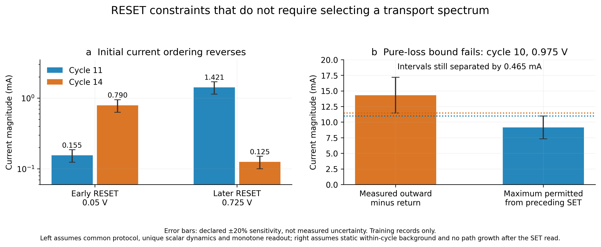
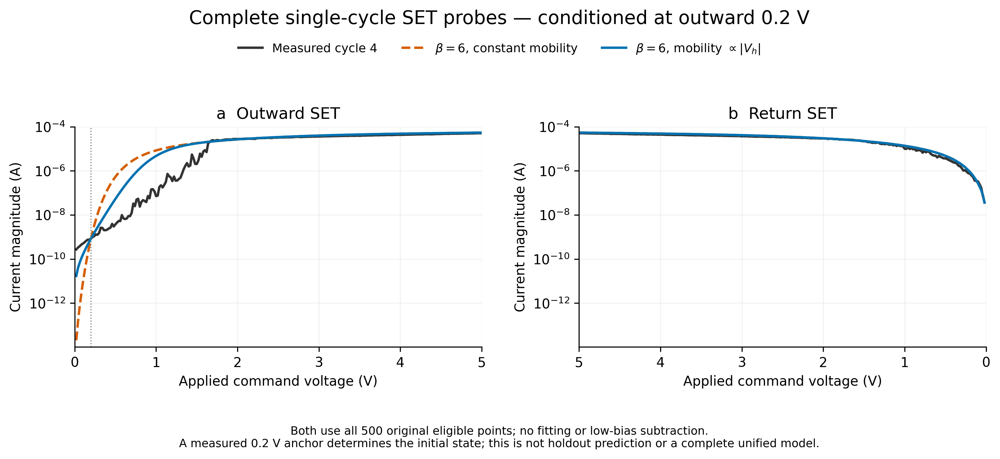

# RESET 结构约束与软通道反馈筛选

本阶段从上一轮的三参数失败继续推进。核心新证据是：**仅把各圈初始电导乘以共同衰减形状不够；在明确条件下，即使把损失率改成依赖电导本身，也无法产生实验中的电流排序反转。** 这不是某个优化器未找到好参数，而是对一组模型假设的可检验约束。准确统一 1R/1T1R 的目标仍未完成。

范围保持裸 1R 原训练圈 1–3、5–15；软通道检验只用既有训练锚及 1T1R 第 4 圈 SET。未读原保留集，未补造第 4、23 个裸器件循环，未改变评分门槛、桌面默认或推送。上一目标轮完成实际试验与独立审核，属于实质进展。

## 1. 同圈背景相消后，纯损失上界仍被超过

若 SET 返扫低压读到的电导 G_SET 至少包含一个被动近欧姆通道，其后该通道只能减弱，则 a_RESET≤a_read≤G_SET。若同一圈 RESET 的背景 B(v) 在外扫与返扫间不变，令 v=|V_h|、I 为电流幅值，有

\[
0\le I_{out}(v)-I_{ret}(v)
=v[a_{out}(v)-a_{ret}(v)]\le vG_{SET}.
\]

这里**不需要选择背景的能谱形状，也允许不同圈有不同背景**。它仍要求读态到 RESET 没有通道增长、通道读出为欧姆形式，以及比较的是相同实际材料电压。

最强训练见证来自第 10 圈、v≈0.975 V：

| 量 | 数值 |
|---|---:|
| RESET 外扫电流 | 14.312920 mA |
| 同电压返扫电流 | 3.025 nA |
| 前 SET 电导给出的 vG_SET | 9.154399 mA |
| 分支差与上界之比 | 1.563502 |
| 各相关读数采用 ±20% 比较带后，分支差的最小值 | 11.450333 mA |
| 同一比较带下，vG_SET 的最大值 | 10.985278 mA |

即使采用上述宽容带，仍超出约 **0.465054 mA**。这是预声明敏感性比较，不是已测仪器误差；nA 级返扫小量不会解释这个 mA 级差距。

原 1,399 个评分有效分支配对中，0%、5%、10%、20% 比较带下分别有 64、24、22、6 对违反上界；20% 下剩下第 10 圈的 6 对。这些点相互依赖，不能当成独立实验重复。分支差小于零的另一类违反全部在低信号区，未作为主要机制证据。

若坚持近欧姆通道只损失，就至少需要背景在两分支间改变，或重新检验 SET 读态到 RESET 的衔接/观测模型；也可能是通道读出不再欧姆。**本检验不能单独判定 RESET 一定发生了通道生长。**

## 2. 更一般的单状态反馈还遇到排序反转

为避免正负读态以及 SET 末端到 RESET 的间隔假设，另直接用同极性 RESET 外扫的 50 mV 读数排序，再看同一扫描后续电压：

| RESET 电压幅值 | 第 11 圈电流 | 第 14 圈电流 | 排序 |
|---|---:|---:|---|
| 0.050 V | 0.155152 mA | 0.790152 mA | 第 11 圈较小 |
| 0.725 V | 1.421159 mA | 0.125306 mA | 第 11 圈较大 |

四个读数均远离 pA/nA 低电流区。±20% 比较带下仍严格反序；至少约 ±67.17% 才能使其中一个端点的两圈区间接触。这个百分数不是测得的噪声水平。

若后续驱动协议相同，确定性标量连续状态方程具有唯一解，且不同电压的电流读出对状态保持同一个单调方向，初态排序就必须保留。因而只把 `a'=-λ(v)a` 换成 `a'=-λ(v,a)a`，甚至换成一般光滑的一维增减律，都不能产生这项排序反转。

这项结论不依赖固定能谱或跨极性读数；但协议差异、随机演化、额外状态、非单调读出或不保序的跳变都可能改变前提。现有数据还不能在它们之间作唯一判断，不能直接写成“已证明必须两个连续状态”。

图中的误差棒表示声明的 ±20% 敏感性窗，并非实验不确定度。展示的是在预定规则下选出的最强见证，全部训练点结果仍保留在机器可读文件中。

## 3. 共用衰减形状不成立，但分支乘积检验尚不可判

另分别采用零背景及上一轮冻结背景，检查归一化剩余通道 `(I−B)/(v a0)`。在全部 14 圈都达到 10 µA、背景比例不超过 1% 的 37 个外扫节点中，0.925 V 的跨圈跨度约 **215.5 倍**；即使 SET 与 RESET 读数各自采用同一相对比较带，逐节点区间接触也需要约 ±87.25%。这不是对整条轨迹的拟合，也没有把此窗口替换为原评分掩码。

对任意跨圈共同非负背景，还可以放宽得到必要界

\[
\max(0,\max_j[I_j(v)-vG_j])\le\min_jI_j(v).
\]

在 ±20% 比较带下，0.875、0.900、0.925 V 三个全部 14 圈均为高信号的节点仍违反该界。主结论不采用含 nA 小分母的夸大比值。

上一轮推导的 `Q_out(v)Q_ret(v)=常数` 则需要两支扣背景后都可分辨。本轮没有一对同时满足预声明的双支高信号窗口，故**没有可靠检验这个乘积恒等式**，不能将缺少可用点写成实验否定它。

## 4. 软背景应如何解释，还不能由逐点反演决定

固定谱下，从返扫电流反演 Γ_eff，只在全部电流由软支路承担时才是状态等式；如果并联通道非负，它只是 Γ 的上界。原训练 14 圈六个返扫节点的 Γ_eff 在高压到低压总体下降 4–331 倍，7 圈仍有局部增加。

旧背景过高本身不要求新增自由度：将旧 Γ 降低约 1.685 倍，就能先满足原 0.2 V 尾流上限。若不知道软背景至少占多少，足够小的静态 Γ 仍可满足这些点的非负路径约束；代价是其他通道必须承担更多电流。

若额外假设每个返扫点至少 50% 电流由软谱承担，则某条非增 Γ 轨迹在 13/14 圈可行，但最简共同场律 `d lnΓ/ds=−kΓ|V_h|` 的必要区间要求同时 kΓ≥15.4545 和 kΓ≤−1.76435 V⁻²，因而为空。这个结果约束“固定谱＋背景份额＋此场律”的组合，不能据此确定哪一项失效，也不能把逐圈反演 Γ 直接当作预测模型。

此处 kΓ 为 V⁻² 的候选衰减系数，与下一节无量纲 soft 反馈 β 不是同一个参数。

## 5. 软通道 SET 的有限必要筛查

保留共用谱与 Ron=58.4630 Ω，固定 gc=0.031270314 eV，检查

\[
\frac{du}{ds}=-k_S[\ln(I_T/J_S)+\beta u]_+.
\]

原额外 0.1/0.2 V 的 ±5% 局部带不再充当新的硬门槛，但其残差仍必须进入完整前向评分。用原 0.2→2 V 到达和 5→2 V 返扫锚，对 β=1、2、4、6 各取五个预声明 JS，共 20 项，不作自适应扩域。

| β | 条件速率区间未排除 / 5 |
|---:|---:|
| 1 | 0/5 |
| 2 | 0/5 |
| 4 | 3/5 |
| 6 | 4/5 |

分片上、下界的方向及同一个 JS 同时用于两段的实现已独立审核。未排除只表示取得前向检查资格，不是完整曲线通过；某些返扫界无穷仅表示这个必要下界没有约束力。

两个前向探针预先锁定为 β=4、JS 上界比例 0.95，以及 β=6、比例 0.8。前者取有限 k 区间的几何中点，后者取 k 下界的两倍，不拟合或继续调参。第 4 圈实测 0.2 V 只用于条件初态反推；随后从 0 V 完整正向传播并保留全部低压残差。

两点实际完整单圈检查已经完成：

| 候选 | 全 500 点 RMSE / decade | 外扫 250 点 | 返扫 250 点 | 外扫低压 10 点 | 其余 480 点 | 三个预算端点同时成立 |
|---|---:|---:|---:|---:|---:|---|
| β=4 | 0.774736 | 1.093162 | 0.073680 | 2.975207 | 0.663827 | 否 |
| β=6 | 0.698574 | 0.985926 | 0.062939 | 2.189857 | 0.638986 | 是 |

β=6 的外扫 2 V、返扫 5 V、返扫 2 V 电流分别为 26.477、54.013、29.796 µA，满足生成此候选所用的三个条件。**这比只有必要区间未排除更进一步，但完整外扫依然不准确。** 去掉单列的低压窗口后误差仍约 0.639 decade，因此不能将全部偏差归咎于最初两个低压点。

六项 SET 返扫参考特征中，β=6 的单圈预测只有三项落入原聚合参考带：4 V 电流及两个斜率仍偏离。此处没有计算原 32 圈连续历史的聚合特征，不能称原主合同通过了三项。

两精度的原生电流最大改变分别为 5.45×10⁻⁶、1.95×10⁻⁶ decade，状态轨迹也已对照，故上述曲线失配不是积分步长造成的。初次 0 个 ODE 的电路边界舍入误判、以及两次近零电压表域停止均保留。后者只在证明正部驱动为零后恢复同一精度，不外推域外电流、不夹状态；合计六次求解尝试仍只有两个物理参数点，累计计算 3.505 s。

## 6. 只增加一个局部场因子的候选

外扫偏差为下一项有限检查提供了依据：保留 β=6 的反馈与有效阈值，只将速率乘以实际材料电压幅值：

\[
\frac{du}{ds}=-\kappa |V_h|[\ln(I_T/J_S)+\beta u]_+.
\]

这可在低场降低演化速率，正场下不改变原停止面。它是受场驱动迁移启发的**有效动力学候选**，并非已经推导或测定的微观迁移率；u 不是已测纳米间隙，κ 仍是协议条件下的路径系数。这里不用外加总电压代替 V_h，也不额外拟合场指数。

只允许 β=6 原 JS、gc、Ron 及 κ 数值 0.8900744371 的一个点；新 κ 单位为 V⁻²，不能与旧 V⁻¹ 参数当成同一个已标定物理量。先重算带 V_h 的早期/返扫必要预算，未排除才做同一单圈的两精度前向。结果另列，不以机制动机代替准确性检验。

带局部场的必要下界为 κ≥0.234575881 V⁻²，返扫没有得到有限必要上界；指定点未被排除。已完成的加密轨迹给出以下同数据、同评分点的比较：

| 原第 4 圈 SET 指标 | β=6，常迁移率 | β=6，线性局部场因子 |
|---|---:|---:|
| 全 500 点 RMSE / decade | 0.698574 | 0.470735 |
| 外扫 250 点 | 0.985926 | 0.662697 |
| 返扫 250 点 | 0.062939 | 0.063375 |
| 外扫低压 10 点 | 2.189857 | 0.621857 |
| 其余 480 点 | 0.638986 | 0.471845 |

整圈 RMSE 降低约 32.6%，改善并不限于最低压十点；返扫误差略增。三个实际预算端点仍同时满足，但单圈 4 V 返扫电流及两项斜率仍在原参考带外。**这是一个有效动力学修改在条件单圈上的实际改进，尚不是完整统一模型的性能提升或机制证实。** 原始全曲线偏差仍明显，不能把接近的返扫单独作为模型成绩。

名义精度在反向初始化接近零电压时触及数值表的低压边界；该处原正部驱动上界仍为正，故不能声称导数精确为零。针对这一数值问题保留原失败后，只恢复相同参数点的名义精度：在 A<v_min=10⁻⁹ V、u≤80 时，用被动电流界 I≤A/Ron 得到整个微段遗漏状态积分不超过约 2×10⁻¹⁶。这个证书仅界定局部遗漏量，不直接声称全轨迹误差上界；不会给域外电流赋值，也不改变原生非零点评分。

恢复完成后，名义/加密两轨迹的原生电流最大对数差为 **2.96×10⁻⁷ decade**，全状态差为 **6.93×10⁻⁷**；已完成的加密轨迹逐位保持不变。三个求解尝试仍仅一个物理参数点，累计计算 1.242 s。数值证书触发 15 次是求解器内部评估次数，对应反向初始化的一个物理微段，不能把它们计成 15 次实验等待或扫描。

图中线性场因子改善了起始段，但约 0.2–1.7 V 的外扫电流仍升得过早。返扫较接近不能抵消这个失配；下一步应约束启动与加速的电压依赖，而不是只继续提高全局速率。

## 7. 当前决策与仍须完成的工作

保留线性局部场因子作为下一轮可继续检验的候选，但不替换完整模型。它修正了一部分 soft SET 动力学，不会自动解决裸 RESET 的排序反例、通道形成和已知段的连续历史。

下一项模型必须明确满足两个结构要求：一是各圈未来响应不能只由一个保序标量初态和共同驱动决定；二是近欧姆通道纯损失与静态背景的组合不能照搬。可比较额外保留状态、共同随机演化或有依据的读出/协议修正，但不能为每圈单独拟合阈值、速率或随机种子，也不能把不可辨识背景当作已测状态。

完整评估仍要求同一材料数学方程用于 1R/1T1R，外电路只改变实际边界和应力；裸 1–3、5–15 与 series 4–35 连续传播全部状态，保持原 27,023 项联合评分和 20 项主特征，之后才进入真正的留出预测。相同材料方程与相同数值参数是不同假设，不能因两个名义同结构器件的联合拟合困难就混淆两者。

本阶段推进了模型选择和一个 SET 条件轨迹的准确度；尚未达成较好的完整统一模型，目标继续保留。

## 复核入口

- [纯损失形状、背景消去与完整点位结果](reset_shape_2026-11-03/RESET_SHAPE_DIAGNOSTIC.md)
- [同极性标量排序检查](reset_shape_2026-11-03/RESET_SCALAR_ORDER_CHECK.md)
- [理论及独立复核](reset_shape_2026-11-03/SHAPE_THEORY_REVIEW.md)
- [软背景反演与区间预算](reset_shape_2026-11-03/soft_return_diagnostic.md)
- [20 项 soft 反馈预算](reset_shape_2026-11-03/soft_beta_relaxed_budget.md)
- [两个实际单圈前向及数值记录](reset_shape_2026-11-03/soft_beta_conditional_forward.md)
- [实际到达端点与误差审计](reset_shape_2026-11-03/soft_beta_conditional_forward_audit.md)
- [局部场候选的理论审核](reset_shape_2026-11-03/LOCAL_FIELD_MOBILITY_REVIEW.md)
- [局部场候选实际前向记录](reset_shape_2026-11-03/soft_field_mobility_probe.md)
- [局部场候选独立数值复核](reset_shape_2026-11-03/SOFT_FIELD_MOBILITY_REVIEW.md)
- [完整 SET 对照图 PDF](reset_shape_2026-11-03/soft_field_probe_comparison.pdf)
- [证据图 PDF](reset_shape_2026-11-03/reset_constraint_witnesses.pdf)
