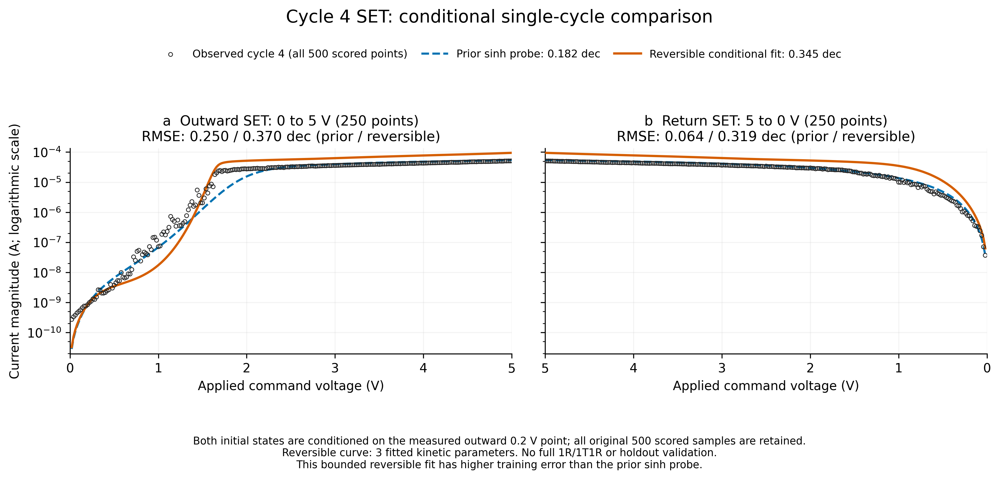

# 可逆三参数族的实际条件曲线校准

**本轮完成了真正的连续曲线拟合与数值复核，得到 0.345118 decade 的原 500 点误差；尚未优于已有的 0.182231，完整统一模型目标仍未完成。** 这次放开了“两个返扫动态读点都处于平衡”的校准假设，没有添加状态、材料读出、温度或每圈参数。优化达到预定 80 次目标函数评估上限，未收敛，结果不能称为全局最优或整个模型族的反证。

## 为什么继续检查同一方程

上一阶段已证明固定 λ/J 和初态下，无论 κ 如何选择，原 500 点 RMSE 都至少为 0.490896 decade。那个 λ/J 来自返扫 2/4 V 两点零净率校准；动态测量并不必然满足零净率。因此有必要做一次独立于该假设的有限参数校准，避免把一个种子的失败扩大为整个方程失败。

同一方程保持为

\[
q=e^{-u},\quad \Gamma=\Gamma_c/\operatorname{expm1}(u),\quad
u'=\kappa v\left[e^{\lambda v}-I\operatorname{expm1}(u)/J\right].
\]

λ≥0、κ>0、J>0；固定谱、Γc、Ron 和晶体管映射。v、I 是闭合电路给出的局部电压与净电流。q 仍是有效谱宽坐标，不能改称实测陷阱占据；动力学使用命令电压路径，不能识别每秒速率或小时级保持。

## 实际做了什么

首先只用已有的 26 个条件反演点，在两个分支各 12 个非零路径区间内构造插值积分。固定 λ∈[0,2] V⁻¹ 的 41 个点，对 κ 和 κ/J 做非负两系数回归，Gauss 8/16 求积共 82 个回归。该有限域只控制显式场倍率与计算范围，不是实验测得的参数置信界。

这一步仅提供初始化，不是 ODE 轨迹，也不是电流 RMSE。三个预先划分的 λ 区间分别得到一个正参数起点。随后三个起点均实际完成原生曲线积分，但误差分别为 3.88027、4.72819 和 5.58258 decade，不能直接使用。

取其中误差最低的一个进行唯一一次三参数 Nelder–Mead 校准。λ 保持 [0,2]，κ、J 各自在初始值的 1/100–100 倍范围内搜索，不裁参数、不新增起点。所有 80 次优化请求完整保留，其中 8 次超出已声明参数域而记为无限目标值，没有伪造成有限残差。

实际共完成 **77 次 kernel/ODE 轨迹**：3 个初始候选、72 个域内优化评估、2 个最终精度复核。没有数值失败；总计算约 26.252 s，未耗尽 180 s 搜索或 300 s 总时限。停止原因是预先规定的评估次数上限，不是已经证明优化收敛。

每条轨迹都从同一外扫 0.2 V 条件态向前到 5 V，再连续返扫至零；独立逆向积分 0.2→0 补齐低压外扫点。原 503 个原生记录及 500 个评分点全部保留，顶点不重置状态，也不把两个相邻峰值观测间虚构出等待时间。

## 最终结果与已有成绩

最终参数是 λ=0.104212995 V⁻¹、κ=5.254465517 V⁻²、J=0.141697115 mA。这些是同圈有效校准量，未识别物种、势垒、缺陷数或微观时间常数。

| 同圈条件结果 | 原 500 点 RMSE | 外扫 250 点 | 返扫 250 点 |
|---|---:|---:|---:|
| 已有单向 sinh 驱动 | 0.182231 | 0.249763 | 0.063518 |
| 本轮可逆三参数拟合 | 0.345118 | 0.369697 | 0.318650 |

新拟合确实优于上一固定种子 **0.490896 的必要误差下界**，说明那组参数的失败不能代表整个可逆族。但项目现有的最好同圈成绩仍是 0.182231；本轮不替换它，不宣称总体准确性提高。

## 主要误差在哪里

启动区域仍有明显形状偏差：外扫 (0.5,1.5] V 的 50 点 RMSE 为 0.645062 decade。1 µA 的首次跨越由实验的 1.32–1.34 V 推迟到 1.40–1.42 V，而 10 µA 跨越由实验的 1.62–1.64 V 提前到 1.56–1.58 V；两个跨越间的电压跨度过窄，反映拟合转变过陡。

这个 50 点窗口贡献约 34.94% 的总平方对数残差，返扫贡献约 42.62%。返扫全部 250 点均高估，预测/实测的几何平均比为 2.012916。

同时，高电流状态与返扫电流偏高：

| 原生位置 | 实验 / µA | 模型 / µA |
|---|---:|---:|
| 返扫 2 V | 29.778 | 52.6389 |
| 返扫 4 V | 44.400 | 77.7496 |
| 返扫 5 V | 50.970 | 94.5081 |

三个既有条件端点检查中，返扫 2 V 上界失败；两个下界虽通过，却不代表幅度已准确，因为它们没有限制过高电流。六项既有返扫参考中仅一项落在参考带内。它们仍是单圈参考比较，不能宣称重算了原 32 圈中位数主合同。

该候选为加快启动所得到的导电状态，在返扫阶段过强。这里是保存轨迹上的具体表现，尚不能据一个局部、未收敛的有限拟合证明所有参数都存在同样矛盾。也不能通过调权重、删低流点或改评分口径把它包装成成功。

## 数值可靠性与物理范围

两次最终积分的最大原生电流差为 2.44118×10⁻⁶ decade，最大 u 差为 5.71140×10⁻⁶；原生和 RHS 的 KCL 残差约 2.4×10⁻¹⁷ A。独立旧求根器在全部 503 个原生点的电流差约 1.06×10⁻¹² decade，顶点与锚连接误差为零。数值误差远小于当前曲线错配。

根任务及独立复核检查保存数据、评分、参数映射、失败/域外请求、两精度对照和来源哈希。比较图保留全部原 500 点，已目视检查，没有新增阈值或裁去低电流端。数值通过说明这条候选轨迹算得可靠，不意味着物理机制成立。

本轮依然只涉及 **series cycle 4、soft-only SET、固定读出和条件初态**。没有执行裸 1R、RESET、完整 46 对训练历史或未来保留集。裸器件真实顺序、缺失 4/23 圈、段间未知历史、原 20 项主特征合同均保持原要求。项目目标不能缩减为这一条曲线。

## 后续判断

本阶段按计划结束，不追加附近起点或扩展参数域。后续应利用这条实际轨迹分析“启动过陡、返扫过强”的来源，特别是瞬时停止面与速率尺度是否能够独立满足实验。前一轮局域交换审计的限制仍成立：不能把 q 直接当电子占据，不能从净电流自动推出慢缺陷捕获率。

若进一步提出局域电荷—结构联系，需要给出明确、可受证据约束的映射及可证伪预测；若继续同一族的参数研究，应先有新的约束或可达性依据，不能仅用增加优化次数替代机制判断。完整统一解释仍需同一材料方程贯穿 1R/1T1R 及 SET/RESET。

本轮产物：

- [实际运行与全部请求记录](reversible_family_2026-11-03/finite_family_fit.json)
- [最终加密轨迹指标](reversible_family_2026-11-03/final_refined.json)
- [初始化与理论审查](reversible_family_2026-11-03/FAMILY_THEORY_REVIEW.md)
- [独立结果复核](reversible_family_2026-11-03/RESULT_REVIEW.md)
- [可导出比较图 PDF](reversible_family_2026-11-03/conditional_set_comparison.pdf)

没有修改桌面默认模型或推送远端；目标保持 active、未完成。
