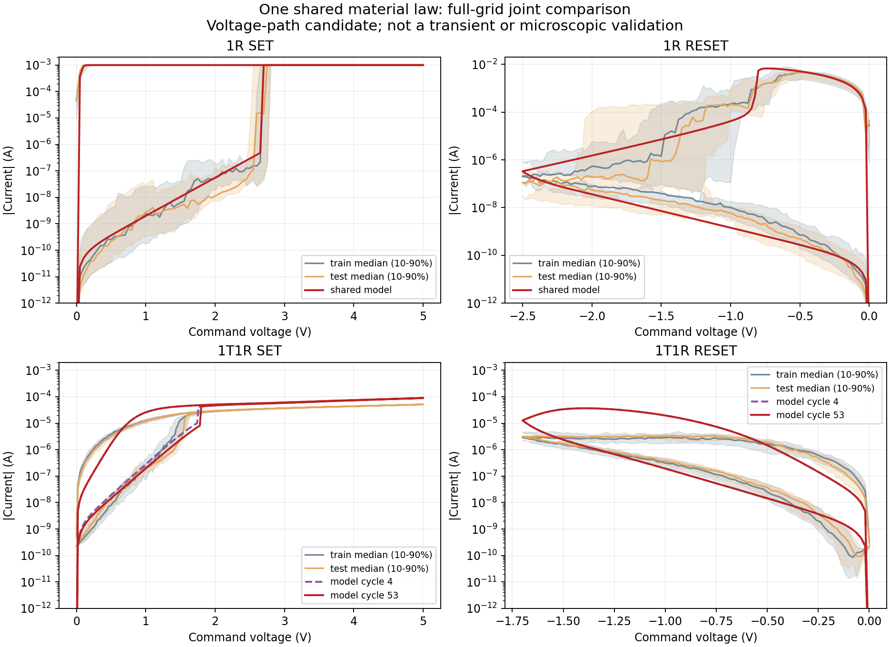

# 1R / 1T1R 同一材料模型：联合实现与实测检验

日期：2026-11-03。

**已经实现同一本构、同一状态演化和共享材料参数，并用两类原始数据联合标定。
定量解释尚未达标，主要缺口仍是 RESET。** 本文交付一个可运行、可反驳的共同
候选，不把代码统一或测试通过当作微观机制已经确定。

## 具体统一了什么

实现位于 [`shared_gap.py`](../vulcan2d/shared_gap.py)，用法见
[`README_shared_gap.md`](../vulcan2d/README_shared_gap.md)。两种接法都满足

\[
V_h=R_{on}I+V_0u\operatorname{asinh}(I e^u/I_0),
\]

其中 u 是有效、无量纲瓶颈坐标。u→0 时连续回到欧姆导通，u>0 时是非线性
瓶颈。两类器件使用相同的材料参数对象，栅压不进入材料定律。

状态的局部驱动为 `e=V0 asinh(|I|exp(u)/I0)`，正电流使 u 减小，负电流使
u 增大。RESET 中包含一个可归零的共同状态项 `e_init exp(-u)`，表示小 u
状态具有额外启动门槛。这是有效阈值假设，不能称为已测能垒或断键证据。

- 1R SET：1 mA 理想仪器限流，并反求实际器件压降；RESET 不截到 1 mA。
- 1T1R：相同材料串联已存档实测晶体管，VG=1.1 V；不另拟合晶体管。
- 正扫、返扫与 RESET 均连续演化，没有独立硬态开关、RESET 重置或经验交接比例。
- 两种未知制备历史各有一个初态，没有给每圈拟合独立初态。

自变量仍是累计指令电压变化 s（V），不是秒；当前不模拟电容放电、仪器响应
或等待松弛。u 不是已测纳米间隙，材料律也没有指认离子物种。

## 数据已经实际恢复与核对

四份工作簿从 Git HEAD `87b6a154374db96fdd37167a8ad9b516e0122229` 导出到
`shared_hbn_2026-11-03/data/`，未覆盖原来的云端占位文件。

- 裸 R：22 对同编号表，原编号缺 4、23，保留原编号。
- 1T1R：53 对；212 条电压/电流数组与此前缓存逐值一致。
- 裸 R 初始 RESET 低压线性电阻中位 95.35 Ω，约 96 Ω 有原始数据支持。
- 21/22 对裸 R 的 SET 返扫与 RESET 初态电阻近似相容；24 号差 2.72 倍，单列。

来源、哈希与电压/电流符号见
[`data_inventory.json`](shared_hbn_2026-11-03/data_inventory.json)。同编号只支持
条件配对计算，不能替代未记录的真实时序、等待时间和形成/重复 SET 身份。

训练使用 1T1R 第 4–35 圈，留出第 36–53 圈；裸 R 按原表顺序前 14 对训练、
后 8 对留出，后者不称为已确认的时间外推。前三圈 1T1R 没有重新加入评分。
所有数据曾参与项目历史开发，本次是内部检验，不是全新的外部盲测。

## 完整网格的最终误差

以下均为电流幅值 log10 RMSE，单位 decade。最终步长上限为 0.001 V，非零
电压点中，SET 只评分实测电流≥1e−11 A、RESET≥1e−12 A 的点。

| 接法与分支 | 训练全部记录 | 留出全部记录 | 留出中位曲线 |
| --- | ---: | ---: | ---: |
| 1R SET | 0.44245 | 0.54143 | 0.31209 |
| 1R RESET | 0.85672 | 0.96120 | 0.57534 |
| 1T1R SET | 0.32927 | 0.29676 | 0.28468 |
| 1T1R RESET | 0.63484 | 0.58763 | 0.55543 |

裸 R SET 约 72% 的记录点位于限流平台。单列**非限流区**后，训练/留出误差
分别为 **0.80367/0.90472 decade**；不能只引用含平台的较小总分。裸 R 的
初始 −0.025 V RESET 点存在异常，含/不含它，以及是否排除 24 号，均在 JSON
单列；主表没有静默删除这些记录。

图中的阴影是观测的 10–90% 区间，不是模型置信区间。中位曲线的分数与所有
记录合并的分数明确分开。当前没有随机变异模型，不能声称逐圈散布已被解释。

主要剩余误差：1T1R SET 高压电流偏高，低压返扫偏低；1T1R RESET 峰值偏高、
位置偏晚；裸 R RESET 的多阶段下降与尾部尚未复现。共同模型的约束真实地
暴露了这些失配，不能再用独立分支包络/重置状态把它们掩盖。

## 连续性与同初态对照

1T1R 只给第 4 圈一个初态，实际连续计算到第 53 圈，第 35→36 圈不重置。
模型从第 5 圈起接近固定回线：圈初 u≈4.82093、SET 后≈2.45423、RESET 后
≈4.82093。这也意味着当前确定性模型没有解释实验的逐圈变化。
独立积分从首圈末态继续第二对回线，Radau 的期末状态残差约 6.18e−9，
DOP853 约 −1.41e−7，也支持这个固定协议下的近周期态；不据此声称全局稳定。

再固定同一初态 u≈7.53686、相同 0→5→0 V 指令，只换外电路：

| 输出 | 裸 1R，1 mA 限流 | 1T1R，VG=1.1 V |
| --- | ---: | ---: |
| 最终 u | 0.0470604 | 2.45423 |
| 本征 +0.05 V 读电阻 | 133.50 Ω | 4.032 MΩ |
| 本征零偏置小信号电阻 | 7.362 kΩ | 4.209 MΩ |

这说明同一方程能产生不同导通区间，但它只是该候选的受控对照。尤其两种
读电阻并不相等；不能把 133.50 Ω 宣传成已经预测出完全欧姆的 96 Ω 硬态。
`Ron=93.48 Ω` 本来就是从训练低压分支约束的参数，不是独立预测结果。

## 优化与数值检查的边界

原无附加门槛候选、粗抽样试跑与扩展尝试全部保留。最初抽样漏掉裸 R SET
返扫唯一非限流正读点的问题已修正。最终联合标定保留共同输运与 SET 参数，
只针对 RESET 的共同基础阈值、速率和新增门槛作有限优化。

细积分复算的平衡训练成本由原候选 **0.45703** 降到 **0.38992**；最终两个
起点细积分成本为 0.39250 与 0.38992，选择次序没有因加密翻转。这是约 15%
的训练目标降低，**不是四支误差都改善，也不等于机制验证**。两个最终优化
均触及 160 次函数评估上限，没有取得优化收敛证明；更早的 xtol 停止也不能
当成全局最优。没有根据留出分数选参数。

针对性测试 **74 项通过**，其中共享 gap 内核有 14 项。独立验证给出：

- Radau 与 DOP853 的完整首对回线电流最大差约 **1.42e−7 decade**；
- RK4 最大步长 0.001 V 与独立积分的四支最大差约 **1.44e−5 decade**；
- 独立 Brent 电路求根最大电压差约 **1.77e−13 V**；
- 粗步长 0.02 和 0.005 V 都越过裸 R 理论停止状态，新增 RESET 门槛放大后
  最大偏差约 0.277 decade。因此最终表与图使用 0.001 V，不使用粗拟合输出。

这些是数值一致性检查，不是准确性或物理因果证据。独立积分器共用材料律，
电路另用独立求根核对；因此没有把相同公式互相重算当作新物理证据。

## 交付与复现

- [模型用法](../vulcan2d/README_shared_gap.md)
- [参数、优化记录](shared_hbn_2026-11-03/gap_joint_fit.json)
- [完整评分与 50 圈状态记录](shared_hbn_2026-11-03/gap_joint_evaluation.json)
- [独立数值验证](shared_hbn_2026-11-03/gap_independent_validation.json)
- [矢量对比图](shared_hbn_2026-11-03/gap_joint_comparison.pdf)

本轮完成了共同数学模型及联合实测检验；尚未完成令人满意的统一定量解释。
没有替换旧桌面默认模型，没有提交或推送。后续应围绕上述具体失配核查可辨识性
与文献支持的电路动态，不能把这版候选直接当作论文机制结论。
