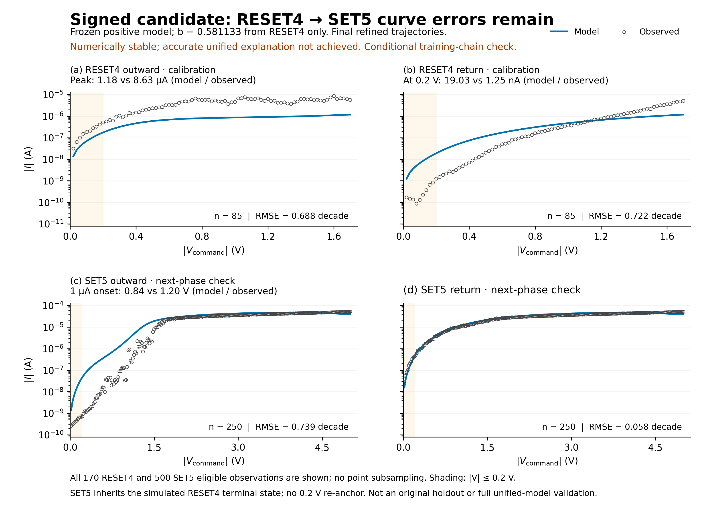
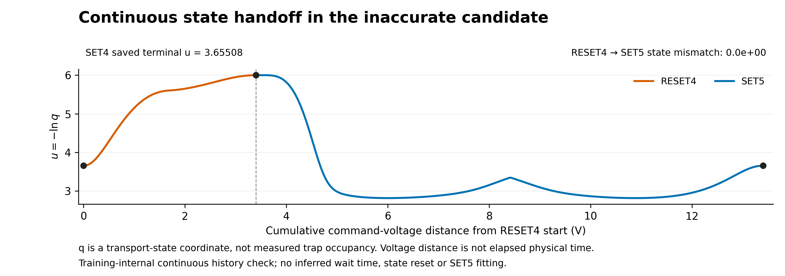

# 固定 m=2 的连续 SET→RESET→SET 检验

**本轮已将同一 soft 状态方程真正接入正负电压，并完成无状态重置的 SET4 末态→RESET4→SET5。计算可靠，但准确性不足：RESET4 的原170点误差为 0.705458 decade，下一圈 SET5 的原500点误差为 0.524327 decade。** 因此不能把上一轮单圈条件 SET 的0.133895成绩称为完整统一模型精度。

实际改进在于验证了状态连续传递，并定位了当前方程无法同时满足的曲线特征；没有得到更准确的完整1R/1T1R模型，也没有替换桌面默认模型或访问原保留集。旧阶段、其0.134条件成果及失败记录均保留。

## 同一方程怎样衔接两种极性

本轮固定正向已校准的 λ=0.447039875 V⁻¹、J+=4.108927208 mA、κ+=77.700138249 V⁻²，以及谱形状、Ron、Γc和m=2。只加入一个有效极性参数b，统一写成

\[
q'=\kappa_qv\left[\frac{i}{J_0}e^{\sigma b}(1-q)
-e^{-\sigma b+\lambda v}q^2\right],
\quad q=e^{-u},\quad \sigma=\operatorname{sgn}V_h.
\]

其中 v=|Vh|、i=|I|，使用实际电路求出的局部电压和电流。令κq=κ+exp(b)、J0=J+exp(2b)，正向方程严格保持不变；负向方程为

\[
u'_- =\kappa_+v\left[e^{2b+\lambda v-u}
-\frac{i}{J_+}e^{-2b}\operatorname{expm1}(u)\right].
\]

材料读出使用同一谱形状的真实正负支，负电压没有套用正向曲线；外电路使用相应实测晶体管支。扫回不改变局部场极性，重复顶点不改变状态，材料方程不读取数据文件名、圈号或观测电流来决定状态。

q仍是有效谱宽坐标，不是测得的陷阱占据率；b不是已确认的能垒。动力学自变量仍为累计命令电压路径，未知测试时钟和等待没有补成秒数。这是待检验的有效极性延拓，并非新的微观机制证明。

## 实际执行与参数选择

先完成12个正负静态电路点和24个RHS代数检查。新通用相位核仅做一次固定参数SET4回归：从旧0.2 V条件锚反向推得并保存的零压状态出发，不重设0.2 V锚。它与旧轨迹的最大电流差为4.44668×10⁻⁷ decade、最大u差为1.48083×10⁻⁶，复现了旧0.133895成绩。

随后RESET4固定从旧SET4的实际返零末态 `u=3.655082141628295` 开始。在预先声明的b∈[0,ln10]内，两个端点加一次一维有界优化共完成10个搜索调用；优化器8次调用后报告收敛，未用完20次上限。这是有限域搜索的停止结果，不是全局最优证明。

唯一选出的b为 **0.5811330029022057**，距最近边界约占域宽25.2%。选择只使用RESET4的170个原评分点，SET5从未参与该参数选择。

最终同一b分别以两套精度运行RESET4→SET5，每套SET5继承本套RESET4的真实末态。总计15个完整相位、30个积分段，无数值失败。实际数值计算约5.498 s；输入读取和结果落盘另计，不把云盘延迟当成求解失败。

## 真实连续历史给出的误差

| 相位及数据角色 | 原评分点数 | 全相位RMSE / decade | 外扫 | 返扫 |
|---|---:|---:|---:|---:|
| RESET4，本轮b校准 | 170 | **0.705458** | 0.688382 | 0.722130 |
| SET5，本轮未用于b选择的后续检查 | 500 | **0.524327** | 0.739213 | 0.058324 |

SET5属于原训练集4–35，只是这次b选择未使用的后续相位，不称原保留集或独立新实验。两个相位分别评分，未用170+500点合并均值掩盖相位差异。低压各20个评分点均保留。

RESET同时出现两个相反方向的偏差：

| 特征 | 实验 | 模型 | 偏差 |
|---|---:|---:|---|
| 原生外扫峰值 | 8.6317 µA | 1.183713 µA | 明显偏低 |
| 峰所在的命令幅值 | 1.60 V | 1.70 V | 预测峰落在扫描端点 |
| 返扫0.2 V读电流 | 1.2504 nA | 19.03213 nA | 明显偏高 |
| 外扫1.0–1.4 V几何平均电流 | 5.33667 µA | 0.922377 µA | 明显偏低 |

0.2 V尾部是原主特征定义；没有换成最后非零点或另选更有利电压。上述峰与尾处于不同电压，不能把它们的电流比直接称为同读压ON/OFF比。

下一圈SET启动明显提前：

| 外扫跨越 | 实验括区 / V | 模型括区 / V |
|---|---|---|
| 1 µA | 1.18–1.20 | 0.82–0.84 |
| 10 µA | 1.56–1.58 | 1.28–1.30 |

SET5返扫已比较接近，但外扫偏差仍大。仅报告其绝对倍数误差中位数1.1605会遗漏启动区的大错配，应同时保留0.524327的全500点RMSE和分支结果。

## 状态连续，但留下的状态不合适

保存的实际状态链为

\[
u_{\rm SET4,end}=3.655082141628295
\longrightarrow u_{\rm RESET4,end}=5.999383986199006
\longrightarrow u_{\rm SET5,end}=3.655082161884186.
\]

RESET4→SET5的状态接缝误差为零，没有重新设定初态。接续状态生成的SET5启动过早；在冻结正向方程、读出及路径协议下，当前RESET动力学没有留下能解释下一圈观测的状态。不能直接把旧SET4的条件初态当成“SET5实验要求的初态”，本轮没有反演SET5初态。

SET5结束时又回到几乎相同的模型末态，返扫也接近旧SET4返回形状；这是本次已算轨迹的行为，不能据两次末态接近就宣称已证明完整32周期的稳定性。

## 单个极性参数的结构性矛盾

在相同命令和状态下，电路电流与局部电压不直接依赖b，而

\[
\frac{\partial u'_-}{\partial b}
=2\kappa_+v\left[e^{2b+\lambda v-u}
+\frac{i}{J_+}e^{-2b}\operatorname{expm1}(u)\right]\ge0.
\]

对于同一入口和协议、连续且局部唯一并保持在有效数值域内的解，较大的b给出较大的RESET状态u，因而同一原生点的电流幅值不增；原生外扫峰和固定0.2 V尾电流也都不增。这个排序同样会传到使用相同正向方程的下一圈SET，但它不证明平均误差对b必然单峰。

以已经计算的b*=0.581133为分界：

- b≥b*时，原生外扫峰不可能高于当前1.183713 µA，仍达不到8.6317 µA。
- b≤b*时，返扫0.2 V尾电流不可能低于当前19.03213 nA，仍高于1.2504 nA。

因此当前固定正向参数、读出、入口和路径协议下，仅调这个b不能同时修复这两个特征。实验峰/当前峰为7.292054591，当前尾/实验尾为15.220836299；至少一项特征的倍数偏差受到二者较小值约7.29205倍的条件限制。**这是两个原生特征的条件折衷界，不是全170点RMSE下界，也不是原20项群体中位数合同。** 数值见[独立折衷审查](signed_soft_history_2026-11-04/SIGNED_POLARITY_TRADEOFF_REVIEW.md)；该近似数值经过两精度核验，未提供严格区间算术证书。不得把它推广为所有m=2动力学、所有统一模型或所有真实协议均不可能。

这个结论使继续密扫b失去针对性：降低b以抬高峰值会使尾部及下一圈初态更导电；提高b以降低尾流又会进一步压低峰值。后续需要检验能改变这一联系的物理假说或协议条件，而非增加同一参数的搜索次数。

## 数值可靠性与当前边界

两精度最大差为：RESET电流1.26420×10⁻⁷ decade、u为2.95995×10⁻⁷；SET5电流2.35583×10⁻⁶ decade、u为6.36024×10⁻⁶。原生和RHS KCL残差均小于约7.1×10⁻¹⁹ A。独立原生求根检查了每个精度的173个RESET点和503个SET点，电流差约10⁻¹³ decade；状态、重复顶点、符号、被动性及电压闭合均通过。

近零局部遗漏界保持原要求，两个相位的返零和离零分别计数，没有虚构停留时间；这些局部界不替代两精度核验，也不建立真实保持时间。22项实际运行来源哈希未变化。

数值检查说明当前曲线错配来自这个受限候选及其假设，不能用调积分精度解释。它不证明真实器件必须增加某个指定微观状态；未知扫描/等待协议、负向场依赖、状态耦合或输运假设仍可能改变结论。

## 下一步的约束

本轮停止这一个常数b延拓的校准，不扩大范围或新增起点。下一步先围绕已定位的三件事建立必要条件：RESET前段须保留足够导电、返扫尾部须充分降导、其末态还须生成正确的下一圈启动。优先用既有数据和固定输运读出检查所需的状态变化与场依赖，区分速率结构和未知协议的影响，再决定是否接入额外有效通道a。

若增加a，它会改变总电流、q动力学和原软支路条件锚，现有SET精度不能自动继承。仍须以同一材料方程与状态定义用于裸1R和1T1R，仅让外电路不同；不能回到两套独立包络各自拟合。

用户已确认裸器件编号对应实际测试顺序、同号先SET后RESET，缺失的4和23圈确实测过但未提供。因此已知连续段为1–3、5–22、24，不能直接把第3圈末态接到第5圈，也不能把第22圈末态接到第24圈；缺失历史不能伪装成零演化或逐圈自由初态。训练仍为1–3、5–15，已知段内不得逐圈重置；series训练仍为4–35。完整46对历史、原27023残差及20项聚合验证均未完成，本轮不访问原保留集、不改默认模型、不推送远端。完整项目目标保持active、未完成。

## 产物

- [唯一试验及全部参数请求](signed_soft_history_2026-11-04/bounded_signed_trial.json)
- [正负材料与连续相位核](signed_soft_history_2026-11-04/signed_forward_kernel.py)
- [数据与指标审计](signed_soft_history_2026-11-04/DATA_PROTOCOL_AUDIT.md)
- [理论和电路审查](signed_soft_history_2026-11-04/THEORY_AND_CIRCUIT_REVIEW.md)
- [实际结果独立审查](signed_soft_history_2026-11-04/SIGNED_ACTUAL_RESULT_REVIEW.md)
- [单极性参数峰尾冲突推导](signed_soft_history_2026-11-04/SIGNED_POLARITY_TRADEOFF_REVIEW.md)
- [曲线图 PDF](signed_soft_history_2026-11-04/figures/signed_reset4_set5_comparison.pdf)
- [连续状态图 PDF](signed_soft_history_2026-11-04/figures/continuous_state_handoff.pdf)
