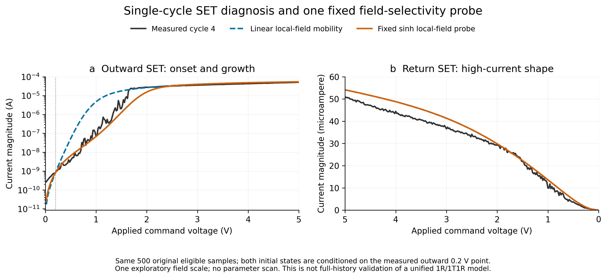

# SET 启动与停止结构：进一步改善，但尚未完成统一模型

本轮取得了实际进展：**在相同原始 500 点上，1T1R 第 4 圈条件 SET
误差由 0.470735 降至 0.182231 decade；同时明确了尚未解决的 2 V
到达不足与返扫停止问题。** 裸 1R 方面，已把 RESET 的纯损失矛盾
转成第二状态必须承担的电流及状态幅度预算。完整共同方程、真实历史
连续传播与原 20 项聚合特征目标仍未完成，研究目标保持 active。

本轮沿用确认的裸器件历史：同一器件按数字编号测试，同号先 SET 后 RESET；
第 4、23 圈实际测过但缺失，已知段为 1–3、5–22、24。这里没有跨缺失圈
衔接状态、逐圈复位，或补造扫描时间。当前新正向计算仅是一个条件单圈，
并不是新的全 46 对训练联合校准成绩。

## 1. 原来误差大在哪里

保存轨迹复算表明，线性局部场候选约 **87.19% 的平方 log 误差**来自
外扫 0.5–1.5 V。1 µA 的首次原生跨越发生在 0.76–0.78 V，实测在
1.32–1.34 V；10 µA 的跨越发生在 1.18–1.20 V，实测在 1.62–1.64 V。
这确定了主要问题是过早且过分分散的转变，不只是一个整体电流幅度偏差。

返扫误差占当时总平方误差不到 1%，却仍有原参考特征失败。状态在命令
4.96→4.94 V 间进入非正驱动区，此后 247/250 个非零返扫点完全冻结。
程序没有按扫向强制冻结；这是 `D=ln(I/JS)+βu` 的正部状态律产生的结果。

详见 [保存轨迹诊断](soft_drive_structure_2026-11-03/drive_trace_diagnostic.md)。

## 2. 一个固定场选择性探针的实际改进和代价

只把迁移率从 M(v)=v 改为

\[
M(v)=V_f\sinh(v/V_f),\qquad
\frac{du}{ds}=-\kappa M(|V_h|)[\ln(I/J_S)+6u]_+.
\]

V_f 固定 0.5 V，κ 按预定规则取同一到达预算下界的两倍，即
0.080618666 V⁻²；其余 JS、Γc、Ron 与观测条件锚均保持。
这新增了一个固定有效场尺度，属于看过残差后的探索性选择；它是场辅助
迁移率形式的有效试验，**不是测得的原子跳跃长度、激活能或微观机制证明**。
没有尺度/速率扫描、事后调整 κ，或逐圈自由参数。

| 相同 cycle4 条件评分 | 线性局部场 | 固定 sinh 场因子 |
|---|---:|---:|
| 全部 500 点 RMSE / decade | 0.470735 | **0.182231** |
| 外扫 250 点 | 0.662697 | **0.249763** |
| 返扫 250 点 | 0.063375 | 0.063518 |
| 外扫低压 10 点 | 0.621857 | 0.474615 |
| 其余 480 点 | 0.471845 | 0.172535 |

整圈条件 RMSE 下降 **61.3%**，但不能只报告这一个数：

- 转变现在略晚：1 µA 在 1.46–1.48 V，10 µA 在 1.86–1.88 V。
- 外扫 2 V 只有约 **15.476 µA**，实测 27.418 µA，且低于既有条件
  到达下界 26.106 µA；原来通过的三个预算端点现在只通过两个。
- 返扫 4 V 约 **48.796 µA**，仍高于原聚合参考区间 43.590–44.481 µA；
  0.1→0.2 V、2→4 V 斜率也仍出带。三个失败没有被总体 RMSE 抵消。
- 六个单圈特征中三个落入旧聚合参考带，不等于通过 32 圈的聚合验收。

图左保留全部非零低压范围，图右用线性电流轴展示返扫系统偏差。
两种计算都从同一圈外扫 0.2 V 观测反求初态，再正向积分整个 0→5→0 V；
该锚也保留在 500 点评分中。因此这是条件训练诊断，不是独立预测。

详见 [新探针完整结果](soft_drive_structure_2026-11-03/sinh_field_probe.md)。

## 3. 为什么接下来不能只继续增大迁移率

对无源电路定义 α=∂lnI/∂A>0、χ=−∂lnI/∂u>0，停止曲线满足
du*/dA=−α/(β−χ)。正迁移率只改变追赶这条曲线的快慢，不移动它。
更强的高场迁移率可以改善外扫，却让状态更早贴近停止面，返扫缺乏继续
演化的余量。改善启动和保留适量返扫演化必须联合检查。

本轮 29 个反演还防止了一项过度否定：精确外扫 2 V 与返扫 4 V 的状态
次序虽略冲突，但两点 minimax 电流偏差仅约 1.8%，不能据此拒绝近似模型。
既有外扫 2 V 下界与返扫 4 V 上界在状态上仍有交集。

不过该交集仅允许 u 从 3.057700 降到不低于 3.044495：out2→5→ret4
全过程只能再损失 **0.0132053**。下一次预算将把这项上界与早期到达下界
直接比较；这比继续随意调整速率更能判断当前停止律是否值得保留。
本轮已给出公式，尚未执行这个新预算或扩展参数扫描。

详见 [停止面推导与有限误差界](soft_drive_structure_2026-11-03/THEORY_DRIVE_STRUCTURE.md)。

## 4. 裸 1R：第二状态不能只是一个很小的修正项

在明确假设 `I=Fsoft(V,u)+aV`、a≥0 且从前 SET 读点以后只损失时，
第 10 圈 0.975 V 外扫需要

\[
B_{out}\ge \max(0,I_{out}-vG_{SET}),\quad B_{ret}\le I_{ret}.
\]

反演第二式只能得到 Γret 上界，不能把总返扫电流说成实测软支路电流。
在冻结谱和继承的 0.3% 数值包络下，有：

| 比较情景 | 外扫软电流必要下界 | Γout 必要下界 | 到返扫 0.2 V 的 Δu 必要下界 |
|---|---:|---:|---:|
| 原始名义电流 | 5.15852 mA | 0.969054 eV | 13.0073 |
| 各相关电流 ±20% 敏感性带 | 0.465058 mA | 0.091518 eV | 12.5628 |

±20% 是诊断敏感性条件，并非已测仪器噪声。在更宽容的第二行，必要 Γout
仍约为现有 series 线性场候选最大 Γ 的 **50 倍**。即使坚持欧姆支路只衰减，
软状态也必须在同一 RESET 中承担显著导电贡献再强烈减弱；仅让它轻微调节
另一路的断裂率、自己始终可忽略，并不能满足这一见证。

这没有证明上述分解正确，也不排除欧姆支路增长、其他读出结构、随机转变
或协议差异。它给下一套耦合方程的是**有条件的量级约束**。未知扫描时间
仍未换算成秒，Δu 大不等于已量得一个快/慢时间常数。

16 个反演都在原谱表域内；预先指定的 4 个端点以 32/64 阶直接谱复核，
表与直接积分差均在所用 0.3% 包络内。最初一个参考路径编码错误发生在
0 次反演时，已完整归档；仅修正路径后完成原预算，未增加物理候选。

详见 [状态幅度预算](soft_drive_structure_2026-11-03/soft_state_budget.md)
和 [额外记忆的要求](soft_drive_structure_2026-11-03/BARE_STATE_REQUIREMENTS.md)。

## 5. 核查与下一步

固定 sinh 探针两次精度计算均完成，共 1.153 s；原生电流最大精度差
4.00×10⁻⁷ decade，全状态最大差 9.62×10⁻⁷。电路独立求根、原生评分、
端点/特征失败、状态衔接和来源文件均已复核。近零有界忽略仅是单调微段
局部积分界，约 1.80×10⁻¹⁷，不能充当全程严格误差证明。

并行代理的最终审查被额度限制中断；主代理核对原进程已经终止后接手，
独立复算保存数组并检查源码，结果见
`soft_drive_structure_2026-11-03/STAGE_VALIDATION.json`。未重复积分已经
完成的探针。这里的 107 项核查只覆盖本阶段结果，不能冒充完整模型测试。

下一步保留两个并行约束：先检查新的 out2→ret4 速率预算，决定如何联合
修正外扫到达与返扫停止；裸 RESET 则要求显著、可保留且由真实历史生成的
额外状态，或者明确改选其他可检验的机制。之后才进入两接法共式、连续
训练历史和原指标下的联合评价。当前结果没有升级为生产默认，也没有访问
原保留集。完整准确统一解释的目标仍未达成。
