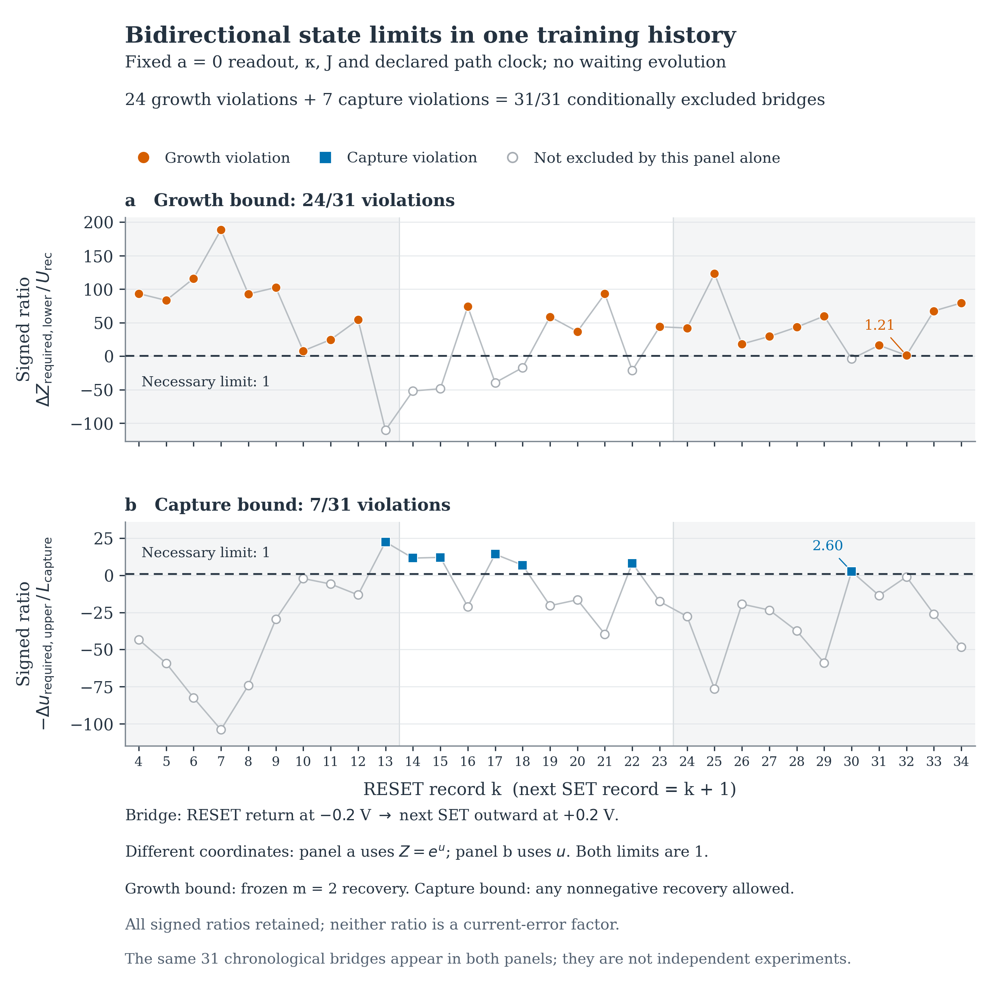

# 连续训练历史中的双向状态变化限制

**在当前固定参数、输运读出和无等待演化的路径协议下，31个训练内过零连接全部出现条件冲突：24个要求的恢复过快，另外7个要求的捕获过快。** 这说明从单圈SET校准得到的参数不能直接解释完整循环。相同方程在另一组共同参数下仍有待检验；本轮据此推导了下一次联合校准的必要参数范围。

没有新拟合或ODE，本轮没有得到更低的I–V误差，也没有替换默认模型。已有连续检验仍为RESET4 0.705458 decade、SET5 0.524327 decade；此前0.133895仅是条件单圈SET4成绩。

## 已检查的是哪段历史

只使用原series训练4–35中的31个连接：RESET k返扫−0.2 V到SET k+1外扫+0.2 V，k=4…34。各桥命令路径为−0.2→0→+0.2 V，累计0.4 V；全部原读点符合评分阈值，没有删点、换读压或访问原保留集。

最早4→5桥的两个反演结果直接复用；其余60个条件读点采用同一冻结输运与电路，新增120次电路回代。两种逆算、被动性、有限域和原生身份检查均通过。没有把任何反演值设成仿真初态。

31桥来自同一器件的同一训练历史，不作为31个独立样本计算显著性或置信区间。完整1R/1T1R的46对、27023残差和20项聚合验证仍未执行；裸器件缺失4、23圈保持为未知历史边界。

## 恢复不足出现在整个训练段

沿用上一轮的Z=exp(u)=1/q状态坐标与宽松上限ΔZ≤171.633866，取反演区间最有利的状态增量作比较：

| RESET编号范围 | 预定连接 | 恢复必要界违反 | 此界未排除 |
|---|---:|---:|---:|
| 4–13 | 10 | 9 | 1 |
| 14–23 | 10 | 5 | 5 |
| 24–34 | 11 | 10 | 1 |
| 合计 | 31 | 24 | 7 |

违反者的状态预算比为1.21345–188.53022，最强见证是7→8，所需ΔZ下界32358.170984。它们不是电流误差倍数，也不给出完整曲线RMSE下界。剩余7桥的ΔZ均为负，增加Z的这条界自然不能排除它们，不能据此说模型已解释它们。

## 相反方向同样存在限制

当前捕获项为电流驱动。固定a=0读出，有Γ(exp(u)−1)=Γc。对于任意非负恢复函数、负向b≥0，可得

\[
u'_-\ge-\frac{\kappa\Gamma_c}{J}C_-v,
\qquad u'_+\ge-\frac{\kappa\Gamma_c}{J}C_+v,
\]

其中C±是完整原Γ表域、0<v≤0.2 V下的|Isoft|/Γ上界。对冻结的双线性对数输运表，逐格最大值位于角点；纳入0.2 V切片及Ron缩放后得到

\[
C_+=0.001302745187,\quad C_-=0.001224954172\quad\mathrm{A/eV}.
\]

利用v≤|Vcmd|积分，并加数值裕量，得

\[
\Delta u\ge-0.029893851.
\]

原来那7桥即便取最有利反演区间，仍要求u下降0.077662–0.674076，超过允许量2.598–22.549倍。七个见证为13→14、14→15、15→16、17→18、18→19、22→23、30→31。

因此，**原m=2模型在当前参数下的违例并集为31/31**。捕获界还说明：固定捕获强度、读出和协议时，仅把恢复改成其他非负函数，仍无法同时精确匹配那7桥。改变恢复函数后，原24个恢复违例是否保留必须重新分析，不能继续机械地称“所有新模型也有31个违例”。

这些是固定表域与其近零冻结规则下的条件结论。表内命令若要求表外局部电压仍属不可接受/未定，不能外推。未知真实等待、额外驱动或时间演化不包含在本次协议中。

## 为什么暂不直接增加一个线性恢复项

本轮还用保存端点筛了两种最小修正。仅替换恢复项、保持κ/λ及场前因子不变时，q^m要求

\[
\int_{Z_-}^{Z_+}Z^{m-2}\,dZ\le U;
\]

q²+εq要求

\[
\frac1\epsilon\ln\frac{1+\epsilon Z_+}{1+\epsilon Z_-}\le U.
\]

31桥共用参数的必要边界分别为m≤1.443121658、ε≥0.017918602，最强均来自7→8。它们是条件边界，不是拟合参数、微观反应阶数或可达性证明。七个捕获违例进一步表明，单独修改非负恢复仍不足以通过全部端点检验。

## 更合适的下一步：共同参数的连续联合校准

本轮没有排除相同方程的全部共同参数。固定读出、λ、b范围和路径时钟时，恢复上界随κ线性缩放，捕获上界随κ/J线性缩放。因此，若要求同时精确匹配这31桥的给定端点，至少需要

\[
\kappa_{new}\ge188.53022\,\kappa_{old}
\simeq14648.82435\ \mathrm{V^{-2}},
\]

\[
(\kappa/J)_{new}\ge22.54898\,(\kappa/J)_{old}
\simeq426403.08390\ \mathrm{A^{-1}V^{-2}}.
\]

这不要求J单独下降；例如仅在κ取上述最低值时，第二条给出J≤0.0343544 A。数值由[保存界的代数换算](zero_crossing_population_2026-11-04/JOINT_PARAMETER_REGION.json)得到，没有选择新参数或运行新曲线。系数使用路径单位，不是已测得的每秒速率。

下一轮优先在这些约束提示的区域，对同一q²材料方程做有限的SET4→RESET4→SET5连续联合校准，同时保留旧参数对照，检验共同参数能否兼顾三相位。两条界是精确端点匹配的必要条件，不能替换原拟合残差或聚合门槛；有限误差拟合可以存在取舍。

须预先声明整段唯一初态或一致的准备历史。旧SET4零压状态由旧参数下的0.2 V条件锚反推，不是直接测量；固定旧初态的失败不能排除更广参数族。禁止逐相位、逐周期或逐读点重锚。放开λ、b范围、读出或恢复结构后，上述数值必要边界也需更新。

统一1R/1T1R目标仍要求同一材料读出、同一状态方程和同一反馈定义。裸1R还存在mA级外返扫差和跨圈反序约束，soft-only改进不能代替这些要求；若引入额外保留状态a，也不能按接法开启或逐圈赋值，且现有SET精度不自动保留。

## 可复核性

本轮60个新条件反演与结构界筛选用时0.030004 s；捕获表界用时0.006789 s。两项均按有限计划执行一次。保存结果的独立审查分别核对15项和4项实际来源；没有重跑反演、ODE或历史拟合。

结构界二分的部分相邻浮点“通过端”在高精度代入下有约10⁻¹⁴量级差异；实际报告的保守必要界端点仍保持正确方向，审计已披露。浮点裕量不构成严格区间算术证书，也不是实验噪声带。

- [训练数据与路径审计](zero_crossing_population_2026-11-04/audit.md)
- [31桥结果与结构界独立审查](zero_crossing_population_2026-11-04/ACTUAL_RESULT_REVIEW.md)
- [捕获表界独立审查](zero_crossing_population_2026-11-04/CAPTURE_BOUND_REVIEW.md)
- [双向图 PDF](zero_crossing_population_2026-11-04/figures/fig_bidirectional_state_limits.pdf)

完整目标保持active、未完成；未访问原保留集、未修改桌面默认模型、未推送远端。
