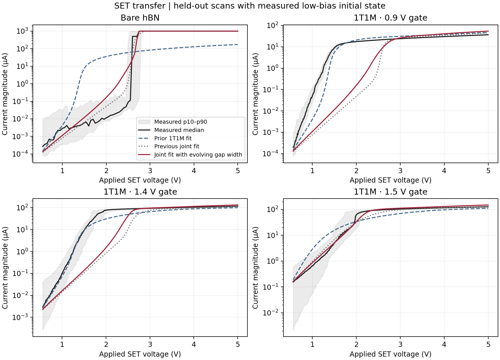

# 11 月 24–25 日模型实验记录

[模型探索总目录](README.md) · [全部原图](figures.md) · [评分原件](evidence/)

这一阶段从交接快照的 soft/hard 模型继续，目标是把同一套 hBN 规律用到不同栅压的 1T1M 和裸 1M。先查 RESET 的入口和尾段，再用新增 IV41 数据查 SET 的开通，最后联合拟合裸器件与串联器件。每项记录写明改动、物理假设、对照和留下的偏差。

## 数据与评分

- **历史三档 1T1M**。跨栅压实验多用 0.9 V 前 70 圈和 1.1 V 第 4–35 圈训练，留出其余及整档 1.3 V。最初冻结迁移只用 1.1 V 第 4–35 圈标定，单列。
- **新增 IV41**。《不同栅压_原始曲线数据.xlsx》覆盖 0.9–1.5 V，每档约百条。SET、RESET 分开评分。工作簿行序用于切分，实际测试时序及跨相位编号对应未确认。后续 SET 拟合使用 0.9–1.3 V 每档前 70%，余下行以及整档 1.4/1.5 V 留出。高栅压数据参与过改模诊断，作为未参加系数拟合的留出结果汇报。 [工作簿校验值](evidence/origin_sha256.txt)
- **裸 1M**。用 `1R数据.xlsx` 和 `裸RRESET.xlsx`。22 个观测循环来自同一器件，4 和 23 缺记录。联合 SET 用前 14 条训练、后 8 条评估。裸器件的 SET 有 1 mA 仪器限流。裸转接基准每对从空初态开跑，RESET 接用预测 SET 终态，跨圈历史属于更早的专题实验。
- **输入的区别**。冻结迁移及若干 RESET 联动版本只用波形和统一初态。后续 SET 诊断需要每条曲线的低压实读，部分还用低压斜率。RESET 入口或终点替换、SET 回程分组均明确标作诊断条件。以实测终点分组后比较曲线，有助于定位误差；自主预测需要模型自己推算终态。
- **误差口径**。下文 RMSE 默认为 `log10(|I预测|/|I实测|)` 的均方根，单位 decade。表中写明使用去程、回程、整相位或指定电压窗。限流点按各实验自己的掩码处理，达到 1 mA 的电压单独评分。场激活速率按扫压路径积分，绝对时间和扫速仍缺记录。

## 冻结迁移与 soft 电导

soft 是模型中描述渐进导通的状态量。早期写入把它限制在固定的低、高电流包络之间。hard 是另一个高导通状态；两者是拟合中的状态定义，物理载体仍以候选解释记录。

| 尝试 | 改动与物理含义 | 量化结果和曲线判断 | 证据 |
|---|---|---|---|
| 冻结 1.1 V 参数 | hBN 参数只在 1.1 V 第 4–35 圈标定，往 0.9/1.3 V 迁移只换晶体管。SET 的终态接给 RESET | 筛后 SET/RESET 为 0.9 V **0.589/2.299**、1.1 V **0.165/0.243**、1.3 V **0.471/1.083**。三档 SET 末态 soft 都接近 1，hard 都为 0。负载差异没有留下明显的状态差异 | [评分](evidence/frozen_gate_transfer.json) |
| 检查状态压缩 | 尝试用电流尺度延缓 soft 的饱和。随后从实测 RESET 入口反推需要的 soft，检验固定包络能覆盖多少 | 训练选出的电流尺度为 0 µA，即该扫描里的原限制。入口固定包络覆盖 **0.0036–2.693 µS**。1.3 V 的 100 条里有 **66 条**需要 soft>1。将实测反推状态截在 [0,1] 再算，随后 RESET 仅 **1.039→1.002** | [范围和干预](evidence/gate_state_compression_audit.json) · [脚本](evidence/gate_state_compression_audit.py) |
| 连续对数电导与插值 | 用局部 0.15 V 的低压电导定义连续状态，在对数电导轴上插值归一化 RESET 曲线。边界沿用端点形状。用实测低压回程点启动局部诊断 | 1.3 V 回程的条件误差从共用形状 **0.425** 降到 **0.330**。已覆盖锚点范围内，两者为 **0.409/0.408**，收益主要依赖所处电导段 | [锚点、模板与局部评分](evidence/log_soft_audit.json) |
| 从 SET 的峰值、曲线面积或功率积分推入口 | 尝试把整段 SET 压成一个输入量，经验映射到 RESET 入口电导。其中电流、功率都是沿电压路径积分 | 1.3 V 实测入口中位数约 **4.15 µS**，峰值／电流积分／功率积分预测 **73.91／24.32／28.13 µS**，入口 RMSE **1.531／1.270／1.297**。整段 RESET 原版 **1.083**，三候选 **1.349／1.494／1.479**。经验压缩作为对照保留 | [完整对照](evidence/log_soft_cycle.json) |
| 补充高电导入口锚点 | 从训练 RESET 前段补采高电导模板，将表示范围延伸，再比较保持或重拟合擦除规则 | 对完全留出的 1.3 V，新范围覆盖 **101/101 个预测入口状态**。以实测入口启动的早段 **0.168→0.176**。加入锚点并重拟合后整段 **1.204**，相同测试的旧 compact 模型 **1.083** | [锚点扩展与两种留出协议](evidence/entry_anchor_validation.json) |
| 代入实测入口定位残差 | 固定扩展模板，用实测入口替换预测入口，在同一批后续点上检查 | 1.3 V、外加电压幅值 ≥0.3 V，预测入口／实测入口的去程分别 **1.029/1.581**，回程 **1.253/1.816**。入口替换以后偏差仍在，且这组替换使完整支路变差 | [残差分段](evidence/entry_anchor_residual_diagnostic.json) |
| 逐步写入取代 SET 面积映射 | 从共同初态出发，每个扫压步由 hBN 局部场推进对数电导，让 SET 直接产出 RESET 入口 | 1.3 V 入口中位数到 **3.08 µS**，实测约 **4.15 µS**，入口 RMSE **1.220**。原／逐步写入 SET **0.471/0.487**，接续 RESET **1.083/1.405**。入口电导更近，后续 RESET 形状仍有偏差 | [三档评分与边界扫描](evidence/field_log_soft_validation.json) |

## RESET 读出与擦除动力学

用“读出”描述给定状态下电压如何变成电流，用“擦除”描述状态随着反向扫描如何变化。以下实验分别改这两项，或用实测入口、终点定位问题。

| 尝试 | 改动与物理含义 | 量化结果和曲线判断 | 证据 |
|---|---|---|---|
| 局部场激活擦除 | 冻结 SET 和读出曲线，用随局部反向电压增长的损失率推进导电状态 | 0.9/1.1/1.3 V 整段 RESET **1.428/1.113/1.405 → 1.539/0.783/1.180**。1.3 V 去程好转，回程改动小；0.9 V 两程都更差 | [评分](evidence/activated_reset.json) · [对比图](evidence/activated_reset.png) |
| 固定状态的读出诊断 | 固定已知低压状态，在与读数分开的电压窗比较模板插值和场辅助读出 | 1.3 V 去程早段（局部 0.20–0.35 V）**0.176→0.156**，回程（0.20–0.60 V）**0.333→0.302**。是给定状态后的局部读出收益 | [同点评分](evidence/reset_fixed_state_readout_check.json) |
| 平台电流与场辅助读出 | SET 入口固定，RESET 读出增加随场增长的电流，并重拟合擦除。平台区用实测入口和终点检查电流包络 | 1.3 V 平台有 **2616/5375 点**高于原可达上界。整段 **1.180→1.115**、去程 **1.135→1.038**、回程 **1.224→1.186**。只换读出、沿用原擦除时整段是 **1.215** | [误差与包络检查](evidence/reset_platform_readout.json) · [图](evidence/reset_platform_readout.png) |
| 延迟擦除 | 令导电状态主要在局部反压超过起始场之后衰减，尝试保住去程平台 | 1.1 V 平台 **0.284→0.172**，回程 **0.353→0.487**；1.3 V 整段 **1.115→1.204**。平台更贴时，低压回程往往偏高 | [评分](evidence/delayed_reset.json) · [图](evidence/delayed_reset.png) |
| 联合约束低压终点 | 在延迟擦除的训练目标里加入终点电导，检查平台与尾段能否兼顾 | 1.3 V 回程 **1.186→1.177**，整段 **1.115→1.127**；1.1 V 平台 **0.284→0.110**，回程却到 **0.781** | [评分](evidence/endpoint_constrained_reset.json) · [图](evidence/endpoint_constrained_reset.png) |
| 代入实测终点 | 用回到零压前的低压实读固定收尾状态，单独检验剩下的回程形状 | 1.3 V 回程 ≥0.3 V，原版 **1.088**、延迟擦除 **1.202**、代实测终点 **0.564**。尾段状态解释了其中一部分误差 | [终点替换评分](evidence/reset_return_endpoint_diagnostic.json) |
| 去回程用同一规律 | 延续同一电流式，沿累计扫压路径在去、回程都推进状态。做固定参数切换，以及同目标重拟合两个版本 | 1.3 V 同目标拟合，冻结／连续版整段 **1.063/1.187**，回程 **1.088/1.255**；1.1 V 整段相反，为 **0.566/0.409**。统一的形式成立，单速率在三档上的准确度不同 | [评分](evidence/continuous_reset.json) · [去、回程和状态轨迹](evidence/continuous_reset.png) |
| 顶点与终点分开看 | 从峰值前 30 mV 内的可用去程点估计顶点状态，再与低压回程状态比较 | 1.3 V 匹配 99 圈，单圈顶点/终点比中位数 **2.89**。连续模型给 **0.140→0.00635 µS**。顶点状态由假设的读出公式反推 | [分布与匹配圈数](evidence/continuous_reset_apex_diagnostic.json) |
| SET+RESET 留出合看 | 汇总逐步 SET 和连续 RESET，控制项分别为原 SET 和用相同 SET 终态的冻结回程 RESET | 相同筛选点共 **171389** 个，控制／候选逐点 RMSE **0.675/0.739**。SET **0.502/0.511**，RESET **1.044/1.197**。图中 RESET 去回程仍是主要误差来源 | [按档与合计](evidence/overall_heldout_iv.json) · [完整 I–V](evidence/overall_heldout_iv.png) |

## 新增栅压与高导通态

高导通组按同一条 SET 的末段在端口 0.15 V 读数是否超过 30 µS 划分，目的是比较曲线。hard 是模型用于描述高导通行为的候选状态。

| 尝试 | 改动与物理含义 | 量化结果和曲线判断 | 证据 |
|---|---|---|---|
| SET 去程先换背景电流 | 对比原背景、根号场增强和 `sinh` 跳跃输运，保持独立晶体管查表，再接固定 RESET | 1.3 V SET 开通窗口 **0.764**（原）、**0.928**（根号场）、**0.670**（`sinh`）；整段 **0.487/0.695/0.460**。根号场版加密敏感；`sinh` 改善开通段但接续 RESET 到 **1.251** | [同点评分](evidence/set_outward_refinement.json) · [图](evidence/set_outward_refinement.png) |
| IV41 冻结检验 | 直接把既有 SET 与连续 RESET 参数用到新增四档数据，晶体管按栅压读表，SET/RESET 分开评分 | 1.4 V SET/RESET **0.382/1.618**，1.5 V **0.543/0.852**。相同 hBN 参数下，两档的主要偏差处不同 | [评分](evidence/iv41_frozen_scores.json) · [四档 I–V](evidence/iv41_frozen_iv.png) |
| 检验高导通组是否源于分压 | 同时看端口电导和扣除晶体管后的电导。用不同读压比较是否近似欧姆 | 1.3/1.4/1.5 V 的高组分别 **39/71/32 条（各 101 条）**。高组在低压区的电导随电压变化较小，端口读数里也看得到分组 | [两种电压口径的分布](evidence/iv41_high_conductance.json) · [图](evidence/iv41_high_conductance.png) |
| 用场激活概率取代硬阈值 | hard 形成改为沿扫压累计的首次开通概率。形成后用约 **92.36 µS** 的共用欧姆电导作对照 | 1.4/1.5 V 实测高态比例 **70.3%/31.7%**，预测 **48.3%/67.2%**。高态电流可近似表示，形成比例的栅压排序算反 | [概率、分类阈值敏感性](evidence/hard_formation_validation.json) · [概率和读出图](evidence/hard_formation_validation.png) |
| 早期导电状态影响形成概率 | 将去程局部 0.5 V 的初始电导加入概率模型。物理假设是初始导通程度会影响后续通路形成 | 1.4/1.5 V 预测比例由 **48.3%/67.2%** 调为 **67.1%/51.0%**。排序修正，1.5 V 的高态比例仍偏高 | [初态筛选结果](evidence/hard_initial_state_screen.json) |
| 初态先进入串联分压 | 按实测早期电流重算各条局部场，再比较初态只改变分压、以及同时改变形成率 | 1.5 V 的排序判别 AUC 约 **0.996**（只改分压），但预测比例只有 **10.2%**，实测 **31.7%**。1.4 V 则预测 **17.7%**，实测 **70.3%**。样本区分能力和总体概率需分别看 | [比例、AUC 和 Brier 分数](evidence/hard_initial_state_loadline.json) · [图](evidence/hard_initial_state_loadline.png) |

## SET 输运与写入分开检查

以下版本用每条曲线的低压输入定起点。1.5 V、写后低电导组在外加 1.4 V处的实测电流中位数为 **3.50 µA**，记录中多次用同一个点比较。写后标签只用于分组。

| 尝试 | 改动与物理含义 | 量化结果和曲线判断 | 证据 |
|---|---|---|---|
| 背景跳跃＋逐步连接通路 | 固定跳跃斜率，按局部场逐步加近欧姆连接；对比独立连接与已有连接促进增长 | 选中独立连接。0.9/1.4/1.5 V 开通窗比原版 **0.414/0.556/0.688 → 0.356/0.470/0.800**。前两档改善，1.5 V 错得更大 | [评分](evidence/compact_set_physics.json) · [图](evidence/compact_set_physics.png) |
| 关掉增长查背景 | 保留低压起点，只关闭新通路增长，按写后高、低组对照 | 1.5 V 低组该点预测 **44.95 µA**，关增长仍有 **44.87 µA**。这一组偏差主要在背景电流的高压外推 | [分组和反事实](evidence/compact_set_high_gate_groups.json) · [图](evidence/compact_set_high_gate_groups.png) |
| 允许上一圈留下欧姆连接 | 用低压前缀估计初始电流中近欧姆部分，以区分保留连接和跳跃背景 | 低组该点 **44.95→37.23 µA**，1.5 V 开通窗 **0.800→0.737**。缓解偏高，规模仍大 | [保留比例与评分](evidence/set_retained_links.json) · [图](evidence/set_retained_links.png) |
| 对比实测涨幅 | 扣除晶体管分压，计算同一扫描 `I(1.0 V)/I(0.5 V)`，对照共用斜率 | 0.9 V 低组中位约 **98**，1.5 V 低组约 **4.9**、高组约 **27**，共用跳跃项约 **47**。去程高压点可能已有状态变化，该比值混合输运与写入响应 | [各电压与各组分位数](evidence/set_pretransition_shape_check.json) |
| 将电流起点与涨幅拆开 | 每条扫描从 hBN 局部 0.30–0.49 V 估计自身斜率，用 0.5 V 定幅度，状态增长参数仍共享 | 低组该点降到 **11.01 µA**；1.5 V 开通窗 **0.800→0.519**，0.9/1.4 V 开通窗则变差。低压估计的涨幅还不能覆盖后续开通过程 | [相同测试点对照](evidence/set_independent_slope.json) · [图](evidence/set_independent_slope.png) |
| 跳跃电流有限速率 | 在跳跃背景中加入共用有限速率，新增连接仍可并联导电 | 低组该点进一步降到 **6.92 µA**。开通窗在 0.9/1.4/1.5 V **0.404/0.576/0.519 → 0.198/0.431/0.413**。部分高偏压平台变低 | [限制强度与分窗评分](evidence/set_current_bottleneck.json) · [图](evidence/set_current_bottleneck.png) |
| 单间隙＋固定串联电阻 | 用同一条间隙传输路径取代两支路，写入扩大间隙电流幅度，内部串联电阻约 **23 kΩ** | 相对有限速率，0.9 V 开通窗 **0.198→0.807**；高偏压电流有所改善。1.5 V 低组该点回到 **14.27 µA**，停掉增长仍有 **13.16 µA** | [拟合与反事实](evidence/single_gap_series_set.json) · [图](evidence/single_gap_series_set.png) |
| 低压读数外推高压 | 在 SET 上做静态检查。用 hBN 0.30–0.50 V 作输入，0.58–1.20 V 评分。回程作为状态相对稳定的参照 | 1.5 V 低组去程，共用形状／有限速率 **0.838/0.153**，0.9 V 同组却 **1.001/1.434**。1.5 V 回程全组的传输锚点把固定电阻上限压到约 **5.64 kΩ**；8 kΩ 对高组有 9 条锚点不可表示 | [去回程各窗、失效数](evidence/set_fixed_state_readout_audit.json) · [归一化曲线](evidence/set_fixed_state_readout_audit.png) |

同一静态检查还做了分压反算。在 1.5 V 低组，固定低压实测起点，只靠改晶体管压降让原共用形状通过后段数据，中位需要**额外约 0.217 V**，现有查表中位压降约 **0.00374 V**。在 0.9 V 低组，28 条被纳入的曲线均有点超过有限速率公式的静态电流上限。两个结果只涉及筛除限流后的对应 SET 去程，反推使用了实测电流，并依赖独立晶体管查表。 [静态检查脚本与筛选](../../../VULCAN-2D-handoff-2026-11-24/analysis/audit_set_fixed_state_readout.py)

## 裸 1M 与 1T1M 共同拟合

| 尝试 | 改动与物理含义 | 量化结果和曲线判断 | 证据 |
|---|---|---|---|
| 直接把 1T1M 参数搬到裸器件 | 用同一 soft/hard 方程，只拿掉晶体管并加入仪器限流。再对照仅重估低电导幅度、允许改变 soft 可用量和完整裸校准 | 后 8 圈去掉限流点，冻结版 SET/RESET **2.69/1.87**，裸校准后 **1.00/0.94**。裸曲线的开通前漏电与 RESET 去程仍有偏差 | [四种标定与状态传递](evidence/bare_handoff.json) · [裸 I–V](evidence/bare_handoff_iv_comparison.png) |
| 共享固定电阻与间隙写入 | 裸 1M 和各档 1T1M 在同一目标里拟合。`sinh` 负责电压响应，状态改变幅度，拟合的共用电阻约 **445 Ω** | 只减到 445 Ω 时裸器件 **1.70–1.80 V** 就到 1 mA；联合重拟合推迟到 **2.90 V**，实测 **2.50–2.80 V**。裸器件去程误差下降，0.9/1.4 V 的 1T1M 开通明显推迟 | [只改电阻和联合结果](evidence/joint_gap_set.json) · [图](evidence/joint_gap_set.png) |
| 导电状态也改变写入速度 | 给同一个状态加一条随当前导电能力增长的速率因子，检验初态及写入中的正反馈 | 与上一联合版相比，0.9 V 约 **1.66→1.65**，1.4 V **1.13→1.12**，裸器件约 **1.09→1.10**。两组联合曲线几乎重合，裸器件到 1 mA 的位置仍为 **2.90 V** | [耦合系数与评分](evidence/joint_gap_state_rate.json) · [图](evidence/joint_gap_state_rate.png) |
| 有效间隙同时控制输运与演化 | 斜势垒的近似 WKB 隧穿决定电流，局部电压除以间隙宽度决定写入场。间隙缩小时，电流幅度和电压响应一起变。电子质量取自由电子质量，最小间隙设为 0.20 nm | 0.9/1.4 V 向实测开通靠近，仍偏晚。裸器件达到 1 mA 的电压平均绝对误差 **0.231→约 0.10 V**，开通前电流算高。串联电阻与闭合电导分别顶到 **1 Ω** 下限和 **2 S** 上限，这两个拟合值用作候选参数 | [参数、开通点、同点评分](evidence/joint_gap_width.json) · [图](evidence/joint_gap_width.png) |

下表对同一批留出 SET 去程数据评分。原参数列是只用 1T1M 拟合的 23 kΩ 单间隙模型。各列使用同一评分掩码。每条测试曲线用低压读数初始化。裸器件部分曲线缺可靠的 0.5 V 插值点，按 0.25–0.55 V 可用前缀换算，回退圈号列在原始 JSON 中。

| 留出组 | 扫描数 | 原参数 | 只减电阻 | 联合固定电阻 | 状态改变速率 | 有效间隙宽度 |
|---|---:|---:|---:|---:|---:|---:|
| 裸 1M | 8 | 2.565 | 3.573 | 1.095 | 1.105 | 1.260 |
| 1T1M，0.9 V | 30 | 0.485 | 0.501 | 1.656 | 1.649 | 1.411 |
| 1T1M，1.0 V | 31 | 0.251 | 0.282 | 0.997 | 0.988 | 0.888 |
| 1T1M，1.1 V | 30 | 0.163 | 0.218 | 0.798 | 0.789 | 0.727 |
| 1T1M，1.2 V | 30 | 0.163 | 0.294 | 0.391 | 0.385 | 0.385 |
| 1T1M，1.3 V | 31 | 0.298 | 0.401 | 0.788 | 0.779 | 0.676 |
| 1T1M，1.4 V | 101 | 0.300 | 0.330 | 1.135 | 1.125 | 0.979 |
| 1T1M，1.5 V | 101 | 0.332 | 0.485 | 0.557 | 0.552 | 0.476 |

间隙宽度模型的裸器件开通很陡，扫压步长加密会移动个别达到 1 mA 的采样点。固定这版参数，把步长从 0.0125 V 继续减到 0.00078125 V，裸器件去程 RMSE 从 **1.260 变到 1.265**。表格保留原统一评分，整体判断一致。联合版本的这些分数只对应 SET，连续跨圈和 RESET 的结果保留在各自章节。



## 复现与交接

所有本阶段原始评分和已生成的图都在本目录。无单独图的条目保留了表格或 JSON。历史报告与最新评分分别保留原有协议。原始测量及解析缓存通过下列位置读取。

- [交接快照](../../../VULCAN-2D-handoff-2026-11-24/) 包含本阶段精确使用的模型和分析脚本。工作簿解析和晶体管分压入口见 [IV41 数据读取](../../../VULCAN-2D-handoff-2026-11-24/analysis/refit_iv41.py)。本机缓存位于 [iv41_cache](../../../outputs/vulcan-handoff/iv41_cache/)。
- [裸迁移](../../../VULCAN-2D-handoff-2026-11-24/vulcan2d/validate_bare_handoff.py) · [插值与入口锚点](../../../VULCAN-2D-handoff-2026-11-24/analysis/validate_entry_anchors.py) · [RESET 连续性](../../../VULCAN-2D-handoff-2026-11-24/analysis/validate_continuous_reset.py) · [SET 独立斜率](../../../VULCAN-2D-handoff-2026-11-24/analysis/validate_set_independent_slope.py) · [有限速率](../../../VULCAN-2D-handoff-2026-11-24/analysis/validate_set_current_bottleneck.py) · [联合固定电阻与状态速率](../../../VULCAN-2D-handoff-2026-11-24/analysis/validate_joint_gap_set.py) · [联合间隙宽度](../../../VULCAN-2D-handoff-2026-11-24/analysis/validate_joint_gap_width.py)。

在交接快照根目录，用装有 `requirements-research.txt` 中研究依赖的 Python 运行。下例把复跑图和评分写到当前目录，既有证据档案保留原样。

```bash
python -m analysis.validate_joint_gap_width \
  --cache ../outputs/vulcan-handoff/iv41_cache \
  --baseline ../VULCAN-2D/docs/model-exploration/evidence/single_gap_series_set.json \
  --joint-reference ../VULCAN-2D/docs/model-exploration/evidence/joint_gap_set.json \
  --output joint_gap_width_rerun.json \
  --figure joint_gap_width_rerun.png
```

接手时优先做已列出的同初态对照。先在裸 1M 与 1T1M 中挑低压电导相近的曲线，扣除晶体管压降，并对比共同电压窗的开通前电流斜率。该比较用于判断先约束输运公式还是状态变化。真正的判定仍以两种接法都能解释开通前电流、开通位置和开通后电流为准。
