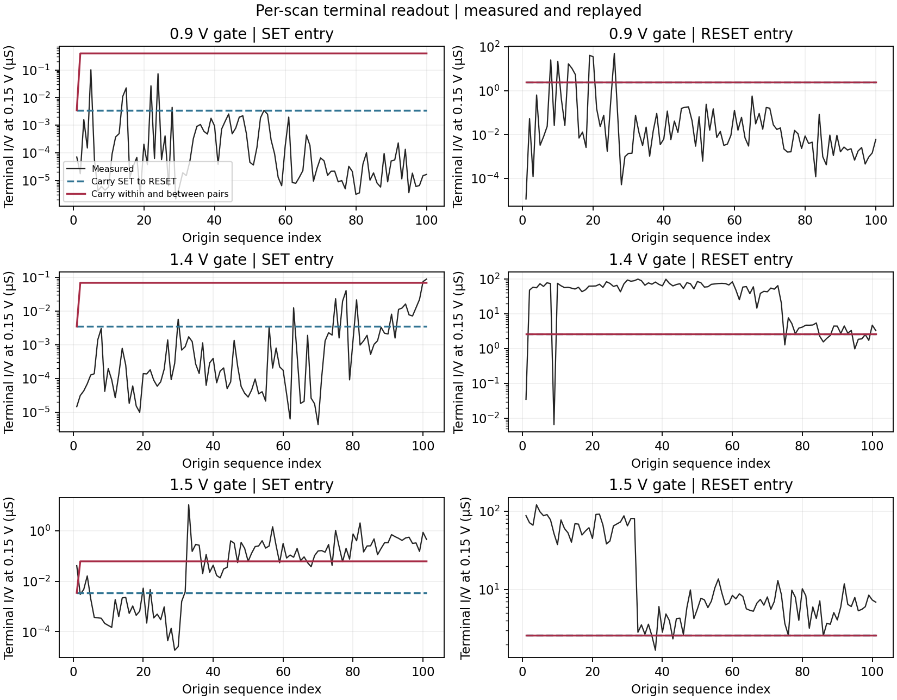

# 2026-11-25 · IV41 状态交接复跑

[模型探索总目录](../../README.md) · [原始评分](scores.json) · [逐圈电导和状态](state_history.csv) · [I–V 对比](iv_curves.png) · [逐圈入口图](entry_history.png)

| 记录项 | 内容 |
|---|---|
| 想解释的现象 | IV41 的实测低压电导在相邻分支之间有关联，现在的 hBN 模型能把这种关联从 SET 接到 RESET、再接到下一圈吗？ |
| 基准 | 冻结此前在历史 `322` 的 1.1 V 第 4–35 个导出记录标定的 soft/hard 参数，沿用现有晶体管正反向查表与电流方程 |
| 对照 | 每个分支清零、只传 SET→RESET、两处都传递。三组共用 704 对曲线和同一套评分点 |
| 结果 | 保留为诊断。圈内传递改善总体 RESET，跨圈传递主要抬高了下一圈 SET 的低压电流。固定参数下，模型在每档栅压重复推到几乎同样的状态 |

## 配对与数据范围

- 用 IV41 的曲线名、Origin X/Y 数据引用的 `@n` 后缀核对序号，首条无后缀记为 1。沿用项目的主波形筛选。七档 0.9–1.5 V 共得到 **704 对**，每档 SET 与 RESET 的序号完全对上，各档内部无缺口。跨序号缺口时重新初始化。实测取端口 0.15 V 的电导 `|I|/|V|`，相关性计算用 1e-14 A 下限。SET 末态与本圈 RESET 入口的对数电导相关 **0.743–0.994**，RESET 末态与下一圈 SET 入口 **0.890–0.991**。序号与相邻读数支持这套配对，实际驻留时间以及跨栅压测试次序尚无仪器记录。
- 原 Fig. 2c 的导出标签映射到 `图17_322` 后，53 对中只有第 **22、23** 对的原始后缀相同。按导出标签配对的入口相关为 **−0.051**，按 `322` 完整序号配对则为 **0.836**。原有依赖连续状态的判据按历史口径保留。本轮的冻结参数曾用过该器件的记录，完整 `322` 仅用于核对来源。
- `IV41 5 V` 留作单相位的大电流对照。141 条 SET 和 79 条 RESET 尝试按相同后缀匹配，相关约 **0.007**。两相位峰值的中位数分别为 **815 µA** 和 **1.03 mA**。本轮连续仿真覆盖 0.9–1.5 V。 [工作簿解析索引](../../../../../outputs/vulcan-handoff/iv41_cache/index.json) · [配对详情](scores.json)

## 模型和评分

三组都用原始电压波形作为输入。实测电流用来配对审查、画图和评分。第一条曲线从基准的零状态开始，`soft` 表示模型中的渐进导通分量，`hard` 表示模型允许的高导通分量。

- **分支清零**让 SET 和 RESET 各自从零状态起算，作为切断圈内信息的对照。
- **只传圈内状态**把 SET 计算的末态作为 RESET 初态，新一圈 SET 从零开始。
- **圈内与跨圈都传**把 RESET 算出的末态接给下一条连续编号的 SET。状态在两相位间直接传递，采用零间隔的计算近似；模型没有独立的等待时间或零压松弛律。

评分用同一组 `use_unclamped` 掩码，SET 电流下限 1e-11 A，RESET 电流下限 1e-12 A。表中是逐点合并的对数电流 RMSE，单位 decade。SET 共 **646,980** 点，RESET 共 **208,450** 点。七档都参加本轮诊断，参数不重新标定。

| 栅压 | 配对数 | SET 清零／圈内／全传递 | RESET 清零／圈内／全传递 |
|---|---:|---:|---:|
| 0.9 V | 100 | 0.589 / 0.589 / 0.854 | 1.626 / 2.299 / 2.299 |
| 1.0 V | 101 | 0.382 / 0.382 / 0.574 | 1.294 / 1.413 / 1.413 |
| 1.1 V | 100 | 0.320 / 0.320 / 0.420 | 1.368 / 0.881 / 0.881 |
| 1.2 V | 100 | 0.424 / 0.424 / 0.445 | 1.502 / 0.993 / 0.993 |
| 1.3 V | 101 | 0.471 / 0.471 / 0.516 | 1.726 / 1.083 / 1.083 |
| 1.4 V | 101 | 0.539 / 0.539 / 0.671 | 2.019 / 1.344 / 1.344 |
| 1.5 V | 101 | 0.555 / 0.555 / 0.498 | 2.048 / 1.081 / 1.081 |
| 总体 | 704 | 0.477 / 0.477 / 0.585 | 1.678 / 1.367 / 1.367 |

**圈内状态有用，跨圈传递暴露了现有状态的问题。** 把 SET 末态交给 RESET，总体误差从 1.678 降到 1.367，0.9 V 是明显例外。再传给下一圈时，SET 总体从 0.477 升到 0.585，1.5 V 局部改善。跨圈传递后七档的 RESET 电流轨迹逐点与只传圈内一致，因为同一栅压下 SET 在每圈都计算到同一个末态，soft 接近 1，hard 始终为 0。状态回到一组固定值，实测的逐圈差异和高低组切换都没有传下去。

0.9 V 就能看到误差怎样传递。实测 SET 起始电导中位数约 **0.000051 µS**，只传圈内时约 **0.00347 µS**，加入跨圈传递后约 **0.395 µS**。模型在 RESET 末端留的电导过高，直接把下一圈 SET 低压电流抬了上去。1.4 V 的 RESET 入口实测中位数约 **57.4 µS**，模型固定在约 **2.62 µS**，图中也看不到实测高、低组的切换。



## 去留与复现

保留重建的配对和三组回放作为基准。下一轮优先检查 SET 后的低压读出是否保留逐圈高低差异，以及 RESET 低压端留下多少导电性。这两处都能用配对后的低压测量约束。零压间隔的动力学用真实时序和驻留记录另行检验。

本轮在[交接代码快照](../../../../../VULCAN-2D-handoff-2026-11-24/)运行。源参数见[冻结参数原件](../../evidence/frozen_gate_transfer.json)，工作簿和参数校验值保存在[评分文件](scores.json)。计算曲线通过当前查表的负载线校验，最大电流平衡残差约 \(2.01\times10^{-12}\) A。以下命令从交接快照执行，示例将复跑文件写入新的临时目录。

```bash
python -m analysis.validate_iv41_state_handoff \
  --workbook /Users/sujiangyu/Desktop/VULCAN-2D/不同栅压_原始曲线数据.xlsx \
  --cache ../outputs/vulcan-handoff/iv41_cache \
  --baseline ../VULCAN-2D/docs/model-exploration/evidence/frozen_gate_transfer.json \
  --output /tmp/iv41-state-handoff-rerun
```

[复现脚本](../../../../../VULCAN-2D-handoff-2026-11-24/analysis/validate_iv41_state_handoff.py)
