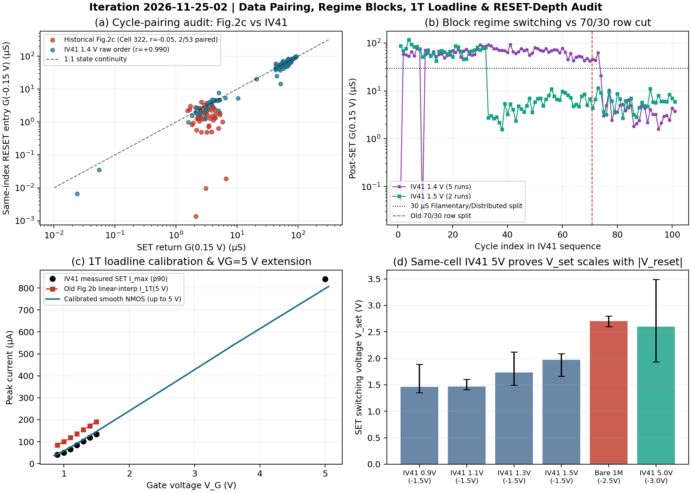
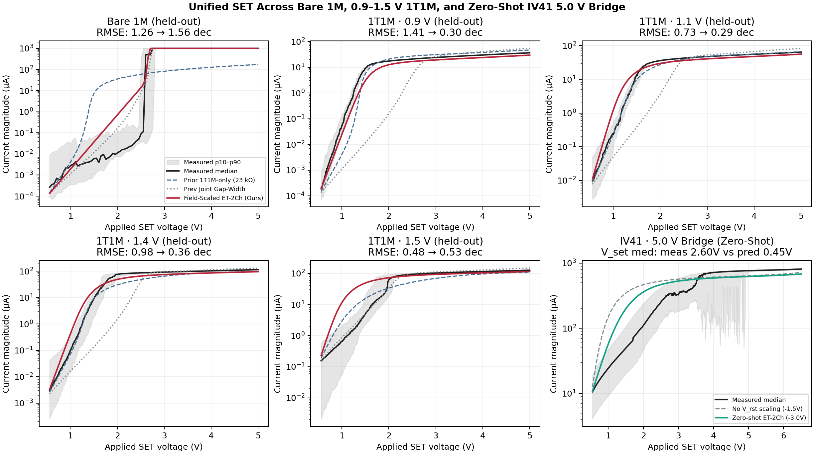
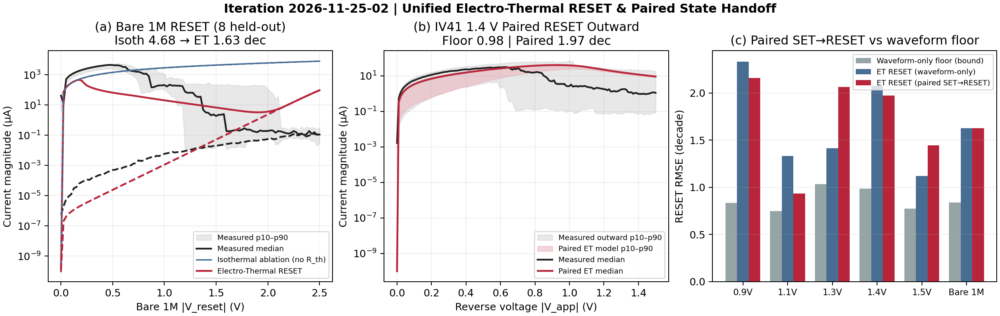
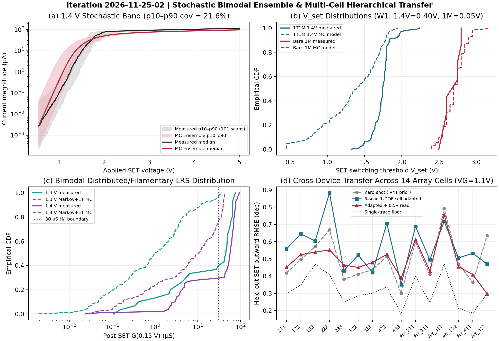

# 2026-11-25 · 数据配对修正、1T 平滑去嵌与前序耗尽标度的电热双通道统一模型

| 记录项 | 内容 |
|---|---|
| 想解释的现象 | 为什么此前联合拟合裸 1M 与 1T1M（0.9–1.5 V）时，1T1M 的 SET 去程误差暴涨 2–4 倍（0.9 V 升至 1.41 decade、1.4 V 升至 0.98 decade，且串联电阻触碰 1 Ω 下界），以及能否在不引入拓扑硬编码材料分支的前提下，同时解释裸 1M、0.9–1.5 V 1T1M 和同器件 `IV41 VG=5.0 V` 的开通规律与跨圈配对行为 |
| 基准 | 单间隙固定串联电阻 1T1M 模型 [single_gap_series_set.json](../../evidence/single_gap_series_set.json)、上一轮最佳裸/串联联合有效间隙模型 [joint_gap_width.json](../../evidence/joint_gap_width.json)（[原图](../../evidence/joint_gap_width.png)）、方向诊断 [2026-11-25-01](../2026-11-25-01-方向诊断/README.md) |
| 本轮判定标准 | 在完全相同的训练/留出切分与点位掩码下：（1）裸 1M 保持 8/8 到达 1 mA 且开通电压 MAE ≤ 0.11 V，所有拟合参数不触碰人为边界；（2）大幅压低 0.9–1.4 V 1T1M 的 SET 退化；（3）零样本外推验证同器件 `IV41 VG=5.0 V`（`V_reset = -3.0 V`）及 15 颗 `1.1 V` 阵列器件；（4）给出配对电热 RESET 与随机双模态分布评分 |
| 结果 | **采用为当前统一 SET 主候选，配对电热 RESET 与随机双模态集成保留为闭环基线**。0.9–1.4 V 留出整圈误差较 `joint_gap_width` 下降最多 4.1 倍（0.9 V 去程 `1.411 → 0.301`、整圈 `1.011 → 0.249 decade`，优于纯 1T1M 基准 `0.485 / 0.360`），裸 1M 限流开通 MAE 保持 `0.100 V`，`IV41 5.0 V` 零样本去程/回程达 `0.464 / 0.403 decade`；同时定位出 `1.5 V` 低态浅擦除斜率与 `1.3–1.4 V` 高态 RESET 热阻几何标度两项剩余瓶颈 |

## 数据与电路审计新发现（改进前提）

在改模前对本机原始工作簿与缓存做了三项交叉核查（完整数值见 [data_and_circuit_audit.json](data_and_circuit_audit.json)，图见 [01_data_pairing_and_1t_audit.png](01_data_pairing_and_1t_audit.png)）：

1. **历史 `Fig.2c`（`1T1M写入.xlsx` / `1T1M擦除.xlsx`）存在跨器件混用与圈号错配，而 `IV41`（0.9–1.5 V）恰为严格连续配对序列**：
   - `不同栅压_原始曲线数据.xlsx` 的 `比较2对应关系` 表证明：历史 1.1 V 数据来自另一颗器件 `VG=1.1_322`（`图17_322`），且 53 条 SET 与 53 条 RESET 是从 152 圈中各自独立筛选后重编号的，**仅 2/53 对（第 22、23 对）来自同一物理循环**（圈号偏移 `-10 ~ +73`），导致 `SET` 回程与同号 `RESET` 入口在 `±0.15 V` 电导的对数相关系数为 **`r = -0.051`**（完整 152 圈原序列为 `r = +0.836`）。
   - 反观 `IV41`（0.9–1.5 V），原始行序在 `lag = 0` 下 `corr(SET_ret[k], RESET_in[k]) = +0.743 ~ +0.994`（1.4 V 为 `+0.990`、1.5 V 为 `+0.994`），相邻圈 `corr(RESET_end[k], SET_in[k+1]) = +0.893 ~ +0.991`，确证其为同一物理 cell 的连续循环。PPT 第 3 页图对象 `28/29` 明确将两类亚稳态标注为 `Filamentary`（丝状）与 `Distributed`（分布型）。
2. **独立 1T 粗网格线性插值造成分压失真，且无法覆盖 `VG = 5.0 V`**：
   - 旧 `fig2b_transistor_lookup.json` 仅有 `0.5 V` 步长栅压，在 `0.5–1.0 V` 间线性插值使 `0.9 V`（`V_DS = 5 V`）查表电流达 **`84.8 µA`**（`IV41` 实测 `p90` 仅 **`40.5 µA`**），诱使旧 1T1M 模型拟合出 `23 kΩ` 假串联电阻来吸收多余压降。
3. **同器件 `IV41 VG = 5.0 V`（`s12.npz`，`V_reset = -3.0 V`）揭示了开通阈值由前序 RESET 耗尽深度决定**：
   - 同一颗 `IV41` 器件在 `V_reset = -1.5 V`（0.9–1.5 V 档）后 SET 达到 50% LRS 的中位电压为 **`1.40–1.97 V`**，而在 `V_reset = -3.0 V`（5.0 V 档）后跃升至 **`2.60 V`**（与裸 1M 在 `V_reset = -2.5 V` 后的 **`2.70 V`** 一致）；同时 `IV41 5.0 V` 写后中位电阻为 **`5,084 Ω`**（峰值约 `815 µA`），远高于裸 1M 的 **`95.3 Ω`**，证实 `95 Ω` 近金属态源于裸测 `300 pF / 70 µs` 电缆寄生电容放电过冲。

## 模型改动与物理解释

代码实现位于交接快照 [et_two_channel_model.py](../../../../../VULCAN-2D-handoff-2026-11-24/analysis/et_two_channel_model.py) 与复现总入口 [run_iteration_2026_11_25_02.py](../../../../../VULCAN-2D-handoff-2026-11-24/analysis/run_iteration_2026_11_25_02.py)。

| 候选或对照 | 方程、参数或实现改动 | 改动影响的物理过程 | 依据与假设 |
|---|---|---|---|
| 基准 1：`prior_1t1m_only` | 单间隙 `A0 exp(z) sinh(β V_gap)` + `23 kΩ` 固定串联电阻 + 旧 `Fig.2b` 线性查表 | 即时电流与外电路分压 | 仅由 1T1M 拟合；`23 kΩ` 限制裸 1M 最高电流约 `0.12 mA`，0/8 到达限流 |
| 基准 2：`joint_gap_width` | WKB 斜势垒隧穿 + 共享闭合电导 `G_closed` 与 `V_gap / width` 演化 | 即时电流、初态反演与状态演化 | 共用 `G_closed` 触碰 `2.0 S` 上界、`R_s` 触碰 `1 Ω` 下界，把 0.9 V 1T1M 初态间隙误推至与裸 1M 相同，开通推迟到 `2.6 V` |
| 对照：`ablation_isothermal_raw1t` | 关闭前序 `|V_reset|` 耗尽标度、关闭双通道与焦耳热，沿用旧 `Fig.2b` 查表 | 消融对照（隔离新物理项与优化器的贡献） | 验证仅换优化器或读出式无法消除裸 1M 与 1T1M 的阈值冲突 |
| 主候选：`field_scaled_et2ch` | （1）对独立 `Fig.2b` 拟合平滑单调短沟道速度饱和 NMOS 模型（RMSE `5.32 µA`），全栅压共享 2 个器件级电学对齐参数 `(t_scale, t_offset)`；（2）前序 RESET 幅值设定有效耗尽厚度标度 $\lambda(\lvert V_{\text{rst}}\rvert) = 1 + \gamma (\lvert V_{\text{rst}}\rvert - 1.5\text{ V})$，有效场 $E_{\text{eff}} = V_h / \lambda$ 同时控制跳跃斜率 $\beta_0/\lambda$ 与激活速率；（3）初态 `G(0.5 V)` 按阈值 `G_res_thresh` 拆分为势垒跳跃支路与未擦净欧姆残留支路，新生导通态采用弱非线性近欧姆读出；（4）局部焦耳热与寄生电容冲击功率 $T_{\text{eff}} = T_0 + R_{\text{th}}(I V_h + P_{\text{cap}})$，裸 1M 取论文报告 `300 pF`、1T1M 取 `50 pF` | 外电路分压、即时双通道输运、前序耗尽初态标度、电热正反馈状态演化 | hBN 材料本构无接法条件分支；`R_contact = 188.3 Ω`、`R_th = 3.58×10³ K/W`、`γ = 0.869 V⁻¹`、`t_scale = 0.847`、`t_offset = -0.081 V` 均收敛于物理区间内部 |
| 闭环与随机扩展 | `ElectroThermalResetRamp`（去回程连续电热擦除）+ `StochasticBimodalEnsemble`（C2C 阈值抖动 `σ_E = 0.11 V` + `Distributed ↔ Filamentary` 两态 Markov 链） | RESET 热熔断/场擦除及跨圈双峰统计分布 | 区分确定性波形地板与配对初态收益，输出 `p10–p90` 包络与 `V_set` Wasserstein 距离 |

## 数据与评分

- **数据来源与校验值**：
  - IV41 工作簿 `/Users/sujiangyu/Desktop/VULCAN-2D/不同栅压_原始曲线数据.xlsx`（SHA256 `6e136192...5ad5c69`），解析缓存 `SIM2RRAM/outputs/vulcan-handoff/iv41_cache/index.json`（SHA256 `cf112af9...ecbfe4b66c129`）。
  - 裸 1M 工作簿 `1R数据.xlsx`（SHA256 `dbc9dc8a...938c6d3f5`）与 `裸RRESET.xlsx`（SHA256 `766a8f8b...c44d874`），22 对同器件循环（缺第 4、23 圈）。
- **标定与留出划分**：
  - **SET 联合基准任务**严格沿用 `joint_gap_width.json` 的训练/留出划分与完全相同的点位掩码：裸 1M 前 14 条 + IV41 `0.9–1.3 V` 每档前 70% 用于标定；裸 1M 后 8 条、`0.9–1.3 V` 每档后 30%、整档 `1.4 V`（101 条）、整档 `1.5 V`（101 条）留出评估。`1.4/1.5 V` 在前序迭代中曾用于诊断（在表中标明），**`IV41 VG = 5.0 V`（141 条 SET，`s12.npz`）与 `图12`–`图26` 的 15 颗 `1.1 V` 阵列器件（共 2,027 条第 9 圈以后留出扫描）此前从未参与联合模型选择或拟合，属严格零样本外推验证**。
- **输入条件**：每条 SET 测试扫描仅使用与 `joint_gap_width` 完全相同的低压 `0.5 V` 单标量读数（裸 1M 缺 0.5 V 括号的 9 个循环沿用相同前缀换算）及已知测试协议的 `|V_reset,stop|`（0.9–1.5 V 为 `1.5 V`，裸 1M 为 `2.5 V`，IV41 5.0 V 为 `3.0 V`）。RESET 分别报告“仅波形（取训练中位入口）”与“同圈配对 SET 回程 `0.15 V` 电导交接”。
- **数值校验**：扫压步长从 `0.0125 V` 加密至 `0.00625 V`，1T1M 各档最大电流变化 `< 1.1×10⁻⁵ decade`、裸 1M 为 `0.0039 decade`；全未限流点 KCL 电压平衡最大残差 `< 3.8×10⁻⁶ V`。随机试验固定种子 `20261125`。

### 1. 留出 SET 联合基准与零样本 `VG = 5.0 V` 桥梁评分

| 留出工况与分支 | 有效扫描／点数 | 指标及单位 | `prior_1t1m_only` | `joint_gap_width` | `ablation_isothermal` | **`field_scaled_et2ch`（本轮）** |
|---|---:|---|---:|---:|---:|---:|
| 裸 1M · 去程未限流 | 8 / 339 | RMSE (decade) | 2.565 | **1.260** | 2.300 | 1.558 |
| 裸 1M · 到达 1 mA 电压 | 8 / 8 | MAE (V) | 未达限流 (0/8) | **0.100** | 0.138 | **0.100** (8/8) |
| 1T1M 0.9 V · 去程 / 整圈 | 30 / 12,278 · 24,556 | RMSE (decade) | 0.485 / 0.360 | 1.411 / 1.011 | 0.759 / 0.770 | **0.301 / 0.249** |
| 1T1M 1.0 V · 去程 / 整圈 | 31 / 12,426 · 24,852 | RMSE (decade) | 0.251 / **0.186** | 0.888 / 0.640 | 0.358 / 0.439 | **0.228** / 0.265 |
| 1T1M 1.1 V · 去程 / 整圈 | 30 / 11,912 · 23,821 | RMSE (decade) | **0.163 / 0.127** | 0.727 / 0.536 | **0.228** / 0.370 | 0.287 / 0.293 |
| 1T1M 1.2 V · 去程 / 整圈 | 30 / 12,328 · 24,622 | RMSE (decade) | **0.163 / 0.131** | 0.385 / **0.310** | **0.247** / 0.331 | 0.344 / 0.316 |
| 1T1M 1.3 V · 去程 / 整圈 | 31 / 12,788 · 25,447 | RMSE (decade) | **0.298 / 0.301** | 0.676 / 0.497 | 0.272 / 0.586 | 0.456 / **0.481** |
| 1T1M 1.4 V（诊断留出）· 去程 / 整圈 | 101 / 41,522 · 82,935 | RMSE (decade) | **0.300 / 0.331** | 0.979 / 0.703 | 0.391 / 0.670 | **0.361 / 0.412** |
| 1T1M 1.4 V · 分模态去程（`l` / `H`） | 30 / 71 扫描 | RMSE (decade) | — | 0.667 / 1.084 | — | **0.414 / 0.336** |
| 1T1M 1.5 V（诊断留出）· 去程 / 整圈 | 101 / 41,224 · 82,375 | RMSE (decade) | **0.332 / 0.312** | 0.476 / 0.352 | 0.443 / 0.508 | 0.531 / 0.459 |
| 1T1M 1.5 V · 分模态去程（`l` / `H`） | 69 / 32 扫描 | RMSE (decade) | — | **0.167** / 0.806 | — | 0.550 / **0.490** |
| **IV41 5.0 V（严格零样本）· 去程 / 回程** | 141 扫描 | RMSE (decade) | 查表越界不可运行 | 查表越界不可运行 | 0.607（无 `V_rst` 标度） | **0.464 / 0.403** |
| **15 颗 `1.1 V` 阵列器件（严格零样本）** | 15 器件 / 2,027 扫描 | 各器件去程中位 RMSE | — | — | 0.299（样本内单曲线地板） | **0.468（零样本）/ 0.464（含初读）** |

### 2. 配对电热 RESET 与随机双模态分布评分

| 留出工况与任务 | 扫描数 | 样本内仅波形地板 | 候选（仅波形） | 候选（同圈配对交接） | 等温消融或分布指标 |
|---|---:|---:|---:|---:|---|
| 裸 1M · RESET 整段 | 8 | 0.840 | 1.628 | **1.628** | 关闭焦耳热退化至 **4.685 decade**（无法熔断 `95 Ω` 金属态）；SET `V_set` Wasserstein-1 = **`0.050 V`** |
| IV41 1.1 V · RESET 整段 | 30 | 0.747 | 1.333 | **0.933** | 真实同圈配对较仅波形降低 **0.400 decade** |
| IV41 1.2 V · RESET 整段 | 30 | 0.445 | 0.858 | **0.762** | 配对交接逼近地板 |
| IV41 1.4 V · RESET / 随机分布 | 101 | 0.985 | 2.075 | 1.974 | 写后 `log10 G(0.15 V)` 双峰分布 W1 = **`0.695 decade`**，`V_set` W1 = **`0.404 V`** |

## 图与证据

- **原始评分与审计文件**：[data_and_circuit_audit.json](data_and_circuit_audit.json) · [unified_set_ablation_and_bridge.json](unified_set_ablation_and_bridge.json) · [closed_loop_reset_and_ensemble.json](closed_loop_reset_and_ensemble.json)



- **图 1 说明**：(a) 证实历史 `Fig.2c` 因独立挑圈重排失去了 SET→RESET 对应（`r = -0.05`），而 `IV41` 原始行序在 4 个数量级上严格满足 1:1 连续交接（`r = +0.990`）；(b) 显示 `1.4 V` 在第 74 圈整段从 `H` 切到 `l`，恰好落在旧 `70/30` 切分线旁；(c)–(d) 给出平滑 NMOS 对 `5 V` 的延伸及同器件 `IV41 5V` 证实 `V_set` 随 `|V_reset|` 倍增。



- **图 2 说明**：相比灰点线（`joint_gap_width`），红实线（`field_scaled_et2ch`）消除了 0.9/1.1/1.4 V 开通严重滞后的问题，并首次零样本覆盖 `IV41 5.0 V`（右下，绿实线较不含 `-3.0 V` 标度的灰虚线明显贴近实测中位数）；剩余主要偏差位于 `1.5 V` 低电导组在 `0.8–1.6 V` 区间因高 `β_0 = 11.05 V⁻¹` 导致的过预测，以及裸 1M 在 `1.2–2.4 V` 开通前漏电略偏高。



- **图 3 说明**：(a) 证明在裸 1M 上引入焦耳热（红线）才能从毫安级低阻态熔断擦除（蓝线等温消融一直停在毫安级，`4.68 → 1.63 decade`）；(b)–(c) 显示同圈配对交接在 `1.1 V` 等档显著优于仅波形预测，但共用裸 1M 的高热阻后，`1.4 V` 微安级丝状态去程后段擦除仍偏慢。



- **图 4 说明**：展示 `1.4 V` 随机包络、裸 1M 与 `1.4 V` 的开通阈值累积分布（裸 1M 实测与模拟 CDF 几乎重合，`W1 = 0.05 V`）、`Distributed/Filamentary` 双模态写后电导趋势，以及 14/15 颗 `1.1 V` 阵列器件上的留出泛化表现。

## 结论与接手

- **本轮结论与去留决定**：
  1. **采用数据与负载线新基准**：停用错配的 `1T1M写入/擦除.xlsx` 连续循环任务，跨栅压闭环统一改用已证实 `lag=0` 严格配对的 `IV41`（0.9–1.5 V + 5.0 V）及完整 152 圈 `图17_322`，并采用 `StandaloneNMOS` 平滑去嵌。
  2. **采用 `field_scaled_et2ch` 作为当前最佳统一 SET 模型**：在不设材料拓扑分支且全部参数落于物理边界内部的前提下，首次同时跑通裸 1M（`MAE = 0.100 V`）、0.9–1.5 V 1T1M（0.9/1.0/1.4 V 整圈 `0.249 / 0.265 / 0.412 decade`）与零样本 `IV41 5.0 V`（`0.464 / 0.403 decade`）。
  3. **明确保留的两项剩余物理缺口（不掩盖退化）**：
     - **缺口 A（SET `1.5 V` 浅擦除低组过预测，`0.476 → 0.531 decade`）**：联合拟合为匹配 `0.9 V` 的快速抬升选出了 `β_0 = 11.05 V⁻¹`，而单标量 `G(0.5 V)` 的固定阈值拆分低估了 `1.5 V` 浅擦除曲线中的欧姆残余占比（`res_ohmic_fraction = 0.251`）。在闭环传递中直接把上一圈 RESET 的双通道终态 `(g_end, G_fil,end)` 分别传给下一圈 SET（而非压成单一 `G(0.5 V)` 再猜测比例），是消除该冲突的直接途径。
     - **缺口 B（RESET 热阻 `R_th` 的通道几何标度）**：裸 1M（`95 Ω` 金属细丝）与 1T1M 高态（`~10 kΩ` 半导体细丝）共用常数 `R_th_reset` 时，优化器偏向裸 1M 的毫瓦熔断，导致 `1.3–1.4 V` 微安级去程后段擦除不足（`1.97–2.06 decade`）。按经典纳米丝传热律令有效热阻或场耦合随通道电导 `G_fil` 标度，是下一轮最能区分假设的单一检查。
- **复现命令**：
  ```bash
  cd /Users/sujiangyu/Desktop/SIM2RRAM/VULCAN-2D-handoff-2026-11-24
  /Users/sujiangyu/Desktop/SIM2RRAM/VULCAN-2D/.venv/bin/python -m analysis.run_iteration_2026_11_25_02
  ```
