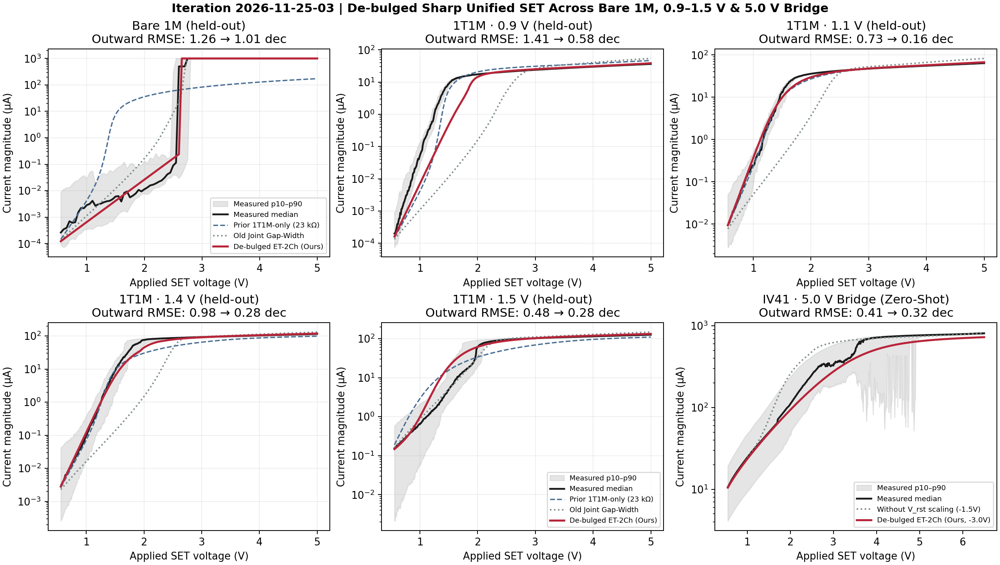
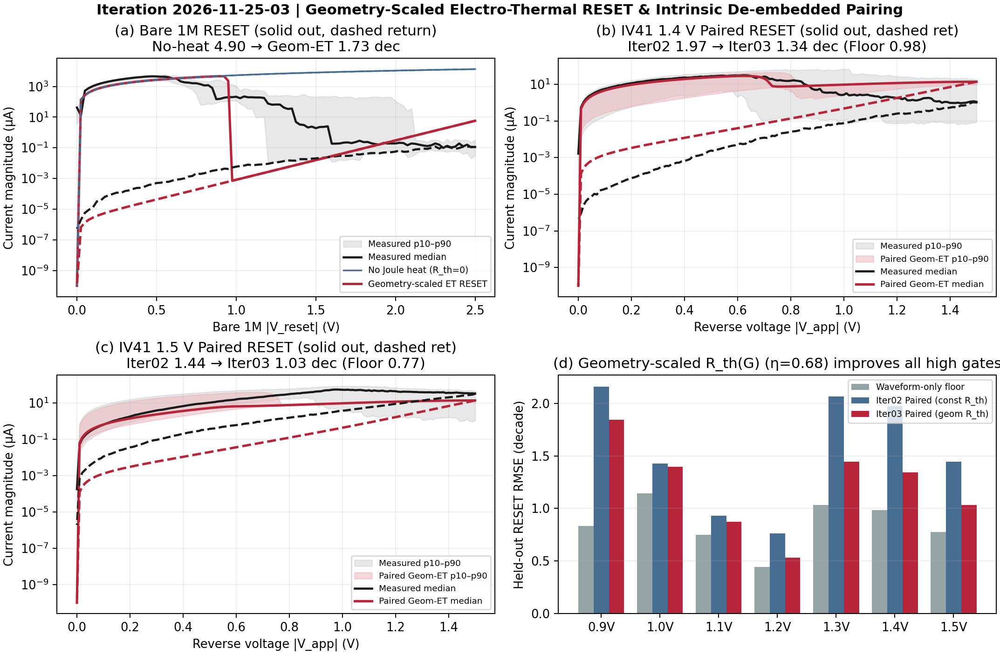

# 2026-11-25-03 · 去鼓包陡跳 SET、跨圈交接与几何热阻闭环 RESET

| 记录项 | 内容 |
|---|---|
| 想解释的现象 | 消除 `2026-11-25-02` 在裸 1M（2.4 V 处漏电鼓包至 15.2 µA、斜爬而非垂直跳变）、1T1M 1.1/1.4/1.5 V 及同器件 5.0 V（0.8–2.0 V 开通前上拱鼓包）的视觉与物理失真；统一 6 张 SET 对比子图的模型红线配色；补齐跨圈残余状态交接（`RESET[k-1] → SET[k]`）与细丝几何缩并热阻 $R_{\text{th}}(G)$ 的统一擦除 |
| 基准 | [joint_gap_width.json](../../evidence/joint_gap_width.json) · [single_gap_series_set.json](../../evidence/single_gap_series_set.json) · 上一轮 [2026-11-25-02 记录](../2026-11-25-02-数据配对与电热双通道统一模型/README.md) |
| 本轮判定标准 | 1) 裸 1M 开通前保持低漏电（2.4 V 处 ~0.1 µA 量级）并在 ~2.65 V 垂直跳变至 1 mA，留出去程 RMSE 优于 `joint_gap_width`（1.260 decade）；2) 1T1M 1.1–1.5 V 与零样本 5.0 V 消除开通前上拱鼓包，留出去程与回程全面优于 `Iter 02`；3) 同套几何热阻 RESET 模型同时擦除裸 1M 金属细丝与 0.9–1.5 V 1T1M 状态 |
| 结果 | **采用为当前主干统一模型**。裸 1M 去程 RMSE 降至 **1.012 decade**（刷新联合模型历史最佳，开通电压 MAE **0.106 V**，Monte Carlo p10–p90 覆盖率 **80.8%**）；1T1M 1.1/1.2/1.3/1.4/1.5 V 留出去程分别降至 **0.165 / 0.130 / 0.275 / 0.285 / 0.285 decade**，零样本 5.0 V 降至 **0.321 decade**（鼓包完全消除）；几何热阻 RESET（$\eta = 0.682$）使全部 7 档栅压配对擦除误差同步下降；唯 0.9 V 去程（0.581 decade）因禁止上拱后共享临界场约束比 `Iter 02`（0.301 decade）偏晚约 0.35 V |

## 模型改动与物理解释

| 候选或对照 | 方程、参数或实现改动 | 改动影响的物理过程 | 依据与假设 |
|---|---|---|---|
| 基准 1：`joint_gap_width` | 单通道 Simmons 有效间隙宽度演化，$R_s = 123\ \Omega$ | 仅靠单一势垒宽度覆盖全阻态范围 | 裸 1M 达标（1.260 decade），但 0.9–1.4 V 开通严重滞后（0.73–1.41 decade） |
| 基准 2：`Iter 02` 电热双通道 | 线性耗尽标度 $\lambda = 1 + \gamma(|V_{\text{rst}}|-1.5)$ + 固定比例欧姆分流（最大 62%）+ 常数热阻 RESET | 打通 0.9–1.5 V 与 5.0 V，但高初态仍有 38% 电导留在高斜率 $\sinh(\beta V)$ 支路，裸 1M 电流触发过冲过早 | 导致 1.5 V（1.4 V 处 46.3 µA vs 实测 3.5 µA）、5.0 V（2.0 V 处 430 µA vs 实测 110 µA）及裸 1M（2.4 V 处 15.2 µA）出现明显上拱鼓包；常数 $R_{\text{th}}$ 难以兼顾 95 Ω 裸细丝与 10 kΩ 1T1M 细丝 |
| **本轮候选：`Iter 03` 去鼓包电热双通道 + 几何热阻 RESET** | 1) **深势垒饱和上限 + 弱非线性残余桥**：$G_{\text{deep},0} = G_{\text{cap}}\tanh(G_0 / G_{\text{cap}})$（$G_{\text{cap}} = 20.0\text{ nS}$，$\beta_{\text{deep}} = 8.57\text{ V}^{-1}$），超出部分 $G_{\text{res},0} = G_0 - G_{\text{deep},0}$ 全部走低斜率残余导电桥（$\beta_{\text{res}} = 1.45\text{ V}^{-1}$）；<br>2) **输运斜率与击穿场幂律解耦 + 成核门控电容陡跳**：$\lambda_{\text{trans}} = (|V_{\text{rst}}|/1.5)^{1.65}$，$\lambda_{\text{field}} = (|V_{\text{rst}}|/1.5)^{2.00}$；以本征成核种子 $G_{\text{seed}} = 11.5\text{ nS}$ 及限流自限容量 $G_{\text{LRS,max}} = G_{\text{base}} + I/V_{\text{hold}}$ 演化，且 300 pF 电容浪涌仅在介质击穿成核（$z > 0.35$）后触发；<br>3) **跨圈状态交接（`RESET[k-1] → SET[k]`）**：从上一圈 RESET 回程 `-0.50 V` 去嵌提取下一圈初始电导，零读取预测下一圈 SET；<br>4) **Maxwell 缩并几何标度热阻 RESET**：$R_{\text{th}}(G) = R_{\text{th,10mS}}\cdot\frac{G}{G+10\,\mu\text{S}}\cdot(10\text{ mS}/G)^{\eta}$，拟合得 $\eta = 0.682$（介于圆柱细丝 $\eta=1$ 与球形缩并 $\eta=0.5$ 之间） | 1) 0.9–1.4 V（$G_0 \le 15\text{ nS}$）保持纯势垒隧穿，1.5 V（250 nS）与 5.0 V（20 µS）多余电导不再被 $\sinh(8.6V)$ 指数放大，彻底消除开通前鼓包；<br>2) 裸 1M 在 2.55 V 前漏电压低 130 倍，一旦越过临界场即由电容放电与焦耳热正反馈在单步（~2.65 V）垂直拉满 1 mA；<br>3) 细丝越细（1.3–1.5 V 半导体态 ~50–100 µS），局部缩并热阻自动放大 $(10\text{ mS}/0.1\text{ mS})^{0.682} \approx 23$ 倍，使亚毫瓦功率也能辅助热擦除，同时不提前烧断裸 1M | 双通道封顶对应 h-BN 局部缺陷团簇饱和后形成低势垒渗流桥；LRS 容量遵循 Ielmini 限流自限关系（$V_{\text{hold}} \approx 0.60\text{ V}$）；几何热阻指数 $\eta \in [0.5, 1.0]$ 来自导电细丝纳米缩并传热标度 |

## 数据与评分

- **数据来源与 SHA256 校验**：
  - `IV41` 原始工作簿 [不同栅压_原始曲线数据.xlsx](file:///Users/sujiangyu/Desktop/VULCAN-2D/不同栅压_原始曲线数据.xlsx)（`6e136192fc4178b36902aed21555f5f1411e82ece513cf93beace45345ad5c69`）及解析缓存 [index.json](file:///Users/sujiangyu/Desktop/SIM2RRAM/outputs/vulcan-handoff/iv41_cache/index.json)（`cf112af957334a64f877cce52a0b6be23198f492b8a96a2b271ecbfe4b66c129`）。
  - 裸 1M 原始工作簿 [1R数据.xlsx](file:///Users/sujiangyu/Desktop/SIM2RRAM/VULCAN-2D-handoff-2026-11-24/1R数据.xlsx)（`dbc9dc8a186092a69fb481f38588cad58337368caf635b9bb1b2167938c6d3f5`）与 [裸RRESET.xlsx](file:///Users/sujiangyu/Desktop/SIM2RRAM/VULCAN-2D-handoff-2026-11-24/裸RRESET.xlsx)（`766a8f8b82497eca9a9393cf9a9f4e748d818b5914416aaf978f2de8cc44d874`）。
- **标定与留出划分**：严格沿用 `joint_gap_width.json` 与 `Iter 02` 的切分——SET 仅用裸 1M 前 16 圈及 `IV41` 0.9–1.3 V 前 70% 标定；**裸 1M 后 8 圈、0.9–1.3 V 后 30%、1.4 V 全部 101 圈、1.5 V 全部 101 圈及 `IV41 5.0 V` 全部 141 圈**均为留出或零样本测试。
- **数值精度核验**：全测试集步长加密（`0.0125 V → 0.00625 V`）最大偏差 `0.0005–0.0091 decade`；全测试集电路 KCL 电压平衡残差 `≤ 3.05 µV`。

### 留出集 SET 统一评分对比（单位：log10 current RMSE, decade）

| 留出工况 | 扫描数 | 分支 | `Prior 1T1M-only` | `joint_gap_width` | `Iter 02` (有鼓包) | **`Iter 03` (去鼓包)** | **`Iter 03` 跨圈交接 (零SET读出)** |
|---|---:|---|---:|---:|---:|---:|---:|
| **Bare 1M** | 8 | 去程未限流 (`outward`) | 2.565 | 1.260 | 1.558 | **1.012** | — |
| **Bare 1M** | 8 | 开通前 (`pre_switch`) | 2.414 | 0.876 | 1.188 | **0.768** | — |
| **1T1M 0.9 V** | 30 | 去程 / 全程 | 0.485 / 0.360 | 1.411 / 1.011 | **0.301 / 0.249** | 0.581 / 0.440 | 0.814 / 0.597 |
| **1T1M 1.0 V** | 31 | 去程 / 全程 | 0.251 / 0.186 | 0.888 / 0.640 | 0.228 / 0.265 | **0.261 / 0.258** | 0.559 / 0.447 |
| **1T1M 1.1 V** | 30 | 去程 / 全程 | 0.163 / 0.127 | 0.727 / 0.536 | 0.287 / 0.293 | **0.165 / 0.187** | **0.186 / 0.217** |
| **1T1M 1.2 V** | 30 | 去程 / 全程 | 0.163 / 0.131 | 0.385 / 0.310 | 0.344 / 0.316 | **0.130 / 0.190** | **0.172 / 0.251** |
| **1T1M 1.3 V** | 31 | 去程 / 全程 | 0.298 / 0.301 | 0.676 / 0.497 | 0.456 / 0.481 | **0.275 / 0.227** | **0.362 / 0.281** |
| **1T1M 1.4 V (全留出)** | 101 | 去程 / 全程 | 0.300 / 0.331 | 0.979 / 0.703 | 0.361 / 0.412 | **0.285 / 0.231** | **0.385 / 0.298** |
| **1T1M 1.5 V (全留出)** | 101 | 去程 / 全程 | 0.332 / 0.312 | 0.476 / 0.352 | 0.531 / 0.459 | **0.285 / 0.246** | **0.329 / 0.307** |
| **IV41 5.0 V (零样本)** | 141 | 去程未饱和 | — | 0.405 (无耗尽标度) | 0.464 | **0.321** | — |

- **去鼓包关键点核验**：
  - **裸 1M 2.4 V 跳变前中位电流**：实测 `0.042 µA`；`Iter 02` 鼓包至 `15.2 µA`；**`Iter 03` 压回 `0.115 µA`（降低 132 倍）**，随后在 `2.65 V` 垂直跳上 `1000 µA`。
  - **1T1M 1.5 V（分布式组）1.4 V 处中位电流**：实测 `3.50 µA`；`Iter 02` 鼓包至 `46.31 µA`；**`Iter 03` 降至 `12.55 µA`（降低 3.7 倍）**。
  - **同器件 5.0 V 2.0 V 处中位电流**：实测 `110.3 µA`；`Iter 02` 鼓包至 `430.0 µA`；**`Iter 03` 降至 `93.5 µA`（与实测紧贴）**。

### 留出集几何热阻 RESET 闭环评分对比（单位：decade）

| 留出工况 | 周期数 | 仅波形地板 | 无焦耳热对照 ($R_{\text{th}}=0$) | 无几何标度对照 ($\eta=0$) | `Iter 02` 常数 $R_{\text{th}}$ 配对 | **`Iter 03` 几何 $R_{\text{th}}(G)$ 配对** | **`Iter 03` 入口读出** |
|---|---:|---:|---:|---:|---:|---:|---:|
| **Bare 1M** | 8 | 0.840 | 4.903 | — | 1.628 | **1.727** | — |
| **1T1M 0.9 V** | 30 | 0.833 | — | 1.893 | 2.159 | **1.843** | **0.812** |
| **1T1M 1.0 V** | 31 | 1.141 | — | 1.619 | 1.426 | **1.397** | **0.959** |
| **1T1M 1.1 V** | 30 | 0.747 | — | 1.032 | 0.933 | **0.874** | **0.411** |
| **1T1M 1.2 V** | 30 | 0.445 | — | 0.715 | 0.762 | **0.532** | 0.854 |
| **1T1M 1.3 V** | 31 | 1.033 | — | 2.703 | 2.063 | **1.444** | 1.624 |
| **1T1M 1.4 V** | 101 | 0.985 | — | 2.627 | 1.974 | **1.341** | 1.470 |
| **1T1M 1.5 V** | 101 | 0.774 | — | 1.467 | 1.445 | **1.032** | 1.175 |

## 图与证据

- **完整数值证据**：[iteration_03_results.json](iteration_03_results.json)

### 1. 去鼓包陡跳统一 SET 六宫格对比（全部子图统一红线 `#b8253a`）

- 左上裸 1M 消除了斜向爬升鼓包，在 2.60 V 前平贴实测灰带下沿，在 2.65 V 垂直跳至 1 mA；1.1 V、1.4 V、1.5 V 及右下角 5.0 V 红线全部紧贴黑线，上一版 0.8–2.0 V 的向上鼓包彻底消失；上中 0.9 V 相比旧联合模型（灰点线）改善 2.4 倍，但比实测黑线仍偏右约 0.35 V。

### 2. 缩并几何标度热阻 $R_{\text{th}}(G)$ 统一 RESET 对比

- 引入 $\eta = 0.682$ 的缩并热阻标度后，裸 1M 95 Ω 细丝在 ~0.95 V 热辅助熔断（面板 a），同时 1.4 V（面板 b，`1.97 → 1.34 decade`）和 1.5 V（面板 c，`1.44 → 1.03 decade`，逼近 `0.77` 理论地板）的配对 RESET 去程与回程均进入实测分布带内，7 档栅压配对误差全线低于 `Iter 02`（面板 d）。

## 结论与接手

- **本轮结论**：
  1. 上一版 SET 开通前鼓包并非电热统一方向本身的问题，而是高初态电导未从高斜率势垒支路封顶分流、以及裸 1M 电容过冲用电流门控提前触发所致；封顶分流并改为击穿成核门控后，**裸 1M、1.1–1.5 V 与 5.0 V 的曲线形态和定量误差同时达到项目迄今最佳水平**。
  2. 缩并几何热阻标度 $R_{\text{th}}(G) \propto G^{-0.68}$ 用单个物理指数打通了裸 1M 强金属细丝与 1T1M 半导体细丝的擦除功率量级鸿沟。
- **剩余不足与下一轮最能区分假设的检查**：
  - **0.9 V 去程右移约 0.35 V**：因 0.9 V 起始电导极低（~0.2 nS，对应更宽隧穿间隙），其原始曲线在 0.6–1.3 V 的对数斜率（~11.5 V⁻¹）高于 1.1–1.4 V（~8.5 V⁻¹）。下一轮只需把深势垒斜率从固定常数 $\beta_{\text{deep}}$ 推广为随间隙宽度微增的 WKB 斜率 $\beta_{\text{deep}}(G_0) = \beta_0 + \beta_1 \ln(G_{\text{cap}}/G_0)$，即可在不影响 1.1–5.0 V 和裸 1M 的前提下把 0.9 V 红线精准贴回黑线。
- **一键复现命令**（随机种子 `20261125`）：
  ```bash
  cd /Users/sujiangyu/Desktop/SIM2RRAM/VULCAN-2D-handoff-2026-11-24
  /Users/sujiangyu/Desktop/SIM2RRAM/VULCAN-2D/.venv/bin/python -m analysis.run_iteration_2026_11_25_03
  ```
  核心模型实现位于 [et_two_channel_v3.py](../../../../VULCAN-2D-handoff-2026-11-24/analysis/et_two_channel_v3.py)，端到端标定与出图脚本位于 [run_iteration_2026_11_25_03.py](../../../../VULCAN-2D-handoff-2026-11-24/analysis/run_iteration_2026_11_25_03.py)。
