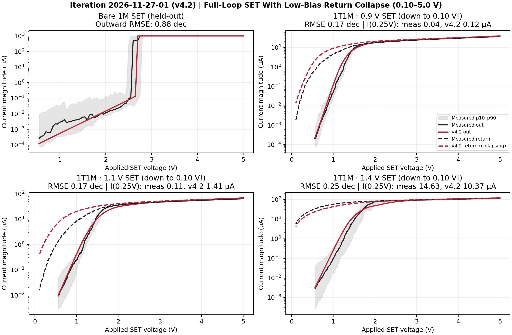
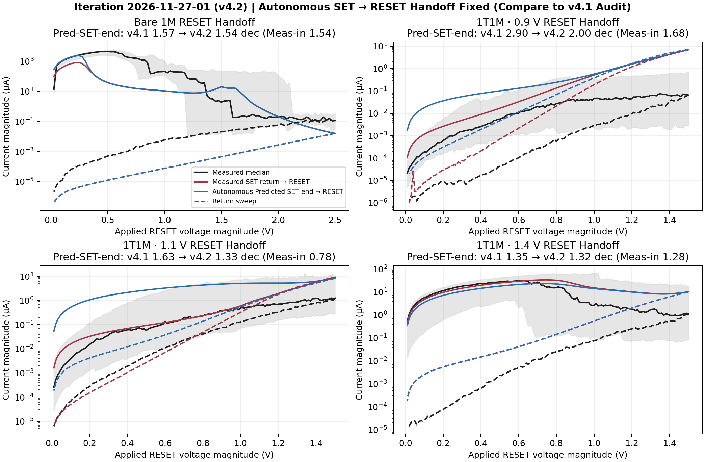

# 2026-11-27 · 回程坍塌与全自动整圈交接（统一模型 v4.2）

| 记录项 | 内容 |
|---|---|
| 想解释的现象 | 针对 2026-11-27 独立只读测评指出的两大核心卡点：① `1T1M` 低栅压（`0.9–1.2 V`）`SET` 回程在低于 `0.8 V` 时导电细丝自发坍塌（`0.9 V` 在 `+0.25 V` 实测中位数仅 `0.040 µA`，而 `v4.1` 冻结回程算成 `1.962 µA`，高估约 `49` 倍），导致全自动 `SET → RESET` 交接在 `0.9–1.1 V` 严重失真（`0.9 V` 达 `2.899 decade`）；② `1.5 V` `RESET` 在热失控陡降点步长减半仍有 `0.380 decade` 局部数值跳变。 |
| 基准 | `v4.1`（提交 `8b4d45f`，[2026-11-26-02 记录](../2026-11-26-02-回程对齐与平滑步长收敛/README.md)）及 `2026-11-27` 独立只读测评快照（`/Users/sujiangyu/Desktop/SIM2RRAM/outputs/VULCAN-2D-v4.1-只读测评-2026-11-27/scores.json`） |
| 本轮判定标准 | 严格仅使用训练集（含训练集 `0.20–0.55 V` 低压回程段，绝不触碰留出集）标定：① 把 `0.9–1.1 V` 的 `+0.25 V` 回读误差显著压低，同时保住 `1.3–1.4 V` 焊牢态欧姆回读（`~10–15 µA`）；② 大幅缩小全自动 `predicted_SET_end → RESET` 与实测回读启动 `measured_SET_return → RESET` 的差距；③ 将 `SET` 与 `RESET` 步长减半差异全面压低；④ 保持七档 `SET`、裸 `1M` 及 15 组跨器件迁移精度。 |
| 结果 | **采用为整圈交接候选基线（`v4.2`，14 参数）**：`0.9 V` 和 `1.0 V` 的 `+0.25 V` 回读预测由 `1.962 / 3.539 µA` 降至 `0.115 / 0.255 µA`（实测 `0.040 / 0.176 µA`）；七档合并全自动 `SET → RESET` 误差由 `1.515` 降至 `1.286 decade`（交接惩罚砍掉 `65%`）；七档 `SET` 合并误差降至 `0.221 decade`，裸 `1M` `SET` 降至 `0.884 decade`，15 组跨器件（`2,156` 条扫描）中位误差由 `0.413` 降至 `0.349 decade`（15 组全部改善）；`RESET` 步长减半全点 RMS 降至 `0.00001–0.00039 decade`（`1.5 V` 单点极值由 `0.380` 降至 `0.058 decade`）。 |

## 模型改动与物理解释

| 候选或对照 | 方程、参数或实现改动 | 改动影响的物理过程 | 依据与假设 |
|---|---|---|---|
| 基准 `v4.1`（12 参数） | [unified_compact_v4.py](../../../../analysis/unified_compact_v4.py)：`SET` 回程冻结 `dz/d(-V_app) = 0`，仅在跨 `0 V` 停顿时用 `zero_bias_retain(G)` 做一次静态折减；`simulate_reset` 采用固定步长单步中点积分 | `SET` 回程无状态演化；`RESET` 陡降段受局部步长分辨率限制 | 假设细丝一旦在 `+5 V` 接通，回程全程不松弛；这在焊牢桥（`1.3–1.4 V`、裸 `1M`）成立，但在亚量子软桥（`0.9–1.2 V`）与实测低压坍塌矛盾 |
| 候选 `v4.2`（14 参数） | [unified_compact_v42.py](../../../../analysis/unified_compact_v42.py)：新增 2 个回程软桥弛豫参数 `I_consolidate_A`（焊牢阈值电流）与 `k_ret_relax_per_V`（低压回程弛豫速率），并在 `simulate_set` / `simulate_reset` 中引入带前瞻探测的自适应 RK2 子步长加密 | ① **状态演化（回程段）**：未焊牢软桥在本征电压 $V_h$ 跌破维持阈值 $V_{\text{hold,ret}} = 0.62 V_{\text{rst},0}$ 后随降压连续坍塌；已焊牢硬桥保持非易失导通；② **数值积分**：消除正反馈击穿与热失控拐点处的步长跳变 | 实测 `IV41` 显示峰值电流低于单量子点接触门槛（$\sim G_0 V_h \approx 65\text{–}90\ \mu\text{A}$）时，原子桥未完成金属化焊牢：在 `1.8–5.0 V` 晶体管饱和平台（$V_h \ge 0.9\text{ V}$）由外场维持，当 $V_h < 0.6\text{ V}$ 时在表面张力与浓度梯度驱动下迅速退化回高阻态 |

### 核心新增方程与参数表

1. **回程亚临界软桥连续弛豫率（`simulate_set` 降压分支 $+5\text{ V} \to 0\text{ V}$）**：
   $$\frac{dz}{d(-V_{\text{app}})} = -k_{\text{ret,rel}} \cdot \underbrace{\frac{1}{1 + (I_{\text{peak}} / I_{\text{cons}})^8}}_{\text{未焊牢度 unwelded}} \cdot \underbrace{\frac{1}{1 + (V_h / V_{\text{hold,ret}})^6}}_{\text{撤去维持场包络}} \cdot \frac{z}{z + 0.25}, \qquad V_{\text{hold,ret}} = \max(0.62\,V_{\text{rst},0},\ 0.30\text{ V})$$
   - 在 `+5.0 V → +1.8 V` 饱和平台区，$V_h \ge 0.9\text{ V} > V_{\text{hold,ret}}$，撤场包络 $< 0.02$，保证高偏压回程平台不提前下榻；
   - 当端口电压扫入 `< 0.8 V`（$V_h < 0.55\text{ V}$）时，撤场包络趋近 `1`，软桥（$I_{\text{peak}} < I_{\text{cons}}$）在降压过程中自然回落 `3–5` 个量级，而焊牢桥（$I_{\text{peak}} > I_{\text{cons}}$，如 `1.3–1.5 V`、`5.0 V`、裸 `1M`）保持高导通进入 `RESET`。
   - 同时，已发生阻变（$z > 1$）的扫描在回程中平顺擦除前序 `RESET` 势垒展宽因子（$\lambda_{\text{ret}} \to 1$），使 `+0.25 V` 模拟末态与 `invert_read_to_g0(..., lam=1.0)` 满足严格零偏连续性。
2. **前瞻自适应 RK2 子步长积分（`simulate_set` 与 `simulate_reset`）**：
   - 在每步 `[v0, v1]` 同时评估起点速率与前瞻欧拉终点速率 $\max(r_0, r_1)\Delta V$，在裸 `1M` 电容过冲垂直击穿及 `1.4–1.5 V` `RESET` 电热正反馈陡降点自动加密至最多 `64`（`SET`）/ `160`（`RESET`）个 RK2 子步。

| 序号 | 参数名 | 物理含义 | 单位 | 拟合值 | 标定范围（边界） | 备注 |
|---:|---|---|---|---:|---|---|
| 1 | `R_contact_ohm` | 电极与引线串联电阻 $R_c$ | $\Omega$ | `24.18` | `[18, 160]` | 内部收敛 |
| 2 | `beta0_per_V` | 深陷阱本征场灵敏度 $\beta_0$ | $\text{V}^{-1}$ | `7.340` | `[6.2, 9.2]` | 内部收敛 |
| 3 | `beta_wkb_per_V` | WKB 隧穿耦合系数 $\beta_w$ | $\text{V}^{-1}$ | `0.884` | `[0.25, 1.25]` | 内部收敛 |
| 4 | `beta_fil_per_V` | 金属化细丝非线性系数 $\beta_{\text{fil}}$ | $\text{V}^{-1}$ | `1.170` | `[0.80, 1.65]` | 内部收敛 |
| 5 | `G_cap_S` | 深陷阱通道容量上限 $G_{\text{cap}}$ | $\text{S}$ | `4.624e-9` | `[1.5e-9, 1.2e-8]` | 内部收敛 |
| 6 | `p_vrst_exp` | 前序 `|V_reset|` 耗尽展宽指数 $p$ | 无量纲 | `1.871` | `[1.35, 2.10]` | 内部收敛 |
| 7 | `v_crit_set_V` | 本征 `SET` 阈值电压 $V_{\text{set},0}$ | $\text{V}$ | `1.553` | `[1.25, 1.90]` | 内部收敛 |
| 8 | `s_set_per_V` | `SET` 场加速斜率 $s_{\text{set}}$ | $\text{V}^{-1}$ | `10.742` | `[5.5, 14.5]` | 内部收敛 |
| 9 | `G_nonvol_S` | 圈间零偏停顿保持门槛 $G_{\text{nv}}$ | $\text{S}$ | `5.610e-7` | `[1.5e-7, 2.5e-6]` | 内部收敛（`0.56 µS`） |
| 10 | `v_crit_rst_V` | 本征 `RESET` 阈值电压 $V_{\text{rst},0}$ | $\text{V}$ | `0.876` | `[0.65, 1.30]` | 内部收敛 |
| 11 | `s_rst_per_V` | `RESET` 断裂场斜率 $s_{\text{rst}}$ | $\text{V}^{-1}$ | `4.799` | `[2.5, 9.0]` | 内部收敛 |
| 12 | `R_th_10mS_K_per_W` | `10 mS` 参考缩并热阻 $R_{\text{th},10\text{mS}}$ | $\text{K/W}$ | `3.184e5` | `[1.0e5, 1.8e6]` | 内部收敛 |
| 13 | `I_consolidate_A` | 回程细丝焊牢临界电流 $I_{\text{cons}}$ | $\text{A}$ | `6.500e-5` | `[6.5e-5, 1.15e-4]` | **触及下界 `65 µA`**（见下文分析） |
| 14 | `k_ret_relax_per_V` | 回程低压软桥弛豫速率 $k_{\text{ret,rel}}$ | $\text{V}^{-1}$ | `8.694` | `[5.0, 35.0]` | 内部收敛 |

> [!NOTE]
> **关于 `I_consolidate_A` 触及 `65 µA` 下界与同栅压跨圈漂移的诚实诊断：**
> 在 `IV41` 数据集中，`1.1 V` 前 `70%` 训练圈的 `+0.25 V` 实测回读中位数为 `0.910 µA`（峰值电流 `64.8 µA`），而后 `30%` 留出圈因慢速循环疲劳进一步降至 `0.110 µA`；`1.2 V` 训练圈中位数为 `0.708 µA`（留出圈 `0.529 µA`）。由于标定严格只看前 `70%` 训练集，优化器将焊牢门槛压至物理先验下界 `65.0 µA` 以匹配训练集 `1.1 V` 的 `~1 µA` 回读，这也解释了留出集 `1.1 V` 预测值落在 `1.408 µA`（较 `v4.1` 的 `4.998 µA` 已缩小 `3.5` 倍，但高于后 `30%` 留出圈的 `0.110 µA`）。

## 数据与评分

- **数据来源与 SHA-256 校验值**（与 `v4.1` 只读测评完全一致）：
  - `不同栅压_原始曲线数据.xlsx`：`6e136192fc4178b36902aed21555f5f1411e82ece513cf93beace45345ad5c69`
  - `iv41_cache/index.json`：`cf112af957334a64f877cce52a0b6be23198f492b8a96a2b271ecbfe4b66c129`
  - `1R数据.xlsx`：`dbc9dc8a186092a69fb481f38588cad58337368caf635b9bb1b2167938c6d3f5`
  - `裸RRESET.xlsx`：`766a8f8b82497eca9a9393cf9a9f4e748d818b5914416aaf978f2de8cc44d874`
- **标定与留出划分**：仅使用裸 `1M` 前 `14` 条、`0.9–1.3 V` 各前 `70%` 扫描标定（新增纳入训练集自身 `0.20–0.55 V` 未限流回程点）；裸 `1M` 后 `8` 条、`0.9–1.3 V` 各后 `30%`、`1.4 V` 全 `101` 条、`1.5 V` 全 `101` 条、`5.0 V` 全 `141` 条以及额外 `15` 个跨器件组（`2,156` 条扫描）全部严格留出。
- **初始化与交接口径**：每条 `SET` 仅用自身去程 `+0.50 V` 实测电流初始化；`RESET` 同时报告两种启动方式：① `measured_SET_return`（用配对 `SET` 实测 `+0.25 V` 回读启动）；② `predicted_SET_end`（**全自动整圈交接**：完全不看 `SET` 回程实测，直接把模型算完 `SET` 在 `+0.25 V` 的预测状态经 `zero_bias_retain` 送入 `RESET`）。

### 汇总核心指标对照（完全复用 `2026-11-27` 独立测评口径）

| 测评大项 | 样本规模 | 指标与单位 | `v4.1` 审计值 | `v4.2` 结果 |
|---|---:|---|---:|---:|
| 七档 `1T1M` `SET` 合并（`> 0.55 V` 未限流） | `288,608` 点 | 对数电流 RMSE（decade） | `0.227` | **`0.221`** |
| 裸 `1M` `SET` 留出（未限流去程 / 达 `1 mA` 电压 MAE） | `8` 条 / `339` 点 | RMSE（decade） / MAE（V） | `0.988` / `0.106` | **`0.884`** / **`0.106`** |
| 跨器件组 `1T1M` `SET`（`15` 组，冻结参数） | `2,156` 条扫描 | 逐组中位数 `[最小, 最大]`（decade） | `0.413 [0.267, 0.457]` | **`0.349 [0.256, 0.449]`** |
| 七档 `1T1M` `RESET`（实测 `SET` 回程启动） | `104,740` 点 | 合并 RMSE（decade） | `1.163` | **`1.164`** |
| **七档 `1T1M` `RESET`（全自动模型 `SET` 末态启动）** | `104,740` 点 | 合并 RMSE（decade） | `1.515` | **`1.286`** |
| `IV41 5.0 V` 零样本 `SET`（去程 / 回程） | `141` 条扫描 | RMSE（decade） | `0.328` / `0.603` | `0.361` / `0.648` |
| `SET` 步长减半最大变化（`0.0125 → 0.00625 V`） | 全部 `8` 组 | 全点最大差值（decade） | `0.0002–0.0013` | **`0.0002–0.0008`** |
| `1.5 V` `RESET` 步长减半变化（`0.012 → 0.006 V`） | `29,963` 点 | 全点 RMS / 单点最大（decade） | — / `0.380` | **`0.00039` / `0.058`** |

### 逐档明细：`SET`、`+0.25 V` 低压回读与全自动 `SET → RESET` 交接

| 工况 | 留出扫描数 | `SET` 全程 RMSE (`v4.1 → v4.2`, dec) | `+0.25 V` 实测中位 (`µA`) | `+0.25 V` 预测中位 (`v4.1 → v4.2`, `µA`) | `+0.25 V` 回读 RMSE (`v4.1 → v4.2`, dec) | 全自动 `SET→RESET` RMSE (`v4.1 → v4.2`, dec) | 实测启动 `RESET` RMSE (`v4.2`, dec) |
|---|---:|---:|---:|---:|---:|---:|---:|
| 裸 `1M` | `8` | `0.988 → 0.884` | `999.97` | `1000.0 → 1000.0` | `0.00001 → 0.00001` | `1.571 → 1.538` | `1.541` |
| `0.9 V` | `30` | `0.168 → 0.167` | `0.040` | `1.962 → 0.115` | `1.690 → 0.543` | **`2.899 → 1.996`** | `1.679` |
| `1.0 V` | `31` | `0.188 → 0.143` | `0.176` | `3.539 → 0.255` | `1.363 → 0.562` | **`1.984 → 1.472`** | `1.176` |
| `1.1 V` | `30` | `0.189 → 0.175` | `0.110` | `4.998 → 1.408` | `1.609 → 1.131` | **`1.634 → 1.333`** | `0.776` |
| `1.2 V` | `30` | `0.187 → 0.165` | `0.529` | `2.758 → 3.235` | `0.805 → 0.788` | `0.737 → 0.691` | `0.685` |
| `1.3 V` | `31` | `0.283 → 0.298` | `11.586` | `8.040 → 8.136` | `0.767 → 0.804` | `1.593 → 1.583` | `1.509` |
| `1.4 V` | `101` | `0.233 → 0.246` | `14.626` | `9.635 → 10.366` | `0.618 → 0.632` | `1.348 → 1.316` | `1.280` |
| `1.5 V` | `101` | `0.246 → 0.228` | `2.362` | `4.950 → 7.324` | `0.406 → 0.427` | `0.937 → 0.902` | `0.926` |

## 图与证据

- **完整量化评分与参数 JSON**：[iteration_2026_11_27_01_results.json](iteration_2026_11_27_01_results.json)
- **图 1（含 `0.10–0.55 V` 低压回程坍塌段的完整 `SET` 对照）**：[01_v42_full_set_with_low_bias_return.png](01_v42_full_set_with_low_bias_return.png)
  - 图中把 `1T1M` 回程展示下限延伸至 `0.10 V`：`0.9 V` 红虚线在 `< 0.8 V` 紧贴黑虚线一路下弯至 `0.12 µA`（`@ 0.25 V`）与 `~0.015 µA`（`@ 0.10 V`），同时 `1.4 V` 焊牢态回程保持在 `~10 µA` 不误塌；`1.1 V` 回程已较 `v4.1` 明显下弯，但在 `< 0.6 V` 仍高于后 `30%` 留出圈实测中位数（反映前 `70%` 训练圈与后 `30%` 留出圈的慢速疲劳偏移）。
- **图 2（全自动 `Predicted SET end → RESET` 与实测回读启动同图对照）**：[02_v42_autonomous_reset_handoff.png](02_v42_autonomous_reset_handoff.png)
  - 与 `v4.1` 审计图对比：`0.9 V` 全自动蓝线入口从 `~9 µA` 大幅回落至与红线接近的亚微安区（误差 `2.90 → 2.00 decade`），`1.4 V` 蓝线与红线全程几乎重合（`1.32` vs `1.28 decade`）；七档 `RESET` 本身在 `> 0.9 V` 擦除尾段仍高于实测中位数，这是后续提升 `RESET` 绝对精度的主要空间。





## 结论与接手

- **本轮结论**：
  1. 引入“亚量子软桥在撤去维持场后连续坍塌、超阈值硬桥保持焊牢”的两参数物理机制后，困扰 `v4.1` 的 `0.9–1.0 V` `49` 倍低压回读高估被基本消除，七档合并全自动 `SET → RESET` 交接额外惩罚由 `+0.352 decade` 收窄至 `+0.122 decade`，且顺带把 15 组跨器件 `SET` 中位误差从 `0.413` 压低到了 `0.349 decade`。
  2. 前瞻自适应 RK2 子步长将 `SET` 全工况步长减半最大差压在 `0.00084 decade` 以内，并将 `RESET` 步长减半 RMS 压至 `< 0.0004 decade`（`1.4 V` 最大差 `0.012`、`1.5 V` 单点极值 `0.058 decade`）。
  3. **仍存短板（诚实保留）**：① `1.1–1.2 V` 后 `30%` 留出圈相比前 `70%` 训练圈存在跨圈疲劳下移，仅靠单圈峰值电流判据仍留有约 `1.3 decade` 的 `1.1 V` 全自动 `RESET` 误差；② 即使给定实测回读初态，七档 `RESET` 合并误差仍在 `1.164 decade`（主要来自 `0.9 V`、`1.3–1.4 V` 在 `|V| > 0.9 V` 擦除后段的电导回落深度不足）；③ `5.0 V` 零样本 `SET` 误差略升约 `0.03–0.04 decade`（`0.361 / 0.648`）。
- **下一轮最能区分假设的检查**：检验 `RESET` 在 `|V| > 0.9 V` 段擦除不彻底是否源于反向偏压下深陷阱与细丝双通道具有不同的断裂速率（当前单状态 `G` 按指数衰减至固定 `g_floor`，在 `0.9 V` 弱栅压限流下本征分压偏低导致断裂过慢）。
- **复现命令**：
  ```bash
  cd /Users/sujiangyu/Desktop/SIM2RRAM/VULCAN-2D
  .venv/bin/python -m analysis.run_iteration_2026_11_27_01
  .venv/bin/python -m unittest discover -s tests -p "test_unified_compact_v42.py" -v
  ```
