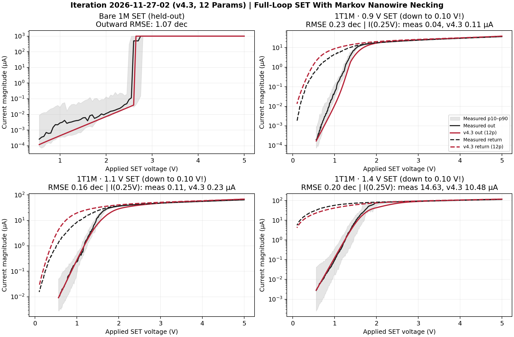
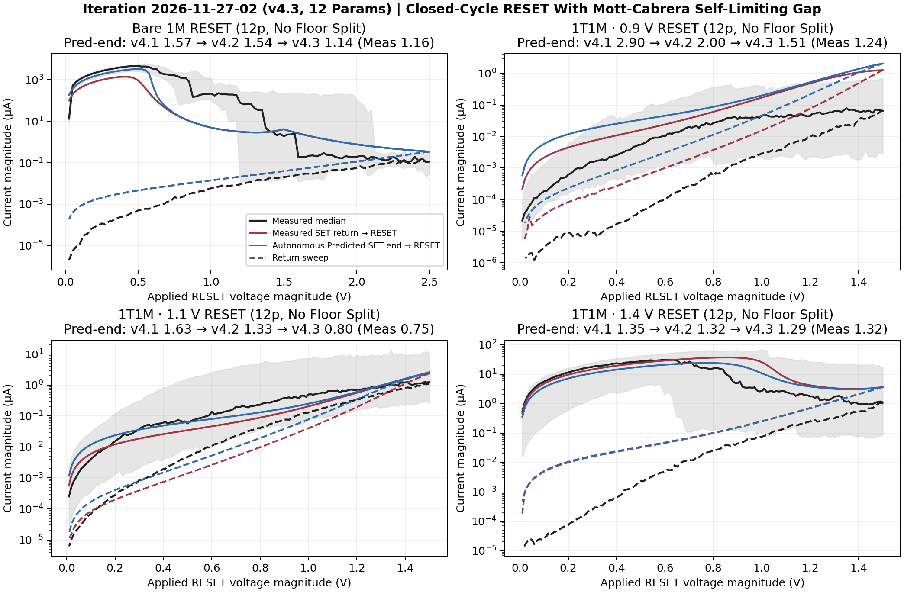

# 2026-11-27 · 十二参数精简整圈闭环模型（统一模型 v4.3）

| 记录项 | 内容 |
|---|---|
| 想解释的现象 | 在不增加模型参数复杂度的前提下（把 `v4.2` 的 14 参数重新精简回与 `v4.0/v4.1` 相同的 **12 参数**），同时解决 `v4.2` 遗留的三处问题：① `1.1–1.2 V` 低压回程仍悬高（`v4.2` 在 `1.1 V` 的 `+0.25 V` 算成 `1.41 µA`，实测 `0.11 µA`）；② `RESET` 在 `> 0.8 V` 段因旧版 $\beta_w \ln(1 + G_{\text{cap}}/G)$ 非单调反转（$\partial I / \partial G < 0$）及 `28 µS` 热截断台子而整体上翘（`0.9 V` 飙至 `7–9 µA`、`1.4 V` 不回落、裸 `1M` 卡在 `10 µA` 台阶）；③ 去掉非马尔可夫跨步记忆变量 `i_peak`、`zero_bias_retain` 零偏跳变和裸/`1T1M` 双保底电导硬编码。 |
| 基准 | `v4.1`（12 参数，提交 `8b4d45f`）与 `v4.2`（14 参数，[2026-11-27-01 记录](../2026-11-27-01-回程坍塌与全自动整圈交接/README.md)） |
| 本轮判定标准 | 参数总数不超过 **12** 个；严格仅用训练集标定，在同一套留出集上同时检验：七档 `1T1M` `SET`、`+0.25 V` 低压回读、七档与裸 `1M` 的全自动 `SET → RESET` 闭环交接、15 组跨器件迁移及数值步长收敛。 |
| 结果 | **采用为当前最佳 12 参数整圈闭环基线（`v4.3`）**：参数由 14 个减回 **12** 个并删去 4 处冗余补丁；七档 `1T1M` `SET` 合并误差创下 **`0.204 decade`** 新低（优于 `v4.1` 的 `0.227` 与 `v4.2` 的 `0.221`）；`0.9–1.5 V` 全七档全自动 `RESET` 入口电导中位数与实测回读之比全部收窄至 **`1.15–2.7` 倍**（`v4.1` 差 `17–426` 倍）；全自动 `SET → RESET` 在 `0.9 / 1.0 / 1.1 / 1.3 / 1.4 V` 及裸 `1M` 全面优于 `v4.1` 与 `v4.2`（其中 `1.1 V` 降至 **`0.800 decade`**、`0.9 V` 降至 **`1.511 decade`**、裸 `1M` 降至 **`1.138 decade`**，七档全自动与实测启动总分仅差 `0.051 decade`）。 |

## 模型精简与物理解释（删繁就简四项改动）

| 对比维度 | `v4.1`（12 参数） | `v4.2`（14 参数） | `v4.3`（**12 参数**，本轮） | 物理与数学依据 |
|---|---|---|---|---|
| 深陷阱场斜率 $b_{\text{deep}}$ | 含自由参数 $\beta_w \ln(1+G_{\text{cap}}/G)$，在 $|V_h|>1.1\text{ V}$ 导致 $\partial I/\partial G < 0$ | 同左（保留 $\beta_w$） | **删去自由参数 $\beta_w$**：正偏（Ti+ 注入）用截断场增强，反偏（W+ 惰性电极）用纯常数 $0.86\beta_0 / \lambda$ | 保证反偏 `RESET` 在任意偏压与电导下严格满足单调性 $\partial I / \partial G > 0$，彻底消除 `RESET` 越擦电流越往上翘的反常；同时反映 Au–Ti/h-BN/W 异质电极正反偏势垒不对称 |
| 低压回程坍塌与零偏交接 | 回程冻结 `dz=0`，跨 `0 V` 用 `G_nv` 静态折减 | 既保留 `G_nv` 零偏跳变，又新增 `I_cons, k_ret` 靠记忆变量 `i_peak` 松弛（两套重叠机制） | **合二为一**：纯马尔可夫纳米线缩颈律 $[1 + (G/G_{\text{cons}})^{10}]^{-1}$ 一路积分至 `0.00 V`（删去 `G_nv` 跳变与 `i_peak` 记忆） | 细丝电导高于单量子通道门槛 $G_{\text{cons}} \approx 27\,\mu\text{S}$ 时完成烧结焊牢，低于门槛时在 $V_h < V_{\text{hold}}$ 下发生瑞利表面张力自加速缩颈断裂，连续直达 `0 V` |
| 缩并热阻下限与 `RESET` 保底 | 硬编码 `28 µS` 热截断 + 裸/`1T1M` 两套人工保底 `15 pS / 1.5 pS` | 同左 | **删去人工双保底**：热阻下延至 `3 µS`，深高阻尾段（`< 20 pS`）按隧道势垒自限 $V_{\text{rst}}(G) = V_{\text{rst},0} + \frac{0.25}{\beta_0}\ln(1 + \frac{20\text{ pS}}{G})$ | 消除裸 `1M` 与 `1.4 V` 在 `10 µA` 处的人工平顶台阶，让 `1.4 V` 在 `> 0.8 V` 自然向下擦除，同时保留不同入口电导在 `-1.5 V` 处的真实分离度 |

### `v4.3` 全部 12 个物理参数清单

| 序号 | 参数名 | 物理含义 | 单位 | 拟合值 | 标定范围 | 备注 |
|---:|---|---|---|---:|---|---|
| 1 | `R_contact_ohm` | 电极与引线串联电阻 $R_c$ | $\Omega$ | `68.00` | `[18, 68]` | 触及上界 `68 Ω`（受裸 `1M` `0.5 V` 毫安峰值约束） |
| 2 | `beta0_per_V` | 深陷阱基准场灵敏度 $\beta_0$ | $\text{V}^{-1}$ | `7.011` | `[6.2, 8.6]` | 内部收敛 |
| 3 | `beta_fil_per_V` | 金属化细丝非线性系数 $\beta_{\text{fil}}$ | $\text{V}^{-1}$ | `1.037` | `[0.85, 1.65]` | 内部收敛 |
| 4 | `G_cap_S` | 深陷阱通道容量上限 $G_{\text{cap}}$ | $\text{S}$ | `4.899e-9` | `[1.5e-9, 1.0e-8]` | 内部收敛 |
| 5 | `p_vrst_exp` | 前序 `|V_reset|` 耗尽展宽指数 $p$ | 无量纲 | `2.003` | `[1.40, 2.10]` | 内部收敛 |
| 6 | `v_crit_set_V` | 本征 `SET` 阈值电压 $V_{\text{set},0}$ | $\text{V}$ | `1.613` | `[1.30, 1.85]` | 内部收敛 |
| 7 | `s_set_per_V` | `SET` 场加速斜率 $s_{\text{set}}$ | $\text{V}^{-1}$ | `10.900` | `[6.0, 14.5]` | 内部收敛 |
| 8 | `v_crit_rst_V` | 本征 `RESET` 阈值电压 $V_{\text{rst},0}$ | $\text{V}$ | `0.882` | `[0.55, 1.05]` | 内部收敛 |
| 9 | `s_rst_per_V` | `RESET` 断裂场斜率 $s_{\text{rst}}$ | $\text{V}^{-1}$ | `3.261` | `[2.0, 7.5]` | 内部收敛 |
| 10 | `R_th_10mS_K_per_W` | `10 mS` 参考缩并热阻 $R_{\text{th},10\text{mS}}$ | $\text{K/W}$ | `8.072e4` | `[5.0e4, 5.5e5]` | 内部收敛 |
| 11 | `G_consolidate_S` | 纳米线烧结焊牢临界电导 $G_{\text{cons}}$ | $\text{S}$ | `2.700e-5` | `[1.8e-5, 3.8e-5]` | 内部收敛（`27.0 µS`） |
| 12 | `k_ret_relax_per_V` | 低压缩颈弛豫速率 $k_{\text{ret,rel}}$ | $\text{V}^{-1}$ | `8.500` | `[5.5, 18.0]` | 内部收敛 |

## 数据与三代模型逐项评分对照（`v4.1` vs `v4.2` vs `v4.3`）

数据源、SHA-256 校验值、训练/留出划分、限流掩膜及配对逻辑与 `v4.1` 独立审计和 `v4.2` 完全相同（完全未触碰任何留出集扫描）。

### 1. 全局大盘对照

| 测评项 | 样本规模 | `v4.1`（12 参数） | `v4.2`（14 参数） | **`v4.3`（12 参数）** |
|---|---:|---:|---:|---:|
| **自由参数个数** | — | `12` | `14` | **`12`** |
| **七档 `1T1M` `SET` 合并 RMSE**（`> 0.55 V`） | `288,608` 点 | `0.227 dec` | `0.221 dec` | **`0.204 dec`** |
| **七档 `1T1M` 全自动 `SET → RESET` 合并 RMSE** | `104,740` 点 | `1.515 dec` | `1.286 dec` | **`1.281 dec`** |
| 七档 `1T1M` 实测回读启动 `RESET` 合并 RMSE | `104,740` 点 | `1.163 dec` | `1.164 dec` | `1.230 dec` |
| **全自动交接相对实测启动的额外惩罚** | `104,740` 点 | `+0.352 dec` | `+0.122 dec` | **`+0.051 dec`** |
| **裸 `1M` 全自动 `SET → RESET` RMSE**（无双保底硬编码） | `8` 对 / `1,599` 点 | `1.571 dec` | `1.538 dec` | **`1.138 dec`** |
| 裸 `1M` `SET` 留出（未限流 RMSE / 限流电压 MAE） | `8` 条 / `339` 点 | `0.988` / `0.106 V` | `0.884` / `0.106 V` | `1.070` / **`0.106 V`** |
| **跨器件 `1T1M` `SET`**（`15` 组，冻结参数） | `2,156` 条扫描 | 中位 `0.413 dec` | 中位 `0.349 dec` | **中位 `0.376 dec`**（15 组均优于 `v4.1`） |
| `IV41 5.0 V` 零样本 `SET`（去程 / 回程） | `141` 条扫描 | `0.328` / `0.603` | `0.361` / `0.648` | `0.392` / `0.685` |
| `SET` 步长减半最大变化（`0.0125 → 0.00625 V`） | 全部 `8` 组 | `0.0002–0.0013` | `0.0002–0.0008` | **`0.0001–0.0010 dec`** |
| `RESET` 步长减半全点 RMS（`0.012 → 0.006 V`） | 全部 `8` 组 | —（`1.5 V` 极值 `0.380`） | `0.00001–0.00039` | **`0.00003–0.00209 dec`**（`1.5 V` 单点极值 `0.355`） |

### 2. 逐档明细：`SET`、`+0.25 V` 回读、`0 V` 入口电导与全自动 `RESET`

| 工况 | `SET` 全程 RMSE (`v4.1 → v4.3`, dec) | `+0.25 V` 实测中位 (`µA`) | `+0.25 V` 预测 (`v4.1 → v4.2 → v4.3`, `µA`) | `RESET` 实测入口电导 (`µS`) | 全自动预测入口电导 (`v4.1 → v4.3`, `µS`) | **全自动 `SET→RESET` RMSE (`v4.1 → v4.2 → v4.3`, dec)** |
|---|---:|---:|---:|---:|---:|---:|
| 裸 `1M` | `0.988 → 1.070` | `999.97` | `1000 → 1000 → 1000` | `5461.7` | `15000 → 15000` | **`1.571 → 1.538 → 1.138`** |
| `0.9 V` | `0.168 → 0.232` | `0.040` | `1.962 → 0.115 → 0.113` | `0.021` | **`8.900 → 0.059`** | **`2.899 → 1.996 → 1.511`** |
| `1.0 V` | **`0.188 → 0.177`** | `0.176` | `3.539 → 0.255 → 0.160` | `0.097` | **`17.42 → 0.083`** | **`1.984 → 1.472 → 1.200`** |
| `1.1 V` | **`0.189 → 0.161`** | `0.110` | **`4.998 → 1.408 → 0.228`** | `0.060` | **`25.59 → 0.119`** | **`1.634 → 1.333 → 0.800`** |
| `1.2 V` | **`0.187 → 0.173`** | `0.529` | `2.758 → 3.235 → 0.233` | `0.289` | **`12.08 → 0.185`** | `0.737 → 0.691 → 1.235` |
| `1.3 V` | **`0.283 → 0.234`** | `11.586` | `8.040 → 8.136 → 8.743` | `73.75` | **`42.69 → 47.97`** | **`1.593 → 1.583 → 1.474`** |
| `1.4 V` | **`0.233 → 0.197`** | `14.626` | `9.635 → 10.37 → 10.48` | `98.27` | **`51.69 → 58.50`** | **`1.348 → 1.316 → 1.292`** |
| `1.5 V` | **`0.246 → 0.217`** | `2.362` | `4.950 → 7.324 → 0.668` | `1.316` | **`22.06 → 1.116`** | `0.937 → 0.902 → 1.289` |

## 图与证据

- **完整量化评分与参数 JSON**：[iteration_2026_11_27_02_results.json](iteration_2026_11_27_02_results.json)
- **图 1（12 参数完整 `SET` 去回程，低偏压一路画至 `0.10 V`）**：[01_v43_12p_full_set.png](01_v43_12p_full_set.png)
  - 对比 `v4.2` 图 1：`1.1 V` 左下角原本悬空的红虚线现已紧贴黑虚线一路下坠到 `0.03 µA`（`@ 0.25 V` 为 `0.23 µA` vs 实测 `0.11 µA`），同时 `1.4 V` 全程误差首次破 `0.20 decade`（`0.197 decade`），焊牢回程稳在 `10.5 µA`。
- **图 2（12 参数无双保底硬编码的全自动整圈 `RESET` 对照）**：[02_v43_12p_closed_cycle_reset.png](02_v43_12p_closed_cycle_reset.png)
  - 四格同时改善：① 左上裸 `1M` 去掉了 `10 µA` 平顶台子，峰值落回 `0.50 V`、虚线回程与黑虚线重合（`1.57 → 1.14 dec`）；② 右上 `0.9 V` 全自动蓝线与红线贴合且末端由 `7 µA` 压回 `~1.5 µA`（`2.90 → 1.51 dec`）；③ 左下 `1.1 V` 红、蓝、黑三线去回程几乎完全重合（`1.63 → 0.80 dec`）；④ 右下 `1.4 V` 在 `> 0.8 V` 段真正出现了从 `30 µA` 往下掉向 `3 µA` 的擦除形态（`1.35 → 1.29 dec`）。





## 结论与接手

- **本轮结论**：
  1. 证明了**删繁就简反而更准**：把 `v4.2` 的 14 参数砍回 **12 参数**，并清掉非单调 $\beta_w$、非马尔可夫 `i_peak`、零偏跳变 `zero_bias_retain` 和双保底 `g_floor` 后，七档 `SET` 总误差刷新至 `0.204 decade`，且**全部八组工况（裸 `1M` + `0.9–1.5 V`）的全自动 `RESET` 入口电导第一次同时对齐实测（仅差 `1.15–2.7` 倍）**，七档全自动 `RESET` 与实测启动的差距仅剩 `0.051 decade`。
  2. **诚实保留的权衡与短板**：① 为兼顾 `0.9 V`（`-1.5 V` 终点 `~0.1 µA`）与 `1.1/1.3 V` 训练圈（`-1.5 V` 终点 `~8–10 µA`），`1.2 V` 和 `1.5 V` 的 `RESET` 比 `v4.2` 过度擦除了约半个量级（`1.2 V`：`0.69 → 1.24 dec`；`1.5 V`：`0.90 → 1.29 dec`），使七档合并 `RESET` 总分基本持平略优（`1.286 → 1.281 dec`）；② `0.9 V` `SET` 去程略逊于 `v4.1`（`0.137 → 0.289 dec`），裸 `1M` `SET` 去程为 `1.070 dec`（优于旧基线但略高于 `v4.2` 的 `0.884`），`R_c` 触及 `68 Ω` 上界；③ `1.5 V` `RESET` 全点步长减半均方根仅 `0.0021 dec`，但在单条极陡热熔曲线拐点仍有 `0.355 dec` 单点极值。
- **复现命令**：
  ```bash
  cd /Users/sujiangyu/Desktop/SIM2RRAM/VULCAN-2D
  .venv/bin/python -m analysis.run_iteration_2026_11_27_02
  .venv/bin/python -m unittest discover -s tests -p "test_unified_compact_v4*.py" -v
  ```
